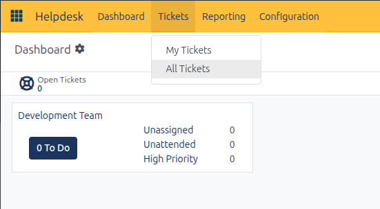
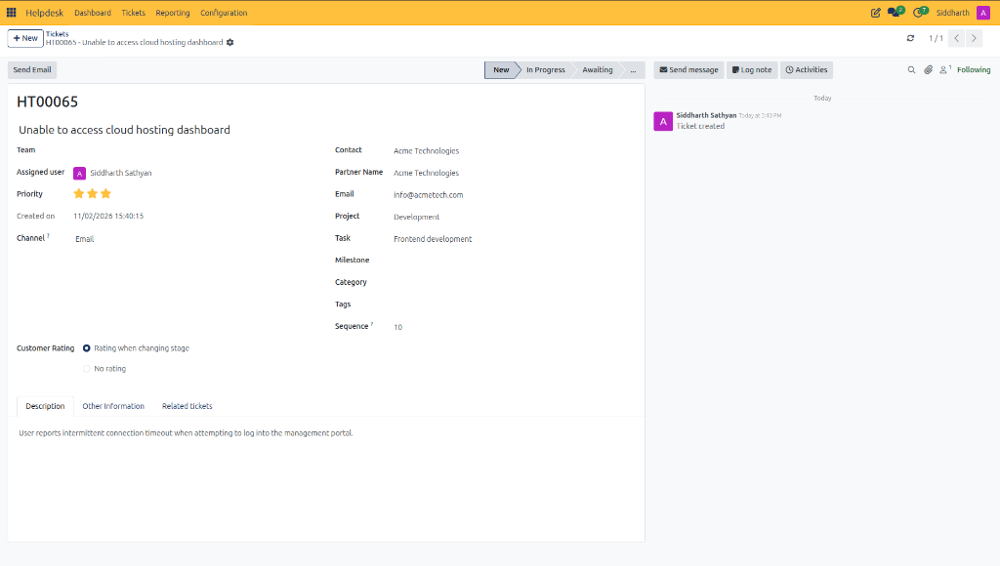
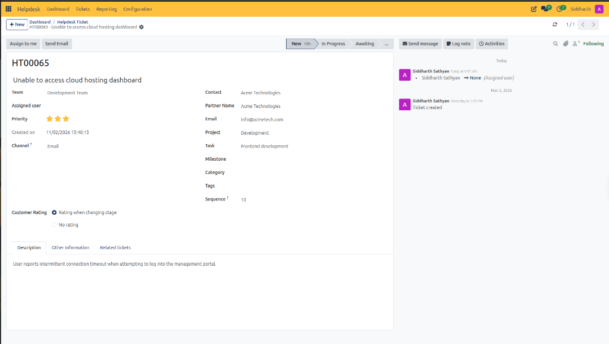
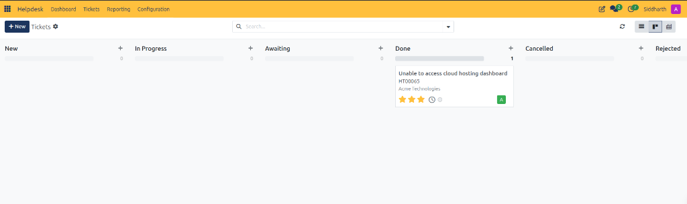
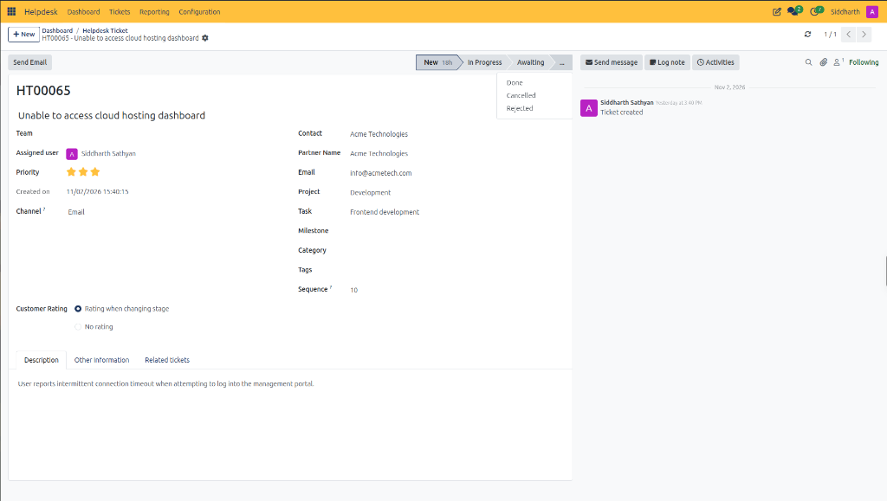
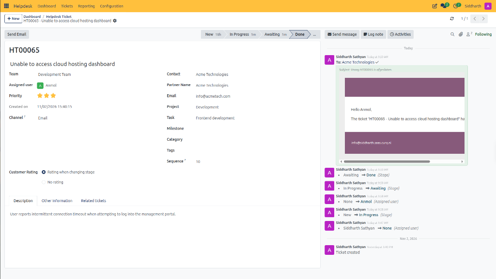
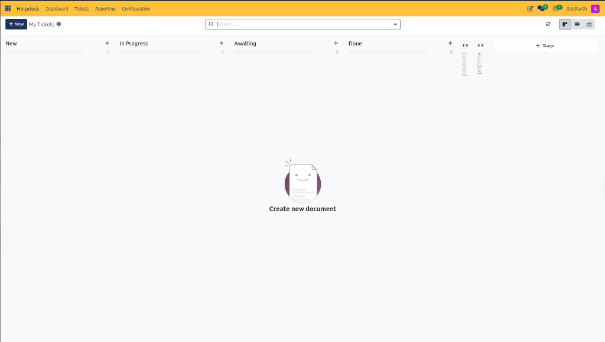

# Create and Manage Helpdesk Tickets

This task guide provides step-by-step procedures for logging, triaging, assigning, and escalating support tickets in CURQ Helpdesk.

> **Prerequisites**
> * Support Agent or Helpdesk Administrator permissions in CURQ Helpdesk.
> * Customer partner records configured in [**Contacts**](../../Contacts/getting-started/01-create-your-first-contact.md).
> * An active support team configured in **Helpdesk > Configuration > Teams**.

---

## 1. Create and Configure Support Tickets

### 1.1 Create a Support Ticket from the Tickets Register

1. In the top navigation bar, click or hover over **Tickets** to choose the desired queue:

   * **All Tickets**: Opens the full organizational ticket register across all teams and specialists.
   * **My Tickets**: Filters the queue strictly to tickets assigned to the logged-in user profile.
2. Click **+ New** in the upper-left action bar.
3. Configure the ticket header:
   * **Title**: Enter a clear, problem-focused summary.
   * **Assigned user**: Delegate to an individual specialist or leave unassigned for team pool dispatch.
   * **Priority**: Designate the urgency level using star ratings *(0 stars for Normal, up to 3 stars for Urgent)*.
   * **Channel**: Select the incoming medium *(e.g., `Email`, `Website Form`, `Phone`)*.
4. Configure customer partner linkage:
   * Select the **Contact** or **Partner Name**. CURQ automatically retrieves their email address.
5. In the **Description** tab, record the technical description, customer statements, and system logs.

> For a detailed explanation of register columns, routing fields, project linkages, and description notes, see [**Ticket Register List View Columns**](../settings-and-fields/01-helpdesk-ticket-field-definitions.md#1-ticket-register-list-view-columns), [**Identification and General Routing Fields**](../settings-and-fields/01-helpdesk-ticket-field-definitions.md#21-identification-and-general-routing-fields), [**Counterparty and Project Linkage Fields**](../settings-and-fields/01-helpdesk-ticket-field-definitions.md#22-counterparty-and-project-linkage-fields), and [**Description Tab**](../settings-and-fields/01-helpdesk-ticket-field-definitions.md#31-description-tab).

6. Click Save:
   * CURQ commits the record, logs the creation audit event in the chatter, and allocates the official ticket sequence *(e.g., `HT00065`)*:

   

---

### 1.2 Claim or Reassign Tickets Using "Assign to me"

When a ticket is routed to a functional department *(e.g., `Development Team`)* without an individual specialist assigned, the action bar dynamically displays the **Assign to me** button:

1. Open an unassigned ticket *(e.g., `HT00065`)*.
2. Observe the top action bar:
   * Next to **Send Email**, CURQ displays the **Assign to me** button whenever **Assigned user** is unassigned.
3. Click **Assign to me**:
   * CURQ immediately assigns your logged-in user profile to the **Assigned user** field.
   * The **Assign to me** button disappears from the action bar.
   * The right-hand chatter stream records an automated audit entry logging the assignment change.
4. If a ticket needs to be released back to the team pool for another specialist:
   * Clear the **Assigned user** field *(set to empty)* and save.
   * CURQ logs the unassignment audit event in the chatter stream *(e.g., `Agent Name -> None (Assigned user)`)* and immediately re-enables the **Assign to me** button.

---

### 1.3 Link Development Projects and Tasks

When remediation requires software bug fixes or technical development:

1. On the ticket form, locate the **Project** field.
2. Select the relevant project workspace *(e.g., `Development`)*.
3. In the **Task** field, select or create a project task *(e.g., `Frontend development`)*.
4. Optional: Assign a project **Milestone** to lock remediation to a specific software release.

---

### 1.4 Cross-Reference Related Tickets

To group duplicate inquiries or multi-customer outages:

1. Open the primary parent ticket.
2. Select the **Related tickets** tab.
3. Click **Add a line**.
4. Select the duplicate or related ticket from the register dropdown.
5. Click Save. The chatter records the linkage for audit tracking.

---

## 2. Track Progression and Advance Lifecycle Stages

### 2.1 Monitor Stage Progression and Timestamps

1. Select the **Other Information** tab.
2. Inspect the operational SLA timestamps:
   * **Last Stage Update**: Reflects when the stage was modified.
   * **Assigned Date**: Records the initial user allocation.
   * **Closed Date**: Auto-populates when moving the ticket to resolved status.

> For a detailed explanation of lifecycle audit timestamps, stage transition timers, and terminal resolution states, see [**Ticket Lifecycle Stages Data Dictionary**](../settings-and-fields/01-helpdesk-ticket-field-definitions.md#5-ticket-lifecycle-stages-data-dictionary).

---

### 2.2 Advance Tickets Across Lifecycle Stages

Tickets can be advanced either by dragging cards across columns on the central **Tickets** Kanban board or directly from the ticket status bar:

1. Open the active ticket *(e.g., `HT00065`)*.
2. Review the stage status bar in the upper-right corner:
   * **Stage Duration Timer**: Displays elapsed hours spent in the active stage *(e.g., `New 18h`)* to guide SLA adherence.
3. Advance the ticket as remediation progresses:
   * Click **In Progress** when actively working on diagnosis or code fixes.
   * Click **Awaiting** if waiting on additional client information or logs.
4. For terminal resolution:
   * Click the three dots **`...`** button on the stage bar to open the final stage menu:

   

   * **Done**: Select when the issue is verified and solved. Triggers customer satisfaction surveys and closure notification emails when enabled:

   

   * **Cancelled**: Select if the customer resolved the issue independently or withdrew the ticket.
   * **Rejected**: Select if the ticket is duplicate, spam, or out-of-scope.

---

## 3. Filter Personal Workload Using "My Tickets"

To focus exclusively on inquiries assigned to your internal user profile without department noise:

1. In the top navigation bar, select **Tickets > My Tickets**.
2. CURQ filters the active Kanban board to show only tickets where **Assigned user** matches the currently logged-in user profile.
3. If no tickets are currently assigned to you *(as seen above)*, CURQ presents the empty state prompting ticket creation or claiming from team pools.
4. When tickets are assigned to you, you can drag and drop cards across stage columns directly from this personal queue.

---

## 4. Edge Cases & Troubleshooting

* **Missing Customer Email**: If customer automated replies bounce, verify that the **Email** field on the ticket header matches a valid address. Updating the email on the ticket updates future communications without altering the contact master card.
* **Unassigned Ticket Backlog**: Monitor tickets where **Assigned user** is blank by filtering the register by `Unassigned` to ensure response times meet team SLAs.
* **Accidental Stage Move**: If a ticket was moved to Closed prematurely, click the target stage in the status bar *(e.g., `In Progress`)* to reopen the ticket and reset the closed date.

---

## Related Documentation

* [Log and Resolve Your First Helpdesk Ticket](../getting-started/01-log-and-resolve-your-first-helpdesk-ticket.md)
* [Navigate and Use the Helpdesk Dashboard](./02-navigate-and-use-the-helpdesk-dashboard.md)
* [Helpdesk Ticket and Register Field Definitions](../settings-and-fields/01-helpdesk-ticket-field-definitions.md)
* [Understanding Ticket Lifecycle and Routing](../core-concepts/01-understanding-ticket-lifecycle-and-routing.md)
