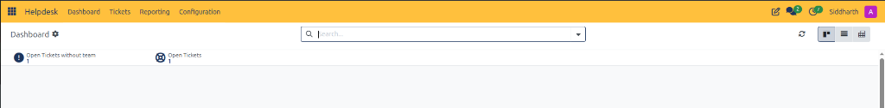
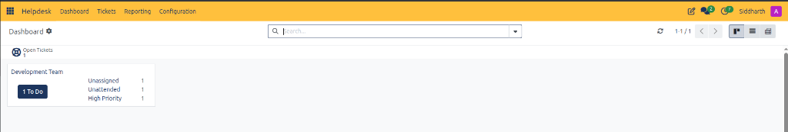
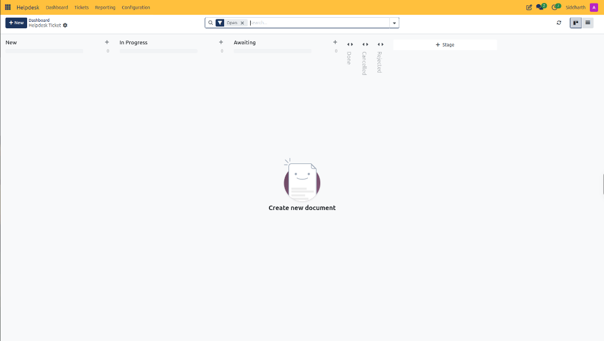

# Navigate and Use the Helpdesk Dashboard

The **Helpdesk Dashboard** serves as the central triage cockpit in CURQ Helpdesk. Accessible at **Helpdesk > Dashboard**, it monitors active workload volumes, team distribution, unassigned backlogs, and multi-view ticket queues.

> **Prerequisites**
> * Access to the **Helpdesk** application in CURQ.
> * Active support tickets and teams configured in the database.

---

## 1. Dashboard Workload Metrics and Operational Cards

### 1.1 Dashboard Overview and Operational Counters

When tickets are logged into the system, the dashboard automatically calculates aggregate triage counters across the support operation:

* **Open Tickets without team** *(Exclamation Circle icon)* flags active tickets whose **Team** field is still unassigned *(e.g., `1`)*.
* **Open Tickets** *(Life Ring Wheel icon)* tracks all unresolved tickets across active stages prior to terminal closure *(e.g., `1`)*.

Clicking on any counter dynamically filters the underlying ticket register to display the matching records.

---

### 1.2 Team-Specific Workload Cards

Once tickets are assigned to a support department *(e.g., `Development Team`)*, the dashboard dynamically renders functional workload cards:

Each card displays the **Team Title**, a quick-access **`To Do`** button *(e.g., `1 To Do`)* that opens the filtered queue for that department, and sub-counters for **Unassigned**, **Unattended**, and **High Priority** tickets. When all active tickets reach a resolved stage *(e.g., `Done`)*, the action button transitions to **`0 To Do`**, and all sub-counters reset to `0` *(as shown in [020.png](../media/020.png))*, confirming that team queues are clear.

> For a detailed explanation of all dashboard triage counters, workload metrics, and card controls, see [**Helpdesk Dashboard Metrics Data Dictionary**](../settings-and-fields/01-helpdesk-ticket-field-definitions.md#4-helpdesk-dashboard-metrics-data-dictionary).

---

## 2. Triage and Manage Ticket Workflows

### 2.1 Triage Unassigned Team Tickets

1. In the top navigation bar, select **Helpdesk > Dashboard**.
2. Inspect the **Open Tickets without team** counter:
   * If the counter is greater than zero, unrouted tickets require triage.
3. Click on **Open Tickets without team** *(or navigate to [Tickets](./01-create-and-manage-helpdesk-tickets.md))*.
4. Open the target ticket *(e.g., `HT00065`)*.
5. In the **Team** field, select the appropriate functional support team *(e.g., `Development Team`)*.
6. Click Save. Returning to the dashboard clears the triage alert and populates the **Development Team** workload card *(as shown in [011.png](../media/011.png))*.

---

### 2.2 Switch Display Modes and Filter Kanban Columns

In the upper-right corner of the dashboard or ticket register, switch between three interactive visualization layouts:

1. **Kanban View (Default)**: Visualizes tickets grouped into columns by operational stage:

   * **Open Filter Tag**: By default, CURQ applies the **`[Open]`** filter in the top search bar.
   * **Active vs Collapsed Stages**: Active workflow columns *(e.g., `New`, `In Progress`, `Awaiting`)* remain expanded for ongoing work, while terminal closed columns *(e.g., `Done`, `Cancelled`, `Rejected`)* are collapsed into vertical headers with expand/collapse arrows *(two opposing horizontal arrows)* to prevent finished records from cluttering the screen.
   * **Custom Stage Addition**: Click the **`+ Stage`** button on the far right of the column headers to add custom department-specific workflow stages.
2. **List View**: Displays tabular records with sorting on priority stars, ticket numbers, customer partner names, and last stage update timestamps.
3. **Pivot View**: Launches multidimensional pivot analysis for analyzing ticket volume across teams, channels, and partners.

---

## 3. Edge Cases & Dashboard Troubleshooting

* **Zero Tickets Displayed**: If the dashboard shows an empty state *(as seen in initial setup [001.png](../media/001.png))*, verify that search filters or restrictive team criteria are cleared in the top search bar.
* **Triage Warning Alerts**: High numbers on **Open Tickets without team** indicate that incoming automated channels *(such as email aliases or web forms)* lack default team routing rules in Helpdesk Configuration.

---

## Related Documentation

* [Log and Resolve Your First Helpdesk Ticket](../getting-started/01-log-and-resolve-your-first-helpdesk-ticket.md)
* [Create and Manage Helpdesk Tickets](./01-create-and-manage-helpdesk-tickets.md)
* [Analyze Helpdesk Performance and Reports](./04-analyze-helpdesk-performance-and-reports.md)
* [Helpdesk Ticket and Register Field Definitions](../settings-and-fields/01-helpdesk-ticket-field-definitions.md)
* [Understanding Ticket Lifecycle and Routing](../core-concepts/01-understanding-ticket-lifecycle-and-routing.md)
