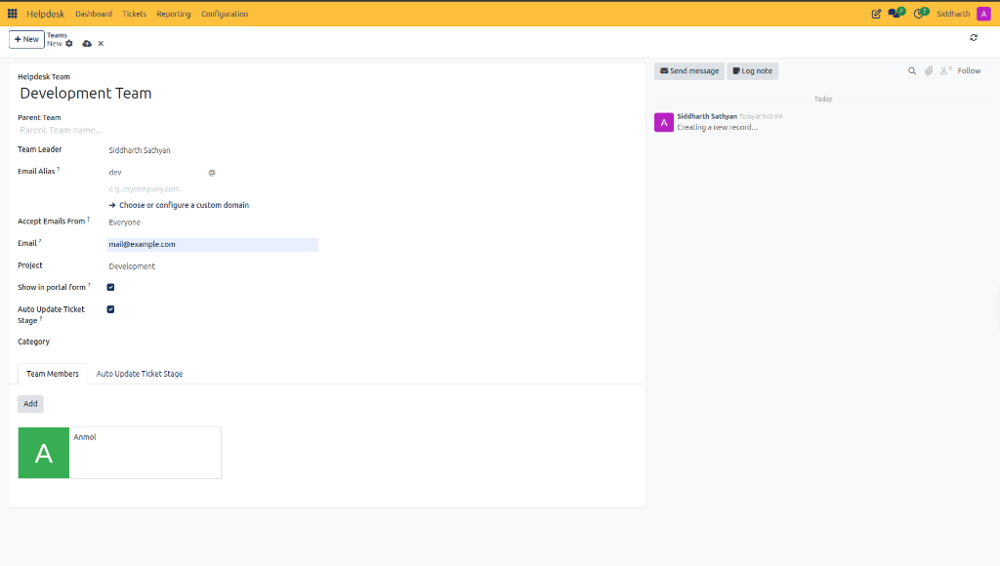
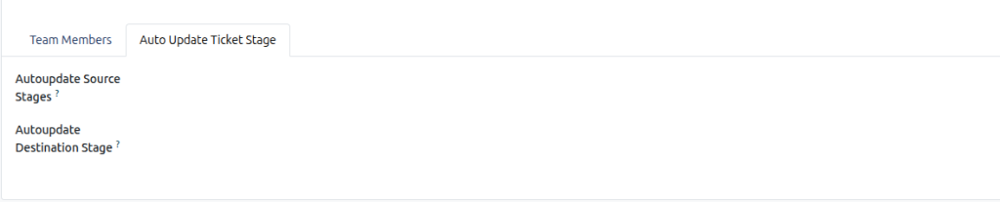

# Configure Helpdesk Teams and Routing

This task guide provides step-by-step procedures for setting up functional support teams, configuring inbound email aliases, managing customer portal exposure, and establishing automated stage transitions in CURQ Helpdesk.

> **Prerequisites**
> * Helpdesk Administrator or Manager access permissions in CURQ.
> * Internal user accounts configured for assigned support specialists.
> * Inbound mail server configuration active if configuring email aliases.

---

## 1. Create and Configure Support Teams

### 1.1 Create a Helpdesk Support Team

1. In the top navigation bar, select **Configuration > Teams**.
2. Click **+ New** in the upper-left action bar.
3. Configure the team header:
   * **Helpdesk Team**: Enter the department designation *(e.g., `Development Team`)*.
   * **Parent Team**: Select a parent department if organizing a tiered escalation hierarchy.
   * **Team Leader**: Assign the supervisory user responsible for team throughput.

4. Click Save.

---

### 1.2 Configure Inbound Email Aliases and Security

To automatically convert incoming customer emails into support tickets assigned to this team:

1. On the team form, locate the **Email Alias** field.
2. Enter the local email prefix *(e.g., `dev`)* to establish `dev@yourcompany.com`.
3. In the **Accept Emails From** dropdown, set sender authorization:
   * **Everyone**: Ingests inquiries from all external clients.
   * **Authenticated Partners**: Restricts intake to registered customer records.
4. Set the **Email** field to verify the outbound correspondence address.

> For a detailed explanation of all team configuration fields, email alias parameters, and security policies, see [**Helpdesk Team Field Definitions**](../settings-and-fields/02-helpdesk-team-field-definitions.md).

---

### 1.3 Synchronize Projects and Enable Web Portal Forms

1. **Default Project Linkage**:
   * In the **Project** field, select the default project workspace *(e.g., `Development`)*.
   * All tickets routed to this team automatically gain access to task backlogs and agile tracking.
2. **Customer Web Portal Form**:
   * Enable the **Show in portal form** checkbox.
   * Customers submitting tickets through your website client portal can now select this department directly from the service dropdown.

---

### 1.4 Enroll Support Team Members

1. Select the **Team Members** tab.
2. Click **Add** to open the user directory.
3. Select the support specialists, technical leads, or field engineers allocated to this team.
4. Click Select. The member profiles appear as visual cards in the team roster.
5. Click Save.

---

## 2. Configure Automated Stage Transitions

### 2.1 Configure Automated Stage Reactivation Rules

When support staff place a ticket into an awaiting state, receiving a customer reply should automatically reactivate the ticket:

1. On the team form, verify that **Auto Update Ticket Stage** is checked.
2. Select the **Auto Update Ticket Stage** tab:

3. Configure the automated rules:
   * **Autoupdate Source Stages**: Select the dormant or waiting stages *(such as `Awaiting`)*.
   * **Autoupdate Destination Stage**: Select the reactive target stage *(such as `In Progress`)*.
4. When a client replies to an awaiting ticket via email or portal, CURQ automatically moves the ticket to the destination stage and alerts the assigned user.

> For a detailed explanation of automated source and destination stage transitions, see [**Auto Update Ticket Stage Tab Field Definitions**](../settings-and-fields/02-helpdesk-team-field-definitions.md#22-auto-update-ticket-stage-tab).

---

## Edge Cases & Configuration Troubleshooting

* **Inbound Emails Not Generating Tickets**: Verify that the domain configured on the email alias matches an active mail server domain in CURQ settings, and verify that **Accept Emails From** is set to `Everyone`.
* **Tickets Flagged Without Team**: If dashboard metrics display an alert on **Open Tickets without team** *(as documented in [Navigate and Use the Helpdesk Dashboard](./02-navigate-and-use-the-helpdesk-dashboard.md))*, manually open the ticket and select the newly created team.

---

## Related Documentation

* [Configure a Support Team and Automate Ticket Intake](../getting-started/02-configure-a-support-team-and-automate-ticket-intake.md)
* [Helpdesk Team Field Definitions](../settings-and-fields/02-helpdesk-team-field-definitions.md)
* [Navigate and Use the Helpdesk Dashboard](./02-navigate-and-use-the-helpdesk-dashboard.md)
* [Create and Manage Helpdesk Tickets](./01-create-and-manage-helpdesk-tickets.md)
* [Understanding Ticket Lifecycle and Routing](../core-concepts/01-understanding-ticket-lifecycle-and-routing.md)
