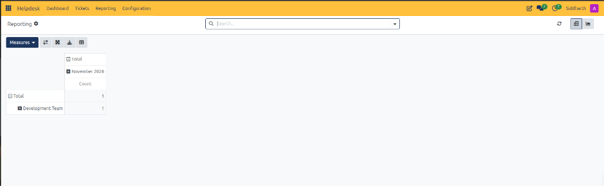
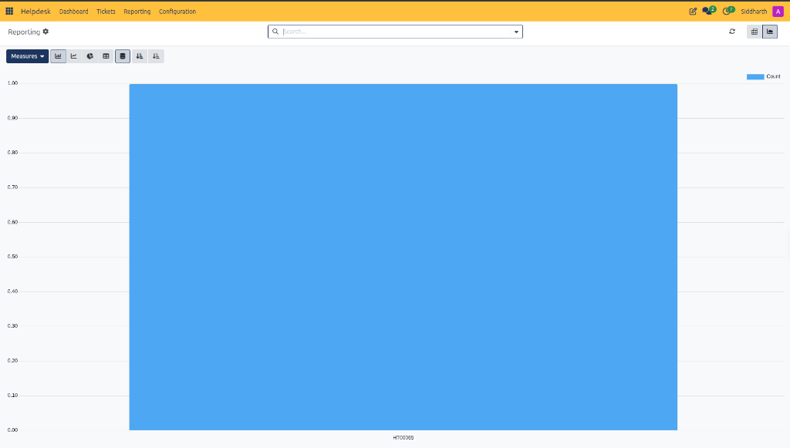
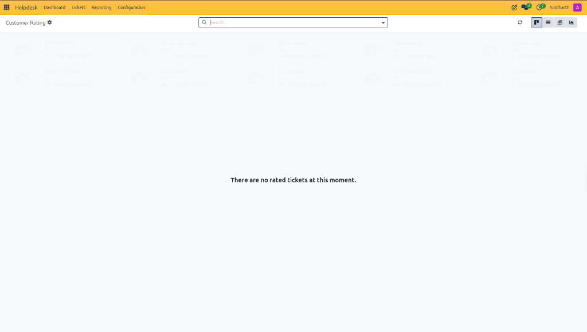

# Analyze Helpdesk Performance and Reports

The **Helpdesk Reporting** workspace, accessible at **Helpdesk > Reporting**, provides operational intelligence, volume distribution, and team throughput metrics across CURQ Helpdesk. It equips support managers with multi-dimensional pivot tables and graphical charts to monitor resolution efficiency and SLA adherence.

> **Prerequisites**
> * Helpdesk Administrator or Manager reporting access permissions in CURQ.
> * Historical or active support tickets logged across functional teams and lifecycle stages.

---

## 1. Generate and Customize Operational Reports

### 1.1 Generate Pivot Matrix Reports

Pivot reporting allows managers to cross-tabulate ticket metrics across multiple operational dimensions such as intake month, department team, priority, or stage:

1. In the top navigation bar, select **Reporting**.
2. In the upper-right view switcher, confirm that the **Pivot View** *(grid icon)* is active.
3. Drill into organizational dimensions:
   * Click the **+** icon beside row headers *(e.g., expanding `Total` to reveal `Development Team`)* to segment ticket metrics by team or agent.
   * Click the **+** icon beside column headers *(e.g., expanding `Total` to reveal `November 2026`)* to evaluate monthly intake cohorts.
4. Utilize the pivot action toolbar to manipulate matrix data:
   * **Measures**: Click the dropdown to alter the aggregated computation *(defaults to `Count`)*.
   * **Flip Axis** *(two opposing horizontal arrows)*: Swaps rows and columns instantly to reverse analytical perspectives.
   * **Expand All** *(four outward diagonal arrows)*: Expands all nested hierarchy groupings simultaneously.
   * **Download / Export** *(downward arrow to tray)*: Exports the active matrix table directly into an XLSX spreadsheet for executive distribution.
   * **Table View** *(grid table icon)*: Toggles table formatting density.

> For a detailed explanation of pivot controls, matrix dimensions, graph modes, and customer satisfaction metrics, see [**Pivot Action Toolbar Controls**](../settings-and-fields/03-helpdesk-reporting-field-definitions.md#11-pivot-action-toolbar-controls), [**Pivot Matrix Dimensions and Cohorts**](../settings-and-fields/03-helpdesk-reporting-field-definitions.md#12-pivot-matrix-dimensions-and-cohorts), [**Graph View Mode and Chart Selectors**](../settings-and-fields/03-helpdesk-reporting-field-definitions.md#21-graph-view-mode-and-chart-selectors), [**Graph Formatting and Sorting Controls**](../settings-and-fields/03-helpdesk-reporting-field-definitions.md#22-graph-formatting-and-sorting-controls), and [**Customer Rating Controls and Metrics Data Dictionary**](../settings-and-fields/03-helpdesk-reporting-field-definitions.md#3-customer-rating-controls-and-metrics-data-dictionary).

---

### 1.2 Generate Graphical Trend and Distribution Charts

Graphical reporting transforms ticket intake and resolution volumes into visual charts for rapid bottleneck identification:

1. In the upper-right corner of the Reporting screen, click the **Graph View** *(chart icon)*.
2. Select the visual presentation format from the left toolbar:
   * **Bar Chart** *(default)*: Visualizes discrete ticket quantities across tickets, teams, or priorities.
   * **Line Chart**: Plots intake velocity and resolution trends across continuous timelines.
   * **Pie Chart**: Displays proportional workload allocation across teams or problem categories.
3. Apply advanced chart formatting controls:
   * **Stacked Bar**: Stacks sub-dimensions vertically within each bar column for multi-variable composition.
   * **Grouped Bars**: Arranges comparative categories side-by-side along the horizontal axis.
   * **Ascending / Descending Sort**: Click the directional sorting icons to order bars from lowest to highest volume, or vice versa.
4. Hover the cursor over any bar or segment *(e.g., `HT00065`)* to inspect the underlying metric count *(e.g., `Count: 1.00`)*.

---

### 1.3 Filter and Segment Analytical Data

1. In the top search bar, enter specific search parameters or select predefined filters.
2. Filter by operational dimensions:
   * **Team**: Isolate data for specific units *(e.g., `Development Team`)*.
   * **Priority**: Filter by high-criticality tickets to evaluate emergency support loads.
   * **Stage**: Focus on open backlog stages *(e.g., `New`, `In Progress`, `Awaiting`)* versus terminal stages *(e.g., `Done`)*.
3. Combine filters with the **Group By** criteria to construct custom cross-sectional analyses.

---

## 2. Monitor Customer Satisfaction Ratings (Customer Rating)

Customer feedback collected via automated satisfaction surveys is aggregated in the dedicated **Customer Rating** dashboard:

1. In the top navigation bar, select **Reporting > Customer Rating**.
2. Review customer satisfaction scores submitted by partners upon ticket resolution:
   * Displays visual rating cards indicating client satisfaction levels *(e.g., Happy, Neutral, or Unhappy)*.
   * When no customer survey submissions exist for the active period, CURQ displays: `There are no rated tickets at this moment.`
3. Switch visualization modes using the upper-right view toggles:
   * **Kanban**: Cards grouped by rating sentiment.
   * **List**: Tabular log of ratings with submission dates and partner names.
   * **Pivot**: Multidimensional matrix calculating satisfaction percentages across teams and months.
   * **Graph**: Bar and pie charts displaying satisfaction proportions.

---

## 3. Edge Cases & Reporting Troubleshooting

* **Zero Records in Date Range**: If the pivot grid displays empty cells, verify that the top search bar does not contain restrictive date or stage filters from previous sessions. Click the filter tag removal icons to restore complete historical intake.
* **Missing Custom Measures**: Operational metrics calculate based on logged ticket fields. Ensure support specialists populate project tasks, stages, and teams so that multi-dimensional groupings remain complete.
* **Exporting Formatted Spreadsheets**: When using **Download / Export**, the resulting spreadsheet retains the current expanded or collapsed structure of the on-screen pivot grid. Expand all desired sub-rows before clicking download.

---

## Related Documentation

* [Log and Resolve Your First Helpdesk Ticket](../getting-started/01-log-and-resolve-your-first-helpdesk-ticket.md)
* [Navigate and Use the Helpdesk Dashboard](./02-navigate-and-use-the-helpdesk-dashboard.md)
* [Configure Helpdesk Teams and Routing](./03-configure-helpdesk-teams-and-routing.md)
* [Create and Manage Helpdesk Tickets](./01-create-and-manage-helpdesk-tickets.md)
* [Helpdesk Reporting Field Definitions](../settings-and-fields/03-helpdesk-reporting-field-definitions.md)
