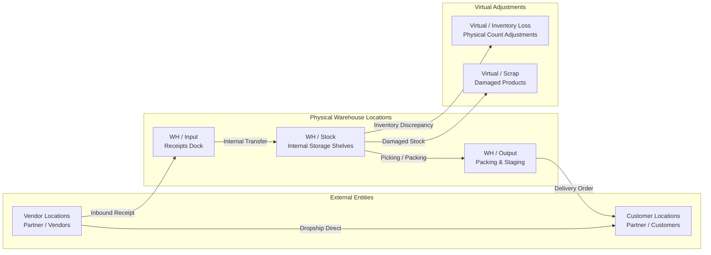
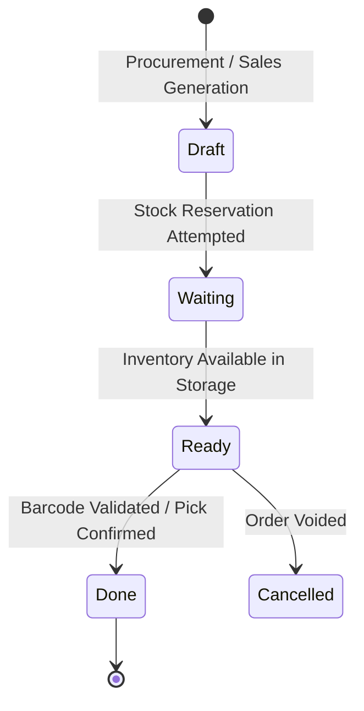

# Understanding Double-Entry Inventory and Stock Flows

Modern warehouse logistics requires continuous tracking of material quantities without numerical discrepancies. In CURQ Inventory, all physical handling is governed by a double-entry stock architecture. Products never appear or disappear arbitrarily; every movement represents a balanced transaction from a designated source location to a target destination location.

This document explains the conceptual foundations of double-entry inventory, warehouse location hierarchies, and stock picking lifecycles.

---

### The Double-Entry Stock Movement Model

Similar to financial accounting where every debit requires a corresponding credit, CURQ Inventory records all product moves as balanced pairs:

$$\text{Source Location} \xrightarrow{\text{Stock Move}} \text{Destination Location}$$

#### 1. Location Types and Boundaries
* **Internal Locations**: Physical zones owned and operated by your enterprise *(e.g., `WH/Stock`, `WH/Input`, `WH/Packing`)*. Products stored in internal locations contribute directly to on-hand inventory balances and corporate asset valuation.
* **Vendor Locations**: Counterpart virtual locations representing external suppliers. Receiving goods from a vendor transfers units from `Partner Locations/Vendors` into `WH/Stock`.
* **Customer Locations**: Counterpart virtual locations representing buyers. Fulfilling a sales order transfers units from `WH/Stock` into `Partner Locations/Customers`.
* **Virtual Locations**: Statistical holding zones used for inventory write-offs, physical count adjustments, and scrap logging.

---

### The Transfer and Picking Lifecycle

Every warehouse movement progresses through structured execution states to coordinate physical dock activities with digital inventory ledgers:

1. **Draft**: Initial transfer record generated manually, triggered by an approved Purchase Order, or created by a confirmed Sales Order.
2. **Waiting**: Transfer is awaiting raw materials, vendor arrival, or upstream manufacturing operations.
3. **Ready**: Required quantities have been successfully reserved in `WH/Stock`. The warehouse team can physically pick and pack the items.
4. **Done**: Barcodes scanned, quantities verified, and transfer validated. CURQ commits the stock move to the valuation ledger immediately.

---

### Core Operation Types in Warehouse Flow

CURQ structures warehouse logistics around dedicated operation types:

| Operation Type | Default Source Location | Default Destination Location | Primary Purpose |
| :--- | :--- | :--- | :--- |
| **Receipts** | Partner Locations / Vendors | WH / Input or WH / Stock | Inbound dock unloading, quality checking, and vendor intake. |
| **Internal Transfers** | WH / Stock / Zone A | WH / Stock / Zone B | Stock replenishment, shelf relocation, and inter-warehouse moves. |
| **Delivery Orders** | WH / Stock or WH / Output | Partner Locations / Customers | Outbound customer packing, palletizing, and freight shipping. |
| **Dropship** | Partner Locations / Vendors | Partner Locations / Customers | Direct vendor delivery to buyer without entering warehouse premises. |

---

### Related Documentation

* [Navigate Inventory and Manage Stock Operations](../getting-started/01-navigate-inventory-and-manage-stock-operations.md)
* [Navigate Inventory Overview and Operation Types](../task-guides/01-navigate-inventory-overview-and-operation-types.md)
* [Inventory Dashboard and Operation Card Definitions](../settings-and-fields/01-inventory-dashboard-and-operation-card-definitions.md)
