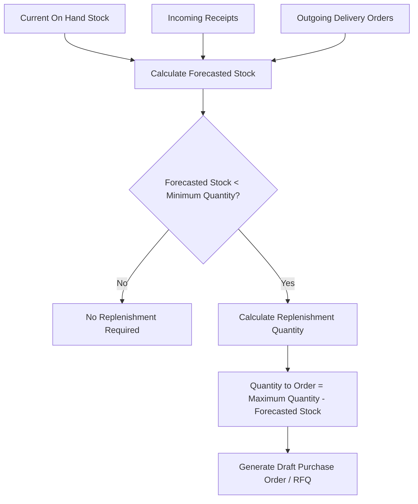
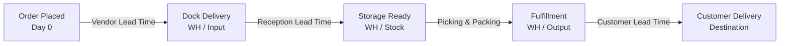

# Understanding Reordering Rules and Lead Times

Maintaining optimal inventory requires balancing product availability against working capital expenditure. Stockouts result in missed delivery deadlines and dissatisfied customers, while excessive stock inflates storage costs and depreciation. In CURQ Inventory, replenishment is governed by automated reordering rules, safety stock thresholds, and multi-tier lead time calculations.

This document explains the conceptual mechanics of minimum and maximum stock rules, replenishment scheduling triggers, and supply chain lead times.

---

### The Min/Max Reordering Rule Model

CURQ evaluates inventory replenishment through continuous stock level surveillance:

$$\text{Forecasted Stock} = \text{Quantity On Hand} + \text{Incoming Stock} - \text{Outgoing Stock}$$

#### 1. Core Replenishment Thresholds
* **Minimum Quantity (Trigger Threshold)**: The critical safety stock floor. When forecasted inventory dips below this level, CURQ automatically initiates a replenishment order.
* **Maximum Quantity (Target Ceiling)**: The target replenishment volume. CURQ calculates the exact order quantity necessary to bring inventory back up to this ceiling without overstocking.
* **Quantity Multiple (Packaging Constraint)**: Supplier packaging batch sizes *(e.g., ordering in multiples of 10 or pallet increments of 50)*. CURQ rounds calculated replenishment quantities up to the nearest valid multiple.

---

### Make to Stock (MTS) versus Make to Order (MTO)

Enterprises apply distinct fulfillment strategies depending on product velocity and customization requirements:

| Dimension | Make to Stock (MTS) | Make to Order (MTO) |
| :--- | :--- | :--- |
| **Trigger Mechanism** | Replenishment rules based on historical demand forecasts. | Direct customer sales orders generating automated procurements. |
| **Inventory State** | Products held in `WH/Stock` ready for immediate picking. | Products ordered or manufactured only after a sales order is confirmed. |
| **Lead Time Impact** | Immediate fulfillment; zero procurement waiting time for buyer. | Customer fulfillment timeline includes complete vendor production and transit lead times. |
| **Risk Profile** | Inventory holding costs and obsolescence risk. | Risk of stockout or supplier fulfillment delays impacting delivery promises. |

---

### Cumulative Supply Chain Lead Times

Accurate delivery promises require cumulative calculation across each stage of procurement and physical handling:

1. **Vendor Lead Time**: Calendar days required by the supplier to manufacture and ship goods to your receiving dock.
2. **Reception Lead Time (Warehouse Intake)**: Dwell time required by receiving teams to unload, inspect, barcode, and transfer goods from `WH/Input` to `WH/Stock`.
3. **Customer Lead Time (Fulfillment)**: Transit duration required by freight logistics providers to deliver packaged shipments to the customer address.
4. **Security Lead Time (Safety Buffer)**: Strategic margin added to customer commitments to protect against unforeseen transit bottlenecks.

---

### Related Documentation

* [Manage Replenishment and Automated Reordering Rules](../task-guides/09-manage-replenishment-and-automated-reordering-rules.md)
* [Replenishment and Reordering Rules Field Definitions](../settings-and-fields/09-replenishment-and-reordering-rules-field-definitions.md)
* [Fulfill Sales Orders and Process Deliveries](../getting-started/02-fulfill-sales-orders-and-process-deliveries.md)
* [Process Outbound Delivery Orders and Customer Shipments](../task-guides/03-process-outbound-delivery-orders-and-customer-shipments.md)
* [Understanding Double-Entry Inventory and Stock Flows](./01-understanding-double-entry-inventory-and-stock-flows.md)
* [Delivery Order and Outbound Shipping Field Definitions](../settings-and-fields/03-delivery-order-and-outbound-shipping-field-definitions.md)

