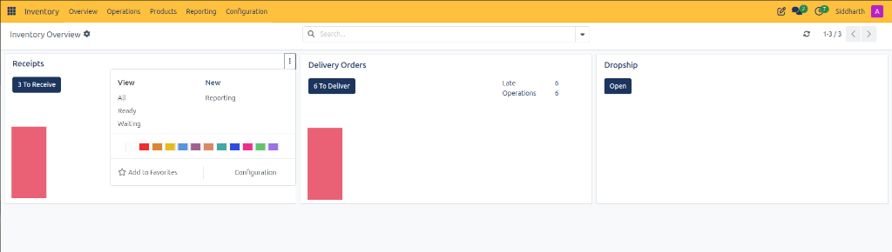
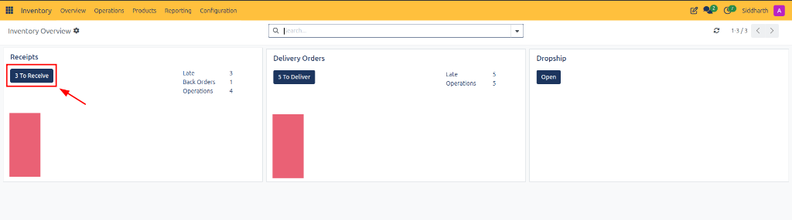
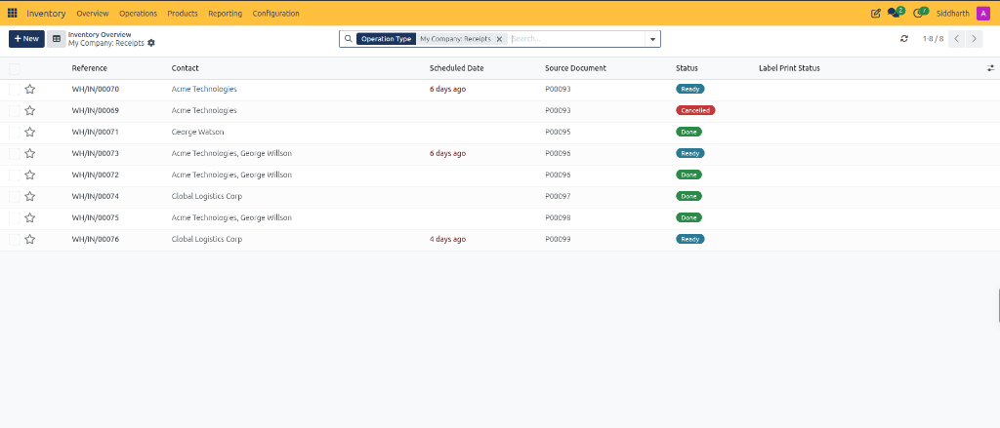
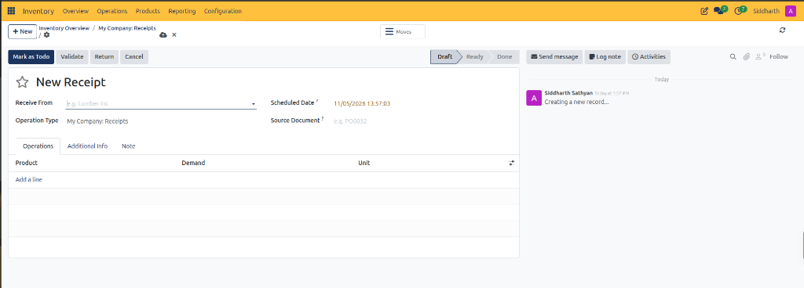

# Navigate Inventory and Manage Stock Operations

This tutorial introduces the foundational workflows of CURQ Inventory, guiding logistics coordinators and warehouse managers through the central Inventory Overview dashboard, operation type cards, and warehouse fulfillment pipelines.

> **Prerequisites**
> * Ensure your user account has access permissions to the **Inventory** application in CURQ.
> * Verify that warehouse operations *(such as Receipts, Delivery Orders, and Dropship)* are initialized in your system.

---

## 1. Navigate the Dashboard and Inbound Receipts

### 1.1 Access the Inventory Application

1. From the primary CURQ application switcher in the upper-left corner, click **Inventory**.
2. CURQ opens the centralized **Inventory Overview** dashboard:

3. Review the top navigation structure:
   * **Overview**: Real-time warehouse operational board showing all active picking and shipping queues.
   * **Operations**: Detailed registers for transfers, batch transfers, physical inventory adjustments, scrap orders, and land costs.
   * **Products**: Product catalog management, product variants, price lists, lots, and serial numbers.
   * **Reporting**: Stock valuation, stock moves analysis, moves history, and warehouse performance reports.
   * **Configuration**: Warehouse settings, location hierarchies, operation types, route rules, and putaway strategies.

---

### 1.2 Open and Review the Inbound Receipts Register

1. On the **Receipts** operational card, locate the primary execution button:

2. Review the card metrics:
   * **3 To Receive**: Dark blue action button displaying the count of actionable inbound shipments.
   * **Late (3)**: Critical counter showing supplier deliveries that have passed their expected arrival date.
   * **Back Orders (1)**: Pending split shipments awaiting residual vendor fulfillment.
   * **Operations (4)**: Total active receiving transfers in the pipeline.

3. Click the **3 To Receive** button to open the receipts register:
   * CURQ displays the inbound transfers register:

4. Review the register columns:
   * **Reference**: Unique transaction identifier *(e.g., `WH/IN/00070`)*.
   * **Contact**: Vendor or supplier entity delivering the goods *(e.g., `Acme Technologies`, `Global Logistics Corp`)*.
   * **Scheduled Date**: Target dock arrival date, highlighted in red if overdue *(e.g., `6 days ago`)*.
   * **Source Document**: Originating Purchase Order number *(e.g., `P00093`)*.
   * **Status**: Operational lifecycle badge (*Ready*, *Done*, *Cancelled*).

> For more details about the fields and columns on the receipts register, see [**Receipts List Register Data Dictionary**](../settings-and-fields/01-warehouse-operations-and-transfer-field-definitions.md#1-receipts-list-register-data-dictionary).

---

### 1.3 Inspect Inbound Transfer Lines in Form View

1. Click **+ New** in the upper-left corner or open an existing receipt:
   * CURQ renders the comprehensive stock transfer form:

2. Review primary receipt parameters:
   * **Receive From**: Supplier company supplying the items *(e.g., `Lumber Inc`)*.
   * **Operation Type**: Destination warehouse intake route *(e.g., `My Company: Receipts`)*.
   * **Scheduled Date**: Target intake timestamp.
   * **Source Document**: Linked procurement reference.
   * **Operations Tab**: Product lines detailing demand quantities and units of measure.

> For more details about the fields and line item controls on the receipt form, see [**Ready Inbound Receipt Form and Operations Tab Definitions**](../settings-and-fields/01-warehouse-operations-and-transfer-field-definitions.md#3-ready-inbound-receipt-form-and-operations-tab-definitions).

---

## 2. Monitor Outbound Pipelines and Card Actions

### 2.1 Interpret Delivery Orders and Dropship Pipelines

Return to **Inventory > Overview** to monitor outbound and partner operations:

1. **Delivery Orders Card**:
   * Tracks outgoing fulfillment shipments to customers and partners.
   * Displays the primary action button **6 To Deliver**.
   * Highlights urgent execution bottlenecks:
     * **Late (6)**: Direct alert indicating transfers that have passed scheduled delivery deadlines.
     * **Operations (6)**: Total quantity of scheduled fulfillment orders in the active pipeline.

2. **Dropship Card**:
   * Coordinates direct vendor-to-customer deliveries bypassing physical warehouse handling.
   * Click **Open** to review active dropship orders.

---

### 2.2 Access Card Context Menus and Fast Actions

Click the three vertical dots icon in the upper-right corner of any operation card *(e.g., `Receipts`)* to open the context flyout:

1. **Filtered Views**:
   * **All**: Displays all historical, active, and completed operations of this type.
   * **Ready**: Filters specifically for transfers where reserved products are available in stock for immediate picking.
   * **Waiting**: Isolates transfers blocked awaiting stock arrival or component availability.
2. **Operational Shortcuts**:
   * **New**: Opens a blank transfer form to record an ad-hoc receipt or delivery order.
   * **Reporting**: Launches analytical reports focused exclusively on this operation type.
3. **Card Personalization**:
   * **Color Palette**: Select from 12 color swatches to tint the card border for rapid visual categorization.
   * **Add to Favorites**: Pins the operation card to the top priority section.
   * **Configuration**: Opens the underlying Operation Type configuration settings.

---

## Related Documentation

* [Navigate Inventory Overview and Operation Types](../task-guides/01-navigate-inventory-overview-and-operation-types.md)
* [Manage Product Catalog and Inventory Levels](../task-guides/05-manage-product-catalog-and-inventory-levels.md)
* [Manage Replenishment and Automated Reordering Rules](../task-guides/09-manage-replenishment-and-automated-reordering-rules.md)
* [Warehouse Operations and Transfer Field Definitions](../settings-and-fields/01-warehouse-operations-and-transfer-field-definitions.md)
* [Replenishment and Reordering Rules Field Definitions](../settings-and-fields/04-replenishment-and-reordering-rules-field-definitions.md)
