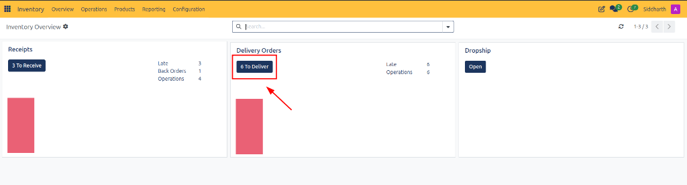
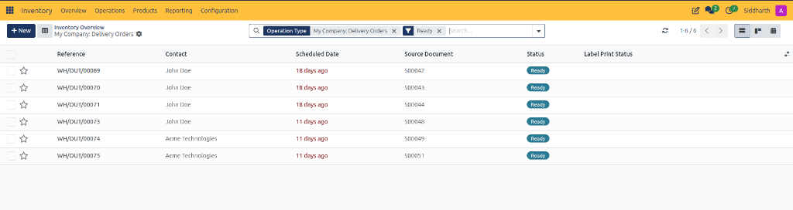
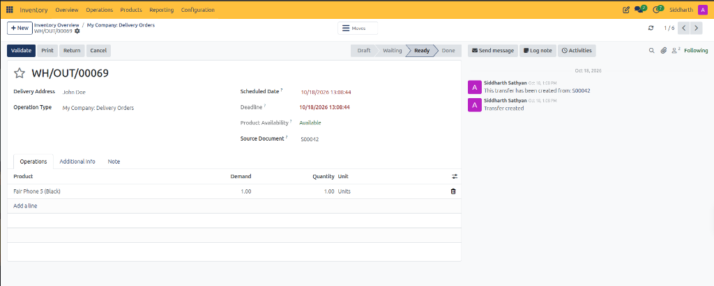
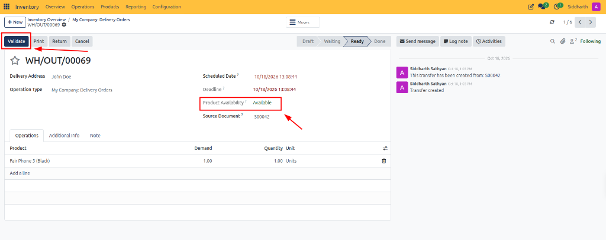
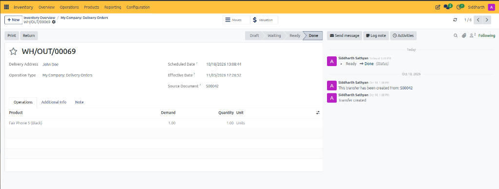
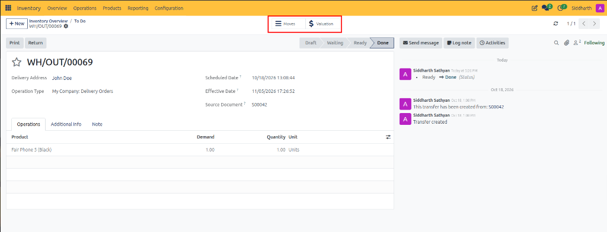
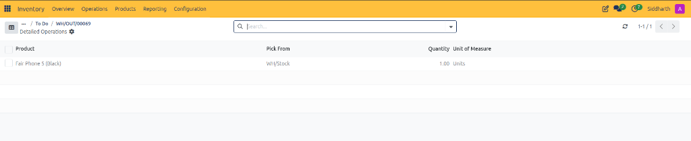
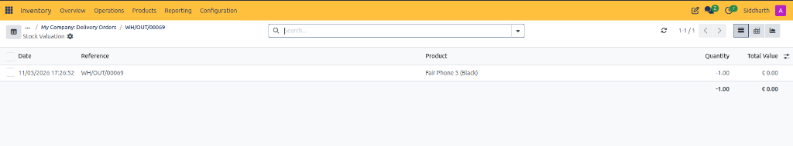

# Fulfill Sales Orders and Process Deliveries

This tutorial guides logistics coordinators and shipping specialists through the end-to-end outbound order fulfillment process in CURQ Inventory, from monitoring the delivery pipeline on the overview dashboard to validating stock shipments against confirmed customer orders.

> **Prerequisites**
> * Ensure the **Inventory** and **Sales** applications are active with cross-module integration.
> * Verify that at least one confirmed sales order *(e.g., `S00042`)* has generated an active outbound delivery order.
> * Confirm that required inventory is on hand in the primary warehouse storage location *(e.g., `WH/Stock`)*.

---

## 1. Process and Validate Outbound Delivery Orders

### 1.1 Open the Outbound Delivery Queue

1. Navigate to **Inventory > Overview**.
2. Locate the **Delivery Orders** operational card:

3. Review the card indicators:
   * **6 To Deliver**: Primary action button displaying the count of pending outbound shipments.
   * **Late (6)**: Urgent alert indicating transfers past their planned shipping deadline.
   * **Operations (6)**: Total volume of active fulfillment orders in the queue.
4. Click the dark blue **6 To Deliver** button to open the fulfillment register.

---

### 1.2 Triage Ready Deliveries in the Register

CURQ opens the delivery orders register pre-filtered to isolate actionable orders:

1. Review the applied filters in the search bar:
   * `Operation Type: My Company: Delivery Orders`: Restricts records to outbound customer shipments.
   * `Ready`: Isolates transfers where all required products are physically reserved in stock.
2. Review delivery attributes:
   * **Reference**: Unique outbound transfer code *(e.g., `WH/OUT/00069`)*.
   * **Contact**: Customer recipient entity *(e.g., `John Doe`, `Acme Technologies`)*.
   * **Scheduled Date**: Target dispatch date, styled in red text for overdue shipments *(e.g., `18 days ago`, `11 days ago`)*.
   * **Source Document**: Originating customer sales order *(e.g., `S00042`)*.
   * **Status**: Operational readiness badge (*Ready*).
3. Click on the reference link for **WH/OUT/00069** to enter the form view.

> For more details about the fields and controls on the delivery order register, see [**Delivery Orders List Register Data Dictionary**](../settings-and-fields/01-warehouse-operations-and-transfer-field-definitions.md#7-delivery-orders-list-register-data-dictionary).

---

### 1.3 Inspect Reserved Quantities and Order Details

CURQ displays the comprehensive delivery order form:

1. Review header attributes:
   * **Delivery Address**: Destination shipping address for the customer *(e.g., `John Doe`)*.
   * **Operation Type**: Confirms outbound routing *(e.g., `My Company: Delivery Orders`)*.
   * **Scheduled Date & Deadline**: Customer delivery timeline constraints.
   * **Source Document**: Direct cross-module link to sales order `S00042`.
2. Review the **Operations** tab product lines:
   * **Product**: Deliverable item name *(e.g., `Fair Phone 5 (Black)`)*.
   * **Demand**: Ordered quantity requested by the customer *(e.g., `1.00`)*.
   * **Quantity**: Measured quantity prepared for packing *(e.g., `1.00 Units`)*.

> For more details about header fields and line item parameters, see [**Delivery Order Header Fields Data Dictionary**](../settings-and-fields/01-warehouse-operations-and-transfer-field-definitions.md#9-delivery-order-header-fields-data-dictionary) and [**Operations Tab Line Item Definitions**](../settings-and-fields/01-warehouse-operations-and-transfer-field-definitions.md#10-operations-tab-line-item-definitions).

---

### 1.4 Verify Product Availability and Validate Shipment

Before goods physically leave the loading dock, warehouse operators confirm stock availability and validate the transfer:

1. **Verify Stock Reservation**:
   * Inspect the **Product Availability** field. A green indicator displaying **Available** confirms that required stock has been successfully reserved in `WH/Stock` and is not allocated to competing orders.
2. **Execute Validation**:
   * In the upper-left action bar, click the dark blue **Validate** button.
3. **Automated Stock Accounting**:
   * CURQ transitions the status chevron from **Ready** to **Done**.
   * Balanced stock moves transfer the physical product units out of `WH/Stock` and into `Partner Locations/Customers`.
   * Connected Sales Order `S00042` automatically updates delivered quantities from `0` to `1`, unlocking customer invoice generation in CURQ Accounting.

> For more details about action buttons and stage triggers, see [**Delivery Order Form Action Buttons and Smart Controls**](../settings-and-fields/01-warehouse-operations-and-transfer-field-definitions.md#8-delivery-order-form-action-buttons-and-smart-controls).

---

## 2. Review Validated Shipments and Stock Valuation

### 2.1 Review Validated Order State and Completed Metrics

Upon successful validation, CURQ updates the form view to reflect the finalized dispatch:

1. **Terminal State Controls**:
   * The **Validate** and **Cancel** buttons are removed to prevent duplicate processing.
   * Active action buttons are now restricted to **Print** *(to generate the final Delivery Slip)* and **Return** *(to process customer returns)*.
2. **Effective Date**:
   * CURQ logs the immutable dispatch timestamp in **Effective Date** *(e.g., `11/05/2026 17:26:52`)*.
3. **Audit Chatter**:
   * The chatter feed logs the state transition: `Ready -> Done (Status)` along with automated creation references.

---

### 2.2 Access Tracking Smart Buttons on Validated Transfers

The validated delivery order header exposes smart buttons that link the physical dispatch to operational moves and accounting ledger entries:

1. **Smart Button Navigation**:
   * **Moves Smart Button**: Displays the detailed physical stock moves executed during fulfillment.
   * **Valuation Smart Button**: Provides immediate drill-down access to inventory valuation ledger records and cost postings.
2. Click the **Moves** smart button to inspect the underlying warehouse picking transactions.

> For more details about transfer smart buttons and navigation headers, see [**Validated Transfer Smart Controls Data Dictionary**](../settings-and-fields/06-stock-moves-analysis-and-valuation-field-definitions.md#1-validated-transfer-smart-controls-data-dictionary).

---

### 2.3 Inspect Detailed Operations and Stock Move Records

CURQ displays the **Detailed Operations** view itemizing the exact source location and picked quantities:

1. **Review Physical Stock Movement Attributes**:
   * **Product**: Specific inventory item transferred *(e.g., `Fair Phone 5 (Black)`)*.
   * **Pick From**: Source warehouse storage bin or shelf location *(e.g., `WH/Stock`)*.
   * **Quantity**: Precise count of units decremented from the source location *(e.g., `1.00`)*.
   * **Unit of Measure**: Standard measuring unit applied *(e.g., `Units`)*.
2. Navigate back to the delivery order via the breadcrumb link *(e.g., `WH/OUT/00069`)*.

---

### 2.4 Audit Automated Stock Valuation Ledger Postings

From the delivery order header, click the **Valuation** smart button to audit financial inventory impacts:

1. **Audit Stock Valuation Register Fields**:
   * **Date**: Exact execution timestamp matching the transfer effective date *(e.g., `11/05/2026 17:26:52`)*.
   * **Reference**: Outbound transfer identifier *(e.g., `WH/OUT/00069`)*.
   * **Product**: Catalog product evaluated *(e.g., `Fair Phone 5 (Black)`)*.
   * **Quantity**: Net stock quantity delta *(e.g., `-1.00`)* representing stock reduction.
   * **Total Value**: Monetary balance sheet change recorded for this stock movement *(e.g., `€ 0.00`)*.
2. Verify that financial stock decrement entries reconcile with cost of goods sold accounts in CURQ Accounting.

> For more details about financial stock ledger entries and quantity deltas, see [**Stock Valuation Register Data Dictionary**](../settings-and-fields/06-stock-moves-analysis-and-valuation-field-definitions.md#4-stock-valuation-register-data-dictionary).

---

## Related Documentation

* [Process Outbound Delivery Orders and Customer Shipments](../task-guides/03-process-outbound-delivery-orders-and-customer-shipments.md)
* [Audit Stock Moves and Inventory Valuation](../task-guides/04-audit-stock-moves-and-inventory-valuation.md)
* [Warehouse Operations and Transfer Field Definitions](../settings-and-fields/01-warehouse-operations-and-transfer-field-definitions.md)
* [Stock Moves Analysis and Valuation Field Definitions](../settings-and-fields/06-stock-moves-analysis-and-valuation-field-definitions.md)
* [Navigate Inventory and Manage Stock Operations](./01-navigate-inventory-and-manage-stock-operations.md)
