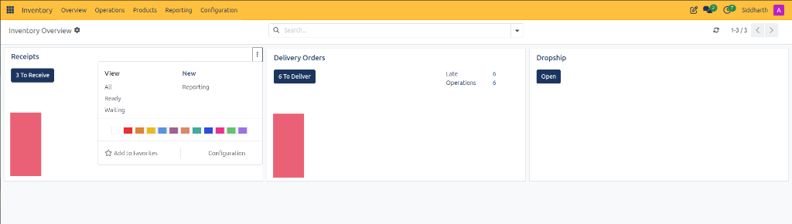
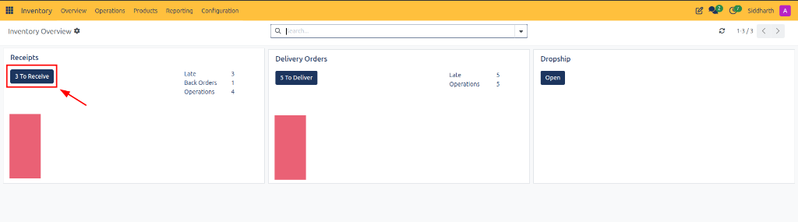

# Inventory Dashboard and Operation Card Definitions

This document provides a comprehensive data dictionary for all top navigation menus, overview action controls, operation type card metrics, and card context flyouts within the CURQ Inventory dashboard at **Inventory > Overview**.

---

### Navigation and Control Bar Data Dictionary

The top header bar and control panel coordinate warehouse navigation, filtering, and pagination:

| Field Name / Control | Description |
| :--- | :--- |
| **Overview Top Menu** | Primary navigation tab opening the real-time operational warehouse dashboard. |
| **Operations Top Menu** | Dropdown menu providing access to transfers, batch transfers, physical inventory adjustments, and scrap registers. |
| **Products Top Menu** | Dropdown menu managing product masters, product variants, price lists, lots, and serial numbers. |
| **Reporting Top Menu** | Analytical menu launching stock valuation, inventory moves analysis, and performance metrics. |
| **Configuration Top Menu** | Administrative menu configuring warehouses, location hierarchies, operation types, and reordering rules. |
| **Inventory Overview Breadcrumb** | Active workspace label with configuration gear icon for customizing dashboard display parameters. |
| **Search Bar** | Keyword search input allowing warehouse operators to isolate cards by operation name or warehouse location. |
| **Refresh Button** | Action button reloading live stock counters and pending transfer quantities. |
| **Pagination Counter** | Indicator displaying currently visible cards and total available operation types *(e.g., `1-3 / 3`)*. |
| **Pager Navigation Chevrons** | Navigation arrows switching between multi-page operation type registers. |

---

### Operation Type Card Data Dictionary

Each card on the dashboard summarizes active fulfillment and intake pipelines for a specific warehouse activity:

| Field Name / Control | Description |
| :--- | :--- |
| **Receipts Card Title** | Operational card identifying the incoming goods intake workflow. |
| **To Receive Button** | Action button displaying pending inbound shipments *(e.g., `3 To Receive`)* and opening the receipts register. |
| **Back Orders Metric** | Indicator tracking partially fulfilled supplier shipments awaiting balance delivery *(e.g., `Back Orders 1`)*. |
| **Delivery Orders Card Title** | Operational card identifying the customer fulfillment and shipping workflow. |
| **To Deliver Button** | Action button displaying scheduled outbound shipments *(e.g., `5 To Deliver` or `6 To Deliver`)* and opening the delivery register. |
| **Late Metric** | Critical alert metric showing shipments that have exceeded scheduled execution deadlines *(e.g., `Late 3`, `Late 5`)*. |
| **Operations Metric** | Quantitative counter displaying the total volume of active fulfillment orders in the queue *(e.g., `Operations 4`, `Operations 5`)*. |
| **Dropship Card Title** | Operational card tracking direct supplier-to-customer order fulfillment. |
| **Open Button (Dropship)** | Action button launching the active dropship transfers queue. |
| **Card Color Indicator Strip** | Vertical colored bar on the left edge reflecting custom card tinting. |

---

### Card Context Flyout Data Dictionary

Clicking the vertical ellipsis *(three dots icon)* on an operation card opens the administrative context menu:

| Field Name / Control | Description |
| :--- | :--- |
| **Card Context Menu Trigger** | Three vertical dots button in the upper-right corner of the card opening operational shortcuts. |
| **All View Link** | Navigational link opening the complete list of historical, active, and completed operations of this type. |
| **Ready View Link** | Filtered link opening only those transfers with reserved stock ready for physical picking. |
| **Waiting View Link** | Filtered link isolating transfers blocked pending component availability or supplier arrival. |
| **New Action Link** | Action link creating a blank transfer record pre-assigned to this operation type. |
| **Reporting Link** | Navigational link launching analytical performance reports filtered for this operation queue. |
| **Color Palette Swatches** | 12 selectable color swatches allowing managers to color-code cards for rapid visual triage. |
| **Add to Favorites Button** | Bookmark toggle with star icon pinning high-priority operation cards to top positions. |
| **Configuration Action Link** | Navigational link opening the master configuration form for this operation type. |

---

### Related Documentation

* [Navigate Inventory and Manage Stock Operations](../getting-started/01-navigate-inventory-and-manage-stock-operations.md)
* [Navigate Inventory Overview and Operation Types](../task-guides/01-navigate-inventory-overview-and-operation-types.md)
* [Understanding Double-Entry Inventory and Stock Flows](../core-concepts/01-understanding-double-entry-inventory-and-stock-flows.md)
