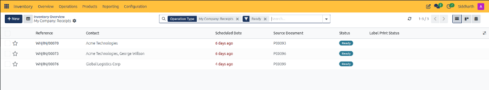
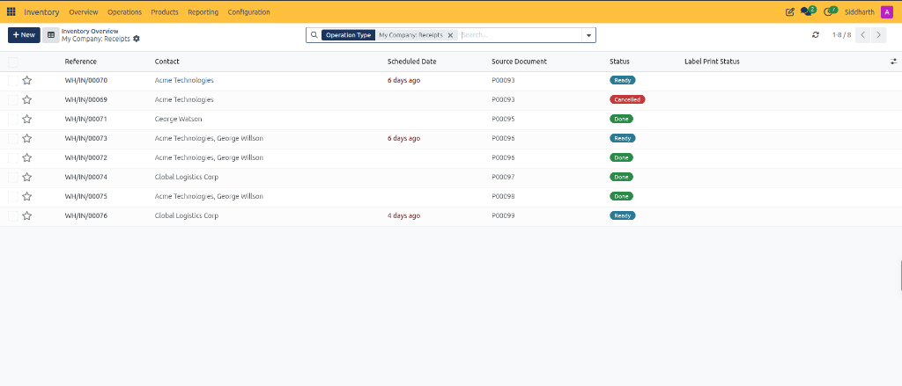
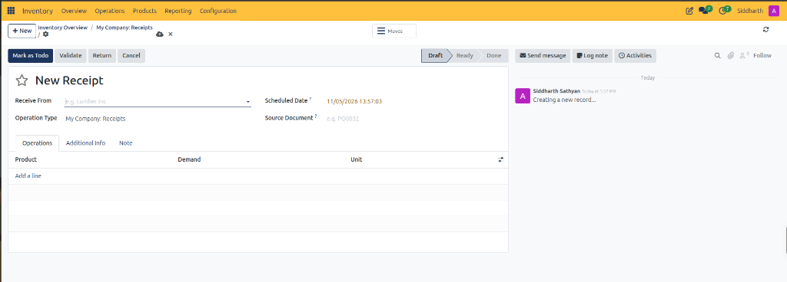
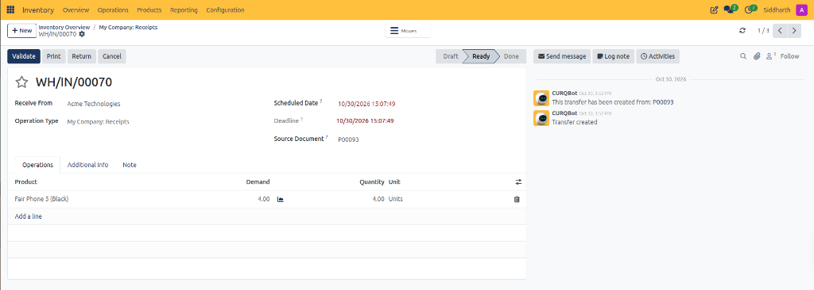
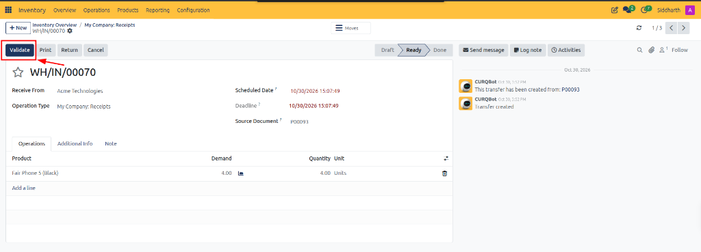
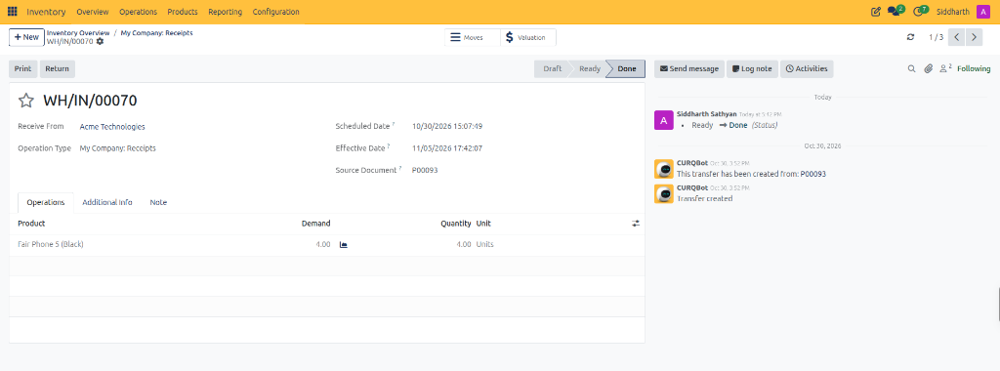
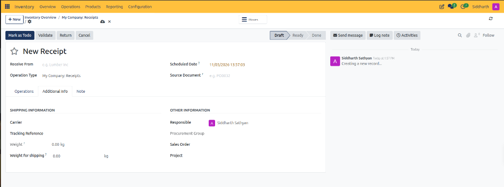
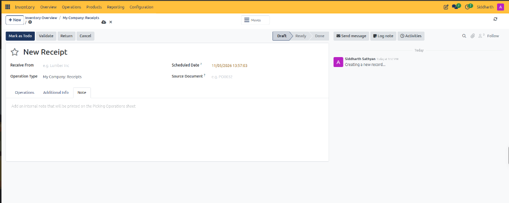

# Receipt and Stock Transfer Field Definitions

This document provides a comprehensive data dictionary for all list register columns, header action buttons, primary fields, notebook tabs, and shipping metrics within the CURQ Inventory receipts and transfer forms at **Inventory > Overview > Receipts**.

---

### Receipts List Register Data Dictionary

The receipts register aggregates all incoming warehouse transfers from suppliers, both in comprehensive views and filtered ready states:

| Field Name / Control | Description |
| :--- | :--- |
| **Reference** | Unique alphanumeric tracking code assigned to the transfer *(e.g., `WH/IN/00070`)*. |
| **Contact** | Commercial entity, supplier, or specialist associated with the delivery *(e.g., `Acme Technologies`)*. |
| **Scheduled Date** | Target arrival timestamp, styled in red text when delivery has passed due date *(e.g., `6 days ago`, `4 days ago`)*. |
| **Source Document** | Originating procurement or sales document establishing the order baseline *(e.g., `P00093`)*. |
| **Status** | Operational lifecycle stage badge (*Ready*, *Done*, *Cancelled*). |
| **Label Print Status** | Indicator tracking whether physical barcode pallet labels have been generated. |
| **Favorite Star** | Interactive toggle bookmarking critical inbound receipts. |
| **Batch Selection Checkbox** | Multi-select selector for initiating bulk receiving validations or batch moves. |
| **Ready Filter** | Search filter restricting listed transfers to actionable arrivals ready for intake. |

---

### Receipt Form Header and Action Controls

The receipt form view provides execution controls, status tracking, and relational smart buttons:

| Field Name / Control | Description |
| :--- | :--- |
| **Mark as Todo Button** | Primary action button advancing a draft receipt to active `Ready` execution status. |
| **Validate Button** | Action button committing physical intake, updating on-hand stock balances, and finalizing moves. |
| **Return Button** | Reverse logistics action generating an outbound return picking to supplier. |
| **Cancel Button** | Administrative action voiding the transfer record without modifying inventory. |
| **Moves Smart Button** | Navigational button displaying individual underlying stock move records. |
| **Status Chevron Bar** | Sequential stage indicator tracking progression across **Draft**, **Ready**, and **Done**. |
| **Receive From** | Supplier or vendor delivering products *(e.g., `Acme Technologies`, placeholder `e.g. Lumber Inc`)*. |
| **Operation Type** | Warehouse routing pathway governing source and destination defaults *(e.g., `My Company: Receipts`)*. |
| **Scheduled Date** | Planned delivery timestamp for dock scheduling. |
| **Deadline** | Operational threshold for completing receiving intake. |
| **Source Document** | Reference code linking this transfer to purchase orders or external shipping notes *(e.g., `P00093`)*. |

---

### Ready Inbound Receipt Form and Operations Tab Definitions

When an inbound transfer reaches the `Ready` stage, warehouse staff inspect ordered demand against physical counts:

| Field Name / Control | Description |
| :--- | :--- |
| **Product** | Catalog item being received into warehouse storage *(e.g., `Fair Phone 5 (Black)`)*. |
| **Demand** | Total expected product quantity scheduled for delivery on the purchase order *(e.g., `4.00`)*. |
| **Quantity** | Actual physical quantity counted and accepted at the dock *(e.g., `4.00 Units`)*. |
| **Unit** | Standard Unit of Measure applied to the product quantity *(e.g., `Units`)*. |
| **Delete Row Icon** | Trash can icon allowing dock workers to remove an unfulfilled line item before validation. |
| **Add a line Control** | Table button inserting a new product receiving row. |

---

### Receipt Validation Action Controls

The receipt validation control bar coordinates stock intake execution:

| Field Name / Control | Description |
| :--- | :--- |
| **Validate Action Button** | Primary execution button committing physical receipt, moving stock into `WH/Stock`, and posting valuation. |
| **Print Action Button** | Document generation action producing the Receiving Slip and pallet barcodes. |
| **Return Action Button** | Reverse logistics action creating an outbound return picking to the supplier for rejected units. |
| **Cancel Action Button** | Administrative action cancelling the transfer and releasing planned receiving capacity. |

---

### Validated Receipt Form and Valuation Smart Controls

Upon validation, the receipt displays terminal metrics, execution timestamps, and accounting links:

| Field Name / Control | Description |
| :--- | :--- |
| **Valuation Smart Button** | Header navigation control marked with a currency symbol providing access to inventory valuation ledger debits. |
| **Moves Smart Button** | Navigational button linking to detailed stock move records documenting the intake transfer into storage. |
| **Effective Date** | Immutable timestamp recording the exact date and time physical intake was validated *(e.g., `11/05/2026 17:42:07`)*. |
| **Terminal Status Chevron** | Progress indicator displaying completed **Done** status in grey shading. |

---

### Additional Info Tab Data Dictionary

The **Additional Info** tab captures freight parameters, tracking numbers, and corporate governance:

| Field Name / Control | Description |
| :--- | :--- |
| **Carrier** | Third-party freight carrier or delivery service handling physical transportation. |
| **Tracking Reference** | Waybill, bill of lading, or tracking number provided by the carrier. |
| **Weight** | Measured net weight of the delivered goods in kilograms. |
| **Weight for shipping** | Total freight gross weight including packaging and pallets. |
| **Responsible** | Assigned warehouse specialist or procurement lead overseeing delivery intake. |
| **Procurement Group** | Relational link coordinating multiple transfers within a shared supply group. |
| **Sales Order** | Connected customer order when items are received for direct cross-docking or reserved sale. |
| **Project** | Relational link associating received stock with a specific project workspace. |

---

### Note Tab Data Dictionary

The **Note** tab communicates internal warehouse guidance:

| Field Name / Control | Description |
| :--- | :--- |
| **Internal Note Text Area** | Freeform text editor for recording handling instructions printed on Picking Operations sheets. |

---

### Related Documentation

* [Navigate Inventory and Manage Stock Operations](../getting-started/01-navigate-inventory-and-manage-stock-operations.md)
* [Process Inbound Receipts and Vendor Deliveries](../task-guides/02-process-inbound-receipts-and-vendor-deliveries.md)
* [Detailed Operations and Stock Valuation Field Definitions](./04-detailed-operations-and-stock-valuation-field-definitions.md)
* [Inventory Dashboard and Operation Card Definitions](./01-inventory-dashboard-and-operation-card-definitions.md)
* [Understanding Double-Entry Inventory and Stock Flows](../core-concepts/01-understanding-double-entry-inventory-and-stock-flows.md)
