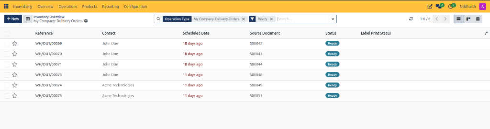
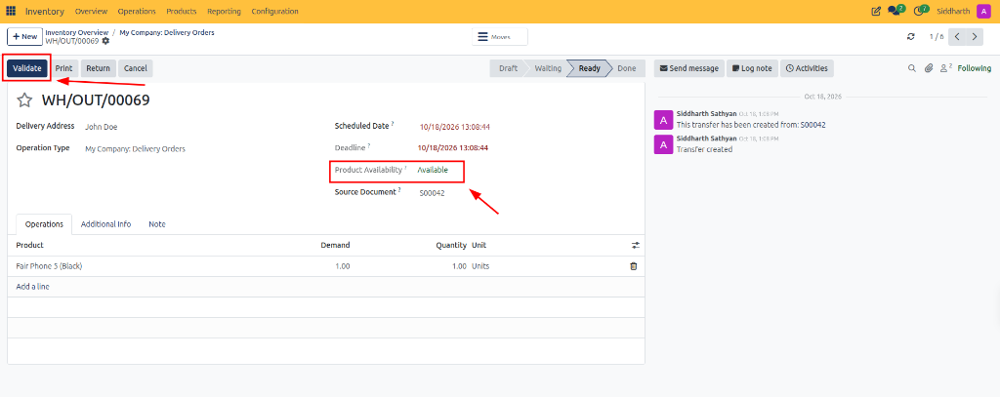
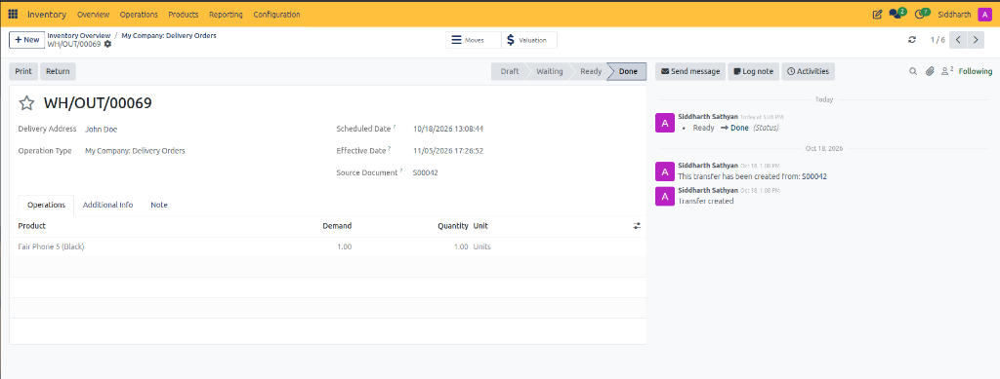
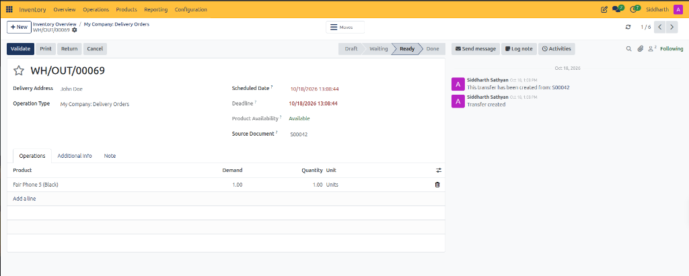

# Delivery Order and Outbound Shipping Field Definitions

This document provides a comprehensive data dictionary for all list register columns, header action buttons, primary fields, product line items, and availability indicators within the CURQ Inventory delivery order and outbound shipping forms at **Inventory > Overview > Delivery Orders**.

---

### Delivery Orders List Register Data Dictionary

The delivery orders register aggregates all outgoing customer shipments requiring warehouse fulfillment:

| Field Name / Control | Description |
| :--- | :--- |
| **Reference** | Unique alphanumeric tracking identifier assigned to the outbound transfer *(e.g., `WH/OUT/00069`)*. |
| **Contact** | Customer, buyer entity, or commercial partner receiving the goods *(e.g., `John Doe`, `Acme Technologies`)*. |
| **Scheduled Date** | Target dispatch timestamp, displayed in red text when fulfillment is overdue *(e.g., `18 days ago`)*. |
| **Source Document** | Originating customer sales order establishing the fulfillment commitment *(e.g., `S00042`)*. |
| **Status** | Operational lifecycle stage badge (*Ready*, *Waiting*, *Done*, *Cancelled*). |
| **Label Print Status** | Indicator tracking whether physical parcel or pallet shipping labels have been printed. |
| **Favorite Star** | Interactive toggle bookmarking critical customer shipments. |
| **Batch Selection Checkbox** | Multi-select selector for initiating bulk shipping validations, wave pickings, or batch moves. |

---

### Delivery Order Form Action Buttons and Smart Controls

The delivery order form view coordinates picking verification, stock validation, and shipping documents:

| Field Name / Control | Description |
| :--- | :--- |
| **Validate Button** | Primary action button committing outbound dispatch, deducting stock from inventory, and completing the move. |
| **Print Button** | Document generation action generating the Delivery Slip, picking operations sheet, or parcel labels. |
| **Return Button** | Reverse logistics action generating an inbound return transfer if goods are rejected or exchanged. |
| **Cancel Button** | Administrative action voiding the transfer record and releasing reserved warehouse inventory. |
| **Moves Smart Button** | Navigational button displaying individual underlying stock move records linked to this picking. |
| **Valuation Smart Button** | Financial ledger button displaying automated inventory valuation and cost accounting entries. |
| **Status Chevron Bar** | Sequential stage indicator tracking progression across **Draft**, **Waiting**, **Ready**, and **Done**. |

---

### Validated Delivery Order View

Once validated, the transfer transitions to its completed state with financial valuation links:

---

### Delivery Order Header Fields Data Dictionary

The form header captures customer shipping destinations, operational deadlines, and stock availability metrics:

| Field Name / Control | Description |
| :--- | :--- |
| **Delivery Address** | Commercial destination address for the customer recipient *(e.g., `John Doe`)*. |
| **Operation Type** | Warehouse routing pathway governing outbound fulfillment defaults *(e.g., `My Company: Delivery Orders`)*. |
| **Scheduled Date** | Planned target date and time for shipment departure. |
| **Deadline** | Hard operational delivery threshold agreed with the customer. |
| **Effective Date** | Immutable timestamp recording the exact date and time shipment validation occurred. |
| **Product Availability** | Real-time stock reservation indicator displaying **Available** in green when stock is ready for picking. |
| **Source Document** | Reference code linking this transfer directly to the originating sales contract *(e.g., `S00042`)*. |

---

### Operations Tab Line Item Definitions

The **Operations** tab captures product lines, customer demand quantities, and picked units:

| Field Name / Control | Description |
| :--- | :--- |
| **Product** | Catalog item description and SKU being picked for shipment *(e.g., `Fair Phone 5 (Black)`)*. |
| **Demand** | Total product quantity requested by the customer on the originating sales order. |
| **Quantity** | Actual physical quantity picked, verified, and staged for packing and dispatch. |
| **Unit** | Standard Unit of Measure applied to the product quantity *(e.g., `Units`, `kg`)*. |
| **Delete Row Icon** | Trash can icon allowing operators to remove a product line before validation. |
| **Add a line Control** | Table action button allowing operators to add extra items to the shipment. |

---

### Related Documentation

* [Fulfill Sales Orders and Process Deliveries](../getting-started/02-fulfill-sales-orders-and-process-deliveries.md)
* [Process Outbound Delivery Orders and Customer Shipments](../task-guides/03-process-outbound-delivery-orders-and-customer-shipments.md)
* [Audit Stock Moves and Inventory Valuation](../task-guides/04-audit-stock-moves-and-inventory-valuation.md)
* [Detailed Operations and Stock Valuation Field Definitions](./04-detailed-operations-and-stock-valuation-field-definitions.md)
* [Inventory Dashboard and Operation Card Definitions](./01-inventory-dashboard-and-operation-card-definitions.md)
* [Receipt and Stock Transfer Field Definitions](./02-receipt-and-stock-transfer-field-definitions.md)
* [Understanding Double-Entry Inventory and Stock Flows](../core-concepts/01-understanding-double-entry-inventory-and-stock-flows.md)

