# Detailed Operations and Stock Valuation Field Definitions

This document provides a comprehensive data dictionary for validated transfer smart controls, detailed operational stock moves, and automated financial stock valuation entries across inbound receipts and outbound delivery orders within CURQ Inventory.

---

### Validated Transfer Smart Controls Data Dictionary

Following the completion of an outbound delivery order or inbound stock receipt, CURQ activates dedicated navigation buttons in the form header:

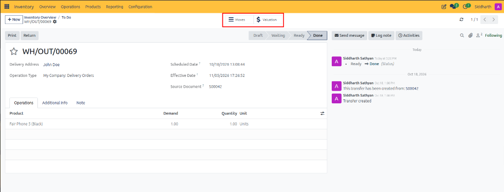

| Field Name / Control | Description |
| :--- | :--- |
| **Moves Smart Button** | Header navigation control displaying underlying physical stock moves, source bins, and lot tracking lines. |
| **Valuation Smart Button** | Header navigation control marked with a currency symbol providing drill-down access to inventory ledger valuation entries. |
| **Print Button** | Document generation action producing the Delivery Slip, Receiving Slip, or picking operations document. |
| **Return Button** | Reverse logistics action initiating an inbound or outbound return transfer. |
| **Status Chevron Bar** | Progression bar displaying terminal **Done** status in grey shading. |
| **Effective Date** | Immutable timestamp recording the precise date and time of physical stock validation. |
| **Delivery Address / Receive From** | Contact entity receiving dispatched goods or delivering inbound products *(e.g., `John Doe`, `Acme Technologies`)*. |
| **Operation Type** | Warehouse route governing the completed transfer *(e.g., `My Company: Delivery Orders`, `My Company: Receipts`)*. |
| **Source Document** | Originating business record triggering fulfillment *(e.g., `S00042`, `P00093`)*. |

---

### Detailed Operations Grid Data Dictionary

The Detailed Operations view itemizes exact warehouse locations, source shelves, tracking identifiers, and item counts:

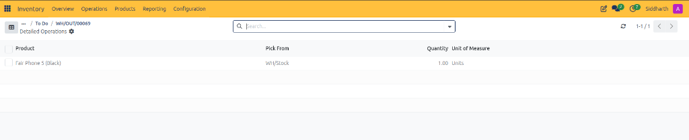

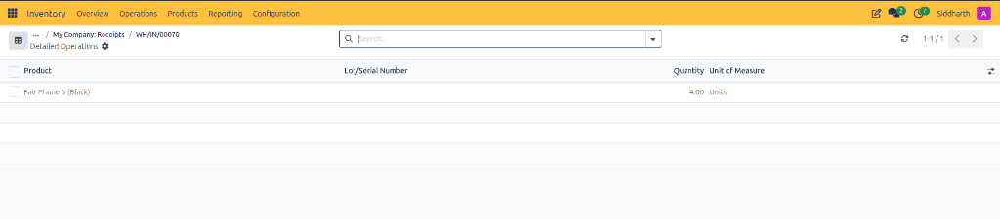

| Field Name / Control | Description |
| :--- | :--- |
| **Checkbox Selector** | Multi-select selector for flagging individual move records for batch operations or exports. |
| **Product** | Catalog item name and specification transferred during execution *(e.g., `Fair Phone 5 (Black)`)*. |
| **Pick From** | Source internal warehouse storage location or bin from which items were retrieved on outbound deliveries *(e.g., `WH/Stock`)*. |
| **Lot/Serial Number** | Unique serialized hardware code or production lot number assigned to items during inbound receiving. |
| **Quantity** | Physical quantity moved into or out of warehouse storage *(e.g., `1.00`, `4.00`)*. |
| **Unit of Measure** | Standard measurement unit applied to the product quantity *(e.g., `Units`)*. |
| **Search Bar** | Filter field enabling warehouse staff to search moves by product, lot, or location. |
| **Settings Cog** | Display control allowing operators to customize visible table columns and field sorting. |
| **Pager Control** | Record counter displaying active pagination *(e.g., `1-1/1`)* with forward and back arrows. |

---

### Stock Valuation Register Data Dictionary

The Stock Valuation register itemizes financial balance sheet debits, credits, asset additions, and cost adjustments:

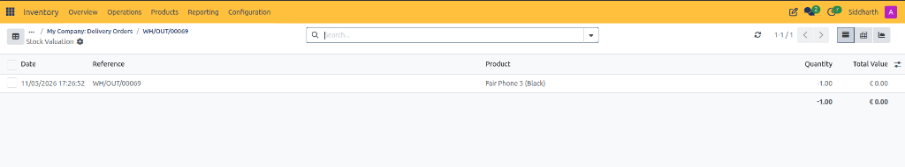

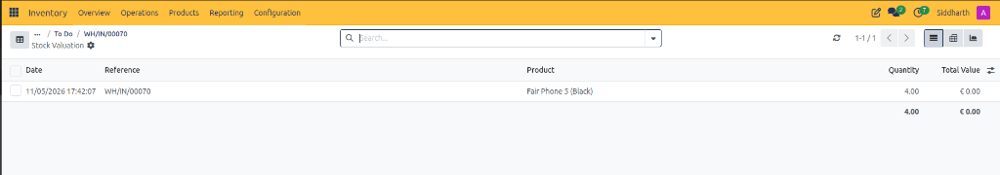

| Field Name / Control | Description |
| :--- | :--- |
| **Checkbox Selector** | Multi-select selector for exporting or auditing specific valuation journal rows. |
| **Date** | Execution timestamp recording when the valuation entry was committed *(e.g., `11/05/2026 17:26:52`, `11/05/2026 17:42:07`)*. |
| **Reference** | Stock transfer reference code linking the valuation entry to its physical picking *(e.g., `WH/OUT/00069`, `WH/IN/00070`)*. |
| **Product** | Catalog item associated with the financial inventory adjustment *(e.g., `Fair Phone 5 (Black)`)*. |
| **Quantity** | Signed quantity delta reflecting net stock impact: negative for customer dispatches *(e.g., `-1.00`)*, positive for vendor receipts *(e.g., `4.00`)*. |
| **Total Value** | Monetary valuation change calculated from unit cost and signed quantity *(e.g., `€ 0.00`)*. |
| **List View Switcher** | Tabular register layout displaying individual transactional valuation records. |
| **Pivot View Switcher** | Multidimensional analysis layout grouping valuation entries by category, date, or warehouse. |
| **Graph View Switcher** | Graphical visualization layout plotting stock valuation movements over time. |

---

### Inventory Reporting Menu Data Dictionary

The Reporting dropdown in the main navigation bar provides analytical access across physical inventory balances, stock movements, and ledger valuations:

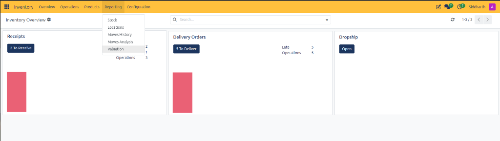

| Field Name / Control | Description |
| :--- | :--- |
| **Reporting Navigation Menu** | Primary application dropdown grouping inventory performance reports. |
| **Stock Option** | Navigation option opening the current stock balance register across warehouse storage bins. |
| **Locations Option** | Navigation option listing inventory counts grouped by physical shelf, transit route, and virtual location. |
| **Moves History Option** | Navigation option opening the comprehensive audit trail of executed double-entry stock transactions. |
| **Moves Analysis Option** | Navigation option providing multi-dimensional pivot reporting on movement velocities and fulfillment throughput. |
| **Valuation Option** | Navigation option opening the master enterprise balance sheet stock valuation ledger. |

---

### Enterprise Stock Valuation Register and Pivot View Data Dictionary

Navigating to **Reporting > Valuation** exposes global inventory asset valuations in tabular and pivot modes:

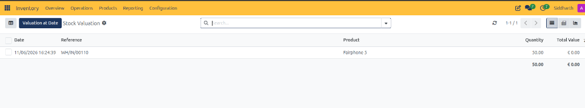

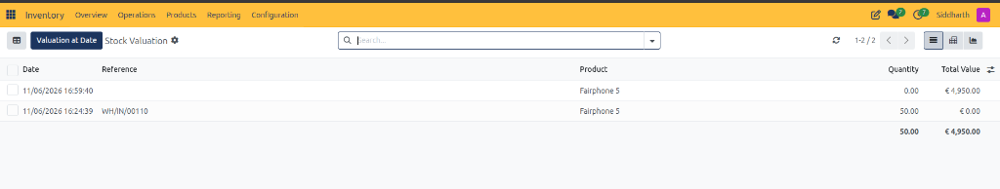

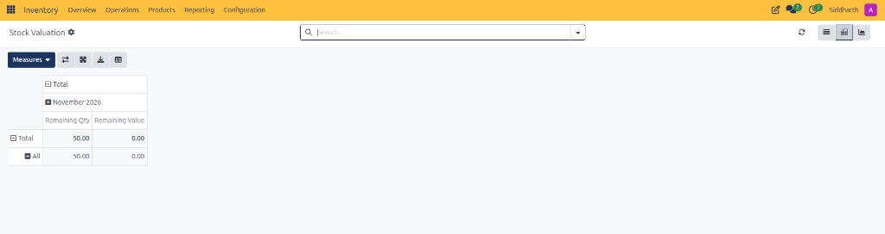

| Field Name / Control | Description |
| :--- | :--- |
| **Stock Valuation Register Header** | Top breadcrumb confirming navigation within the global stock valuation audit ledger. |
| **Valuation at Date Action Button** | Primary execution button opening the historical point-in-time inventory valuation recalculation wizard. |
| **Date Column** | Execution timestamp recording the physical move completion date and time *(e.g., `11/06/2026 16:24:39`, `11/06/2026 16:59:40`)*. |
| **Reference Column** | Transactional document code linking to the originating warehouse receipt or blank for direct cost revaluation adjustments *(e.g., `WH/IN/00110`)*. |
| **Product Column** | Inventory catalog item evaluated *(e.g., `Fairphone 5`)*. |
| **Quantity Column** | Inventory volume delta committed by the transfer *(e.g., `50.00` for physical moves, `0.00` for pure valuation revaluations)*. |
| **Total Value Column** | Balance sheet valuation change calculated from standard or FIFO product costs *(e.g., `€ 4,950.00`)*. |
| **Revaluation Journal Line** | Specialized valuation entry with `0.00` quantity adjusting balance sheet asset value without altering physical bin counts. |
| **Aggregate Valuation Totals Bar** | Summary footer calculating total physical warehouse units and net monetary asset value *(e.g., `50.00` units, `€ 4,950.00`)*. |
| **Pivot Measures Selector** | Analytical dropdown toggling metrics between physical count and financial asset valuation. |
| **Remaining Qty Column** | Pivot table column calculating remaining physical stock units on hand at the close of the period *(e.g., `50.00`)*. |
| **Remaining Value Column** | Pivot table column calculating remaining monetary asset balance at the close of the period *(e.g., `0.00`)*. |
| **Swap Axis Control** | Pivot layout tool interchanging horizontal and vertical grouping dimensions. |
| **Expand and Collapse All Control** | Structural control expanding or minimizing all hierarchical product categories simultaneously. |
| **Download XLSX Control** | Export utility downloading the active valuation pivot grid to a Microsoft Excel spreadsheet. |
| **Insert in Spreadsheet Control** | Collaborative tool embedding the live valuation pivot into an internal CURQ spreadsheet dashboard. |

---

### Valuation at Date Modal Dialog Data Dictionary

Auditors use the Valuation at Date wizard to generate historical asset snapshots:

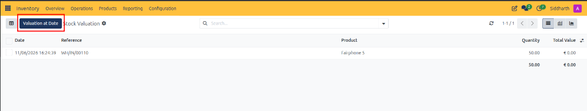

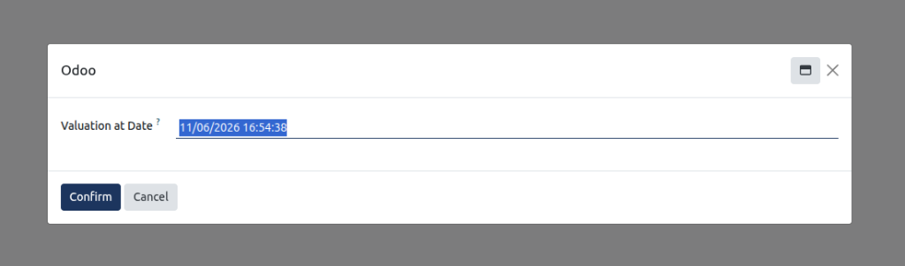

| Field Name / Control | Description |
| :--- | :--- |
| **Valuation at Date Action Button (Header)** | Action button launching the point-in-time valuation calculation interface. |
| **Modal Dialog Header** | Window title identifying the historical valuation configuration popup. |
| **Valuation at Date Datetime Field** | Audit cutoff timestamp selector determining the historical date and time for stock recalculation *(e.g., `11/06/2026 16:54:38`)*. |
| **Confirm Action Button** | Execution button recalculating stock valuation quantities and financial balances as of the selected historical cutoff. |
| **Cancel Action Button** | Dismissal button closing the popup without modifying the real-time valuation display. |
| **Modal Window Management Controls** | Icons allowing users to minimize, maximize, or close the dialog popup. |

---

### Related Documentation

* [Stock Reporting Field Definitions](./13-stock-reporting-field-definitions.md)
* [Track Enterprise Stock Balances and Inventory at Date](../task-guides/13-track-enterprise-stock-balances-and-inventory-at-date.md)
* [Location Reporting Field Definitions](./12-location-reporting-field-definitions.md)
* [Track Inventory by Location and Storage Bins](../task-guides/12-track-inventory-by-location-and-storage-bins.md)
* [Moves History Field Definitions](./11-moves-history-field-definitions.md)
* [Audit Historical Stock Movements in Moves History](../task-guides/11-audit-historical-stock-movements-in-moves-history.md)
* [Moves Analysis and Reporting Field Definitions](./10-moves-analysis-and-reporting-field-definitions.md)
* [Analyze Stock Moves and Warehouse Throughput](../task-guides/10-analyze-stock-moves-and-warehouse-throughput.md)
* [Audit Stock Moves and Inventory Valuation](../task-guides/04-audit-stock-moves-and-inventory-valuation.md)
* [Process Outbound Delivery Orders and Customer Shipments](../task-guides/03-process-outbound-delivery-orders-and-customer-shipments.md)
* [Process Inbound Receipts and Vendor Deliveries](../task-guides/02-process-inbound-receipts-and-vendor-deliveries.md)
* [Fulfill Sales Orders and Process Deliveries](../getting-started/02-fulfill-sales-orders-and-process-deliveries.md)
* [Delivery Order and Outbound Shipping Field Definitions](./03-delivery-order-and-outbound-shipping-field-definitions.md)
* [Receipt and Stock Transfer Field Definitions](./02-receipt-and-stock-transfer-field-definitions.md)
* [Understanding Double-Entry Inventory and Stock Flows](../core-concepts/01-understanding-double-entry-inventory-and-stock-flows.md)
