# Product Catalog and Stock Level Field Definitions

This document provides a comprehensive data dictionary for all header controls, search filters, Kanban cards, list register columns, form action buttons, smart buttons, and General Information fields within the CURQ Inventory product master at **Inventory > Products > Products**.

---

### Product Catalog Header and View Controls Data Dictionary

The catalog control bar provides global search, filtering, pagination, and perspective toggles:

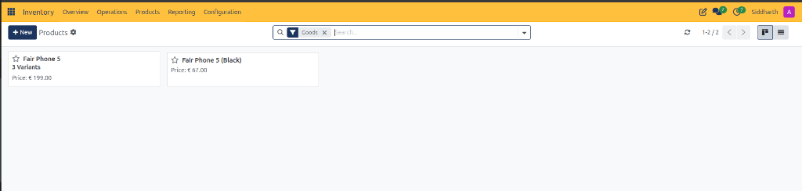

| Field Name / Control | Description |
| :--- | :--- |
| **+ New Action Button** | Primary button opening a blank form to create a new product master record. |
| **Products Header Label** | Active workspace breadcrumb with gear icon for configuring catalog view preferences. |
| **Goods Filter Tag** | Default search filter isolating physical inventory goods and consumable materials from service items. |
| **Search Input Bar** | Keyword search field with dropdown arrow for filtering products by name, reference, or tag. |
| **Refresh Button** | Action button updating live on-hand quantities, price lists, and product listings. |
| **Pagination Counter** | Indicator displaying currently visible products and total record count *(e.g., `1-2/2`)*. |
| **Pager Navigation Chevrons** | Navigation arrows switching between multi-page catalog sets. |
| **Kanban View Switcher** | View mode button displaying products as visual grid cards. |
| **List View Switcher** | View mode button displaying products in a structured tabular register. |

---

### Products Kanban Card Data Dictionary

In Kanban mode, each product is represented as a visual tile summarizing pricing and variant structures:

| Field Name / Control | Description |
| :--- | :--- |
| **Favorite Star** | Interactive toggle bookmarking high-frequency inventory items for rapid filtering. |
| **Product Title** | Primary catalog name assigned to the product *(e.g., `Fair Phone 5`, `Fair Phone 5 (Black)`)*. |
| **Variants Counter** | Badge indicating the quantity of configured product variants *(e.g., `3 Variants`)* based on attributes like color or storage. |
| **Price Indicator** | Configured customer sales price displayed on the card *(e.g., `Price: € 199.00`, `Price: € 67.00`)*. |

---

### Products List Register Data Dictionary

In List mode, CURQ formats product records into tabular columns tracking stock levels and costing metrics:

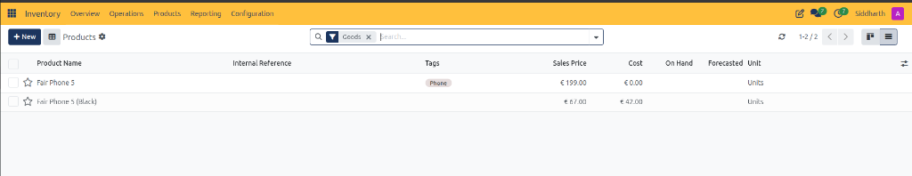

| Field Name / Control | Description |
| :--- | :--- |
| **Batch Selection Checkbox** | Multi-select selector for executing bulk actions such as exporting records or updating categories. |
| **Favorite Star Toggle** | Table column toggle allowing operators to pin favorite products directly in the register. |
| **Product Name** | Catalog description and title of the inventory item *(e.g., `Fair Phone 5`, `Fair Phone 5 (Black)`)*. |
| **Internal Reference** | Enterprise SKU code or internal reference identifier used for scanning and logistics tracking. |
| **Tags** | Categorical labels applied to group products for reporting and search *(e.g., `Phone`)*. |
| **Sales Price** | Base customer selling price before customer-specific discounts or price lists *(e.g., `€ 199.00`, `€ 67.00`)*. |
| **Cost** | Standard cost price or moving average cost used to compute inventory valuation *(e.g., `€ 0.00`, `€ 42.00`)*. |
| **On Hand** | Total physical quantity of product units currently stored in internal warehouse locations. |
| **Forecasted** | Projected inventory quantity calculating on-hand stock plus incoming receipts minus outgoing delivery reservations. |
| **Unit** | Standard Unit of Measure applied to inventory tracking and transactions *(e.g., `Units`)*. |

---

### Product Variants Register and Kanban Cards Data Dictionary

The Product Variants register displays specific product attribute permutations with independent pricing and inventory tracking:

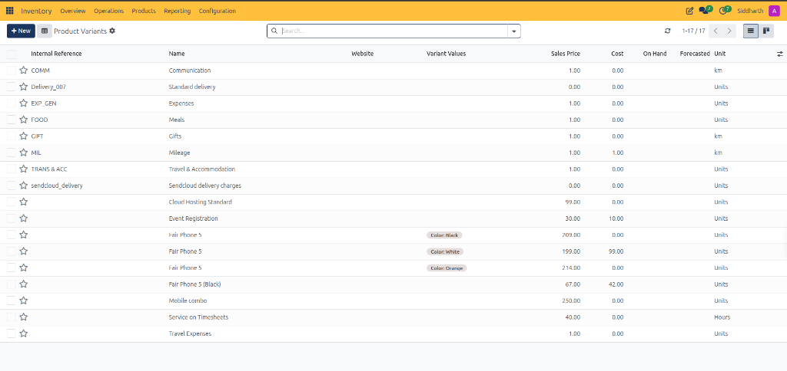

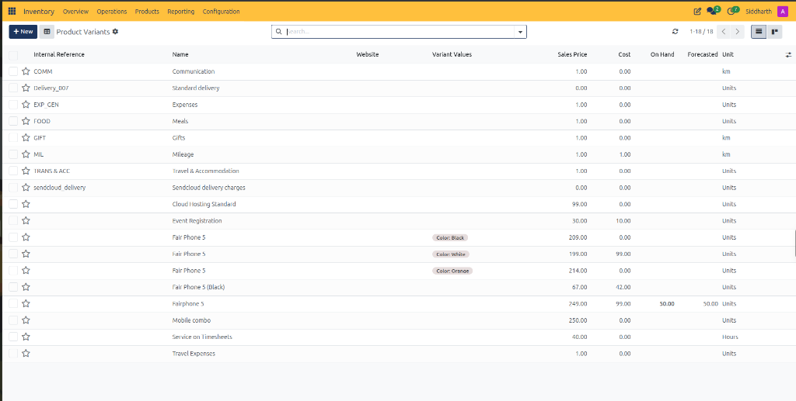

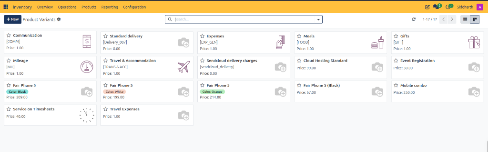

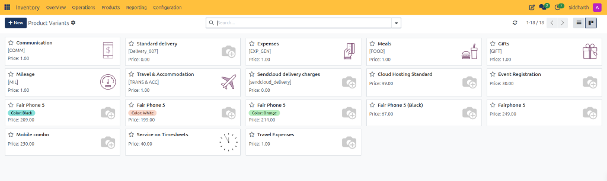

| Field Name / Control | Description |
| :--- | :--- |
| **Internal Reference** | Variant-specific SKU or alphanumeric identifier *(e.g., `COMM`, `Delivery_007`, `EXP_GEN`)*. |
| **Name** | Base catalog product title *(e.g., `Fair Phone 5`, `Standard delivery`)*. |
| **Website** | Designates published visibility in online eCommerce channels. |
| **Variant Values** | Attribute value badges defining the variant *(e.g., `Color: Black`, `Color: White`, `Color: Orange`)*. |
| **Sales Price** | Base customer sales price assigned to this specific attribute combination *(e.g., `€ 209.00`, `€ 199.00`, `€ 214.00`)*. |
| **Cost** | Standard acquisition cost for the specific variant used for stock valuation *(e.g., `€ 99.00`, `€ 42.00`)*. |
| **On Hand** | Measured physical stock balance for this specific variant in warehouse storage. |
| **Forecasted** | Projected inventory availability for this variant factoring in pending receipts and deliveries. |
| **Unit** | Standard Unit of Measure applied to the variant *(e.g., `Units`, `km`, `Hours`)*. |
| **Kanban Card Thumbnail** | Visual icon or product photo representing the variant item. |

---

### Product Master Form Controls and Smart Buttons Data Dictionary

The product master form provides access to replenishment actions, label generation, cross-module links, and operational flags:

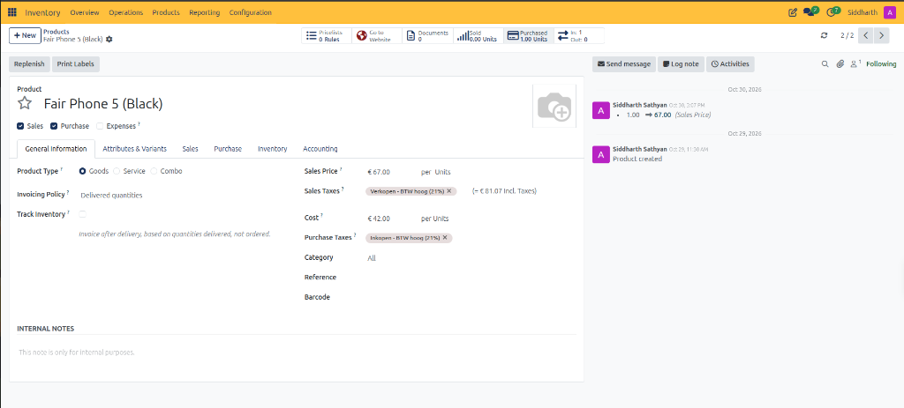

| Field Name / Control | Description |
| :--- | :--- |
| **Replenish Button** | Operational action opening the replenishment modal to manually order stock or configure reordering parameters. |
| **Print Labels Button** | Document generation action producing barcode shelf labels and price tags for retail or warehouse bins. |
| **Pricelists Smart Button** | Navigational button showing customer pricing rules linked to this item *(e.g., `0 Rules`)*. |
| **Go to Website Button** | Relational link navigating to the published eCommerce product page. |
| **Documents Smart Button** | Repository counter tracking attached technical specifications, certifications, and manuals *(e.g., `0`)*. |
| **Sold Counter** | Cumulative historical quantity of units dispatched to customers on validated delivery orders *(e.g., `0.00 Units`)*. |
| **Purchased Counter** | Cumulative historical quantity of units received from suppliers on validated receipts *(e.g., `1.00 Units`)*. |
| **In / Out Flow Indicator** | Dual-arrow indicator summarizing historical intake and dispatch movements *(e.g., `In: 1 / Out: 0`)*. |
| **Sales Checkbox** | Operational scope toggle permitting the product to be quoted and sold on customer sales orders. |
| **Purchase Checkbox** | Operational scope toggle permitting the product to be procured on vendor purchase orders. |
| **Expenses Checkbox** | Operational scope toggle permitting employees to select this item on expense reimbursement claims. |

---

### Product General Information Tab Data Dictionary

The General Information tab defines fundamental logistics classifications, tax profiles, valuation costs, and inventory tracking activation:

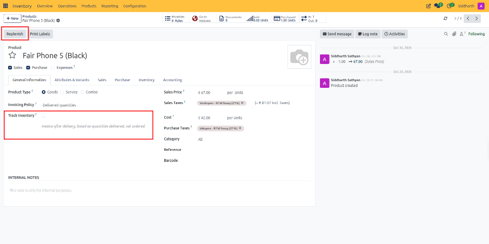

| Field Name / Control | Description |
| :--- | :--- |
| **Product Type** | Classification selector between **Goods** *(tangible physical products)*, **Service** *(non-material labor)*, and **Combo** *(product bundles)*. |
| **Invoicing Policy** | Billing rule governing when invoices are generated; set to **Delivered quantities** to invoice only after physical shipment validation. |
| **Track Inventory** | Checkbox converting physical goods into tracked **Storable Products**. When unchecked, the product is a **Consumable**; when checked, CURQ activates on-hand balances, forecasting, and reordering rules. |
| **Sales Price** | Base customer sales price per unit *(e.g., `€ 67.00 per Units`)* before discounts or customer-specific price rules. |
| **Sales Taxes** | Customer sales tax tags applied automatically to sales quotation lines *(e.g., `Verkopen - BTW hoog (21%)`)*. |
| **Tax-Inclusive Price** | Calculated customer price displaying total amount inclusive of sales taxes *(e.g., `= € 81.07 Incl. Taxes`)*. |
| **Cost** | Standard unit cost price *(e.g., `€ 42.00 per Units`)* applied to calculate automated stock valuation and COGS postings. |
| **Purchase Taxes** | Supplier purchase tax tags applied automatically to vendor purchase order lines *(e.g., `Inkopen - BTW hoog (21%)`)*. |
| **Category** | Product category grouping governing general ledger inventory asset accounts and costing strategies *(e.g., `All`)*. |
| **Reference** | Enterprise SKU or unique alphanumeric product reference code. |
| **Barcode** | Standard optical barcode *(e.g., EAN-13, UPC)* scanned during barcode-assisted picking and receiving. |
| **Internal Notes** | Internal memo field for recording warehouse handling guidance or special storage requirements. |

---

### Product Inventory Tab Data Dictionary

The **Inventory** tab governs procurement routing, fulfillment lead times, virtual counterpart locations, and operational dock instructions:

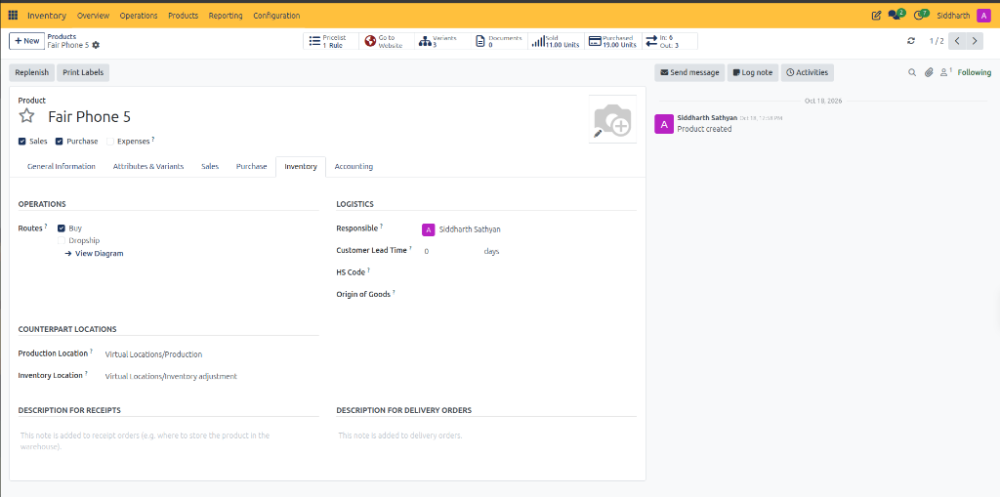

| Field Name / Control | Description |
| :--- | :--- |
| **Buy Route Checkbox** | Operational route instructing replenishment rules to generate draft purchase orders when stock reaches minimum thresholds. |
| **Dropship Route Checkbox** | Operational route fulfilling customer orders directly from vendor locations, bypassing warehouse receiving and putaway. |
| **View Diagram Link** | Interactive link rendering the graphical supply chain route mapping vendor intake, warehouse moves, and customer dispatch. |
| **Responsible** | Assigned warehouse specialist or inventory lead overseeing product availability and storage health. |
| **Customer Lead Time** | Lead time buffer in days *(e.g., `0 days`)* added to sales order confirmation dates to determine scheduled delivery deadlines. |
| **HS Code** | Harmonized System customs classification code applied to international shipping manifests and customs filings. |
| **Origin of Goods** | Country of origin designating product manufacturing location for import and export compliance. |
| **Production Location** | Default virtual counterpart location for manufacturing work orders *(e.g., `Virtual Locations/Production`)*. |
| **Inventory Location** | Default virtual counterpart location for physical stock count adjustments *(e.g., `Virtual Locations/Inventory adjustment`)*. |
| **Description for Receipts** | Automated putaway instructions printed on physical receiving sheets for dock workers. |
| **Description for Delivery Orders** | Automated packaging and handling instructions printed on outbound delivery slips for shipping teams. |
| **Variants Smart Button** | Header navigation control displaying configured product attribute combinations *(e.g., `3 Variants`)*. |
| **Pricelist Smart Button** | Header navigation control displaying customer-specific pricing and discount rules *(e.g., `1 Rule`)*. |

---

### Product Routes Report and Diagram Legend Data Dictionary

Clicking the View Diagram link on the Inventory tab generates the graphical supply chain route mapping:

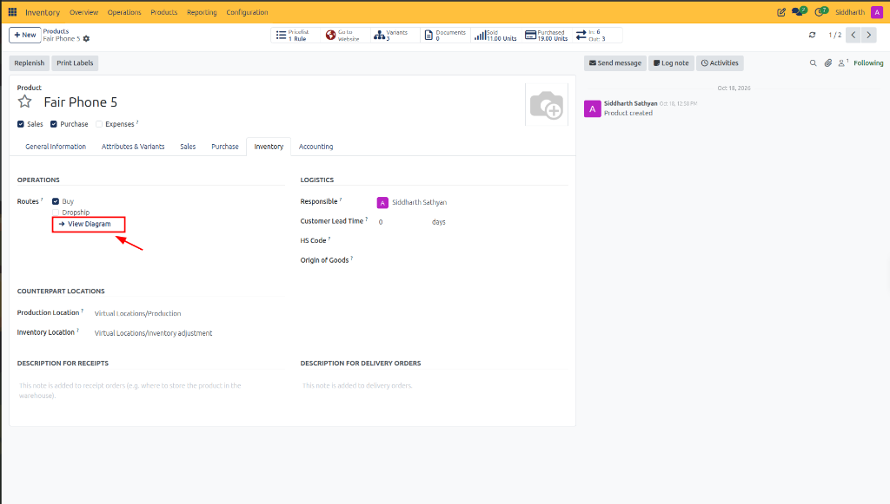

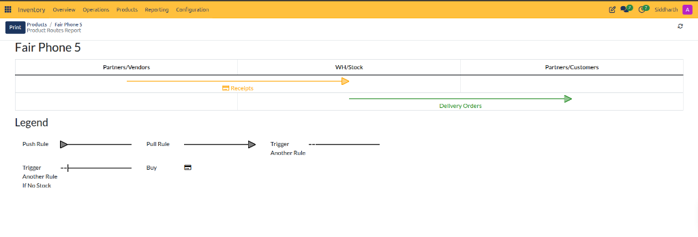

| Field Name / Control | Description |
| :--- | :--- |
| **Print Button (Routes Report)** | Top action button exporting the graphical product route blueprint to a printable PDF document. |
| **Partners/Vendors Location** | External source column representing external supplier and vendor origins. |
| **WH/Stock Location** | Internal warehouse column representing physical on-hand storage and picking bins. |
| **Partners/Customers Location** | External destination column representing customer delivery and dispatch endpoints. |
| **Receipts Flow (Orange Arrow)** | Inbound movement line tracing purchase orders and receiving intake from vendors into warehouse stock. |
| **Delivery Orders Flow (Green Arrow)** | Outbound movement line tracing customer sales orders and picking dispatches from warehouse stock to customers. |
| **Push Rule Legend Symbol** | Flow indicator denoting an automatic forwarding rule triggered immediately upon stock arrival at a location. |
| **Pull Rule Legend Symbol** | Flow indicator denoting a demand-driven fulfillment rule triggered when a destination location requires stock. |
| **Trigger Another Rule Symbol** | Dashed flow line denoting chained multi-step replenishment or manufacturing rules. |
| **Trigger Another Rule If No Stock Symbol** | Exception rule indicator activating secondary procurement when source storage bins have zero available stock. |
| **Buy Action Symbol** | Cart and card icon denoting that the route step triggers automated purchase order generation. |

---

### Related Documentation

* [Manage Product Catalog and Inventory Levels](../task-guides/05-manage-product-catalog-and-inventory-levels.md)
* [Inventory Dashboard and Operation Card Definitions](./01-inventory-dashboard-and-operation-card-definitions.md)
* [Receipt and Stock Transfer Field Definitions](./02-receipt-and-stock-transfer-field-definitions.md)
* [Delivery Order and Outbound Shipping Field Definitions](./03-delivery-order-and-outbound-shipping-field-definitions.md)
* [Detailed Operations and Stock Valuation Field Definitions](./04-detailed-operations-and-stock-valuation-field-definitions.md)
* [Understanding Reordering Rules and Lead Times](../core-concepts/02-understanding-reordering-rules-and-lead-times.md)
