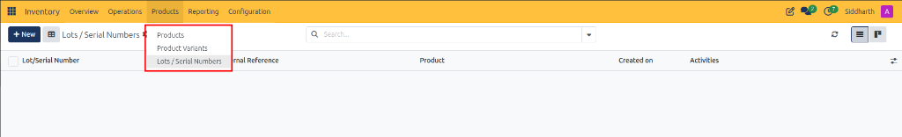
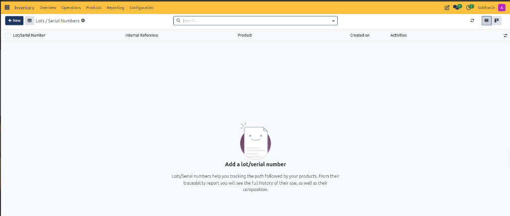
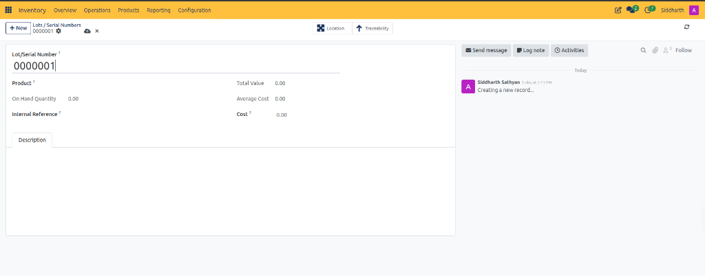

# Lot and Serial Number Field Definitions

This document provides a comprehensive data dictionary for the Products navigation dropdown, the Lots / Serial Numbers register, and the Lot / Serial Number master form within CURQ Inventory at **Inventory > Products > Lots / Serial Numbers**.

---

### Products Navigation Dropdown Data Dictionary

The Products menu provides access to primary catalog entities, variants, and serialized tracking records:

| Field Name / Control | Description |
| :--- | :--- |
| **Products Menu Link** | Navigational link opening the primary catalog of inventory goods and consumables. |
| **Product Variants Menu Link** | Navigational link opening the complete list of individual product attribute combinations. |
| **Lots / Serial Numbers Menu Link** | Navigational link opening the serialized traceability and batch tracking register. |

---

### Lots / Serial Numbers Register Data Dictionary

The Lots / Serial Numbers register tracks all unique product tracking entities across the enterprise:

| Field Name / Control | Description |
| :--- | :--- |
| **+ New Action Button** | Primary action button opening a blank form to manually create or pre-allocate a serial or lot number. |
| **Lot/Serial Number Column** | Alphanumeric code uniquely identifying the specific physical unit or production batch. |
| **Internal Reference Column** | Internal manufacturer part number, supplier batch code, or alternate SKU reference. |
| **Product Column** | Relational link displaying the catalog item associated with this tracking number. |
| **Created on Column** | Timestamp recording when the lot or serial number record was first registered in the system. |
| **Activities Column** | Next planned activity, audit task, or quality inspection scheduled for this tracking record. |
| **Search Input Bar** | Keyword filter input enabling operators to search serial numbers across all products and batches. |
| **List View Switcher** | View mode toggle displaying lots and serial numbers in a tabular register. |
| **Kanban View Switcher** | View mode toggle displaying lots and serial numbers as visual grid tiles. |

---

### Lot / Serial Number Form View Data Dictionary

The form view defines product associations, valuation balances, location tracking, and traceability reports:

| Field Name / Control | Description |
| :--- | :--- |
| **Lot/Serial Number** | Mandatory unique string identifying the item *(e.g., `0000001`)*; must be populated to save the record. |
| **Product** | Mandatory relational field selecting the inventory item associated with this identifier *(e.g., `Fair Phone 5`)*. |
| **On Hand Quantity** | Read-only inventory counter displaying the current physical units present in warehouse storage; updates automatically upon transfer validation. |
| **Internal Reference** | Optional secondary identification code, supplier lot number, or internal tracking label. |
| **Total Value** | Read-only financial metric displaying the current balance sheet valuation of on-hand units for this serial. |
| **Average Cost** | Read-only metric calculating the moving average inventory valuation cost per unit for this lot. |
| **Cost** | Standard cost price per unit used for inventory asset accounting and COGS calculations. |
| **Description Tab** | Notebook tab containing a freeform text area for recording batch quality certificates, supplier notes, or storage instructions. |
| **Location Smart Button** | Header navigation control displaying the specific internal warehouse storage bin or shelf where this unit is located. |
| **Traceability Smart Button** | Header navigation control generating the full upstream and downstream movement report across purchase orders, receipts, and delivery orders. |

---

### Related Documentation

* [Manage Lot and Serial Number Traceability](../task-guides/06-manage-lot-and-serial-number-traceability.md)
* [Manage Product Catalog and Inventory Levels](../task-guides/05-manage-product-catalog-and-inventory-levels.md)
* [Product Catalog and Stock Level Field Definitions](./05-product-catalog-and-stock-level-field-definitions.md)
* [Detailed Operations and Stock Valuation Field Definitions](./04-detailed-operations-and-stock-valuation-field-definitions.md)
* [Understanding Double-Entry Inventory and Stock Flows](../core-concepts/01-understanding-double-entry-inventory-and-stock-flows.md)

