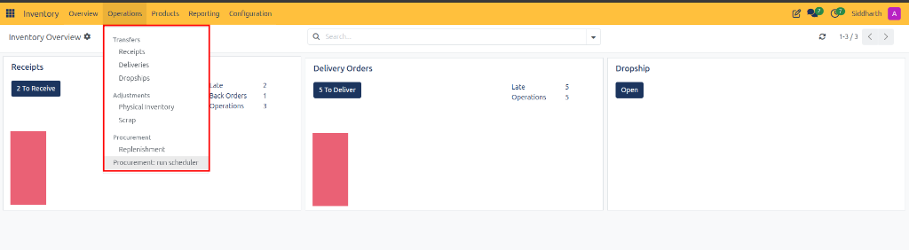
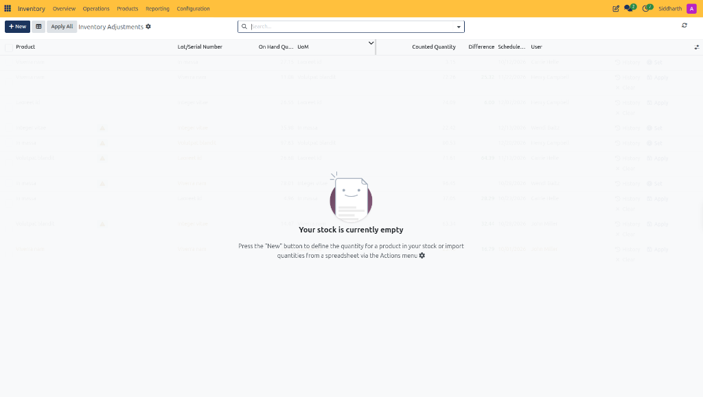

# Operations Menu and Physical Inventory Field Definitions

This document provides a comprehensive data dictionary for the top Operations navigation dropdown and the Physical Inventory Adjustments register within CURQ Inventory at **Inventory > Operations > Physical Inventory**.

---

### Operations Menu and Navigation Structure Data Dictionary

The Operations dropdown organizes warehouse operations into transfers, stock adjustments, and replenishment:

| Field Name / Control | Description |
| :--- | :--- |
| **Transfers Header** | Section grouping primary physical stock movements between warehouses, vendors, and customers. |
| **Receipts Link** | Navigation link opening the inbound vendor delivery register. |
| **Deliveries Link** | Navigation link opening the outbound customer fulfillment register. |
| **Dropships Link** | Navigation link opening the direct vendor-to-customer transfer queue. |
| **Adjustments Header** | Section grouping stock counting, cycle audits, and inventory write-offs. |
| **Physical Inventory Link** | Navigation link opening the cycle count audit and stock adjustment register. |
| **Scrap Link** | Navigation link opening the damaged, expired, or obsolete stock disposal register. |
| **Procurement Header** | Section grouping reordering rules and supply scheduling engines. |
| **Replenishment Link** | Navigation link opening the automated and manual reordering evaluation board. |
| **Procurement: run scheduler** | Immediate execution action triggering background automated purchase order and stock move calculations. |

---

### Physical Inventory Adjustments Register Data Dictionary

The Physical Inventory Adjustments register itemizes theoretical stock balances, counted quantities, and reconciliation actions:

| Field Name / Control | Description |
| :--- | :--- |
| **+ New Action Button** | Top action button inserting a new manual cycle count line for an individual product and location. |
| **Apply All Button** | Top execution button committing all pending cycle count variances simultaneously across all audited rows. |
| **Batch Selection Checkbox** | Multi-select selector for flagging multiple adjustment lines for batch updates or exports. |
| **Product Column** | Catalog item name and specification being audited during the physical inventory count. |
| **Lot/Serial Number Column** | Specific tracking identifier for items managed by lot batches or unique serial numbers. |
| **On Hand Quantity Column** | Theoretical stock balance calculated by CURQ from cumulative historical transfers. |
| **Unit of Measure (UoM)** | Measurement unit applied to the product quantity *(e.g., `Units`)*. |
| **Counted Quantity Column** | Editable field capturing the actual physical quantity counted on shelves by the audit team. |
| **Difference Column** | Calculated variance reflecting surplus *(positive value)* or shrinkage *(negative value)*. |
| **Scheduled Date Column** | Planned target date for completing the physical inventory audit task. |
| **User Column** | Assigned warehouse specialist or inventory auditor responsible for the cycle count. |
| **Apply Action Control** | Row-level action button committing the specific stock variance and updating on-hand inventory balances. |
| **Set Action Control** | Row-level action button setting the counted quantity to equal theoretical on-hand quantity, confirming zero variance. |
| **Clear Action Control** | Row-level action button resetting the counted quantity entry to zero or blank. |
| **History Action Control** | Row-level navigation link opening the historical log of past inventory adjustments for this product. |

---

### Related Documentation

* [Conduct Physical Inventory Counts and Adjustments](../task-guides/07-conduct-physical-inventory-counts-and-adjustments.md)
* [Scrap Order Field Definitions](./08-scrap-order-field-definitions.md)
* [Replenishment and Reordering Rules Field Definitions](./09-replenishment-and-reordering-rules-field-definitions.md)
* [Inventory Dashboard and Operation Card Definitions](./01-inventory-dashboard-and-operation-card-definitions.md)
* [Manage Lot and Serial Number Traceability](../task-guides/06-manage-lot-and-serial-number-traceability.md)
* [Lot and Serial Number Field Definitions](./06-lot-and-serial-number-field-definitions.md)
* [Understanding Double-Entry Inventory and Stock Flows](../core-concepts/01-understanding-double-entry-inventory-and-stock-flows.md)

