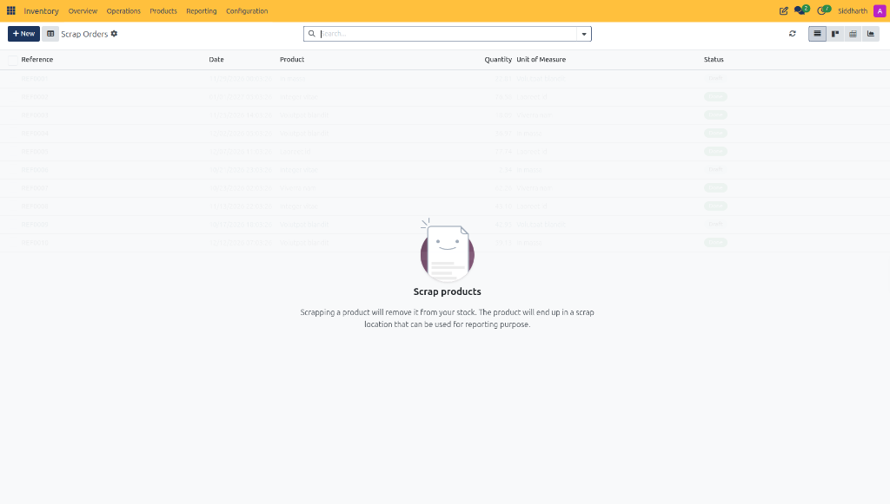
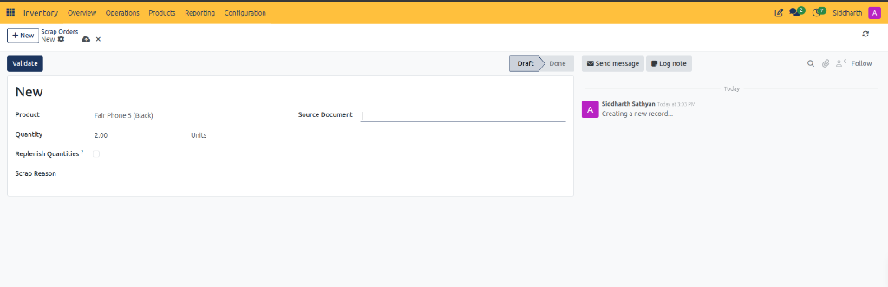
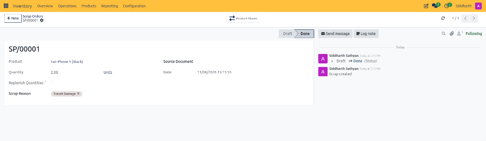
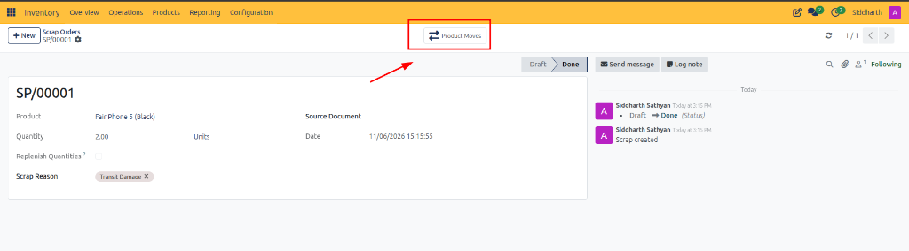
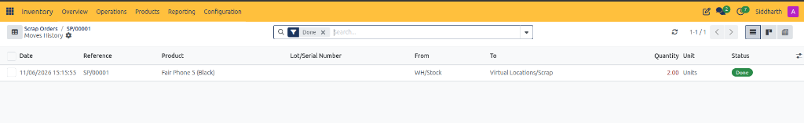
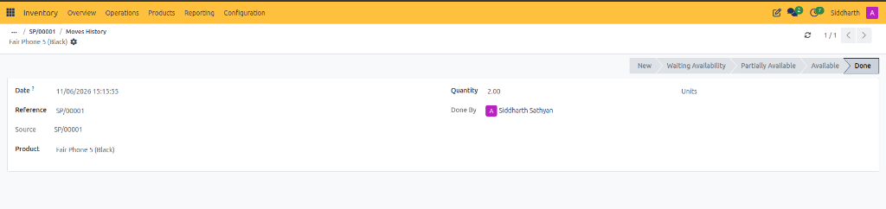

# Scrap Order Field Definitions

This document provides a comprehensive data dictionary for all list register columns, header action controls, form fields, validated state controls, moves history registers, and stock move records within the CURQ Inventory Scrap Orders module at **Inventory > Operations > Scrap**.

---

### Scrap Orders Register Data Dictionary

The Scrap Orders register itemizes all historical and active stock write-offs:

| Field Name / Control | Description |
| :--- | :--- |
| **+ New Action Button** | Primary action button opening a blank form to create a new scrap disposal order. |
| **Reference Column** | Unique alphanumeric identifier assigned to the scrap order upon creation *(e.g., `REF0001`, `SP/00001`)*. |
| **Date Column** | Timestamp recording the date and time when the scrap transaction was initiated or executed. |
| **Product Column** | Relational link displaying the catalog item written off to scrap. |
| **Quantity Column** | Numeric count of units discarded from inventory. |
| **Unit of Measure Column** | Standard measurement unit applied to the scrapped product quantity *(e.g., `Units`, `kg`)*. |
| **Status Column** | Operational lifecycle stage badge (*Draft*, *Done*). |
| **List View Switcher** | Tabular layout displaying individual scrap transactions in rows. |
| **Kanban View Switcher** | Card layout displaying scrap orders as visual tiles. |
| **Pivot View Switcher** | Analytical multidimensional grid grouping scrap volumes by product, date, or category. |
| **Graph View Switcher** | Graphical chart plotting scrap loss trends over time. |

---

### Scrap Order Form Fields and Action Controls Data Dictionary

The Scrap Order form captures product specifications, disposal quantities, replenishment triggers, and scrap justifications:

| Field Name / Control | Description |
| :--- | :--- |
| **Validate Action Button** | Primary execution button committing the scrap write-off, removing stock from storage, and posting valuation entries. |
| **Status Chevron Bar** | Sequential stage tracker displaying progression from active **Draft** to completed **Done**. |
| **Product** | Mandatory relational field selecting the inventory catalog item to be scrapped *(e.g., `Fair Phone 5 (Black)`)*. |
| **Quantity** | Mandatory numeric field specifying the exact number of units to be deducted from stock *(e.g., `2.00`)*. |
| **Unit of Measure Label** | Display label showing the primary unit of measure associated with the product *(e.g., `Units`)*. |
| **Replenish Quantities Checkbox** | Optional toggle instructing CURQ replenishment rules to automatically reorder replacement stock for the scrapped units. |
| **Scrap Reason** | Optional descriptive field or dropdown recording the root cause of the write-off *(such as transit damage, defect, or expiration)*. |
| **Source Document** | Optional reference field linking the write-off to an originating transfer *(e.g., `WH/IN/00070`)* or quality ticket. |

---

### Validated Scrap Order and Smart Controls Data Dictionary

Following validation, CURQ freezes operational parameters, logs immutable timestamps, and exposes relational move buttons:

| Field Name / Control | Description |
| :--- | :--- |
| **Order Reference Title** | System-generated tracking code assigned upon validation *(e.g., `SP/00001`)*. |
| **Product Moves Smart Button** | Header navigation control displaying the balanced double-entry stock moves generated by the write-off. |
| **Done Status Chevron** | Terminal stage indicator confirming inventory has been deducted from storage. |
| **Execution Date** | Immutable timestamp recording when physical stock was written off *(e.g., `11/06/2026 15:15:55`)*. |
| **Scrap Reason Tag** | Removable badge recording verified cause of scrap *(e.g., `Transit Damage`)*. |

---

### Scrap Moves History Register Data Dictionary

Clicking the Product Moves smart button opens the Moves History register itemizing source and destination coordinates:

| Field Name / Control | Description |
| :--- | :--- |
| **Date Column** | Timestamp of physical movement execution *(e.g., `11/06/2026 15:15:55`)*. |
| **Reference Column** | Transactional reference code linking to scrap record `SP/00001`. |
| **Product Column** | Specific catalog item transferred *(e.g., `Fair Phone 5 (Black)`)*. |
| **Lot/Serial Number Column** | Tracking identifier if the scrapped item is managed by lots or serial numbers. |
| **From Column** | Source warehouse location decremented during write-off *(e.g., `WH/Stock`)*. |
| **To Column** | Virtual destination location credited during write-off *(e.g., `Virtual Locations/Scrap`)*. |
| **Quantity Column** | Stock quantity deducted, styled in red text *(e.g., `2.00 Units`)* to indicate inventory reduction. |
| **Status Column** | Finalized execution badge (*Done*). |

---

### Stock Move Record Form Data Dictionary

Drilling down into an individual move row displays detailed operational accountability:

| Field Name / Control | Description |
| :--- | :--- |
| **Move Status Pipeline** | Chevron progression tracking stages across **New**, **Waiting Availability**, **Partially Available**, **Available**, and **Done**. |
| **Date Field** | Execution timestamp matching the scrap order completion date. |
| **Reference Field** | Unique identifier for this individual stock transfer *(e.g., `SP/00001`)*. |
| **Source Field** | Originating business document triggering the physical movement. |
| **Product Field** | Catalog description of the material transferred. |
| **Quantity Field** | Exact unit count moved between locations *(e.g., `2.00 Units`)*. |
| **Done By Field** | User identity logging the warehouse operator who validated the move. |

---

### Related Documentation

* [Process Scrap Orders and Inventory Write-Offs](../task-guides/08-process-scrap-orders-and-inventory-write-offs.md)
* [Replenishment and Reordering Rules Field Definitions](./09-replenishment-and-reordering-rules-field-definitions.md)
* [Conduct Physical Inventory Counts and Adjustments](../task-guides/07-conduct-physical-inventory-counts-and-adjustments.md)
* [Operations Menu and Physical Inventory Field Definitions](./07-operations-menu-and-physical-inventory-field-definitions.md)
* [Detailed Operations and Stock Valuation Field Definitions](./04-detailed-operations-and-stock-valuation-field-definitions.md)
* [Understanding Double-Entry Inventory and Stock Flows](../core-concepts/01-understanding-double-entry-inventory-and-stock-flows.md)
