# Replenishment and Reordering Rules Field Definitions

This document provides a comprehensive data dictionary for all list register columns, header action controls, navigation drawers, row-level action controls, batch execution options, and safety stock curve parameters within the CURQ Inventory Replenishment module at **Inventory > Operations > Replenishment**.

---

### Replenishment Board Header and Navigation Controls Data Dictionary

The header and filter drawer provide controls to search, filter planning horizons, and switch display modes across replenishment propositions:

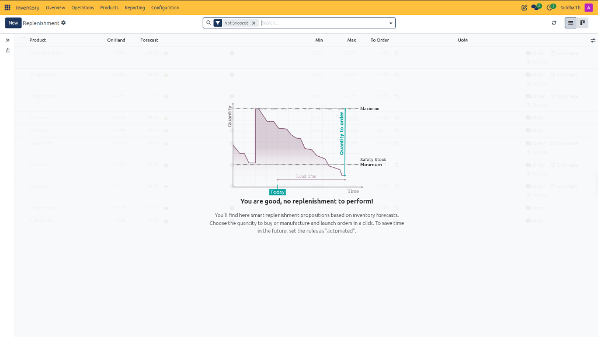

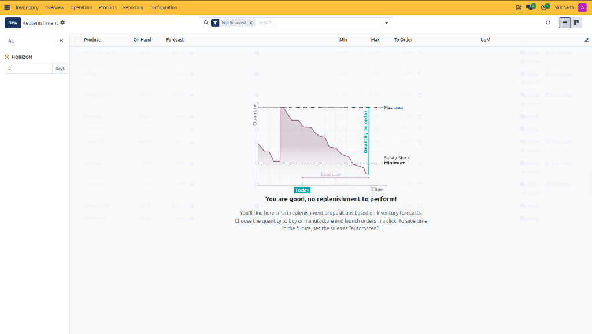

| Field Name / Control | Description |
| :--- | :--- |
| **+ New Action Button** | Action button creating a custom manual reordering rule for a specified product and location. |
| **Replenishment Board Title** | Module header indicating active navigation within the procurement replenishment register. |
| **Settings Gear Icon** | Configuration control allowing administrative users to customize default list views, reordering automation parameters, and scheduled actions. |
| **Search Bar** | Keyword lookup field to filter replenishment lines by product name, SKU reference, or category. |
| **Not Snoozed Filter Tag** | Default filter tag active in the search bar that excludes deferred or snoozed replenishment lines from the active view. |
| **Horizon Drawer Toggle** | Navigation control located at the top-left of the board that expands or collapses the left filter drawer. |
| **HORIZON Filter Control** | Forward planning filter *(e.g., `0 days`)* defining the time window used to project customer demand, delivery orders, and incoming receipts. |
| **TRIGGER Filter Control** | Categorical filter distinguishing between **Manual** rules requiring buyer review and **Automated** rules managed by the system scheduler. |
| **CATEGORY Filter Control** | Multiselect filter grouping replenishment propositions by product category. |
| **Refresh Action Control** | Circular icon recalculating real-time stock balances and updating proposition lines. |
| **List View Switcher** | Tabular layout displaying replenishment propositions in structured rows with granular stock metrics. |
| **Kanban View Switcher** | Card layout presenting replenishment requirements as visual cards grouped by category or priority. |

---

### Search: Product Lookup Modal Data Dictionary

Clicking **+ New** on the Replenishment board and selecting **Search More...** opens the filtered product selection dialog:

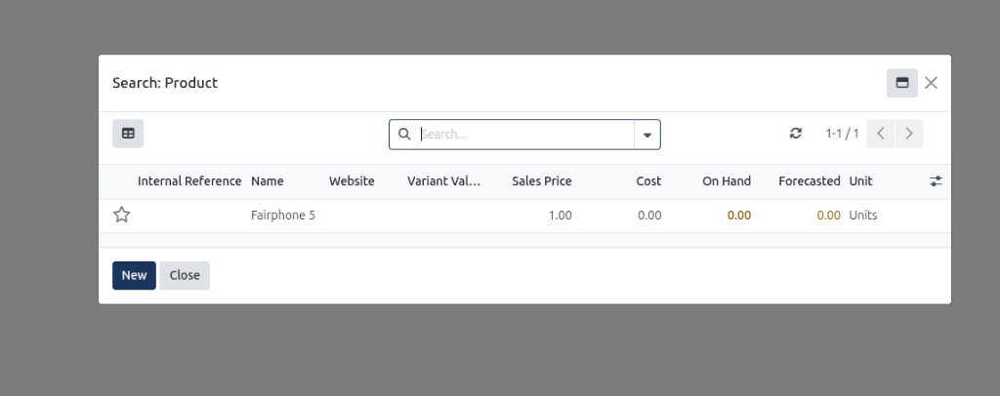

| Field Name / Control | Description |
| :--- | :--- |
| **Search: Product Modal Title** | Dialog banner indicating an active product lookup filtered for procurement reordering rules. |
| **Modal Search Input Bar** | Keyword search box to query products by internal reference, name, or barcode. |
| **Table View Switcher** | Grid layout icon displaying search results in structured tabular format. |
| **Internal Reference Column** | Alphanumeric enterprise SKU identifier assigned to the product variant. |
| **Name Column** | Primary catalog title of the inventory item *(e.g., `Fairphone 5`)*. |
| **Website Column** | Relational link showing online eCommerce availability. |
| **Variant Values Column** | Specific attribute combination tags distinguishing variant permutations. |
| **Sales Price Column** | Standard customer selling price configured for the item *(e.g., `1.00`)*. |
| **Cost Column** | Standard or moving average cost price used for valuation accounting *(e.g., `0.00`)*. |
| **On Hand Column** | Real-time physical inventory count stored in internal warehouse locations *(e.g., `0.00`)*. |
| **Forecasted Column** | Projected inventory availability after factoring in scheduled receipts and dispatches *(e.g., `0.00`)*. |
| **Unit Column** | Primary unit of measure applied to inventory tracking *(e.g., `Units`)*. |
| **New Action Button** | Primary modal button enabling operators to create a brand-new product record on the fly. |
| **Close Action Button** | Dismissal button closing the lookup modal without making a product selection. |

---

### Replenishment Table Columns Data Dictionary

The table grid displays real-time stock metrics, safety limits, and calculated procurement recommendations:

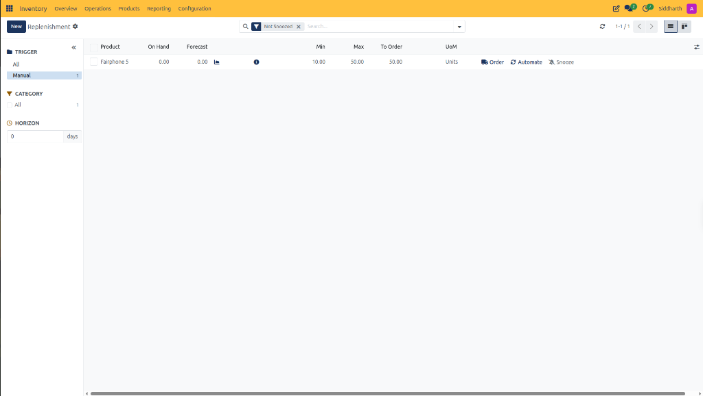

| Field Name / Control | Description |
| :--- | :--- |
| **Row Selection Checkbox** | Checkbox enabling single or multiple row selection to activate batch replenishment action controls. |
| **Product Column** | Relational link displaying the catalog item name requiring inventory replenishment *(e.g., `Fairphone 5`)*. |
| **On Hand Column** | Real-time physical inventory quantity currently stored within internal warehouse locations *(e.g., `0.00`)*. |
| **Forecast Column** | Projected inventory quantity calculating on-hand stock plus incoming receipts minus outbound sales reservations *(e.g., `0.00`)*. |
| **Forecast Origin Icon** | Visual indicator *(such as a factory or truck icon)* signifying whether projected replenishment originates from purchasing or manufacturing routes. |
| **Min Column** | Minimum safety stock threshold configured for the item *(e.g., `10.00`)* below which automated or manual reordering triggers. |
| **Max Column** | Maximum target stock capacity ceiling configured for the item *(e.g., `50.00`)* defining the upper replenishment limit. |
| **To Order Column** | Recommended quantity to purchase or manufacture *(e.g., `50.00`)* to return projected stock levels to the configured maximum limit. |
| **Recalculate Order Quantity Icon** | Circular control next to the order value that refreshes the calculation against the latest live demand entries. |
| **Unit of Measure (UoM) Column** | Standard unit applied to the product inventory count *(e.g., `Units`)*. |

---

### Row-Level Action Controls Data Dictionary

Each row in the replenishment register exposes dedicated action buttons for rapid execution without navigating away from the board:

| Field Name / Control | Description |
| :--- | :--- |
| **Order Action Control (Truck Icon)** | Immediate trigger generating a procurement document *(such as a draft Purchase Order or Manufacturing Order)* for the specified `To Order` quantity. |
| **Automate Action Control (Cycle Icon)** | Configuration toggle converting the rule from manual review to automated background scheduler execution. |
| **Snooze Action Control (Bell Icon)** | Postponement control temporarily hiding the replenishment proposition from the active register until a defined future date. |

---

### Batch Replenishment Selection Bar and Actions Data Dictionary

Selecting one or more line checkboxes activates the batch action bar for high-volume procurement:

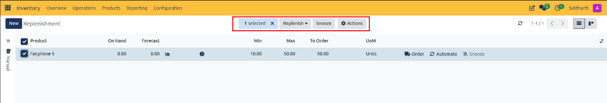

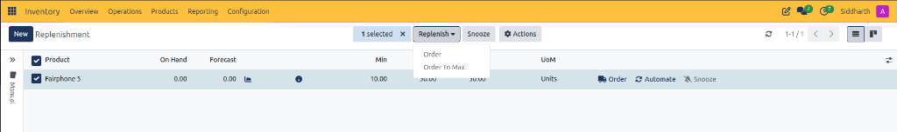

| Field Name / Control | Description |
| :--- | :--- |
| **Selection Counter and Dismiss Control** | Visual badge displaying total selected records *(e.g., `1 selected`)* with an `x` button to clear selection. |
| **Replenish Dropdown Action Button** | Primary batch action control opening execution options for selected replenishment lines. |
| **Order Dropdown Option** | Batch procurement action placing orders for the exact quantities currently displayed in the `To Order` column. |
| **Order To Max Dropdown Option** | Batch procurement action recalculating live demand at runtime to raise total forecasted stock exactly to each item's configured `Max` ceiling. |
| **Snooze Batch Action Button** | Mass postponement control snoozing all selected replenishment propositions simultaneously. |
| **Actions Menu Control** | Contextual dropdown providing administrative tools such as exporting replenishment records to external spreadsheet formats. |

---

### Procurement Warning Dialog Data Dictionary

When automated purchase order generation encounters vendor pricing discrepancies, CURQ displays a modal blocking action:

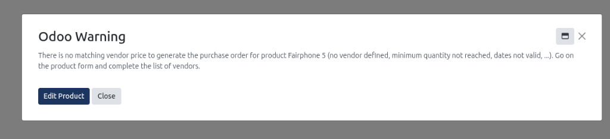

| Field Name / Control | Description |
| :--- | :--- |
| **Warning Dialog Header** | Modal notification banner signaling an unmet procurement constraint *(e.g., `Odoo Warning`)*. |
| **Warning Explanation Text** | Diagnostic message identifying the root cause of the order failure *(such as no vendor defined, minimum quantity not reached, or invalid agreement dates)*. |
| **Edit Product Action Button** | Primary navigational button redirecting directly to the product form's Purchase tab to resolve supplier pricing or quantity rules. |
| **Close Action Button** | Secondary dismissal control closing the warning modal and returning to the replenishment board without generating orders. |
| **Modal Window Controls** | Window management icons allowing users to minimize or close the dialog popup. |

---

### Product Purchase Tab and Vendor Pricelist Data Dictionary

Navigating to the product form from replenishment displays vendor agreements, bill matching rules, and lead times:

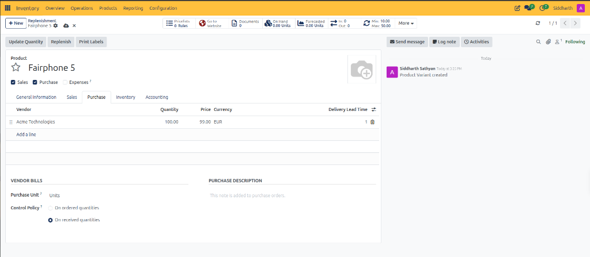

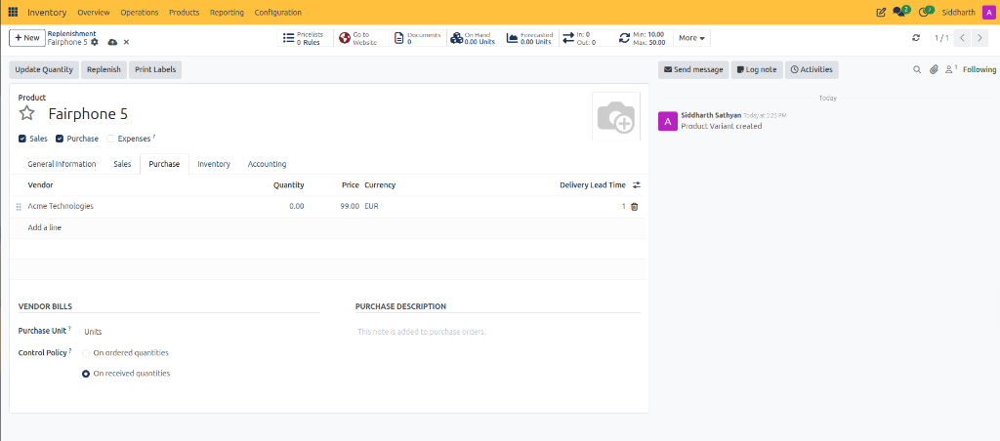

| Field Name / Control | Description |
| :--- | :--- |
| **Replenishment Product Breadcrumb** | Hierarchical navigation trail linking back to the originating replenishment proposition register. |
| **Reordering Rule Smart Button (Min / Max)** | Upper control panel indicator displaying active threshold constraints *(e.g., `Min: 10.00 / Max: 50.00`)*. |
| **Update Quantity Action Button** | Header button allowing manual adjustments to warehouse on-hand inventory levels. |
| **Replenish Action Button** | Direct procurement trigger initiating a one-off stock replenishment for the product. |
| **Print Labels Action Button** | Barcode generation utility printing product and shelf identification tags. |
| **Purchase Notebook Tab** | Dedicated configuration tab housing supplier pricelists, vendor bill matching rules, and procurement descriptions. |
| **Vendor Column** | Relational link selecting the partner organization supplying the product *(e.g., `Acme Technologies`)*. |
| **Minimum Quantity Column** | Threshold value specifying the minimum order volume required by the supplier to honor the agreed price *(e.g., `100.00`)*. |
| **Contracted Price Column** | Unit purchase cost agreed upon with the supplier *(e.g., `99.00`)*. |
| **Currency Selector Column** | Transaction currency applied to vendor procurement orders *(e.g., `EUR`)*. |
| **Delivery Lead Time Column** | Estimated duration in days required by the vendor to deliver goods following order placement *(e.g., `1` day)*. |
| **Delete Vendor Row Icon** | Trash can icon removing an obsolete or unapproved supplier pricelist line. |
| **Add a line Action Control** | Table control creating a new supplier tier or secondary vendor sourcing agreement. |
| **Purchase Unit of Measure Field** | Specific measurement unit used when ordering goods from suppliers *(e.g., `Units`)*. |
| **Control Policy Radio** | Bill matching rule selecting between **On ordered quantities** and **On received quantities** (enforcing 3-way matching against warehouse receipts). |
| **Purchase Description Field** | Text area for internal instructions or vendor notes appended automatically to outbound purchase orders. |

---

### Replenishment Toast Notification and Post-Execution Board State Data Dictionary

Following order execution, CURQ renders confirmation notifications and updates stock projections in place:

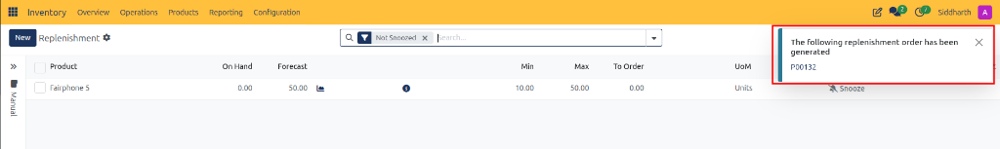

| Field Name / Control | Description |
| :--- | :--- |
| **Replenishment Toast Banner** | Upper-right confirmation popup announcing successful order issuance. |
| **Order Reference Hyperlink** | Clickable identifier *(e.g., `P00132`)* navigating directly to the generated RFQ record in CURQ Purchase. |
| **Dismiss Toast Control** | Close icon dismissing the notification banner from view. |
| **Updated Forecast Metric** | Dynamic table column updating to reflect incoming units from the generated purchase order *(e.g., `50.00`)*. |
| **Updated To Order Metric** | Dynamic table column resetting to `0.00` once the replenishment shortfall is resolved. |
| **Post-Execution Row Action Controls** | Dynamic button states hiding the `Order` and `Automate` buttons while retaining `Snooze` when demand is satisfied. |

---

### Generated Request for Quotation (RFQ) Data Dictionary

Clicking the generated order reference opens the procurement order in the CURQ Purchase module:

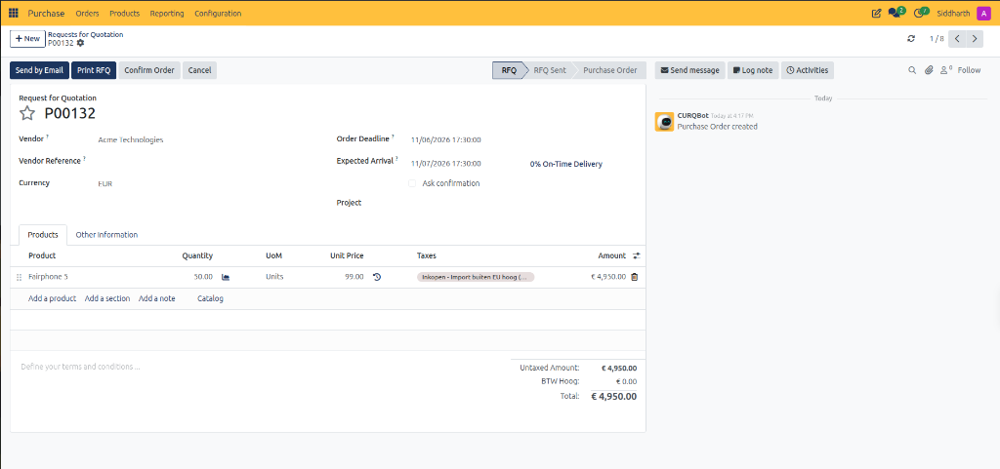

| Field Name / Control | Description |
| :--- | :--- |
| **RFQ Document Identifier** | Alphanumeric purchase document code assigned upon replenishment generation *(e.g., `P00132`)*. |
| **RFQ Lifecycle Chevron Bar** | Sequential stage tracker documenting progress across **RFQ**, **RFQ Sent**, and **Purchase Order**. |
| **Send by Email Action Button** | Communication control emailing the RFQ document directly to the supplier. |
| **Print RFQ Action Button** | Document export action downloading a formal quotation request PDF. |
| **Confirm Order Action Button** | Primary commitment button converting the RFQ into an approved Purchase Order and creating inbound dock receipts. |
| **Cancel Action Button** | Abort control canceling the draft procurement request without inventory impact. |
| **Vendor Field** | Relational link displaying the contracted supplier selected by the replenishment engine *(e.g., `Acme Technologies`)*. |
| **Order Deadline Field** | Target date and time by which the purchase order should be confirmed with the vendor *(e.g., `11/06/2026 17:30:00`)*. |
| **Expected Arrival Field** | Estimated delivery timestamp factoring in vendor transit lead time *(e.g., `11/07/2026 17:30:00`)*. |
| **On-Time Delivery Rate** | Performance metric tracking historical vendor delivery punctuality *(e.g., `0% On-Time Delivery`)*. |
| **Products Line Items Grid** | Itemized procurement table displaying product name, quantity, unit of measure, price, and subtotal. |
| **Order Quantity Metric** | Required replenishment volume populated directly from the reordering rule deficit *(e.g., `50.00 Units`)*. |
| **Unit Price Field** | Agreed purchase cost per unit drawn from the approved vendor pricelist *(e.g., `99.00 EUR`)*. |
| **Taxes Selector** | Applicable import or VAT tax classification tags. |
| **Line Subtotal Amount** | Line-item procurement cost calculation *(e.g., `€ 4,950.00`)*. |
| **Untaxed and Total Financial Balances** | Computed balance sheet commitment figures displayed in the lower-right summary. |
| **Autonomous Bot Chatter Log** | Automated system audit trail logging document creation by the replenishment scheduler. |

---

### Forecasted Report Header and Metric Controls Data Dictionary

Clicking the graph drilldown icon next to the Forecast value opens the dynamic inventory projection report:

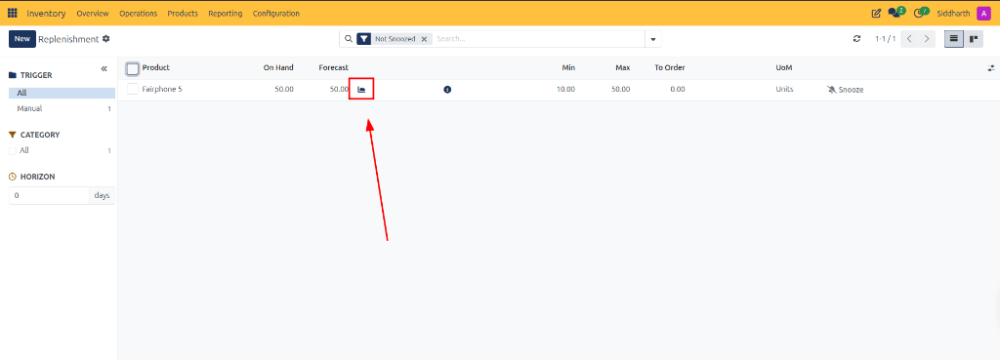

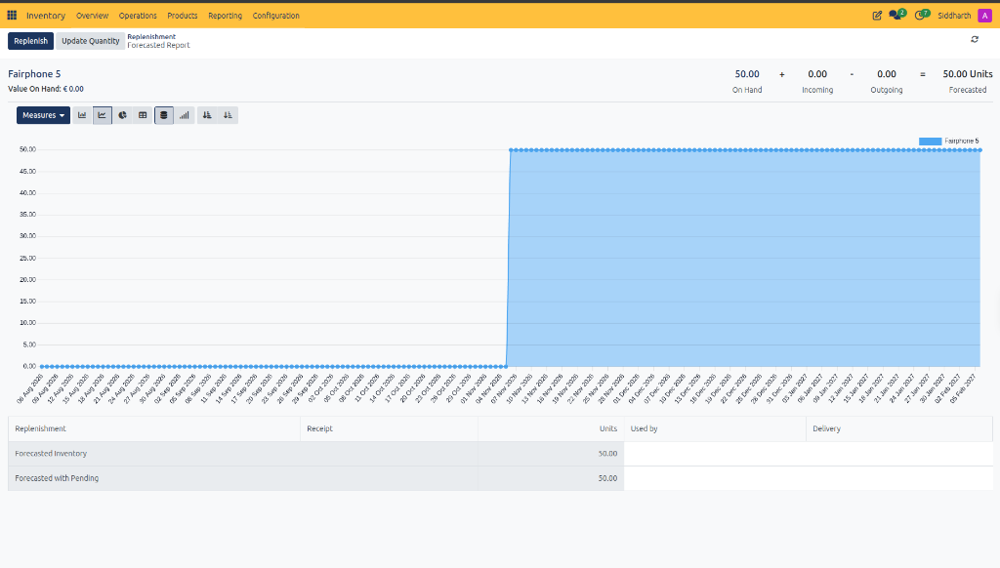

| Field Name / Control | Description |
| :--- | :--- |
| **Forecast Drilldown Icon** | Small chart icon next to the Forecast value launching the detailed timeline report. |
| **Forecasted Report Breadcrumb** | Navigation trail tracking back to the parent replenishment register. |
| **Product Title Header** | Catalog description of the inventory item being analyzed *(e.g., `Fairphone 5`)*. |
| **Value On Hand Indicator** | Monetary valuation of physical units currently stored in warehouse bins *(e.g., `Value On Hand: € 0.00`)*. |
| **On Hand Metric** | Verified physical stock count present in internal warehouse locations *(e.g., `50.00`)*. |
| **Incoming Metric** | Pending unit volume scheduled on approved purchase orders or manufacturing runs *(e.g., `0.00`)*. |
| **Outgoing Metric** | Reserved unit volume allocated to customer delivery orders or work center consumption *(e.g., `0.00`)*. |
| **Forecasted Total Metric** | Net projected stock position computed as On Hand plus Incoming minus Outgoing *(e.g., `50.00 Units`)*. |
| **Replenish Header Action Button** | Direct operational trigger launching the manual replenishment wizard. |
| **Update Quantity Header Action Button** | Action button opening the physical stock adjustment interface. |
| **Measures Selector** | Multidimensional metric selector toggling between unit volume and monetary valuation. |
| **Chart View Mode Switchers** | Visualization toggles switching between step line chart, bar chart, pie chart, pivot table, and list view. |
| **Step Chart Canvas** | Graphical timeline plotting historical and forward-looking product stock trajectories over time. |
| **Forecasted Inventory Row** | Summary table row showing projected stock availability across planned dates. |
| **Forecasted with Pending Row** | Summary table row showing projected stock availability including pending draft operational orders. |

---

### Safety Stock Curve Conceptual Parameters Data Dictionary

The empty state diagram visually illustrates the mathematical models governing CURQ replenishment propositions:

| Field Name / Control | Description |
| :--- | :--- |
| **Quantity (Y-Axis)** | Vertical axis plotting physical and forecasted warehouse stock balances. |
| **Time (X-Axis)** | Horizontal axis representing forward-looking operational timelines and replenishment cycles. |
| **Today Planning Baseline** | Timeline marker indicating the current real-time planning date. |
| **Safety Stock Minimum Threshold** | Lower inventory buffer limit below which procurement must initiate to prevent stockouts. |
| **Maximum Storage Capacity** | Upper target limit preventing warehouse overfilling, working capital bloat, and carrying cost escalation. |
| **Lead Time Window** | Horizontal time span measuring supplier delivery or production duration from order issuance to warehouse intake. |
| **Quantity to Order Parameter** | Calculated inventory deficit between the forecasted low point and the targeted maximum ceiling. |

---

### Related Documentation

* [Manage Replenishment and Automated Reordering Rules](../task-guides/09-manage-replenishment-and-automated-reordering-rules.md)
* [Understanding Reordering Rules and Lead Times](../core-concepts/02-understanding-reordering-rules-and-lead-times.md)
* [Operations Menu and Physical Inventory Field Definitions](./07-operations-menu-and-physical-inventory-field-definitions.md)
* [Scrap Order Field Definitions](./08-scrap-order-field-definitions.md)
* [Product Catalog and Stock Level Field Definitions](./05-product-catalog-and-stock-level-field-definitions.md)
* [Detailed Operations and Stock Valuation Field Definitions](./04-detailed-operations-and-stock-valuation-field-definitions.md)

