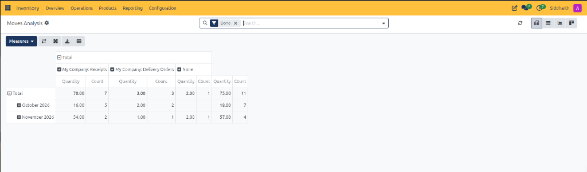
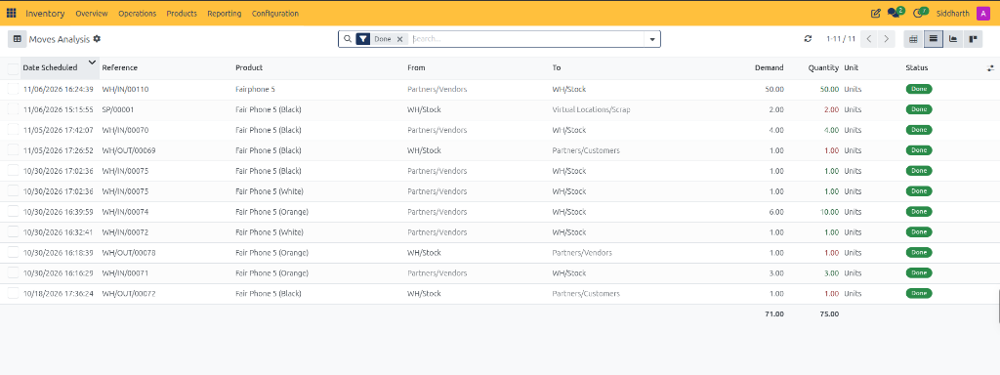
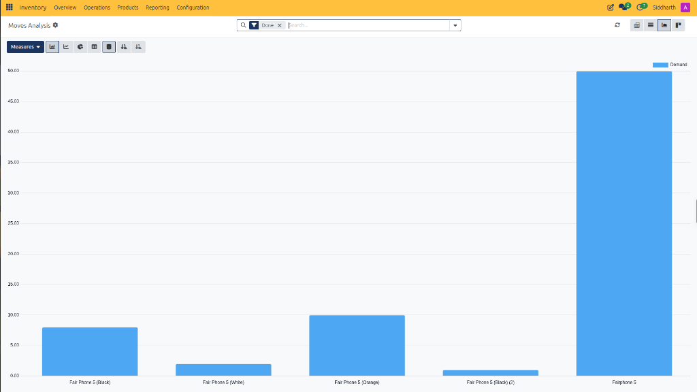
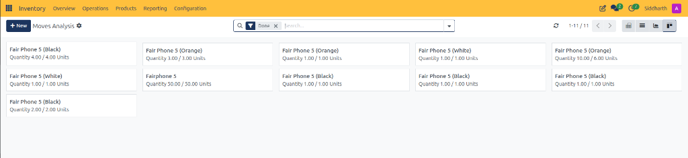

# Moves Analysis and Reporting Field Definitions

This document provides a comprehensive data dictionary for all header action controls, view switchers, pivot grid matrices, tabular register columns, graph visualizers, and Kanban cards within the CURQ Inventory Moves Analysis module at **Inventory > Reporting > Moves Analysis**.

---

### Moves Analysis Header and View Switcher Controls Data Dictionary

The control bar governs filtering, data querying, and perspective toggles across movement records:

| Field Name / Control | Description |
| :--- | :--- |
| **Moves Analysis Header Label** | Active workspace breadcrumb confirming navigation within the movement reporting suite. |
| **Settings Cog Icon** | Display preferences control allowing users to customize analytical thresholds and default groupings. |
| **Done Search Filter Tag** | Default filter restricting analysis strictly to finalized and executed stock movements. |
| **Search Input Bar** | Keyword lookup field to filter moves by product name, document reference, or location. |
| **Refresh Button** | Action button updating real-time transaction records from live warehouse movements. |
| **Pagination Indicator** | Pager displaying active record window and total transaction count *(e.g., `1-11 / 11`)*. |
| **Pivot View Switcher** | View mode button displaying multi-dimensional aggregation matrices across operations and dates. |
| **List View Switcher** | View mode button presenting individual transactional stock moves in structured rows. |
| **Graph View Switcher** | View mode button rendering analytical charts of demand and volume trends. |
| **Kanban View Switcher** | View mode button formatting stock moves as interactive operational cards. |

---

### Moves Analysis Pivot Matrix Data Dictionary

The Pivot View aggregates movement volumes across operational channels and calendar periods:

| Field Name / Control | Description |
| :--- | :--- |
| **Measures Selector** | Analytical dropdown toggling calculations between physical quantity, demand volume, and record count. |
| **Swap Axis Control** | Matrix layout icon transposing horizontal operation types and vertical calendar rows. |
| **Expand and Collapse Controls** | Hierarchy controls revealing granular subcategories and individual product variants. |
| **Download (XLSX) Control** | File export utility downloading the active pivot matrix to Microsoft Excel format. |
| **Insert in Spreadsheet Control** | Collaborative action creating a live embedded spreadsheet dashboard inside CURQ Documents. |
| **Receipts Operation Column** | Column aggregating inbound supplier shipments received into warehouse storage *(e.g., `70.00 Units` across `7` moves)*. |
| **Delivery Orders Operation Column** | Column aggregating outbound customer shipments dispatched from warehouse inventory *(e.g., `3.00 Units` across `3` moves)*. |
| **None (Unassigned) Column** | Column capturing movements executed outside standard receipt/delivery routes, such as scrap write-offs *(e.g., `2.00 Units` on `SP/00001`)*. |
| **Total Summary Column** | Matrix summary aggregating overall movement throughput across all operational categories *(e.g., `75.00 Units` across `11` moves)*. |
| **Fiscal Period Grouping Row** | Row clustering transaction figures by execution month *(e.g., `October 2026`, `November 2026`)*. |
| **Quantity Metric Sub-Column** | Sub-column calculating total physical product units moved during the period. |
| **Count Metric Sub-Column** | Sub-column displaying total number of distinct transfer transactions processed. |

---

### Moves Analysis List Register Data Dictionary

The List View details granular operational parameters for each individual stock transfer:

| Field Name / Control | Description |
| :--- | :--- |
| **Row Checkbox Selector** | Multi-select selector enabling batch export or mass processing of movement lines. |
| **Date Scheduled Column** | Timestamp recording planned or executed physical movement dates *(e.g., `11/06/2026 16:24:39`)*. |
| **Reference Column** | Direct tracking code linking to the originating document *(e.g., `WH/IN/00110`, `SP/00001`, `WH/OUT/00069`)*. |
| **Product Column** | Inventory catalog item description and variant specification *(e.g., `Fairphone 5`, `Fair Phone 5 (Black)`)*. |
| **From Location Column** | Source warehouse storage location debited during execution *(e.g., `Partners/Vendors`, `WH/Stock`)*. |
| **To Location Column** | Destination location credited during execution *(e.g., `WH/Stock`, `Partners/Customers`, `Virtual Locations/Scrap`)*. |
| **Demand Column** | Original product quantity requested by the originating purchase or sales order *(e.g., `50.00`, `4.00`)*. |
| **Quantity Column** | Actual physical units transferred, with inventory deductions styled in red text *(e.g., `2.00 Units`, `1.00 Units`)*. |
| **Unit of Measure Column** | Standard measurement unit applied to physical counting *(e.g., `Units`)*. |
| **Status Column** | Operational lifecycle stage badge confirming finalized execution (*Done*). |
| **Footer Total Summary Row** | Register bottom bar displaying aggregate requested demand *(e.g., `71.00`)* and aggregate completed quantity *(e.g., `75.00`)*. |

---

### Moves Analysis Graph View Controls and Canvas Data Dictionary

The Graph View visualizes product movement distribution and demand volume across product lines:

| Field Name / Control | Description |
| :--- | :--- |
| **Measures Metric Selector** | Chart metric toggle setting the plotted Y-axis value *(e.g., `Demand`, `Quantity`)*. |
| **Bar Chart Toggle** | Visualization mode presenting data as comparative vertical rectangular bars. |
| **Line Chart Toggle** | Visualization mode plotting throughput volume as a continuous timeline curve. |
| **Pie Chart Toggle** | Visualization mode plotting relative volume contributions as circular proportions. |
| **Stacked Chart Toggle** | Chart layout stacking operational categories within single bars to illustrate combined volume. |
| **Sort Order Controls** | Sorting tools ordering product bars in ascending or descending throughput sequence. |
| **Demand Bar Element** | Interactive graphical bar showing total volume for a specific product SKU *(e.g., `50.00` units for `Fairphone 5`)*. |

---

### Moves Analysis Kanban Card Data Dictionary

The Kanban View formats individual stock move executions as standalone operational cards:

| Field Name / Control | Description |
| :--- | :--- |
| **+ New Action Button** | Action button initiating an ad-hoc stock transfer from the card view. |
| **Product Title Header** | Primary catalog title of the moved item displayed at the top of each card *(e.g., `Fairphone 5`, `Fair Phone 5 (Black)`)*. |
| **Fulfillment Ratio Metric** | Operational fraction showing executed units against requested units *(e.g., `Quantity 50.00 / 50.00 Units`, `Quantity 10.00 / 6.00 Units`)*. |
| **Unit of Measure Tag** | Measurement unit identifier assigned to the movement count *(e.g., `Units`)*. |

---

### Related Documentation

* [Moves History Field Definitions](./11-moves-history-field-definitions.md)
* [Audit Historical Stock Movements in Moves History](../task-guides/11-audit-historical-stock-movements-in-moves-history.md)
* [Track Inventory by Location and Storage Bins](../task-guides/12-track-inventory-by-location-and-storage-bins.md)
* [Location Reporting Field Definitions](./12-location-reporting-field-definitions.md)
* [Analyze Stock Moves and Warehouse Throughput](../task-guides/10-analyze-stock-moves-and-warehouse-throughput.md)
* [Audit Stock Moves and Inventory Valuation](../task-guides/04-audit-stock-moves-and-inventory-valuation.md)
* [Detailed Operations and Stock Valuation Field Definitions](./04-detailed-operations-and-stock-valuation-field-definitions.md)
* [Process Outbound Delivery Orders and Customer Shipments](../task-guides/03-process-outbound-delivery-orders-and-customer-shipments.md)
* [Process Inbound Receipts and Vendor Deliveries](../task-guides/02-process-inbound-receipts-and-vendor-deliveries.md)
* [Process Scrap Orders and Inventory Write-Offs](../task-guides/08-process-scrap-orders-and-inventory-write-offs.md)
* [Understanding Double-Entry Inventory and Stock Flows](../core-concepts/01-understanding-double-entry-inventory-and-stock-flows.md)

