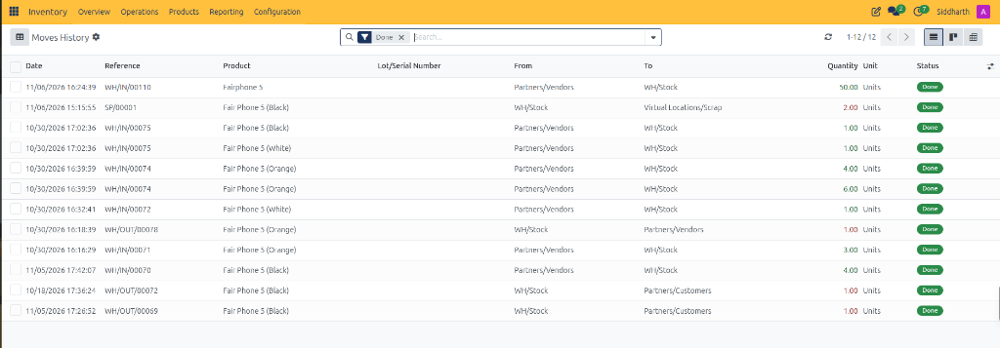
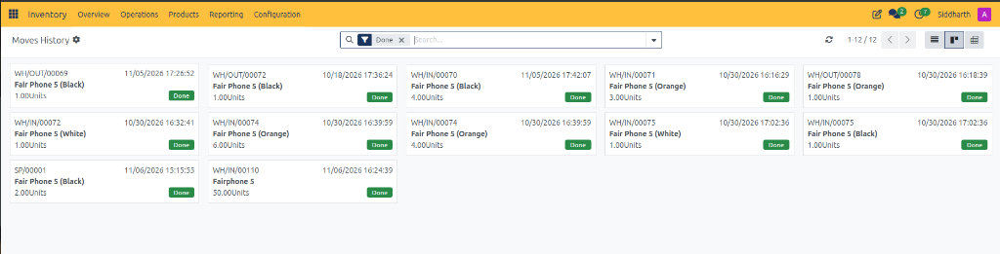
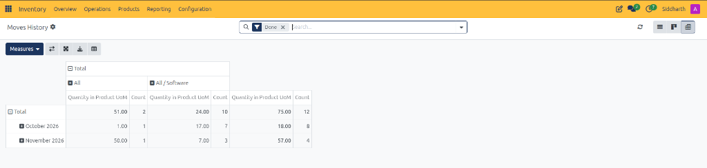

# Moves History Field Definitions

This document provides a comprehensive data dictionary for all list register columns, header controls, view switchers, Kanban operational cards, and category-based pivot matrices within the CURQ Inventory Moves History module at **Inventory > Reporting > Moves History**.

---

### Moves History List Register Data Dictionary

The List View itemizes atomic double-entry stock transactions and hardware tracking identifiers:

| Field Name / Control | Description |
| :--- | :--- |
| **Moves History Header Label** | Active workspace breadcrumb confirming navigation within the historical moves ledger. |
| **Settings Cog Icon** | Preferences control allowing users to customize visible register columns and sorting orders. |
| **Done Search Filter Tag** | Default filter restricting listed moves strictly to completed and validated warehouse operations. |
| **Search Input Bar** | Keyword lookup field to filter movements by product, lot number, reference code, or storage location. |
| **Refresh Action Control** | Action icon updating the register with live transactions from the double-entry database. |
| **Pagination Indicator** | Pager displaying active record window and total transaction count *(e.g., `1-12 / 12`)*. |
| **List View Switcher** | Tabular layout formatting atomic movement records into detailed rows. |
| **Kanban View Switcher** | Card layout presenting movements as operational visual cards. |
| **Pivot View Switcher** | Multi-dimensional matrix layout aggregating movement quantities by category and date. |
| **Date Column** | Timestamp recording the exact execution date and time of the physical stock move *(e.g., `11/06/2026 16:24:39`)*. |
| **Reference Column** | Transactional document code linking to the originating receipt, delivery, or scrap record *(e.g., `WH/IN/00110`, `SP/00001`)*. |
| **Product Column** | Inventory catalog item or product variant transferred *(e.g., `Fairphone 5`, `Fair Phone 5 (Black)`)*. |
| **Lot/Serial Number Column** | Specific hardware serial string or production batch identifier tracked during movement. |
| **From Location Column** | Source storage location debited during execution *(e.g., `Partners/Vendors`, `WH/Stock`)*. |
| **To Location Column** | Destination storage location credited during execution *(e.g., `WH/Stock`, `Virtual Locations/Scrap`, `Partners/Customers`)*. |
| **Quantity Column** | Numeric count of physical units transferred, with warehouse stock deductions highlighted in red text *(e.g., `2.00 Units`, `1.00 Units`)*. |
| **Unit of Measure Column** | Standard measurement unit applied to the product quantity *(e.g., `Units`)*. |
| **Status Column** | Operational lifecycle stage badge confirming terminal execution (*Done*). |

---

### Moves History Kanban Card Data Dictionary

The Kanban View displays executed stock movements as standalone operational cards:

| Field Name / Control | Description |
| :--- | :--- |
| **Reference Header Identifier** | Primary document code displayed in the upper-left of each card *(e.g., `WH/OUT/00069`, `SP/00001`)*. |
| **Execution Timestamp** | Date and time recording when the transfer was validated at the dock or warehouse floor *(e.g., `11/05/2026 17:26:52`)*. |
| **Product Catalog Name** | Catalog description of the inventory item moved *(e.g., `Fair Phone 5 (Black)`)*. |
| **Moved Quantity Tag** | Physical unit count transferred during execution *(e.g., `1.00Units`, `4.00Units`, `50.00Units`)*. |
| **Done Lifecycle Badge** | Terminal status badge confirming completed warehouse movement. |

---

### Moves History Pivot View Data Dictionary

The Pivot View summarizes stock movement quantities across product categories and calendar periods:

| Field Name / Control | Description |
| :--- | :--- |
| **Measures Metric Dropdown** | Calculation selector toggling metrics between physical volume and transaction record count. |
| **Swap Axis Control** | Matrix tool interchanging horizontal category columns and vertical timeline rows. |
| **Expand and Collapse All Controls** | Structural controls expanding or minimizing all nested categories simultaneously. |
| **Download (XLSX) Control** | File export utility downloading the active pivot matrix directly to Microsoft Excel format. |
| **Insert in Spreadsheet Control** | Embedding tool placing the live category matrix into an internal CURQ spreadsheet dashboard. |
| **Product Category Column** | Categorical columns grouping moves by product category hierarchy *(e.g., `All`, `All / Software`)*. |
| **Quantity in Product UoM Metric** | Sub-column calculating total physical product units moved within the category. |
| **Count Metric** | Sub-column displaying total number of distinct atomic move lines executed. |
| **Fiscal Period Grouping Row** | Row clustering transaction figures by execution month *(e.g., `October 2026`, `November 2026`)*. |
| **Total Throughput Summary Row** | Bottom summary row aggregating overall throughput across all categories *(e.g., `75.00` units across `12` moves)*. |

---

### Related Documentation

* [Audit Historical Stock Movements in Moves History](../task-guides/11-audit-historical-stock-movements-in-moves-history.md)
* [Track Inventory by Location and Storage Bins](../task-guides/12-track-inventory-by-location-and-storage-bins.md)
* [Location Reporting Field Definitions](./12-location-reporting-field-definitions.md)
* [Analyze Stock Moves and Warehouse Throughput](../task-guides/10-analyze-stock-moves-and-warehouse-throughput.md)
* [Moves Analysis and Reporting Field Definitions](./10-moves-analysis-and-reporting-field-definitions.md)
* [Audit Stock Moves and Inventory Valuation](../task-guides/04-audit-stock-moves-and-inventory-valuation.md)
* [Detailed Operations and Stock Valuation Field Definitions](./04-detailed-operations-and-stock-valuation-field-definitions.md)
* [Process Scrap Orders and Inventory Write-Offs](../task-guides/08-process-scrap-orders-and-inventory-write-offs.md)
* [Understanding Double-Entry Inventory and Stock Flows](../core-concepts/01-understanding-double-entry-inventory-and-stock-flows.md)

