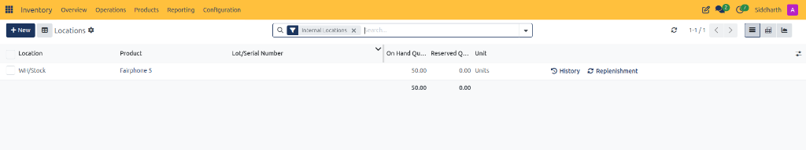
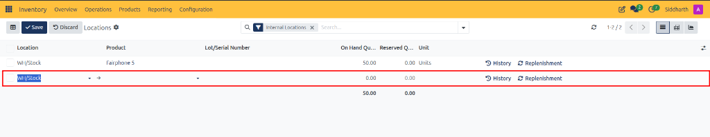
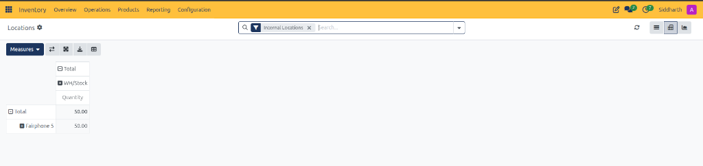
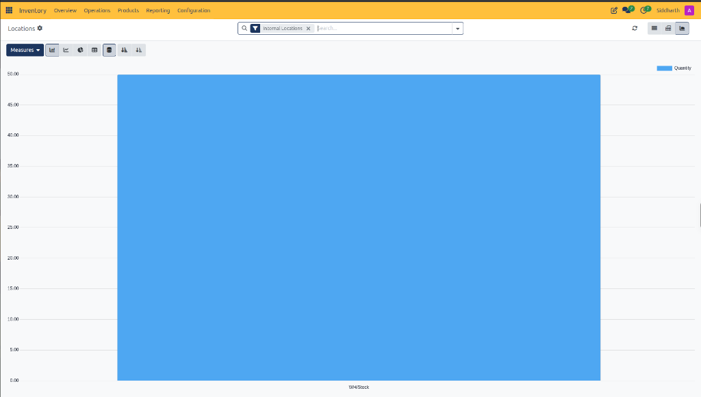

# Location Reporting Field Definitions

This document provides a comprehensive data dictionary for all list register columns, header controls, view switchers, row-level action triggers, pivot matrices, and graphical chart visualizers within the CURQ Inventory Locations report at **Inventory > Reporting > Locations**.

---

### Locations Report Header and Filter Controls

The header action bar provides global search, filtering, and view switching utilities across all location reporting formats:

| Field Name / Control | Description |
| :--- | :--- |
| **+ New Primary Button** | Action button appending an inline editable row to record manual opening stock balances or count adjustments. |
| **Save Action Button** | Primary execution button (checkmark icon) committing the newly added or edited stock balance line to the database. |
| **Discard Action Button** | Secondary action button (undo arrow icon) canceling inline row edits and reverting the register to view mode. |
| **Locations Header Breadcrumb** | Active workspace label confirming navigation within the warehouse location inventory report. |
| **Settings Cog Icon** | Preferences control allowing operators to customize visible register columns and sorting preferences. |
| **View Switcher Icon** | Table layout icon toggling data density and column formatting. |
| **Internal Locations Filter Tag** | Default filter preset restricting listed records to company-owned physical warehouse locations, excluding external vendor, customer, and virtual adjustment locations. |
| **Search Input Bar** | Query lookup field to search stock records by product name, SKU, lot or serial number, or storage location code. |
| **Search Options Dropdown Arrow** | Context menu expanding advanced filter criteria, grouping dimensions, and custom search filters. |
| **Refresh Action Control** | Action icon updating the register with live stock balances from the database. |
| **Pagination Indicator** | Paging indicator displaying the active record window and total line count *(e.g., `1-1/1`)*. |
| **List View Switcher** | Tabular layout formatting on-hand stock balances into detailed location rows. |
| **Pivot View Switcher** | Multi-dimensional matrix layout cross-referencing products against storage locations. |
| **Graph View Switcher** | Visual charting tool illustrating stock volume across storage locations in bar, line, or pie format. |

---

### Locations List Register and Action Controls Data Dictionary

The List View itemizes real-time physical inventory balances and reserved allocations per storage location:

| Field Name / Control | Description |
| :--- | :--- |
| **Selection Checkbox** | Multi-row selection control enabling bulk actions on selected location stock lines. |
| **Location Column** | Physical warehouse storage zone, bin, aisle, or rack where items are stocked *(e.g., `WH/Stock`)*. |
| **Product Column** | Inventory catalog product name and variant description *(e.g., `Fairphone 5`)*. |
| **Lot/Serial Number Column** | Hardware tracking serial identifier or production batch string assigned to the stored units. |
| **On Hand Quantity Column** | Total physical unit count physically stored in the specified location *(e.g., `50.00`)*. |
| **Reserved Quantity Column** | Unit count allocated to confirmed outgoing deliveries, transfers, or manufacturing orders awaiting physical picking *(e.g., `0.00`)*. |
| **Unit Column** | Standard unit of measure applied to the product inventory count *(e.g., `Units`)*. |
| **History Action Control** | Row-level action shortcut opening the Moves History ledger pre-filtered to this specific product and location for complete stock transfer auditability. |
| **Replenishment Action Control** | Row-level action shortcut navigating directly to replenishment rules for this product at this location to update min/max levels or trigger an order. |
| **Column Options Selector Icon** | Table customization control on the far right allowing users to show or hide optional columns. |
| **Summary Total Row** | Bottom register row aggregating total on hand and reserved inventory quantities across all active lines *(e.g., `50.00` on hand, `0.00` reserved)*. |

---

### Inline Stock Balance Entry Data Dictionary

Clicking **+ New** transitions the register to inline edit mode for manual stock balance intake:

| Field Name / Control | Description |
| :--- | :--- |
| **Save Action Button** | Primary button (checkmark icon) validating and committing the inline stock line to the inventory database. |
| **Discard Action Button** | Dismissal button (undo arrow icon) abandoning unsaved line entries and restoring default register display. |
| **Location Selector Field** | Searchable selection field defaulting to internal storage (WH/Stock) with external record link arrow. |
| **Open Related Location Arrow** | Shortcut icon (right arrow) opening the master location configuration record for the selected warehouse zone. |
| **Product Selector Field** | Dropdown lookup menu to search and assign the target catalog item to this storage location. |
| **Lot/Serial Number Selector Field** | Optional input dropdown assigning tracked serial numbers or production lot identifiers to the stock line. |
| **On Hand Quantity Input Field** | Numeric field entering the initial opening balance or physical count adjustment (defaults to 0.00). |
| **Reserved Quantity Display** | Read-only system calculation showing committed outgoing units (defaults to 0.00 for new entries). |
| **Row Checkbox Selector** | Selection box allowing individual row inclusion in bulk register actions. |

---

### Locations Pivot Matrix Data Dictionary

The Pivot View summarizes stock quantities across physical storage locations and catalog items:

| Field Name / Control | Description |
| :--- | :--- |
| **Measures Metric Dropdown** | Calculation selector specifying the metric evaluated across the matrix *(configured to Quantity)*. |
| **Flip Axis Control** | Tool interchanging horizontal location columns and vertical product rows for flexible cross-analysis. |
| **Expand All and Collapse All Controls** | Action controls expanding or collapsing nested multi-level location and product hierarchies. |
| **Download (XLSX) Control** | Utility downloading the active multidimensional matrix directly as a Microsoft Excel spreadsheet. |
| **Insert in Spreadsheet Control** | Embedding tool inserting the location pivot matrix into an internal CURQ spreadsheet dashboard. |
| **Total Column Header** | Root aggregation column summarizing unit quantities across all internal storage locations. |
| **Location Sub-Column (WH/Stock)** | Specific warehouse storage location column displaying the physical count stored within that zone. |
| **Quantity Metric Sub-Header** | Header label confirming that numerical cell values reflect physical inventory unit counts. |
| **Total Row Header** | Root summary row calculating total inventory volume across all catalog items. |
| **Product Row (Fairphone 5)** | Row isolating unit quantities associated with a specific catalog item. |

---

### Locations Graph Visualizer Data Dictionary

The Graph View renders visual charts to evaluate warehouse space utilization and compare stock concentrations:

| Field Name / Control | Description |
| :--- | :--- |
| **Measures Selector** | Metric dropdown defining the numerical measure plotted on the vertical axis *(Quantity)*. |
| **Bar Chart Switcher** | Discrete column visualization displaying stock quantities per storage location as vertical bars. |
| **Line Chart Switcher** | Continuous visual line plot representing stock distribution curves across locations. |
| **Pie Chart Switcher** | Proportional circular visualization illustrating percentage share of inventory held in each location. |
| **Stacked Bar Control** | Layout toggle stacking multiple products or variants on a single location column. |
| **Cumulative Grouped Control** | Layout toggle grouping product bars side-by-side per location for comparative volume analysis. |
| **Ascending Sort Control** | Sorts location bars in ascending order from lowest to highest stock volume. |
| **Descending Sort Control** | Sorts location bars in descending order from highest to lowest stock volume. |
| **Storage Location X-Axis** | Horizontal axis displaying warehouse bin identifiers *(e.g., `WH/Stock`)*. |
| **Unit Quantity Y-Axis** | Vertical axis scaling numeric unit counts from `0.00` to `50.00`. |
| **Quantity Metric Legend** | Color-coded key identifying the plotted bar series as physical unit quantity. |

---

### Related Documentation

* [Track Inventory by Location and Storage Bins](../task-guides/12-track-inventory-by-location-and-storage-bins.md)
* [Track Enterprise Stock Balances and Inventory at Date](../task-guides/13-track-enterprise-stock-balances-and-inventory-at-date.md)
* [Stock Reporting Field Definitions](./13-stock-reporting-field-definitions.md)
* [Audit Historical Stock Movements in Moves History](../task-guides/11-audit-historical-stock-movements-in-moves-history.md)
* [Moves History Field Definitions](./11-moves-history-field-definitions.md)
* [Analyze Stock Moves and Warehouse Throughput](../task-guides/10-analyze-stock-moves-and-warehouse-throughput.md)
* [Moves Analysis and Reporting Field Definitions](./10-moves-analysis-and-reporting-field-definitions.md)
* [Audit Stock Moves and Inventory Valuation](../task-guides/04-audit-stock-moves-and-inventory-valuation.md)
* [Detailed Operations and Stock Valuation Field Definitions](./04-detailed-operations-and-stock-valuation-field-definitions.md)
* [Manage Replenishment and Automated Reordering Rules](../task-guides/09-manage-replenishment-and-automated-reordering-rules.md)
* [Replenishment and Reordering Rules Field Definitions](./09-replenishment-and-reordering-rules-field-definitions.md)
* [Understanding Double-Entry Inventory and Stock Flows](../core-concepts/01-understanding-double-entry-inventory-and-stock-flows.md)

