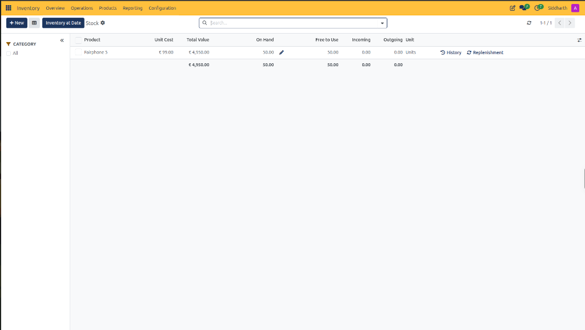
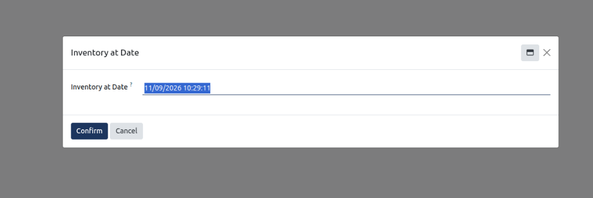

# Stock Reporting Field Definitions

This document provides a comprehensive data dictionary for all list register columns, header controls, category filters, row-level action triggers, and historical point-in-time calculation wizards within the CURQ Inventory Stock report at **Inventory > Reporting > Stock**.

---

### Stock Report Header and Category Filter Controls

The header action bar and collapsible category drawer provide search, filtering, and historical audit utilities across company-wide inventory balances:

| Field Name / Control | Description |
| :--- | :--- |
| **+ New Action Button** | Action button inserting an inline editable row to record a manual opening stock balance or physical count adjustment. |
| **Table Layout Switcher Icon** | Layout icon toggling tabular formatting and row density across the register. |
| **Inventory at Date Action Button** | Primary execution button (dark blue) launching the historical point-in-time stock balance recalculation dialog. |
| **Stock Workspace Breadcrumb** | Header title confirming navigation within the enterprise stock report. |
| **Settings Cog Icon** | Preferences control allowing operators to customize visible register columns and sorting orders. |
| **Search Input Bar** | Query lookup field to search stock by product name, SKU, or category. |
| **Search Options Dropdown Arrow** | Context menu expanding advanced filter criteria, grouping options, and custom search filters. |
| **Refresh Action Control** | Action icon updating the register with live physical stock figures from the inventory ledger. |
| **Pagination Indicator** | Pager displaying active record window and total line count *(e.g., `1-1/1`)*. |
| **Category Panel Drawer** | Collapsible sidebar on the left filtering the stock list by product category hierarchy. |
| **Collapse Drawer Icon** | Toggle control (double left chevron) collapsing the category sidebar to maximize table width. |
| **All Category Checkbox** | Category selection filter including all configured product catalog items. |

---

### Stock Register Columns and Row Controls Data Dictionary

The Stock register itemizes physical quantities, valuation costs, unallocated availability, and incoming/outgoing pipelines per catalog item:

| Field Name / Control | Description |
| :--- | :--- |
| **Batch Selection Checkbox** | Multi-row selector enabling bulk actions across selected stock lines. |
| **Product Column** | Inventory catalog item title and specification *(e.g., `Fairphone 5`)*. |
| **Unit Cost Column** | Valuation standard cost per inventory unit *(e.g., `€ 99.00`)*. |
| **Total Value Column** | Extended financial inventory valuation calculated as on-hand quantity multiplied by unit cost *(e.g., `€ 4,950.00`)*. |
| **On Hand Column** | Total physical unit count currently stored in warehouse premises *(e.g., `50.00`)*. |
| **Inline Adjustment Pencil Icon** | Quick-action control beside on-hand quantity opening an inline editing field for immediate physical count corrections. |
| **Free to Use Column** | Unallocated physical unit count available for new customer orders, equal to on-hand stock minus outgoing reservations *(e.g., `50.00`)*. |
| **Incoming Column** | Total units scheduled for arrival on approved purchase orders or pending inbound receipts *(e.g., `0.00`)*. |
| **Outgoing Column** | Total units committed to confirmed customer delivery orders or work orders awaiting dispatch *(e.g., `0.00`)*. |
| **Unit Column** | Standard measurement unit applied to the product inventory count *(e.g., `Units`)*. |
| **History Action Control** | Row-level shortcut opening the Moves History register pre-filtered to this product. |
| **Replenishment Action Control** | Row-level shortcut opening the reordering rules configuration and safety stock thresholds for this product. |
| **Column Options Selector Icon** | Table customization slider icon allowing operators to display or conceal optional data columns. |
| **Summary Total Row** | Bottom register row aggregating extended total value and unit counts across all listed products. |

---

### Inventory at Date Modal Controls Data Dictionary

Auditors use the Inventory at Date wizard to recalculate point-in-time historical stock balances and asset valuations:

| Field Name / Control | Description |
| :--- | :--- |
| **Modal Header Title** | Window banner identifying the historical inventory calculation interface. |
| **Window Minimize Control** | Icon reducing the modal dialog to the lower taskbar. |
| **Window Close Icon** | Action icon dismissing the dialog without altering the stock display. |
| **Inventory at Date Datetime Field** | Timestamp input determining the exact historical cutoff for recalculating warehouse stock balances *(e.g., `11/09/2026 10:29:11`)*. |
| **Confirm Action Button** | Primary button executing the historical balance recalculation and rolling back subsequent transactions. |
| **Cancel Action Button** | Dismissal button closing the popup and maintaining real-time live stock figures. |

---

### Related Documentation

* [Track Enterprise Stock Balances and Inventory at Date](../task-guides/13-track-enterprise-stock-balances-and-inventory-at-date.md)
* [Track Inventory by Location and Storage Bins](../task-guides/12-track-inventory-by-location-and-storage-bins.md)
* [Location Reporting Field Definitions](./12-location-reporting-field-definitions.md)
* [Audit Historical Stock Movements in Moves History](../task-guides/11-audit-historical-stock-movements-in-moves-history.md)
* [Moves History Field Definitions](./11-moves-history-field-definitions.md)
* [Analyze Stock Moves and Warehouse Throughput](../task-guides/10-analyze-stock-moves-and-warehouse-throughput.md)
* [Moves Analysis and Reporting Field Definitions](./10-moves-analysis-and-reporting-field-definitions.md)
* [Audit Stock Moves and Inventory Valuation](../task-guides/04-audit-stock-moves-and-inventory-valuation.md)
* [Detailed Operations and Stock Valuation Field Definitions](./04-detailed-operations-and-stock-valuation-field-definitions.md)
* [Manage Replenishment and Automated Reordering Rules](../task-guides/09-manage-replenishment-and-automated-reordering-rules.md)
* [Understanding Double-Entry Inventory and Stock Flows](../core-concepts/01-understanding-double-entry-inventory-and-stock-flows.md)

