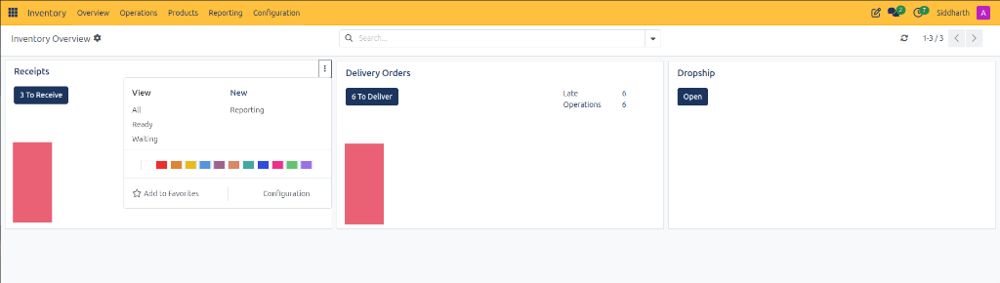

# Navigate Inventory Overview and Operation Types

This task guide provides operational procedures for warehouse teams to monitor warehouse queues, triage urgent shipments, launch ad-hoc transfers, and configure operation cards from the **Inventory Overview** dashboard in CURQ Inventory.

---

### Prerequisites

* Operational access to the CURQ Inventory application.
* Configured warehouse facilities with active operation types.

---

### Access and Navigate the Inventory Dashboard

1. From the top application switcher, click **Inventory**.
2. CURQ opens the primary **Inventory Overview** dashboard:

3. Review the overview header:
   * **Breadcrumb**: Displays **Inventory Overview** with a settings gear icon for administrative adjustments.
   * **Search Bar**: Quickly isolate operation cards or warehouse locations by typing search keywords.
   * **Pagination Counter**: Displays the active range of visible operation cards *(e.g., `1-3 / 3`)*.

---

### Triage Warehouse Operational Queues

Operation type cards display real-time counters representing physical warehouse workload:

1. **Inbound Intake (Receipts)**:
   * Click **3 To Receive** to access the register of incoming supplier shipments awaiting dock intake and inspection.
2. **Outbound Fulfillment (Delivery Orders)**:
   * Click **6 To Deliver** to open the active order packing queue.
   * Review critical operational alerts:
     * **Late**: Displays transfers past their scheduled shipping dates *(e.g., `6`)*. Prioritize these orders to prevent customer SLA breaches.
     * **Operations**: Shows total pending shipments requiring warehouse execution *(e.g., `6`)*.
3. **Dropship Fulfillment**:
   * Click **Open** to monitor partner dropship orders where suppliers deliver directly to clients.

---

### Use Card Context Menus for High-Velocity Execution

Click the vertical ellipsis *(three dots icon)* in the upper-right corner of any operation card to reveal advanced shortcuts:

1. **Access Filtered Transfer Registers**:
   * Click **Ready** to view only those transfers that have full stock reservations and are ready for immediate picking.
   * Click **Waiting** to isolate transfers blocked due to unavailable components or raw materials.
   * Click **All** to view the comprehensive historical and active log.
2. **Launch New Operations and Reports**:
   * Click **New** to open a blank stock transfer form pre-configured for this operation type.
   * Click **Reporting** to launch velocity and throughput reports filtered directly for this queue.
3. **Customize Dashboard Display**:
   * Select a color swatch from the 12-color palette to highlight critical warehouse cards.
   * Click **Add to Favorites** to pin high-priority operation types to the top of your dashboard.
   * Click **Configuration** to adjust sequence prefixes, default source/destination locations, and barcode scanner behaviors.

---

### Related Documentation

* [Navigate Inventory and Manage Stock Operations](../getting-started/01-navigate-inventory-and-manage-stock-operations.md)
* [Inventory Dashboard and Operation Card Definitions](../settings-and-fields/01-inventory-dashboard-and-operation-card-definitions.md)
* [Understanding Double-Entry Inventory and Stock Flows](../core-concepts/01-understanding-double-entry-inventory-and-stock-flows.md)
