# Process Inbound Receipts and Vendor Deliveries

This operational guide provides procedures for warehouse receiving specialists and dock supervisors to triage incoming supplier deliveries, verify physical product quantities against purchase orders, record logistical metadata, validate stock intake, and audit inventory valuation postings in CURQ Inventory.

---

### Prerequisites

* Operational access permissions to the CURQ Inventory application.
* Confirmed vendor purchase order *(e.g., `P00093`)* generating an inbound receipt transfer.
* Access to physical receiving bays and inspection staging zones.

---

### Access and Triage the Receipts Queue

Warehouse receiving teams monitor inbound freight arrivals directly from the central dashboard:

1. Navigate to **Inventory > Overview**.
2. Locate the **Receipts** operational card:

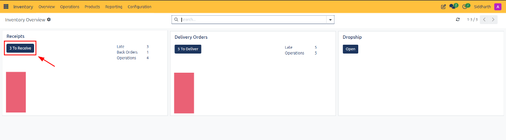

3. Review the receiving workload metrics:
   * **3 To Receive**: Dark blue action button displaying the total count of actionable incoming transfers.
   * **Late (3)**: Critical counter highlighting deliveries that have passed their scheduled arrival date.
   * **Back Orders (1)**: Split shipments awaiting secondary deliveries from suppliers.
   * **Operations (4)**: Total quantity of active receiving orders in the operational queue.
4. Click the dark blue **3 To Receive** button to open the receiving register.

---

### Filter and Prioritize Ready Inbound Deliveries

CURQ opens the receipts register pre-filtered to isolate actionable inbound shipments:

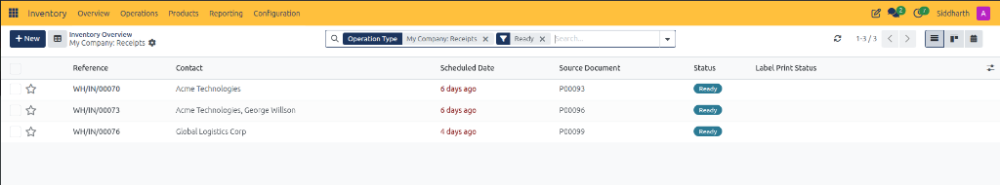

1. Review the active filter tags in the search bar:
   * `Operation Type: My Company: Receipts`: Isolates vendor-to-warehouse inbound transfer routes.
   * `Ready`: Isolates transfers ready for physical dock intake and counting.
2. Review delivery attributes across the queue:
   * **Reference**: Unique transfer tracking code *(e.g., `WH/IN/00070`, `WH/IN/00073`, `WH/IN/00076`)*.
   * **Contact**: Supplier or vendor entity dispatching the shipment *(e.g., `Acme Technologies`, `Global Logistics Corp`)*.
   * **Scheduled Date**: Target dock arrival date, styled in red text for overdue shipments *(e.g., `6 days ago`, `4 days ago`)*. Expedite overdue transfers to prevent downstream manufacturing or fulfillment delays.
   * **Source Document**: Originating Purchase Order number *(e.g., `P00093`, `P00096`, `P00099`)*.
   * **Status**: Operational lifecycle stage (*Ready*).
3. If reviewing all historical or cancelled shipments, remove the `Ready` filter to inspect the complete operational log:

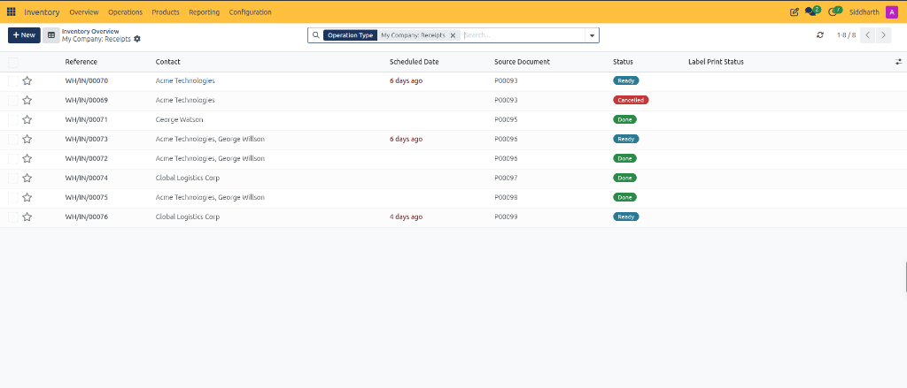

4. Click on the reference link for **WH/IN/00070** to open the receiving transfer form.

---

### Inspect Inbound Transfer Lines and Verify Received Quantities

On the inbound receipt form view:

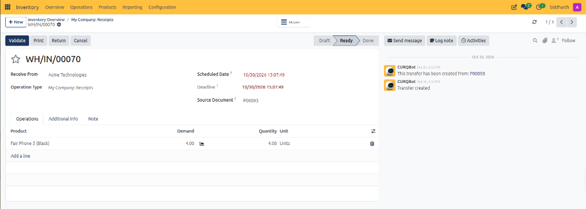

1. **Verify Header Parameters**:
   * **Receive From**: Confirms the delivering supplier *(e.g., `Acme Technologies`)*.
   * **Operation Type**: Confirms the intake route *(e.g., `My Company: Receipts`)*.
   * **Scheduled Date & Deadline**: Confirms planned receiving thresholds *(e.g., `10/30/2026 15:07:49`)*.
   * **Source Document**: Direct cross-reference to originating purchase contract `P00093`.
2. **Inspect Product Lines on Operations Tab**:
   * **Product**: Catalog item description *(e.g., `Fair Phone 5 (Black)`)*.
   * **Demand**: Total expected units ordered from the vendor *(e.g., `4.00`)*.
   * **Quantity**: Actual physically counted units received at the unloading dock *(e.g., `4.00 Units`)*.
3. If partial delivery occurs, adjust the **Quantity** field to match physical counts. Upon validation, CURQ prompts operators to generate a Backorder for remaining units.

---

### Validate Stock Intake and Commit Inventory to Storage

Once physical counting and quality control inspections are complete:

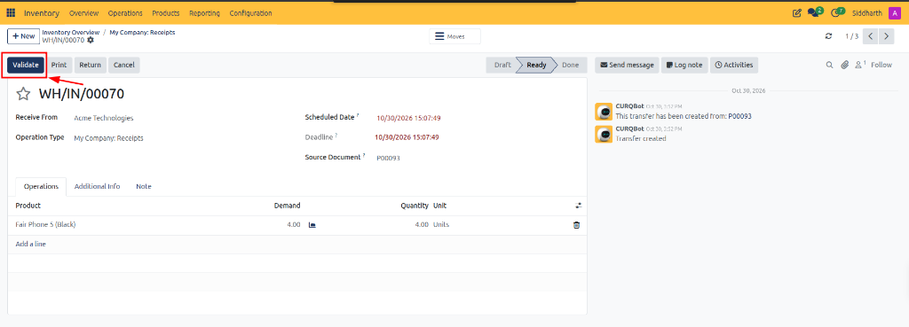

1. In the upper-left action bar, click the dark blue **Validate** button.
2. If quantities match total demand, CURQ immediately executes the stock move.
3. If quantities are zero, CURQ prompts to apply default quantities matching demand.

---

### Review Validated Receipt State and Valuation Impact

Upon successful validation, CURQ updates the transfer form to its finalized state:

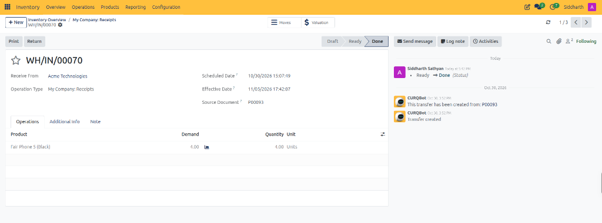

1. **Terminal State Transitions**:
   * The status chevron advances from **Ready** to **Done**.
   * The **Validate** and **Cancel** buttons are removed. Active controls are restricted to **Print** *(to generate the receiving slip)* and **Return** *(to reject defective units back to the vendor)*.
2. **Effective Date**:
   * CURQ logs the immutable intake timestamp in **Effective Date** *(e.g., `11/05/2026 17:42:07`)*.
3. **Smart Button Navigation**:
   * **Moves Smart Button**: Exposes the granular stock moves transferring goods from `Partner Locations/Vendors` into `WH/Stock`.
   * **Valuation Smart Button**: Appears in the top control bar with a currency symbol. Clicking it opens the automated stock valuation register recording asset valuation debits.
4. **Audit Chatter Log**:
   * The chatter feed logs the state transition: `Ready -> Done (Status)` alongside automated creation timestamps.

---

### Audit Inbound Detailed Operations and Tracking Identifiers

From the validated receipt header, warehouse operators click the **Moves** smart button to inspect granular stock move lines and product identification:

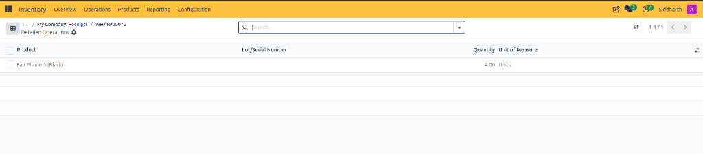

1. **Review Detailed Move Attributes**:
   * **Product**: Catalog item description *(e.g., `Fair Phone 5 (Black)`)*.
   * **Lot/Serial Number**: Serialized identifier tracking individual hardware units or production batches. For non-serialized items, this column remains blank.
   * **Quantity**: Measured quantity moved into warehouse storage *(e.g., `4.00`)*.
   * **Unit of Measure**: Standard measuring unit applied *(e.g., `Units`)*.
2. Navigate back to the receipt form using the breadcrumb link *(e.g., `WH/IN/00070`)*.

---

### Audit Inbound Stock Valuation and Ledger Postings

From the receipt header, click the **Valuation** smart button to audit inventory financial impacts:

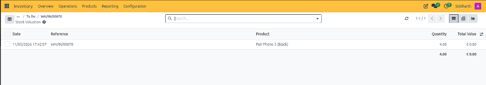

1. **Verify Asset Valuation Attributes**:
   * **Date**: Execution timestamp *(e.g., `11/05/2026 17:42:07`)* matching the receipt effective date.
   * **Reference**: Inbound transfer code *(e.g., `WH/IN/00070`)*.
   * **Product**: Catalog product evaluated *(e.g., `Fair Phone 5 (Black)`)*.
   * **Quantity**: Positive inventory delta *(e.g., `4.00`)* representing stock addition into internal warehouse storage.
   * **Total Value**: Balance sheet inventory asset value adjustment *(e.g., `€ 0.00`)* calculated from supplier cost pricing.
2. Confirm that positive inventory debits balance with accounts payable accruals in CURQ Accounting.

---

### Create an Ad-Hoc Receipt and Define Product Demand

When receiving unannounced deliveries or manual inventory transfers:

1. On the receipts register, click **+ New** in the upper-left action bar:

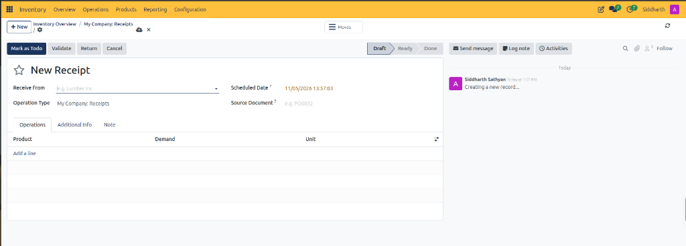

2. Configure receipt parameters:
   * **Receive From**: Select the supplier entity *(placeholder `e.g. Lumber Inc`)*.
   * **Operation Type**: Defaults to `My Company: Receipts`.
   * **Scheduled Date**: Record the expected dock intake timestamp.
   * **Source Document**: Record external vendor packing slip or consignment numbers.
3. In the **Operations** tab, click **Add a line**:
   * Select the **Product**, enter the expected **Demand**, and confirm the **Unit** of measure.
4. Click **Mark as Todo** to advance the draft receipt to **Ready** status.

---

### Record Shipping Logistics and Ownership Metadata

Click the **Additional Info** tab to track logistical parameters and assign accountability:

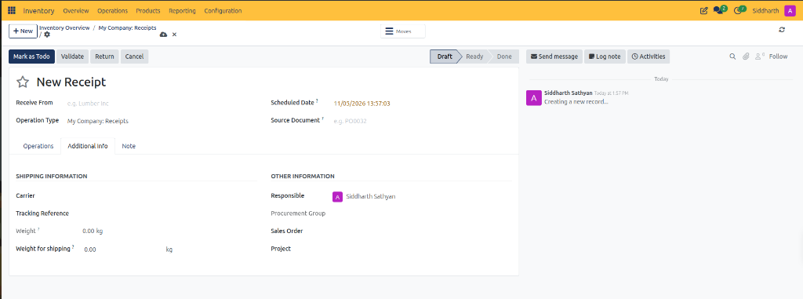

1. **Shipping Information**:
   * **Carrier**: Record the freight logistics provider delivering the goods.
   * **Tracking Reference**: Enter the bill of lading, air waybill, or consignment number.
   * **Weight**: Enter measured net shipment weight in kilograms.
   * **Weight for shipping**: Record gross freight weight including packaging and pallets.
2. **Other Information**:
   * **Responsible**: Assign the warehouse specialist or procurement lead overseeing delivery intake.
   * **Procurement Group**: Links to multi-order supply chain groups.
   * **Sales Order**: Connects incoming stock to an active customer sales contract for direct cross-docking.
   * **Project**: Designates project allocation if materials are dedicated to a specific client engagement.

---

### Document Warehouse Picking Notes

Click the **Note** tab to communicate specific handling instructions to dock workers:

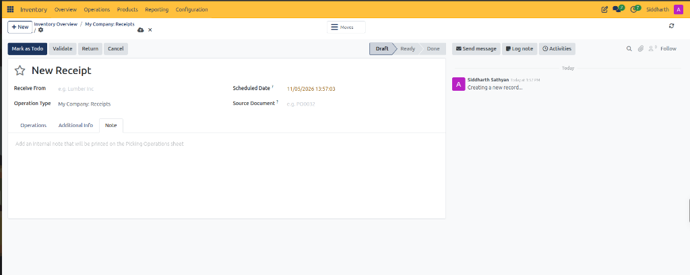

1. In the text area, type operational instructions *(such as quarantine requirements, temperature controls, or assigned storage bins)*.
2. Notes documented here automatically print on physical Picking Operations sheets distributed to forklift operators.

---

### Related Documentation

* [Navigate Inventory and Manage Stock Operations](../getting-started/01-navigate-inventory-and-manage-stock-operations.md)
* [Receipt and Stock Transfer Field Definitions](../settings-and-fields/02-receipt-and-stock-transfer-field-definitions.md)
* [Detailed Operations and Stock Valuation Field Definitions](../settings-and-fields/04-detailed-operations-and-stock-valuation-field-definitions.md)
* [Audit Stock Moves and Inventory Valuation](./04-audit-stock-moves-and-inventory-valuation.md)
* [Understanding Double-Entry Inventory and Stock Flows](../core-concepts/01-understanding-double-entry-inventory-and-stock-flows.md)
