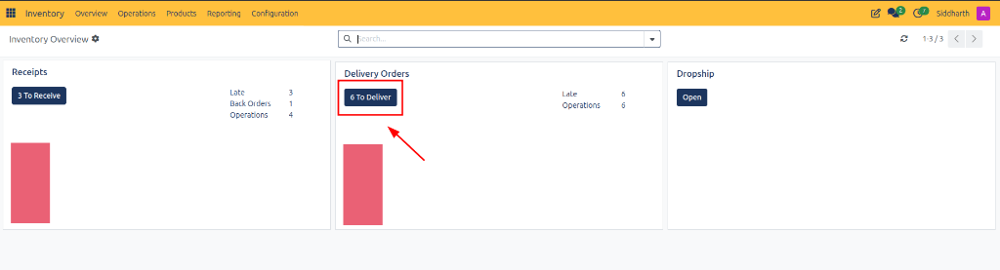
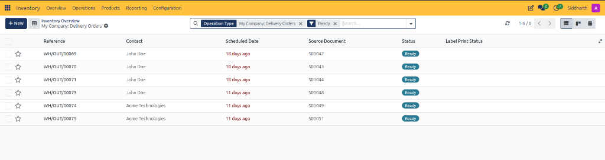
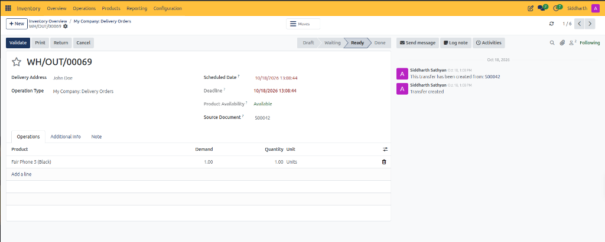
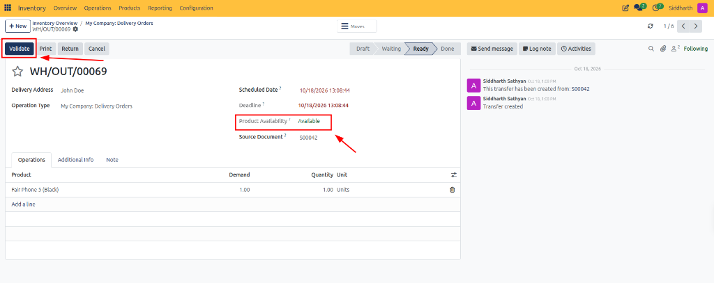
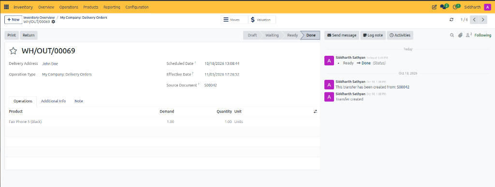

# Process Outbound Delivery Orders and Customer Shipments

This operational guide provides procedures for warehouse shipping teams to triage customer orders, verify product reservations, execute physical picking, validate outbound shipments, and handle reverse logistics in CURQ Inventory.

---

### Prerequisites

* Operational access to the CURQ Inventory application.
* Confirmed customer sales orders generating active outbound delivery pickings.

---

### Access and Triage the Delivery Orders Queue

1. Navigate to **Inventory > Overview**.
2. Locate the **Delivery Orders** operational card:

3. Review the execution workload:
   * **To Deliver**: Total pending outbound transfers requiring warehouse processing.
   * **Late**: Critical metric highlighting shipments that have passed scheduled delivery dates.
   * **Operations**: Quantitative summary of total planned shipping tasks.
4. Click **6 To Deliver** to open the active shipping register.

---

### Filter and Prioritize Ready Shipments

The delivery orders register organizes outbound fulfillment orders by operational priority:

1. **Verify Default Filters**:
   * Confirm the search bar applies `Operation Type: My Company: Delivery Orders` and `Ready`.
   * The `Ready` filter guarantees that listed transfers have complete stock reservations in warehouse storage.
2. **Prioritize Overdue Shipments**:
   * Scan the **Scheduled Date** column for dates highlighted in red text *(e.g., `18 days ago`, `11 days ago`)*. Expedite these orders to mitigate customer delivery delays.
3. **Inspect Order Origin**:
   * Review the **Source Document** column *(e.g., `S00042`)* to confirm customer sales contract details.
4. Click any delivery order reference *(e.g., `WH/OUT/00069`)* to open the detailed fulfillment form.

---

### Pick Items and Confirm Product Availability

On the delivery order form view:

1. **Verify Customer Address**: Ensure the **Delivery Address** matches customer shipping instructions.
2. **Review Product Lines on Operations Tab**:
   * **Product**: Verify the catalog item description *(e.g., `Fair Phone 5 (Black)`)*.
   * **Demand**: Check ordered quantities required by the customer contract *(e.g., `1.00`)*.
   * **Quantity**: Confirm physical items picked and placed in the shipping staging zone *(e.g., `1.00 Units`)*.
3. If partial picking is required, adjust the **Quantity** field to match physical goods picked.

---

### Validate Outbound Transfer and Complete Shipment

Once items are packed and staged at the shipping bay:

1. **Confirm Product Availability Status**:
   * Verify that **Product Availability** displays **Available** in green text.
2. **Click Validate**:
   * Click the dark blue **Validate** button in the upper-left action bar.
3. **System Execution and Form Updates**:
   * CURQ updates the status chevron from **Ready** to **Done**:

   * Balanced stock moves deduct units from `WH/Stock` and credit customer partner locations.
   * The **Effective Date** timestamp is recorded automatically.
   * A new **Valuation** smart button appears in the upper right, providing direct access to financial cost of goods sold (COGS) journal entries.
   * Connected Sales Order lines update to `Delivered`, triggering customer invoice generation.
4. **Print Shipping Documents**:
   * Click **Print** in the top action bar to generate the Delivery Slip and shipping labels.

---

### Handle Returns and Order Cancellations

1. **Process Customer Return**: Click **Return** to initiate a reverse picking transfer routing returned units back into warehouse stock.
2. **Cancel Transfer**: If an order is voided before physical dispatch, click **Cancel** to release reserved inventory back to available stock.

---

### Related Documentation

* [Fulfill Sales Orders and Process Deliveries](../getting-started/02-fulfill-sales-orders-and-process-deliveries.md)
* [Audit Stock Moves and Inventory Valuation](./04-audit-stock-moves-and-inventory-valuation.md)
* [Delivery Order and Outbound Shipping Field Definitions](../settings-and-fields/03-delivery-order-and-outbound-shipping-field-definitions.md)
* [Detailed Operations and Stock Valuation Field Definitions](../settings-and-fields/04-detailed-operations-and-stock-valuation-field-definitions.md)
* [Understanding Double-Entry Inventory and Stock Flows](../core-concepts/01-understanding-double-entry-inventory-and-stock-flows.md)
* [Process Inbound Receipts and Vendor Deliveries](./02-process-inbound-receipts-and-vendor-deliveries.md)

