# Audit Stock Moves and Inventory Valuation

This operational guide provides procedures for warehouse managers, inventory controllers, and cost accountants to trace granular physical stock moves, verify source storage bins, audit lot and serial tracking, and reconcile automated inventory valuation ledger postings in CURQ Inventory.

---

### Prerequisites

* Operational access to CURQ Inventory and CURQ Accounting.
* At least one validated stock transfer *(such as completed Delivery Order `WH/OUT/00069` or completed Inbound Receipt `WH/IN/00070`)*.
* Configured inventory costing method *(Standard Price, Average Cost, or FIFO)* for evaluated product categories.

---

### Locate Validated Transfers and Access Smart Buttons

1. Navigate to **Inventory > Operations > Transfers** or drill down through **Inventory > Overview** to **Delivery Orders** or **Receipts**.
2. Open any completed transfer in **Done** status *(e.g., `WH/OUT/00069` or `WH/IN/00070`)*:

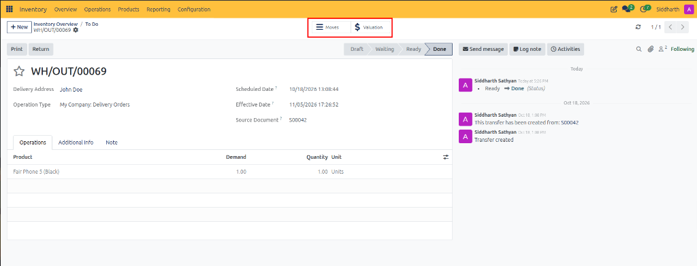

3. Review the available navigation controls in the header:
   * **Moves Smart Button**: Located on the top control bar, this button links directly to the detailed physical stock move records generated by this operation.
   * **Valuation Smart Button**: Marked with a currency symbol, this button provides direct drill-down access to the stock valuation journal entries created upon validation.
   * **Status Chevron**: Confirms the transfer has achieved terminal **Done** status.
   * **Effective Date**: Confirms the exact execution timestamp when physical stock moved into or out of inventory.

---

### Audit Granular Stock Moves in Detailed Operations

To verify which storage locations, bins, and serial or lot identifiers were consumed or received during transfer execution:

1. Click the **Moves** smart button in the transfer header.
2. For outbound delivery orders *(e.g., `WH/OUT/00069`)*, CURQ displays the source location picking grid:

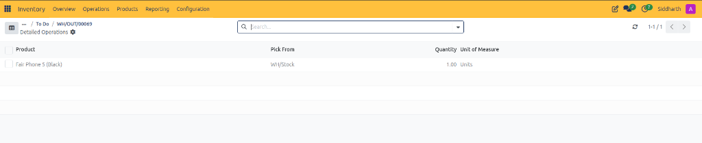

   * **Product**: Confirm the exact product description *(e.g., `Fair Phone 5 (Black)`)*.
   * **Pick From**: Verify the source warehouse storage location *(e.g., `WH/Stock`)*. This confirms that items were picked from the designated internal bin rather than staging or quarantine zones.
   * **Quantity**: Confirm the physical quantity decremented from the source location *(e.g., `1.00`)*.
   * **Unit of Measure**: Verify the assigned measurement unit *(e.g., `Units`)*.

3. For inbound vendor receipts *(e.g., `WH/IN/00070`)*, CURQ displays the tracking identifier grid:

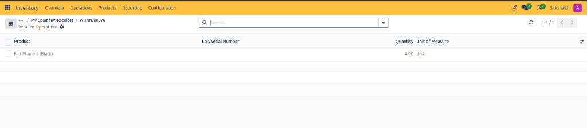

   * **Product**: Catalog product received into inventory *(e.g., `Fair Phone 5 (Black)`)*.
   * **Lot/Serial Number**: Unique hardware serial code or batch lot identifier assigned during intake.
   * **Quantity**: Physical quantity accepted into warehouse storage *(e.g., `4.00`)*.
   * **Unit of Measure**: Measurement unit applied *(e.g., `Units`)*.

4. **Discrepancy Resolution**:
   * If the picked location differs from the physical bin, record an internal stock move to balance inventory location records before customer dispatch.

---

### Audit Inventory Valuation and General Ledger Entries

Automated valuation records reconcile physical warehouse stock with the financial balance sheet:

1. Return to the transfer form and click the **Valuation** smart button.
2. For outbound customer shipments *(e.g., `WH/OUT/00069`)*, CURQ displays the stock decrement valuation row:

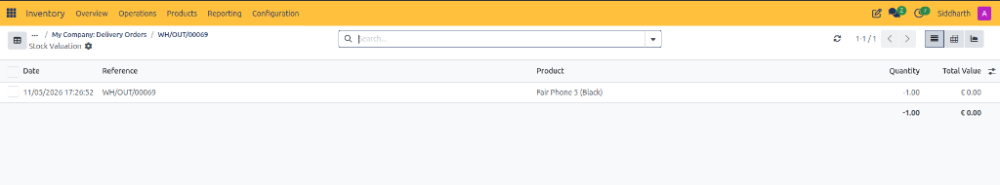

   * **Quantity**: Displays a negative inventory delta *(e.g., `-1.00`)* representing stock reduction from warehouse assets.
   * **Total Value**: Monetary balance sheet reduction *(e.g., `€ 0.00`)* based on unit cost at dispatch.

3. For inbound supplier receipts *(e.g., `WH/IN/00070`)*, CURQ displays the stock increment valuation row:

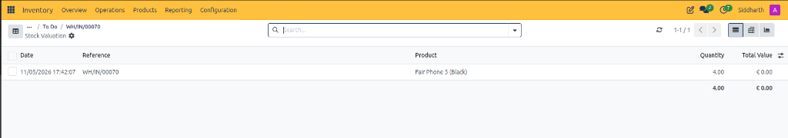

   * **Quantity**: Displays a positive inventory delta *(e.g., `4.00`)* representing stock addition into internal warehouse inventory.
   * **Total Value**: Asset value increase *(e.g., `€ 0.00`)* posted to the inventory valuation ledger.

4. **Switch Reporting Perspectives**:
   * Use the view switchers in the top right to analyze valuation data in **List**, **Pivot**, or **Graph** mode for multi-order stock reconciliation.

---

### Access Enterprise Stock Valuation via the Reporting Menu

In addition to auditing individual transfer documents, inventory controllers and finance auditors can inspect global valuation balances across the entire organization:

1. In the top navigation bar, click the **Reporting** menu.
2. Under the reporting options, click **Valuation**:

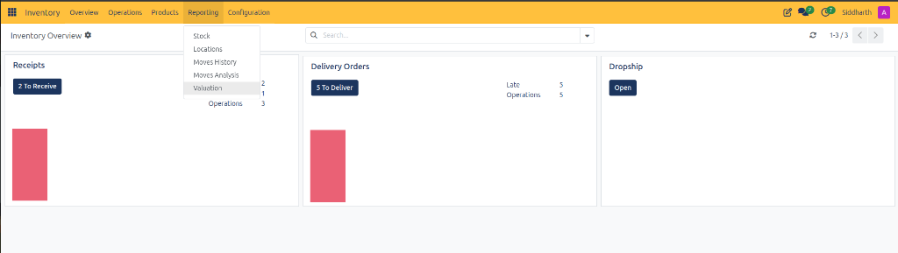

3. **The Reporting Suite Overview**:
   * **Stock**: Displays on-hand quantity balances by product, category, and warehouse location.
   * **Locations**: Itemizes inventory allocation across internal bins, transit routes, and virtual counterpart zones.
   * **Moves History**: Tabular audit trail of all historical double-entry stock transactions.
   * **Moves Analysis**: Multi-dimensional pivot reporting tracking movement volume metrics over time.
   * **Valuation**: Central balance sheet valuation ledger documenting financial inventory additions and deductions.

4. CURQ opens the comprehensive **Stock Valuation** register:

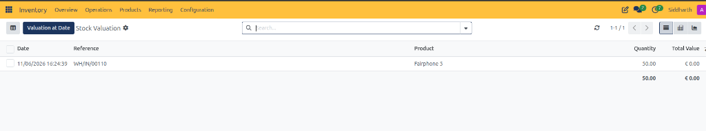

5. **Audit Global Valuation Rows**:
   * **Date**: Execution timestamp of the validated transfer *(e.g., `11/06/2026 16:24:39`)*.
   * **Reference**: System document identifier linking to the warehouse receipt *(e.g., `WH/IN/00110`)*.
   * **Product**: Inventory catalog item *(e.g., `Fairphone 5`)*.
   * **Quantity**: Positive inventory delta reflecting total physical units accepted *(e.g., `50.00`)*.
   * **Total Value**: Current balance sheet asset valuation.
   * **Costing Reconciliation Note**: When **Total Value** displays `€ 0.00` despite positive physical quantity, verify the standard cost on the product master. If the standard cost was initialized at `€ 0.00`, automated valuation registers zero financial value until updated or reconciled against the vendor bill.

6. **Analyze Revaluation Adjustments**:
   * When product cost is updated to reflect agreed supplier pricing, CURQ automatically injects a revaluation journal entry into the valuation register:

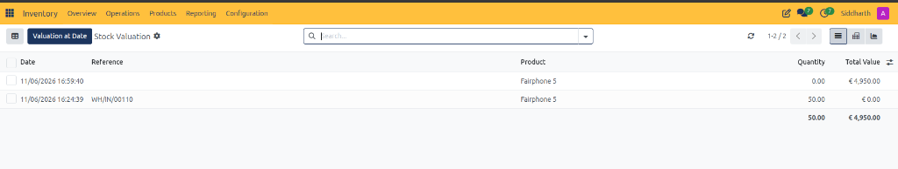

   * **Physical Receipt Line (`16:24:39`)**: Logs physical warehouse intake of `50.00 Units` on receipt `WH/IN/00110` at initial baseline valuation `€ 0.00`.
   * **Cost Revaluation Line (`16:59:40`)**: Displays an empty operational reference and **`Quantity: 0.00`**, verifying that zero physical units moved across warehouse bins. CURQ injects a pure monetary value delta of **`€ 4,950.00`** ($$50.00 \times € 99.00$$).
   * **Reconciled Totals**: Reconciles warehouse stock to **`50.00 Units`** on hand and **`€ 4,950.00`** in total inventory asset valuation on the company balance sheet.

---

### Multidimensional Valuation Analysis in Pivot Mode

To analyze inventory asset distribution by accounting period, category, and warehouse:

1. In the upper-right corner of the Stock Valuation register, click the **Pivot** view switcher.
2. CURQ renders the multi-dimensional valuation grid:

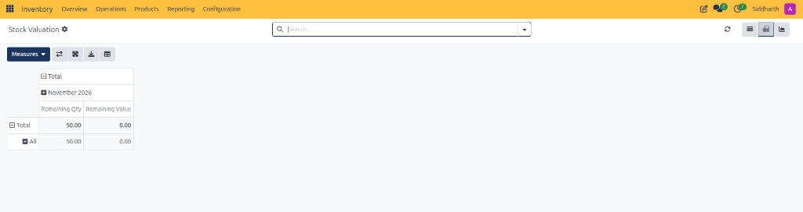

3. **Pivot Table Capabilities**:
   * **Measures Dropdown**: Switch metrics between physical volume *(Remaining Qty)* and monetary value *(Remaining Value)*.
   * **Period Grouping**: Automatically clusters movements by month *(e.g., `November 2026`)*.
   * **Hierarchical Categorization**: Expands rows by product category *(e.g., `All`)*, product variant, or warehouse storage zone.
   * **Spreadsheet Export**: Click the **Download (XLSX)** icon or **Insert in Spreadsheet** icon to export audit figures for corporate financial modeling.

---

### Generate Historical Stock Valuation at Date

For month-end financial closing, fiscal year audits, and historical balance sheet reconciliation, CURQ allows auditors to generate point-in-time stock valuation snapshots:

1. On the Stock Valuation register header, locate the **Valuation at Date** action button:

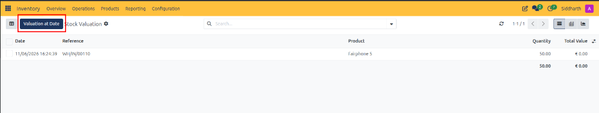

2. Click the dark blue **Valuation at Date** button.
3. CURQ presents the historical valuation cutoff modal dialog:

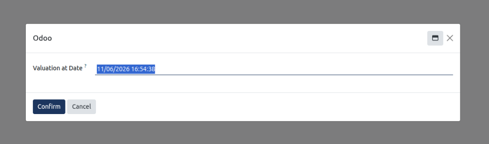

4. **Configure Historical Cutoff**:
   * **Valuation at Date**: Enter or select the exact past date and time for the audit cutoff *(e.g., `11/06/2026 16:54:38`)*.
   * Click **Confirm**: CURQ rolls back subsequent inventory transactions and recalculates warehouse quantities and monetary values exactly as they stood at that historical timestamp.
   * Click **Cancel** to abort without altering the current real-time register view.

---

### Reconcile Stock Entries with CURQ Accounting

1. **Inbound Receipt Reconciliation**:
   * Confirm that the valuation record generates an automated accounting entry debiting the Inventory Asset account *(e.g., `110100 Stock Valuation`)* and crediting the Stock Interim (Received) account *(e.g., `210200 Goods Received Not Invoiced`)*.
   * Reconcile against the vendor bill upon supplier invoice validation.
2. **Outbound Delivery Reconciliation**:
   * Confirm that the valuation record debits the Cost of Goods Sold expense account *(e.g., `500100 COGS`)* and credits the Stock Interim (Delivered) account.
   * Verify reconciliation against customer revenue entries upon sales invoice posting.

---

### Related Documentation

* [Track Enterprise Stock Balances and Inventory at Date](./13-track-enterprise-stock-balances-and-inventory-at-date.md)
* [Stock Reporting Field Definitions](../settings-and-fields/13-stock-reporting-field-definitions.md)
* [Track Inventory by Location and Storage Bins](./12-track-inventory-by-location-and-storage-bins.md)
* [Location Reporting Field Definitions](../settings-and-fields/12-location-reporting-field-definitions.md)
* [Audit Historical Stock Movements in Moves History](./11-audit-historical-stock-movements-in-moves-history.md)
* [Moves History Field Definitions](../settings-and-fields/11-moves-history-field-definitions.md)
* [Analyze Stock Moves and Warehouse Throughput](./10-analyze-stock-moves-and-warehouse-throughput.md)
* [Moves Analysis and Reporting Field Definitions](../settings-and-fields/10-moves-analysis-and-reporting-field-definitions.md)
* [Process Outbound Delivery Orders and Customer Shipments](./03-process-outbound-delivery-orders-and-customer-shipments.md)
* [Process Inbound Receipts and Vendor Deliveries](./02-process-inbound-receipts-and-vendor-deliveries.md)
* [Fulfill Sales Orders and Process Deliveries](../getting-started/02-fulfill-sales-orders-and-process-deliveries.md)
* [Detailed Operations and Stock Valuation Field Definitions](../settings-and-fields/04-detailed-operations-and-stock-valuation-field-definitions.md)
* [Delivery Order and Outbound Shipping Field Definitions](../settings-and-fields/03-delivery-order-and-outbound-shipping-field-definitions.md)
* [Understanding Double-Entry Inventory and Stock Flows](../core-concepts/01-understanding-double-entry-inventory-and-stock-flows.md)
