# Manage Product Catalog and Inventory Levels

This operational guide provides procedures for inventory managers, catalog specialists, and warehouse coordinators to navigate the CURQ Inventory product catalog, toggle between visual Kanban and structured list views, filter tangible goods, inspect on-hand versus forecasted stock levels, and configure product master parameters on the product form.

> **Prerequisites**
> * Operational access to the CURQ Inventory application.
> * Product master records configured in the product database.

---

## 1. Access the Products Catalog

1. From any view in CURQ Inventory, click **Products** in the primary top navigation bar.
2. Select **Products** from the dropdown menu.
3. CURQ opens the product catalog view pre-filtered by default criteria:

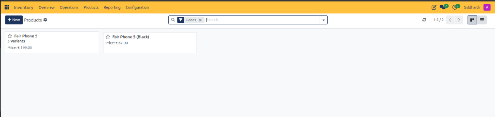

4. Review the search and filter bar:
   * **Goods Filter**: The pre-applied search tag `Goods` restricts catalog listings to physical, storable products and consumables, excluding pure service items.
   * **Search Bar**: Keyword input field for searching items by name, barcode, internal reference, or supplier SKU.
5. Review the view controls in the upper right:
   * **Refresh Button**: Reloads live inventory counters and product records.
   * **Pagination Counter**: Displays current record scope *(e.g., `1-2/2`)*.
   * **View Switchers**: Toggles between visual **Kanban** view and structured **List** view.

> **Tip:** For more details about catalog search bars, filters, and view controls, see [**Product Catalog Header and View Controls Data Dictionary**](../settings-and-fields/02-product-catalog-and-traceability-field-definitions.md#1-product-catalog-header-and-view-controls-data-dictionary).

---

## 2. Navigate Products in Kanban View

The Kanban view presents products as visual cards designed for fast product identification:

1. **Product Title**: Displays the primary catalog item name *(e.g., `Fair Phone 5`, `Fair Phone 5 (Black)`)*.
2. **Variant Counter**: Indicates whether a product has multiple selectable attributes *(e.g., `3 Variants` on `Fair Phone 5`)*.
3. **Sales Price**: Displays the default customer selling price *(e.g., `Price: € 199.00`, `Price: € 67.00`)*.
4. **Favorite Star**: Click the star icon to bookmark high-volume or critical inventory items.
5. Click any card to drill down into the complete product configuration form.

> **Tip:** For more details about card metrics, pricing, and on-hand badges, see [**Products Kanban Card Data Dictionary**](../settings-and-fields/02-product-catalog-and-traceability-field-definitions.md#2-products-kanban-card-data-dictionary).

---

## 3. Switch to Structured List View and Audit Stock Balances

To analyze tabular stock metrics, cost values, and inventory tags:

1. In the upper-right corner next to the pager, click the **List** view icon.
2. CURQ renders the structured product register:

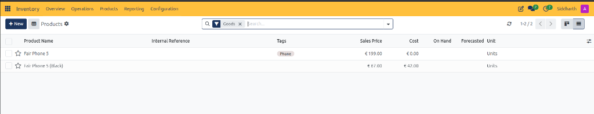

3. Review the tabular product columns:
   * **Product Name**: Specific catalog item description *(e.g., `Fair Phone 5`, `Fair Phone 5 (Black)`)*.
   * **Internal Reference**: Internal enterprise SKU code.
   * **Tags**: Category classification badges *(e.g., `Phone`)*.
   * **Sales Price**: Customer retail or contract price *(e.g., `€ 199.00`, `€ 67.00`)*.
   * **Cost**: Standard or average purchase cost used for valuation calculations *(e.g., `€ 0.00`, `€ 42.00`)*.
   * **On Hand**: Physical inventory units currently present in warehouse storage.
   * **Forecasted**: Projected stock availability factoring in incoming receipts and reserved delivery orders.
   * **Unit**: Standard Unit of Measure applied across inventory operations *(e.g., `Units`)*.

> **Tip:** For more details about the fields and columns on the product list register, see [**Products List Register Data Dictionary**](../settings-and-fields/02-product-catalog-and-traceability-field-definitions.md#3-products-list-register-data-dictionary).

---

## 4. Configure Product Master Attributes on the Form View

Click on any product record *(e.g., `Fair Phone 5 (Black)`)* to open the detailed product master form:

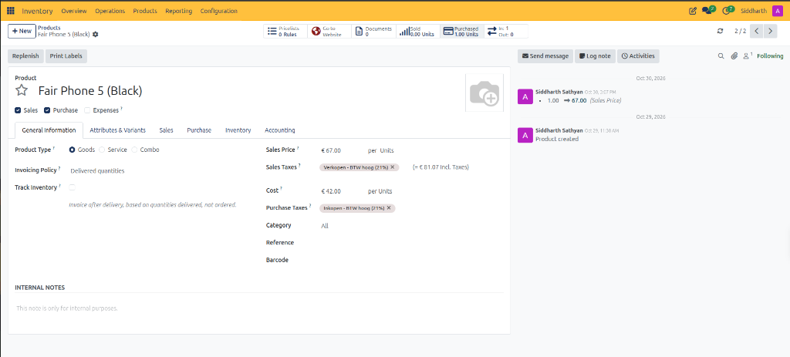

1. **Header Actions and Operational Smart Buttons**:
   * **Replenish Button**: Launches the manual replenishment assistant to order stock or update reordering rules.
   * **Print Labels Button**: Generates printable product barcode and pricing shelf labels.
   * **Pricelists Smart Button**: Displays applicable customer pricing rules *(e.g., `0 Rules`)*.
   * **Go to Website**: Relational link opening the product page in the online eCommerce catalog.
   * **Documents**: Repository for product spec sheets, safety data sheets, and manuals *(e.g., `0`)*.
   * **Sold Counter**: Tracks cumulative sales volume delivered to customers *(e.g., `0.00 Units`)*.
   * **Purchased Counter**: Tracks cumulative purchase volume received from vendors *(e.g., `1.00 Units`)*.
   * **In / Out Stock Flows Indicator**: Displays real-time flow metrics *(e.g., `In: 1 / Out: 0`)* summarizing historical intake and pending dispatch.
2. **Operational Scope Checkboxes**:
   * **Sales**: Enables the product for inclusion on customer sales quotations and sales orders.
   * **Purchase**: Enables the product for vendor purchase orders and requests for quotation (RFQs).
   * **Expenses**: Allows employees to select the item on company expense reimbursement reports.
3. **General Information Tab Configuration**:
   * **Product Type**: Set to **Goods** for tangible physical items, **Service** for non-physical labor, or **Combo** for bundled kits.
   * **Invoicing Policy**: Configured to **Delivered quantities** to ensure customers are invoiced only after physical delivery validation is confirmed in warehouse shipping.
   * **Track Inventory**: Checkbox activating real-time stock balance tracking and warehouse move reservations.
   * **Sales Price**: Base selling price *(e.g., `€ 67.00 per Units`)*, displaying computed tax inclusion *(e.g., `= € 81.07 Incl. Taxes` with `Verkopen - BTW hoog (21%)`)*.
   * **Cost**: Standard acquisition cost *(e.g., `€ 42.00 per Units`)* with applicable purchase taxes *(e.g., `Inkopen - BTW hoog (21%)`)* used for inventory asset valuation.
   * **Category**: Broad classification group governing default accounting accounts and costing methods *(e.g., `All`)*.
   * **Reference & Barcode**: Enter internal SKU codes and EAN/UPC barcodes for optical scanner verification during picking and receiving.
   * **Internal Notes**: Text area for documenting packaging guidelines or storage instructions for warehouse staff.

> **Tip:** For more details about header controls, smart buttons, and general fields, see [**Product Master Form Controls and Smart Buttons Data Dictionary**](../settings-and-fields/02-product-catalog-and-traceability-field-definitions.md#5-product-master-form-controls-and-smart-buttons-data-dictionary) and [**Product General Information Tab Data Dictionary**](../settings-and-fields/02-product-catalog-and-traceability-field-definitions.md#6-product-general-information-tab-data-dictionary).

---

## 5. Enable Storable Product Inventory Tracking vs Consumables

In CURQ, the classification between **Storable Products** and **Consumable Goods** is controlled directly by the **Track Inventory** checkbox on the General Information tab:

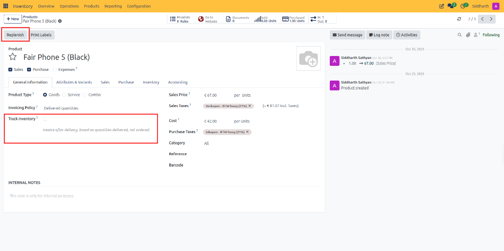

1. **Where Is "Storable Product" Located?**:
   * CURQ replaces the legacy dropdown choice with a streamlined configuration: set **Product Type** to **Goods**, and check the **Track Inventory** checkbox.
2. **Behavior When Track Inventory Is Unchecked (Consumable)**:
   * The product functions as a non-tracked physical good *(Consumable)*.
   * CURQ does not maintain running physical stock balances in warehouse storage locations.
   * The header smart buttons for **On Hand**, **Forecasted**, and **Min / Max Reordering Rules** remain hidden.
   * The item is excluded from the **Replenishment** register and lookup dialogs because consumable items do not use safety stock rules.
3. **Behavior When Track Inventory Is Checked (Storable)**:
   * The product becomes a fully tracked **Storable Product**.
   * CURQ activates real-time physical inventory ledgers, showing **On Hand** and **Forecasted** stock counters in the upper header panel.
   * The **Min / Max** reordering rule smart button becomes available.
   * Clicking the top **Replenish** action button *(highlighted in red)* launches the replenishment assistant to schedule purchase orders or manufacturing runs.

---

## 6. Configure Supply Chain Routes and Logistics on the Inventory Tab

Click the **Inventory** notebook tab to configure procurement routing, lead times, counterpart locations, and warehouse operational notes:

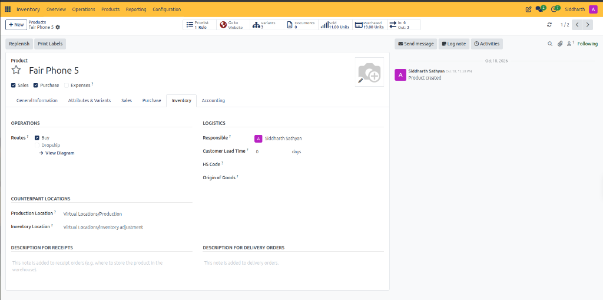

1. **Operations and Supply Chain Routing**:
   * **Buy Route**: Select this checkbox to enable automated procurement. When inventory dips below minimum stock rules, CURQ automatically generates purchase quotations.
   * **Dropship Route**: Select this checkbox if the item is fulfilled directly by third-party suppliers to customer destinations bypassing the warehouse.
   * **View Diagram Action**:

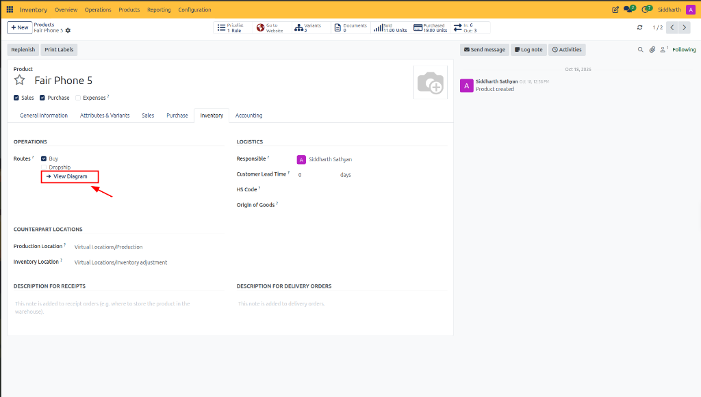

   * Click **-> View Diagram** to inspect the graphical routing flowchart mapping procurement intake to dispatch destinations:

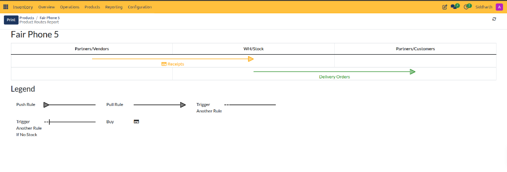

   * **Analyze Route Flow Lines**:
     * **Inbound Receipts (Orange Arrow)**: Traces vendor intake moves from `Partners/Vendors` into `WH/Stock` governed by purchase orders.
     * **Outbound Delivery Orders (Green Arrow)**: Traces customer fulfillment moves from `WH/Stock` into `Partners/Customers` governed by sales orders.
   * **Interpret Diagram Legend**:
     * **Push Rule**: Automatic stock forwarder executing immediate moves upon goods arrival.
     * **Pull Rule**: Demand-driven trigger initiating upstream transfers when downstream demand occurs.
     * **Trigger Another Rule**: Chained procurement or transfer rule linking multiple warehouse stages.
     * **Trigger Another Rule If No Stock**: Exception rule activating fallback procurement when source bins lack inventory.
     * **Buy**: Procurement action generating vendor purchase orders.
   * Click **Print** in the upper left to generate a physical PDF copy of the supply chain routing blueprint.
2. **Logistics Parameters**:
   * **Responsible**: Assign the inventory lead or procurement specialist managing stock health for this product.
   * **Customer Lead Time**: Enter the operational lead time in days *(e.g., `0 days`)* required to pick, pack, and ship the product. CURQ adds this duration to sales confirmation dates to calculate delivery deadlines.
   * **HS Code & Origin of Goods**: Specify the Harmonized System customs classification code and country of origin for international shipping and customs declarations.
3. **Counterpart Locations**:
   * **Production Location**: Confirms the default virtual location used as counterpart for manufacturing consumption *(e.g., `Virtual Locations/Production`)*.
   * **Inventory Location**: Confirms the default virtual counterpart location used for physical inventory count adjustments *(e.g., `Virtual Locations/Inventory adjustment`)*.
4. **Operational Descriptions for Dock Operations**:
   * **Description for Receipts**: Enter putaway guidelines, storage bin instructions, or temperature requirements. This text automatically prints on inbound picking sheets for dock workers.
   * **Description for Delivery Orders**: Enter fragile handling, packaging, or parcel assembly guidance. This text automatically prints on outbound picking slips and delivery sheets.
5. **Header Variant Tracking**:
   * Review the **Variants** smart button *(e.g., `3 Variants` on `Fair Phone 5`)* to inspect specific SKU attribute matrices *(such as color or memory configurations)*.
   * Review cumulative operational counters *(e.g., `Sold: 11.00 Units`, `Purchased: 19.00 Units`, and `In: 6 / Out: 3`)*.

> **Tip:** For more details about logistics parameters and route diagram rules, see [**Product Inventory Tab Data Dictionary**](../settings-and-fields/02-product-catalog-and-traceability-field-definitions.md#7-product-inventory-tab-data-dictionary) and [**Product Routes Report and Diagram Legend Data Dictionary**](../settings-and-fields/02-product-catalog-and-traceability-field-definitions.md#8-product-routes-report-and-diagram-legend-data-dictionary).

---

## 7. Audit and Manage Product Variants

When products feature multiple attributes *(such as colors, sizes, or storage capacities)*, inventory managers audit individual variants across list and Kanban registers:

1. Navigate to **Inventory > Products > Product Variants**.
2. CURQ renders the comprehensive variants list register:

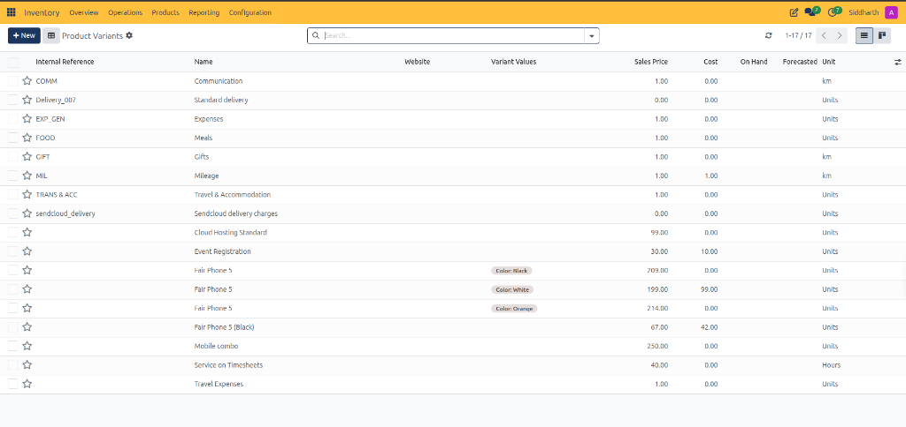

3. Review the variant columns:
   * **Internal Reference**: Variant SKU identifier *(e.g., `COMM`, `Delivery_007`, `EXP_GEN`, `FOOD`, `GIFT`, `MIL`, `TRANS & ACC`)*.
   * **Name**: Base catalog item title *(e.g., `Fair Phone 5`, `Communication`, `Standard delivery`)*.
   * **Variant Values**: Color badges or attribute tags *(e.g., `Color: Black`, `Color: White`, `Color: Orange`)*.
   * **Sales Price & Cost**: Specific variant pricing and unit valuation cost *(e.g., `Fair Phone 5 (Color: Black)` at `€ 209.00`, `Color: White` at `€ 199.00`, `Color: Orange` at `€ 214.00`)*.
   * **On Hand & Forecasted**: Variant-specific physical and projected inventory balances.
4. Click the **Kanban** view switcher in the upper right to inspect visual cards:

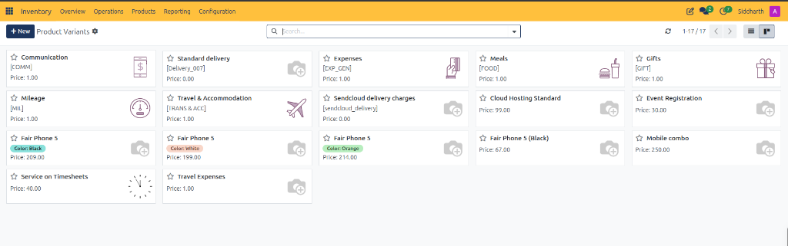

5. Inspect card tiles to quickly verify variant retail prices and active attribute combinations.

6. **Track Real-Time Variant Stock Balances Post-Intake**:
   * Following warehouse receipts and physical stock validation *(such as receiving 50 units on `WH/IN/00110`)*, return to **Products > Product Variants** to audit live updated inventory balances:

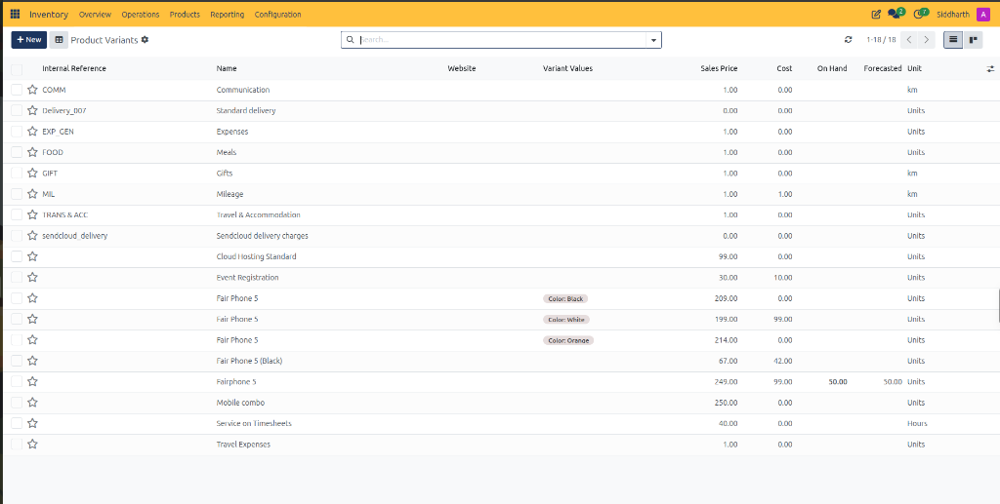

   * The updated list register expands to 18 records (`1-18 / 18`), displaying `Fairphone 5` with **Sales Price: 249.00**, **Cost: 99.00**, **On Hand: 50.00**, and **Forecasted: 50.00 Units**. Non-tracked items and service lines remain unpopulated in the On Hand column.
   * Switch to Kanban view to audit the refreshed 18-card visual layout:

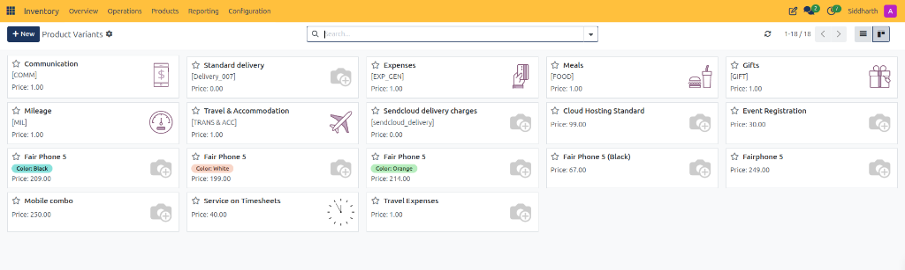

   * Each visual tile highlights specific retail pricing, attribute badges *(such as `Color: Black`, `Color: White`, `Color: Orange`)*, and catalog icons.

> **Tip:** For more details about variant attributes, pricing, and inventory matrices, see [**Product Variants Register and Kanban Cards Data Dictionary**](../settings-and-fields/02-product-catalog-and-traceability-field-definitions.md#4-product-variants-register-and-kanban-cards-data-dictionary).

---

## 8. Create New Products from the Catalog

1. In the upper-left action bar, click **+ New**.
2. Configure product attributes:
   * Enter the **Product Name**.
   * Designate the **Product Type** as *Goods* to enable stock tracking.
   * Set **Sales Price** and standard **Cost**.
   * Define the primary **Unit of Measure**.
3. Save the record to make the product available for purchase orders, receipts, and customer fulfillment.

---

## Related Documentation

* [Product Catalog and Traceability Field Definitions](../settings-and-fields/02-product-catalog-and-traceability-field-definitions.md)
* [Navigate Inventory and Manage Stock Operations](../getting-started/01-navigate-inventory-and-manage-stock-operations.md)
* [Process Inbound Receipts and Vendor Deliveries](./02-process-inbound-receipts-and-vendor-deliveries.md)
* [Process Outbound Delivery Orders and Customer Shipments](./03-process-outbound-delivery-orders-and-customer-shipments.md)
* [Audit Stock Moves and Inventory Valuation](./04-audit-stock-moves-and-inventory-valuation.md)
