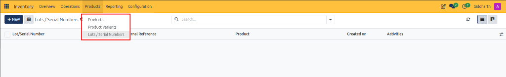
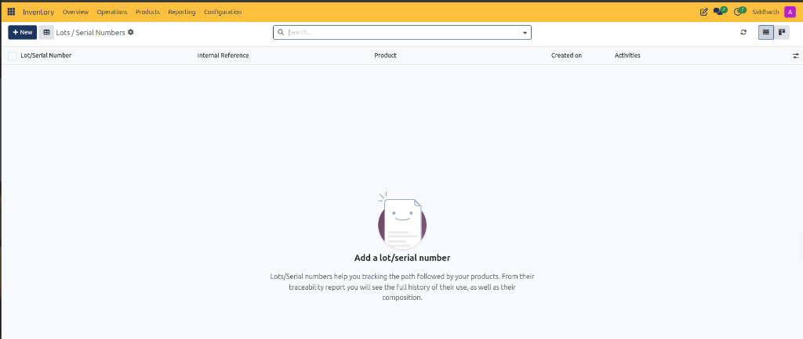
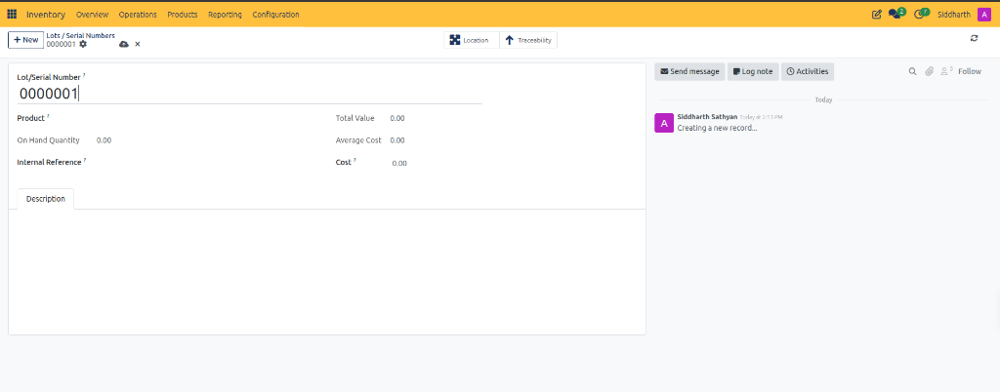

# Manage Lot and Serial Number Traceability

This operational guide provides procedures for inventory managers, quality control specialists, and warehouse supervisors to track product batches, manage unique hardware serial numbers, pre-allocate identifiers, and audit upstream and downstream traceability in CURQ Inventory.

---

### Prerequisites

* Operational access to the CURQ Inventory application.
* Products configured with tracking enabled (*By Unique Serial Number* or *By Lots*) in the product master.

---

### Access the Lots and Serial Numbers Register

1. In the top navigation bar of CURQ Inventory, click the **Products** dropdown menu.
2. Select **Lots / Serial Numbers**:

3. When no serial records exist yet, CURQ displays the dedicated traceability empty state:

4. **Traceability Architecture**:
   * As indicated in the register overview, lots and serial numbers record the complete lifecycle of physical goods.
   * CURQ generates upstream traceability *(tracing back to vendor purchase orders and incoming delivery receipts)* and downstream traceability *(tracing forward to customer sales orders and outbound shipments)*.

---

### Create or Pre-Allocate a Lot or Serial Number

While serial numbers are commonly captured at the dock during inbound receiving, warehouse teams can manually pre-create and allocate serial identifiers before shipments arrive:

1. In the upper-left corner of the register, click **+ New**.
2. CURQ opens the blank record form:

3. **Required Information to Fill**:
   * **Lot/Serial Number (Mandatory)**: Enter the unique serial string or batch identifier *(e.g., `0000001`)*. CURQ may auto-suggest a sequential number.
   * **Product (Mandatory)**: Click the dropdown to select the specific catalog product this identifier tracks *(e.g., `Fair Phone 5` or `Fair Phone 5 (Black)`)*. A serial record cannot exist without an associated product.
4. **Optional Supporting Information**:
   * **Internal Reference**: Enter an optional internal manufacturer SKU, vendor heat number, or alternative barcode identifier.
   * **Cost**: Verify or adjust the standard unit cost applied to this specific lot or serial unit.
   * **Description Tab**: Type internal notes regarding quality inspection certificates, supplier lot numbers, or special handling directives.
5. **System-Calculated Metrics (Read-Only at Creation)**:
   * **On Hand Quantity**: Displays `0.00` upon creation. This counter increments automatically when goods carrying this serial number are validated on an inbound receipt *(e.g., `WH/IN/00070`)*.
   * **Total Value & Average Cost**: Computed automatically from inventory valuation ledger entries once stock is received into warehouse storage.

---

### Audit Location and Traceability Smart Controls

Once saved and associated with physical stock moves, the record header provides direct drill-down buttons:

1. **Location Smart Button**:
   * Click **Location** in the header to view the exact physical warehouse storage location or bin *(e.g., `WH/Stock`)* where this specific serialized unit is currently stored.
2. **Traceability Smart Button**:
   * Click **Traceability** to generate the complete end-to-end movement audit log.
   * Traces the originating vendor purchase order, the inbound receipt transfer, any internal shelf moves, and the destination customer delivery order.

---

### Operational Best Practices: Dock Intake vs Manual Pre-Creation

* **Direct Dock Assignment**: In high-volume operations, serial numbers are typically scanned or entered directly in the **Detailed Operations** table of an active inbound receipt *(as detailed in [Audit Inbound Detailed Operations](./02-process-inbound-receipts-and-vendor-deliveries.md#audit-inbound-detailed-operations-and-tracking-identifiers))*.
* **Manual Pre-Creation**: Use this manual form when vendors supply advance shipping notices (ASNs) with pre-allocated serial numbers, when pre-printing asset barcode tags before unloading, or when migrating legacy inventory balances.

---

### Related Documentation

* [Lot and Serial Number Field Definitions](../settings-and-fields/06-lot-and-serial-number-field-definitions.md)
* [Manage Product Catalog and Inventory Levels](./05-manage-product-catalog-and-inventory-levels.md)
* [Process Inbound Receipts and Vendor Deliveries](./02-process-inbound-receipts-and-vendor-deliveries.md)
* [Process Outbound Delivery Orders and Customer Shipments](./03-process-outbound-delivery-orders-and-customer-shipments.md)
* [Detailed Operations and Stock Valuation Field Definitions](../settings-and-fields/04-detailed-operations-and-stock-valuation-field-definitions.md)
* [Understanding Double-Entry Inventory and Stock Flows](../core-concepts/01-understanding-double-entry-inventory-and-stock-flows.md)

