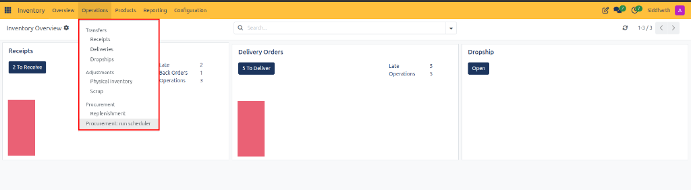

# Conduct Physical Inventory Counts and Adjustments

This operational guide provides procedures for inventory controllers, warehouse auditors, and stockroom managers to navigate the Operations menu, conduct cycle counts, record physical inventory adjustments, and reconcile warehouse stock balances with general ledger accounts in CURQ Inventory.

> **Prerequisites**
> * Operational access to the CURQ Inventory application.
> * Authorized inventory controller permissions to apply stock adjustments.
> * Products configured with inventory tracking enabled.

---

## 1. Perform Physical Inventory Counts and Adjustments

### 1.1 Access the Operations Menu and Physical Inventory Register

1. In the primary top navigation bar of CURQ Inventory, click **Operations**.
2. CURQ opens the structured operations flyout menu:

3. Review the functional sections of the Operations menu:
   * **Transfers**: Direct links to transactional transfer queues:
     * **Receipts**: Inbound supplier deliveries.
     * **Deliveries**: Outbound customer fulfillment shipments.
     * **Dropships**: Direct vendor-to-customer dispatches.
   * **Adjustments**: Stock count auditing and loss write-offs:
     * **Physical Inventory**: Periodic cycle counts and stock adjustment reconciliation.
     * **Scrap**: Destruction or write-off of damaged, expired, or obsolete stock.
   * **Procurement**: Automated and manual replenishment engines:
     * **Replenishment**: Reordering rules execution register.
     * **Procurement: run scheduler**: Background engine triggering automated purchase and transfer rules.
4. Under **Adjustments**, click **Physical Inventory**.

---

### 1.2 Conduct Physical Counts on the Inventory Adjustments Register

CURQ displays the inventory adjustments register:

1. **Initial Stock State and Spreadsheet Import**:
   * If no counts are currently active, CURQ displays the empty state message:
     > *"Press the 'New' button to define the quantity for a product in your stock or import quantities from a spreadsheet via the Actions menu."*
2. **Review Inventory Adjustment Register Columns**:
   * **Product**: Catalog item description being verified on warehouse shelves.
   * **Lot/Serial Number**: Specific serial or batch identifier for tracked items.
   * **On Hand Quantity**: Theoretical stock quantity recorded in CURQ internal storage *(e.g., `WH/Stock`)*.
   * **UoM**: Unit of measure applied to the inventory count *(e.g., `Units`)*.
   * **Counted Quantity**: The actual physical count recorded by the audit team during stocktaking.
   * **Difference**: Real-time variance calculated as:
     $$\text{Difference} = \text{Counted Quantity} - \text{On Hand Quantity}$$
   * **Scheduled Date**: Target compliance deadline for the count audit.
   * **User**: Warehouse auditor or inventory specialist assigned to the count.

> For more details about the fields and controls on the physical inventory adjustments register, see [**Physical Inventory Adjustments Register Data Dictionary**](../settings-and-fields/03-physical-inventory-and-scrap-field-definitions.md#1-physical-inventory-adjustments-register-data-dictionary).

---

### 1.3 Record Cycle Counts and Apply Stock Adjustments

1. **Record a Single Product Count**:
   * Click **+ New** in the upper-left action bar.
   * Select the **Product** and specify the location or storage bin.
   * Enter the physical count in the **Counted Quantity** field.
2. **Execute Single-Line Reconciliation**:
   * Review the computed **Difference** column.
   * Click the row-level **Apply** button to commit the adjustment for that single item.
   * If the physical count matches theoretical on-hand, click **Set** to confirm zero variance.
   * If an incorrect count was entered, click **Clear** to reset the counted input.
3. **Execute Bulk Reconciliation**:
   * When conducting complete periodic physical inventory audits, enter counted quantities across all rows.
   * In the top action bar, click **Apply All** to commit all audited counts simultaneously.

---

## 2. Audit Double-Entry Ledger Impacts of Stock Adjustments

When an adjustment is applied, CURQ executes balanced double-entry inventory transactions:

1. **Inventory Surplus (Counted > On Hand)**:
   * Moves stock from `Virtual Locations/Inventory adjustment` into internal warehouse storage `WH/Stock`.
   * Posts an automated inventory valuation entry debiting the Inventory Asset account and crediting the Inventory Gain account.
2. **Inventory Shrinkage (Counted < On Hand)**:
   * Moves stock out of internal storage `WH/Stock` into `Virtual Locations/Inventory adjustment`.
   * Posts an automated inventory valuation entry debiting the Inventory Loss / Shrinkage expense account and crediting the Inventory Asset account.
3. Click the **History** button on any adjustment row to view historical move records and past cycle counts.

---

## Related Documentation

* [Physical Inventory and Scrap Field Definitions](../settings-and-fields/03-physical-inventory-and-scrap-field-definitions.md)
* [Process Scrap Orders and Inventory Write-Offs](./08-process-scrap-orders-and-inventory-write-offs.md)
* [Manage Replenishment and Automated Reordering Rules](./09-manage-replenishment-and-automated-reordering-rules.md)
* [Navigate Inventory Overview and Operation Types](./01-navigate-inventory-overview-and-operation-types.md)
* [Manage Product Catalog and Inventory Levels](./05-manage-product-catalog-and-inventory-levels.md)
