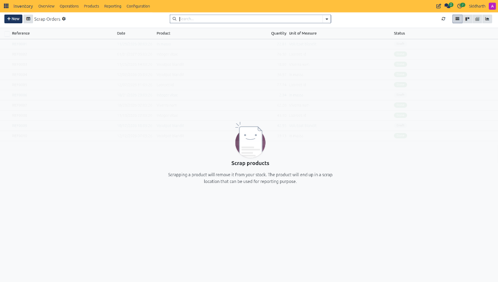
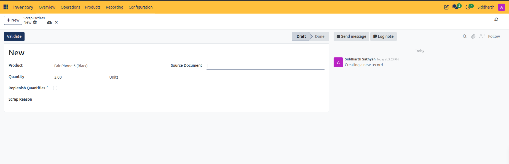
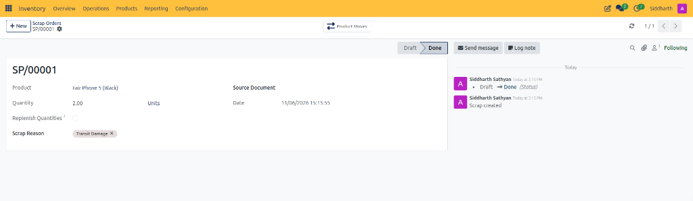
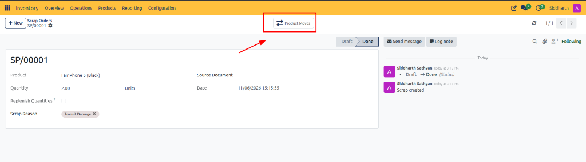
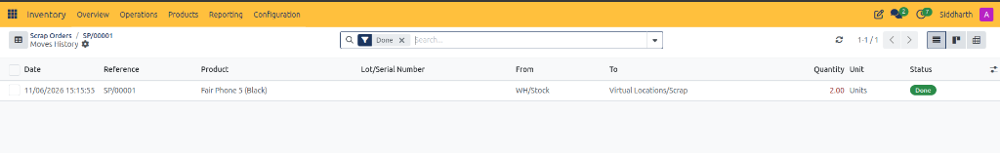
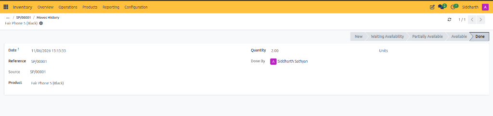

# Process Scrap Orders and Inventory Write-Offs

This operational guide provides procedures for inventory controllers, warehouse leads, and quality inspection teams to write off damaged, expired, or defective products from warehouse storage into virtual scrap locations, audit underlying stock moves, and inspect traceability records in CURQ Inventory.

> **Prerequisites**
> * Operational access permissions to the CURQ Inventory application.
> * Physical products identified as damaged, contaminated, or non-conforming.
> * Authorized permissions to commit inventory write-offs.

---

## 1. Create and Validate Scrap Orders

### 1.1 Access the Scrap Orders Register

1. In the top navigation bar, click the **Operations** menu.
2. Under the **Adjustments** section, click **Scrap**:

3. **Scrap Accounting Architecture**:
   * As indicated in the register overview, scrapping an item removes it from physical warehouse storage *(e.g., `WH/Stock`)* and transfers it to `Virtual Locations/Scrap`.
   * This preserves historical traceability and financial loss reporting without polluting active picking bins.

> For more details about the fields and controls on the scrap orders register, see [**Scrap Orders Register Data Dictionary**](../settings-and-fields/03-physical-inventory-and-scrap-field-definitions.md#2-scrap-orders-register-data-dictionary).

---

### 1.2 Create and Configure a New Scrap Order

1. In the upper-left action bar of the Scrap Orders register, click **+ New**.
2. CURQ opens the blank scrap order form:

3. **Required Information**:
   * **Product (Mandatory)**: Select the specific inventory item being scrapped *(e.g., `Fair Phone 5 (Black)`)*.
   * **Quantity (Mandatory)**: Specify the physical count of units being written off *(e.g., `2.00` `Units`)*.
4. **Optional Supporting Parameters**:
   * **Replenish Quantities**: Check this box if the scrapped units must be replaced immediately. CURQ will trigger a procurement order or replenishment rule to reorder the discarded quantity.
   * **Scrap Reason**: Select or type the justification for the write-off *(e.g., `Transit Damage`)*.
   * **Source Document**: Record cross-module references such as the originating vendor receipt *(e.g., `WH/IN/00070`)*, delivery order, or internal quality audit ticket.

> For more details about the fields and action controls on the scrap order form, see [**Scrap Order Form Fields and Action Controls Data Dictionary**](../settings-and-fields/03-physical-inventory-and-scrap-field-definitions.md#3-scrap-order-form-fields-and-action-controls-data-dictionary).

---

### 1.3 Validate and Review Completed Scrap Orders

Once the product, quantity, and operational context are verified:

1. In the upper-left action bar, click the dark blue **Validate** button.
2. CURQ updates the scrap form to its completed terminal state:

3. **System Execution and Form Updates**:
   * The status chevron advances from **Draft** to **Done**.
   * CURQ assigns an immutable reference identifier *(e.g., `SP/00001`)*.
   * The execution timestamp is recorded in **Date** *(e.g., `11/06/2026 15:15:55`)*.
   * The **Validate** button is removed to prevent duplicate adjustments.
   * The chatter feed logs the state transition: `Draft -> Done (Status)`.

---

## 2. Audit Scrap Stock Moves and History

### 2.1 Access Product Moves via Header Smart Button

From the validated scrap order header, locate the navigation smart button:

1. Click the **Product Moves** smart button in the upper control bar.
2. CURQ redirects to the filtered stock movement register documenting the physical transfer out of warehouse inventory.

> For more details about the validated scrap form and header smart buttons, see [**Validated Scrap Order and Smart Controls Data Dictionary**](../settings-and-fields/03-physical-inventory-and-scrap-field-definitions.md#4-validated-scrap-order-and-smart-controls-data-dictionary).

---

### 2.2 Audit Stock Movements in Moves History

CURQ displays the **Moves History** register filtered to the active scrap reference:

1. **Verify Double-Entry Movement Attributes**:
   * **Date**: Execution timestamp *(e.g., `11/06/2026 15:15:55`)*.
   * **Reference**: Direct link to originating scrap document `SP/00001`.
   * **Product**: Specific inventory item transferred *(e.g., `Fair Phone 5 (Black)`)*.
   * **From**: Source internal storage location *(e.g., `WH/Stock`)*.
   * **To**: Destination scrap location *(e.g., `Virtual Locations/Scrap`)*.
   * **Quantity**: Displayed in red text *(e.g., `2.00 Units`)* reflecting physical inventory deduction.
   * **Status**: Confirms finalized execution with a green **Done** badge.
2. Click anywhere on the table row to inspect the granular stock move record.

> For more details about the columns and stock movement entries on the moves history register, see [**Scrap Moves History Register Data Dictionary**](../settings-and-fields/03-physical-inventory-and-scrap-field-definitions.md#5-scrap-moves-history-register-data-dictionary).

---

### 2.3 Inspect Individual Stock Move Record Attributes

CURQ opens the individual stock move form detailing operational execution:

1. **Stock Move Lifecycle Pipeline**:
   * The chevron bar tracks move progression across **New**, **Waiting Availability**, **Partially Available**, **Available**, and **Done**.
2. **Move Execution Details**:
   * **Date & Reference**: Confirms the execution timestamp and system code *(e.g., `SP/00001`)*.
   * **Source**: Displays originating operational document reference *(e.g., `SP/00001`)*.
   * **Product**: Catalog item description *(e.g., `Fair Phone 5 (Black)`)*.
   * **Quantity**: Exact count of physical units transferred *(e.g., `2.00 Units`)*.
   * **Done By**: User avatar logging the warehouse specialist who validated the physical movement.

> For more details about the lifecycle pipeline and movement fields on the individual move record, see [**Stock Move Record Form Data Dictionary**](../settings-and-fields/03-physical-inventory-and-scrap-field-definitions.md#6-stock-move-record-form-data-dictionary).

---

## Related Documentation

* [Physical Inventory and Scrap Field Definitions](../settings-and-fields/03-physical-inventory-and-scrap-field-definitions.md)
* [Conduct Physical Inventory Counts and Adjustments](./07-conduct-physical-inventory-counts-and-adjustments.md)
* [Manage Replenishment and Automated Reordering Rules](./09-manage-replenishment-and-automated-reordering-rules.md)
* [Replenishment and Reordering Rules Field Definitions](../settings-and-fields/04-replenishment-and-reordering-rules-field-definitions.md)
* [Stock and Location Reporting Field Definitions](../settings-and-fields/05-stock-and-location-reporting-field-definitions.md)
