# Manage Replenishment and Automated Reordering Rules

This operational guide provides procedures for inventory controllers, procurement specialists, and warehouse managers to monitor inventory replenishment propositions, interpret the safety stock curve, filter forecast horizons, evaluate manual reordering lines, execute direct order and Order To Max batch procurements, and convert manual rules to automated scheduler runs in CURQ Inventory.

> **Prerequisites**
> * Operational access permissions to the CURQ Inventory application.
> * Product records configured with tracked inventory and active supply routes *(such as Buy or Manufacture)*.
> * Reordering rules defined with designated minimum and maximum stock limits.
> * Authorized permissions to generate purchase requests or manufacturing orders.

---

## 1. Configure and Filter the Replenishment Board

### 1.1 Access the Replenishment Board and Interpret the Safety Stock Replenishment Curve

1. In the top navigation bar, click the **Operations** menu.
2. Under the **Procurement** section, click **Replenishment**:

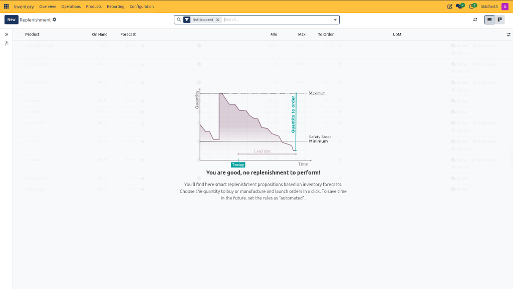

3. **Interpret the Safety Stock Replenishment Curve**:
   * **Time (X-Axis)**: Represents the forward inventory planning timeline, beginning from the current operational date marked by the **Today** badge.
   * **Quantity (Y-Axis)**: Tracks available stock levels over time as goods are consumed or shipped.
   * **Safety Stock Minimum**: The horizontal threshold below which physical stock must not drop to prevent operational stockouts during demand spikes.
   * **Maximum**: The target warehouse storage capacity ceiling configured for the item.
   * **Lead Time**: The elapsed duration between placing a replenishment order and receiving physical stock at the warehouse dock.
   * **Quantity to Order**: The calculated procurement volume required to raise stock from the projected dip back up to the target maximum capacity.
4. **Empty State Guidance**:
   * When all products remain above their minimum safety thresholds within the current forecast window, CURQ displays: *"You are good, no replenishment to perform! You'll find here smart replenishment propositions based on inventory forecasts. Choose the quantity to buy or manufacture and launch orders in a click. To save time in the future, set the rules as 'automated'."*

---

### 1.2 Create Manual Replenishment Rules and Filter Eligible Storable Products

1. To define a new reordering rule manually from the board, click the **+ New** action button in the upper-left header.
2. In the newly generated line, click the **Product** dropdown and select **Search More...** to open the product selection modal:

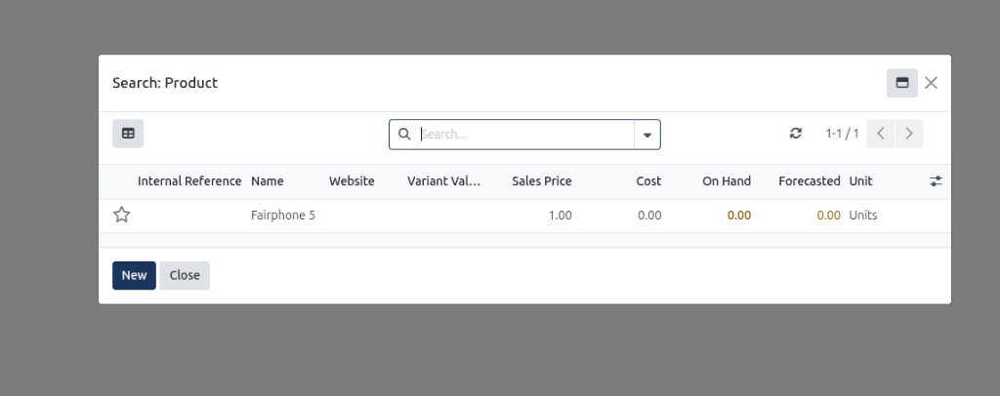

3. **Why Other Products Do Not Appear in the Lookup**:
   * **Storable Products Only**: CURQ enforces a strict domain constraint (`type == 'product'`) on the replenishment product selector. Service items *(such as Delivery charges, Mileage, Expenses, Timesheets)* and Consumable items are automatically excluded because they do not track on-hand inventory or safety stock balances.
   * **Existing Rule Deduplication**: Products that already possess an active reordering rule assigned to the current warehouse location *(e.g., `WH/Stock`)* do not appear in the selection list to prevent duplicate, conflicting safety rules.
   * **Procurement Routing**: Only items configured with active procurement routes *(such as Buy or Manufacture)* qualify for replenishment rule assignment.
4. Select the target product *(e.g., `Fairphone 5`)* to populate the line and configure its minimum and maximum stock limits.

> For more details about the fields and controls on the product search dialog, see [**Search: Product Lookup Modal Data Dictionary**](../settings-and-fields/04-replenishment-and-reordering-rules-field-definitions.md#2-search-product-lookup-modal-data-dictionary).

---

### 1.3 Filter Planning Horizons and Active Replenishment Rules

1. By default, CURQ filters the board using the **Not Snoozed** tag in the search bar, ensuring only active replenishment demands are displayed.
2. Click the navigation drawer toggle icon in the upper-left corner of the register to reveal the horizon filter panel:

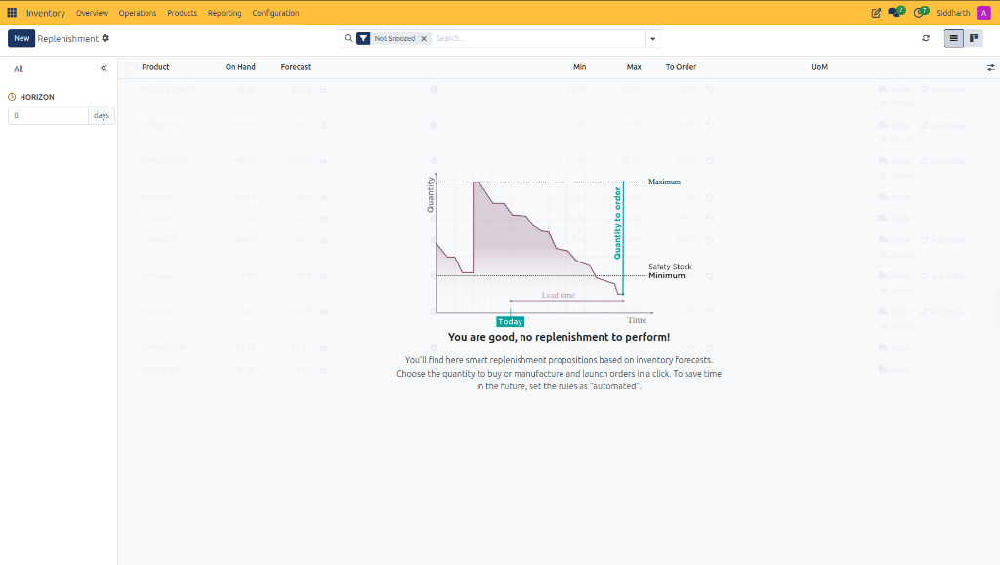

3. **Configure the Forecast Horizon**:
   * **HORIZON (0 days)**: Projects inventory consumption and arrivals up to the selected day threshold. Setting the horizon to 0 days evaluates stock deficits requiring immediate procurement today. Increasing the horizon window allows procurement managers to anticipate future deficits driven by scheduled delivery orders or manufacturing consumption before stockouts occur.
   * **Trigger Filters**: Filter propositions by trigger mechanism *(such as Manual review or Automated execution)*.
   * **Category Filters**: Narrow replenishment propositions by product categories to streamline buyer assignments.

> For more details about the header and horizon filter controls, see [**Replenishment Board Header and Navigation Controls Data Dictionary**](../settings-and-fields/04-replenishment-and-reordering-rules-field-definitions.md#1-replenishment-board-header-and-navigation-controls-data-dictionary).

---

## 2. Execute and Troubleshoot Replenishment Orders

### 2.1 Review Stock Forecasts, Reordering Thresholds, and Row Actions

When inventory levels or customer demand trigger a reordering requirement, CURQ populates the replenishment board with actionable order propositions:

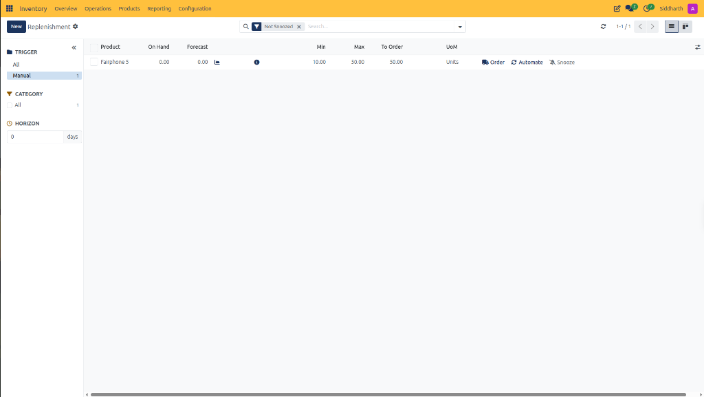

1. **Evaluate Proposition Parameters**:
   * **Product**: Identifies the item requiring replenishment *(e.g., `Fairphone 5`)*.
   * **On Hand**: Displays physical units currently stored in warehouse bins *(e.g., `0.00`)*.
   * **Forecast**: Displays projected future inventory balance *(e.g., `0.00`)*, accompanied by a facility icon denoting incoming receipts or production orders.
   * **Min**: The configured safety stock minimum threshold *(e.g., `10.00`)*. When forecasted inventory falls below this limit, CURQ generates a replenishment proposition.
   * **Max**: The configured target stock capacity ceiling *(e.g., `50.00`)*.
   * **To Order**: The calculated procurement quantity *(e.g., `50.00 Units`)* needed to replenish stock up to the maximum limit.
   * **UoM**: The primary inventory unit of measure *(e.g., `Units`)*.
2. **Execute Row-Level Actions**:
   * **Order (Truck Icon)**: Immediately dispatches a procurement order *(such as a draft Purchase Order or Manufacturing Order)* for the specified `To Order` quantity.
   * **Automate (Cycle Icon)**: Converts the rule from manual review to automated background scheduler execution. When automated, CURQ automatically places orders whenever forecasted stock drops below minimum limits without requiring manual buyer confirmation.
   * **Snooze (Bell Icon)**: Temporarily suppresses the proposition until a specified date, hiding it from the active board until the snooze period expires.

> For more details about the replenishment columns and row actions, see [**Replenishment Table Columns Data Dictionary**](../settings-and-fields/04-replenishment-and-reordering-rules-field-definitions.md#3-replenishment-table-columns-data-dictionary) and [**Row-Level Action Controls Data Dictionary**](../settings-and-fields/04-replenishment-and-reordering-rules-field-definitions.md#4-row-level-action-controls-data-dictionary).

---

### 2.2 Execute Batch Replenishment Orders and Reorder to Max

Procurement teams managing multi-item replenishments can process orders in bulk using the multi-select action bar:

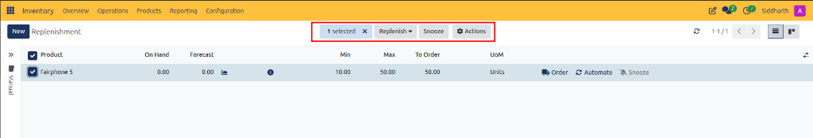

1. Select the checkbox next to one or more replenishment lines *(e.g., `Fairphone 5`)*.
2. CURQ activates the top batch action bar displaying the count of selected items *(e.g., `1 selected`)*.
3. Click the **Replenish** dropdown button to choose the procurement execution strategy:

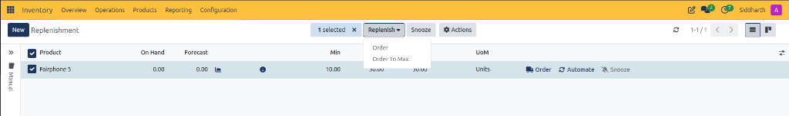

4. **Select Replenishment Strategy**:
   * **Order**: Dispatches procurement orders matching the exact quantity currently specified in the **To Order** column *(e.g., `50.00 Units`)*.
   * **Order To Max**: Recalculates demand at the moment of execution to ensure the placed order raises forecasted stock precisely to the configured **Max** ceiling *(e.g., `50.00 Units`)*, accounting for any new demand orders registered since the table was loaded.
5. **Batch Snooze and Export**:
   * Click **Snooze** to defer replenishment across all selected items simultaneously.
   * Click **Actions** to export selected replenishment lines to a spreadsheet for external supplier review or vendor negotiation.

---

### 2.3 Troubleshoot Procurement Warnings and Vendor Minimum Quantities

When triggering replenishment using **Order** or **Replenish > Order**, CURQ cross-references the proposed order volume against the product's configured vendor pricelist. If validation criteria fail, CURQ halts order generation and displays an operational warning dialog:

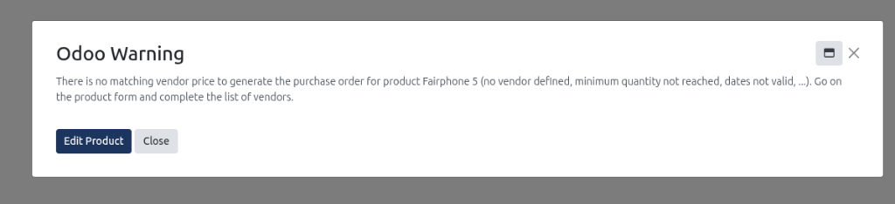

1. **Understand Warning Triggers**:
   * **Warning Message**: *"There is no matching vendor price to generate the purchase order for product Fairphone 5 (no vendor defined, minimum quantity not reached, dates not valid, ...). Go on the product form and complete the list of vendors."*
   * **Root Cause Analysis**:
     * **No Vendor Defined**: The product record contains zero approved vendor pricelist entries on its Purchase tab.
     * **Minimum Quantity Not Reached**: The primary vendor requires a minimum order volume *(e.g., `100.00 Units`)* that exceeds the current replenishment proposal *(e.g., `50.00 Units`)*.
     * **Dates Not Valid**: The vendor agreement carries an expired price validity timeframe.

> For more details about procurement warning dialog controls, see [**Procurement Warning Dialog Data Dictionary**](../settings-and-fields/04-replenishment-and-reordering-rules-field-definitions.md#5-procurement-warning-dialog-data-dictionary).

2. **Resolve Vendor Constraints via Product Form**:
   * Click the dark blue **Edit Product** button in the warning modal to open the product configuration record directly:

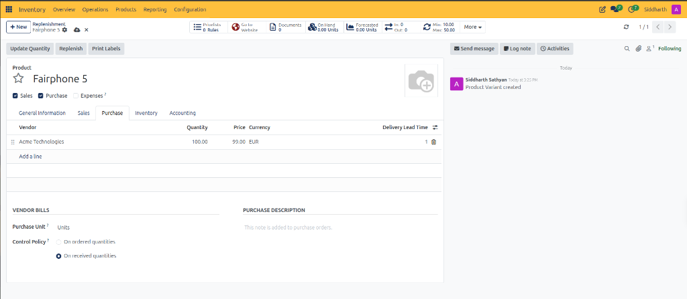

3. **Configure Vendor Pricelist Lines**:
   * **Vendor**: Select or review the primary supplier *(e.g., `Acme Technologies`)*.
   * **Quantity**: Inspect the vendor's minimum purchase threshold. If the vendor accepts smaller replenishment batches, adjust this value from `100.00` to `0.00` or `1.00`. Alternatively, define tiered pricing lines *(e.g., `1.00` unit at standard price, and `100.00` units at volume discount)*.
   * **Price & Currency**: Verify the contracted unit cost *(e.g., `99.00 EUR`)*.
   * **Delivery Lead Time**: Define vendor fulfillment transit days *(e.g., `1` day)* to calculate delivery target dates.
4. **Inspect Reordering Rule Smart Button**:
   * In the upper smart button panel, the **Min: 10.00 / Max: 50.00** indicator confirms the active reordering rule governing replenishment calculations.
5. **Set Vendor Bills Control Policy**:
   * Under the **VENDOR BILLS** section, verify the invoice verification policy:
     * **On ordered quantities**: Authorizes vendor billing based on purchase order commitment before receipt.
     * **On received quantities (Standard for Physical Inventory)**: Enforces three-way matching, blocking vendor bill posting until receiving teams validate inbound dock receipts.
6. **Add Purchase Descriptions**:
   * In the **PURCHASE DESCRIPTION** field, enter vendor-specific packaging instructions or warehouse receiving guidelines to print automatically on outbound Purchase Orders.
7. **Commit Changes and Re-execute Replenishment**:
   * Once the vendor minimum quantity is adjusted to `0.00`, CURQ automatically saves the record:

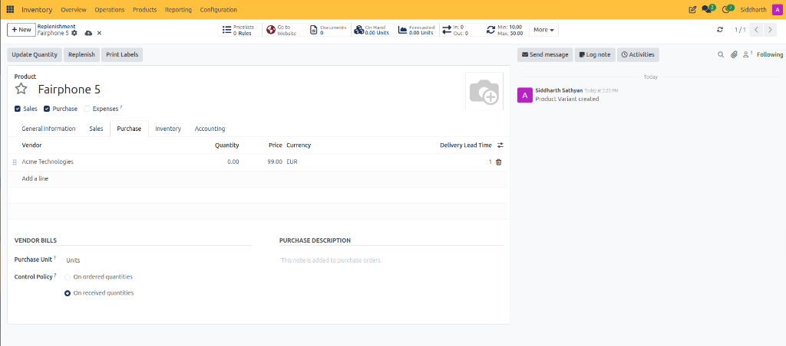

   * Click the **Replenishment** link in the breadcrumb trail *(or navigate to **Operations > Replenishment**)* to return to the active proposition table.
   * Click **Order** on the row or select the line and choose **Replenish > Order**. Because `50.00 >= 0.00`, CURQ successfully validates the supplier contract and generates a draft Purchase Order in CURQ Purchase.

> For more details about vendor pricelists and purchase tab controls, see [**Product Purchase Tab and Vendor Pricelist Data Dictionary**](../settings-and-fields/04-replenishment-and-reordering-rules-field-definitions.md#6-product-purchase-tab-and-vendor-pricelist-data-dictionary).

---

## 3. Validate Orders, Forecast Reports, and Scheduling Modes

### 3.1 Validate Generated Replenishment Orders in CURQ Purchase

Upon clicking **Order**, CURQ executes autonomous procurement generation and alerts operators through real-time notifications:

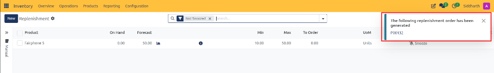

1. **Interpret Live Replenishment Board Updates**:
   * **Toast Notification**: CURQ displays a banner in the upper-right corner announcing: *"The following replenishment order has been generated: P00132"*.
   * **Forecast Adjustment**: The **Forecast** metric immediately updates from `0.00` to `50.00` with an active facility icon, registering incoming purchase units in the inventory projection ledger.
   * **Demand Resolution**: The **To Order** metric drops from `50.00` to `0.00`.
   * **Action Control Disablement**: The `Order` and `Automate` buttons are removed from the row, leaving only `Snooze` since zero unfulfilled replenishment deficit remains.

2. Click the blue **P00132** link in the toast notification to inspect the generated procurement document in CURQ Purchase:

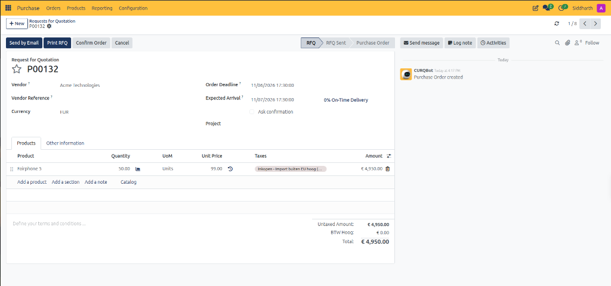

3. **Verify Generated Purchase Order Attributes**:
   * **Lifecycle Chevron**: Positioned in the initial **RFQ** stage, allowing buyers to review terms before issuing legal vendor commitments.
   * **Vendor**: Automatically assigned to **Acme Technologies** based on the product vendor agreement.
   * **Expected Arrival**: System-calculated as `11/07/2026 17:30:00` by adding the vendor's 1-day delivery lead time to the order creation timestamp (`11/06/2026 17:30:00`).
   * **Product & Quantity**: Pre-populated with **Fairphone 5** for exactly `50.00 Units`.
   * **Unit Price & Valuation**: Bound to the contracted rate of `99.00 EUR`, producing an untaxed commitment of `€ 4,950.00`.
   * **Audit Log Traceability**: The chatter feed confirms automated creation by the system: `CURQBot: Purchase Order created`.
4. **Advance Procurement Lifecycle**:
   * Click **Send by Email** to transmit the RFQ to the supplier.
   * Click **Confirm Order** to finalize the purchase agreement, converting the document to an active Purchase Order and creating the corresponding inbound receipt transfer (`WH/IN`) in CURQ Inventory.

> For more details about generated purchase quotations and line items, see [**Generated Request for Quotation (RFQ) Data Dictionary**](../settings-and-fields/04-replenishment-and-reordering-rules-field-definitions.md#7-generated-request-for-quotation-rfq-data-dictionary).

---

### 3.2 Audit Validated Receipts and the Interactive Forecasted Report

Following purchase order confirmation and receipt validation at the warehouse dock, CURQ reconciles physical inventory balances and updates forward-looking planning charts:

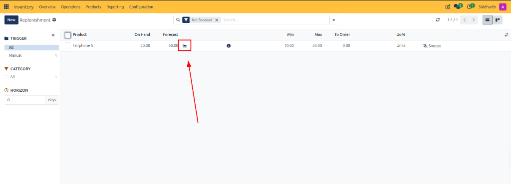

1. **Verify Stock Rebalancing on the Replenishment Board**:
   * **On Hand**: Physical warehouse stock increments from `0.00` to **`50.00 Units`**, confirming warehouse receiving intake into `WH/Stock`.
   * **Forecast**: Retains an equilibrium value of **`50.00 Units`**.
   * **To Order**: Remains at **`0.00`** because on-hand stock matches the configured target maximum (`Max: 50.00`).
2. **Access the Forecasted Report**:
   * Locate the **Forecast** column on the **Fairphone 5** row.
   * Click the graph drilldown icon positioned immediately next to the numerical value *(highlighted by the red box and arrow in `052.png`)*.
   * CURQ opens the comprehensive **Forecasted Report**:

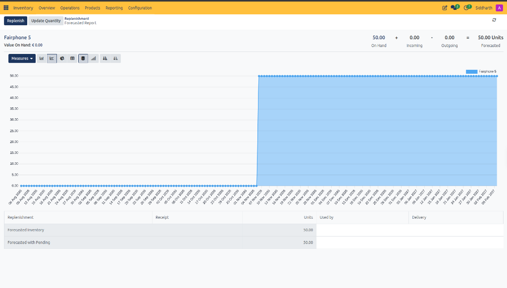

3. **Interpret the Real-Time Stock Balancing Formula**:
   * In the upper-right header, CURQ evaluates inventory equilibrium:
     $$\text{On Hand (50.00)} + \text{Incoming (0.00)} - \text{Outgoing (0.00)} = \text{50.00 Units (Forecasted)}$$
   * **On Hand (`50.00`)**: Physical units stored in warehouse locations, validated by dock receiving.
   * **Incoming (`0.00`)**: Pending purchase receipts or manufacturing completions. Because the purchase receipt was validated, incoming units have fully transitioned into on-hand inventory.
   * **Outgoing (`0.00`)**: Product units reserved for outgoing customer delivery orders.
   * **Forecasted (`50.00 Units`)**: Projected net inventory availability available for future sales allocations.
4. **Analyze the Chronological Timeline Step Chart**:
   * The interactive visual graph plots product availability across forward operational dates.
   * On the intake validation date *(e.g., `07 Nov 2026`)*, the stock curve steps sharply from `0.00` to `50.00 Units` and forms a stable supply plateau.
   * The ledger below details the movements contributing to **Forecasted Inventory** and **Forecasted with Pending**.
   * Operators can click **Update Quantity** or **Replenish** directly from this report to adjust stock counts or schedule further intake.

---

### 3.3 Manual Review vs Automated Procurement Scheduler

CURQ provides two complementary modes for managing inventory replenishment:

1. **Manual Replenishment Review**:
   * Rules configured as **Manual** populate the Replenishment board as propositions.
   * Buyers retain final editorial control over order timing, quantities, and supplier selection before committing purchase commitments.
2. **Automated Background Scheduler**:
   * Rules configured as **Automated** bypass the manual replenishment board.
   * During periodic automated scheduler runs or when clicking **Operations > Procurement: run scheduler**, CURQ scans all automated reordering rules and automatically generates draft Purchase Orders in CURQ Purchase or Manufacturing Orders in CURQ Manufacturing.
   * Clicking the **Automate** action button on any manual line immediately transitions that rule to the automated scheduler workflow.

---

## Related Documentation

* [Replenishment and Reordering Rules Field Definitions](../settings-and-fields/04-replenishment-and-reordering-rules-field-definitions.md)
* [Understanding Reordering Rules and Lead Times](../core-concepts/02-understanding-reordering-rules-and-lead-times.md)
* [Physical Inventory and Scrap Field Definitions](../settings-and-fields/03-physical-inventory-and-scrap-field-definitions.md)
* [Conduct Physical Inventory Counts and Adjustments](./07-conduct-physical-inventory-counts-and-adjustments.md)
* [Process Scrap Orders and Inventory Write-Offs](./08-process-scrap-orders-and-inventory-write-offs.md)
