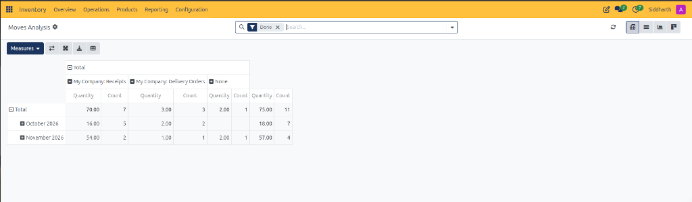
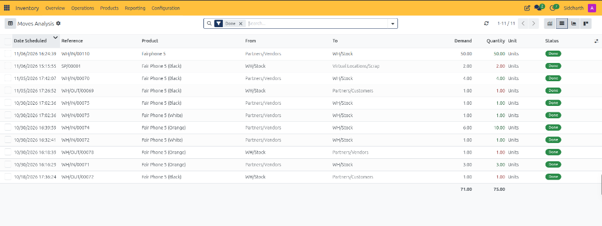
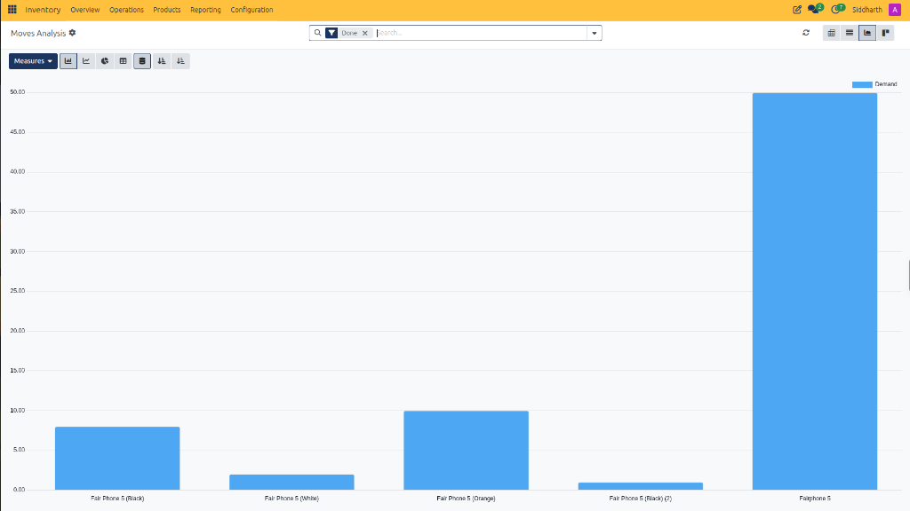
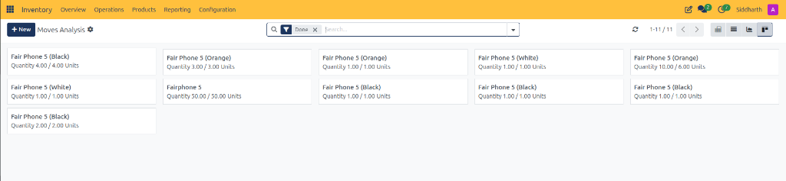

# Analyze Stock Moves and Warehouse Throughput

This operational guide provides procedures for warehouse managers, inventory controllers, and logistics analysts to evaluate fulfillment velocity, inspect double-entry stock movement registers, generate multi-dimensional throughput pivot tables, and visualize demand distributions across product lines in CURQ Inventory.

---

### Prerequisites

* Operational access permissions to the CURQ Inventory application.
* Historical completed stock transfers *(such as vendor receipts, customer deliveries, or scrap write-offs)*.
* Familiarity with CURQ double-entry stock tracking between internal and external locations.

---

### Access Moves Analysis and Evaluate Multi-Dimensional Pivot Metrics

1. In the top navigation bar, click the **Reporting** menu.
2. Select **Moves Analysis**:

3. **Navigate the Multi-Dimensional Pivot Matrix**:
   * **Default Filter**: CURQ applies the `Done` filter tag by default, restricting analytics to finalized stock transactions.
   * **Operation Type Grouping**: Horizontal matrix headers break down moves by operation:
     * **My Company: Receipts**: Tracks inbound freight intake from suppliers *(e.g., 70.00 Units across 7 orders)*.
     * **My Company: Delivery Orders**: Tracks outbound customer shipments *(e.g., 3.00 Units across 3 orders)*.
     * **None**: Identifies operational transfers not bound to standard transfer types, specifically scrap write-offs *(e.g., 2.00 Units on Scrap Order `SP/00001`)*.
   * **Temporal Grouping**: Vertical rows cluster movements by fiscal month *(e.g., `October 2026`, `November 2026`)*.
   * **Metrics Analyzed**:
     * **Quantity**: Aggregate volume of physical product units moved.
     * **Count**: Total number of distinct transaction moves executed.
4. **Pivot Control Bar Tools**:
   * **Measures Dropdown**: Switch calculation metrics between physical volume, demand, and transactional count.
   * **Swap Axis (Flip Icon)**: Inverts rows and columns to analyze operations chronologically.
   * **Expand / Collapse Icons**: Drills down into individual product categories and SKUs.
   * **Download (XLSX)**: Exports the pivot matrix directly into Microsoft Excel format.
   * **Insert in Spreadsheet**: Embeds live pivot figures into an internal CURQ spreadsheet dashboard.

---

### Inspect Granular Double-Entry Transfers in List View

To examine line-by-line execution details, source bins, and fulfillment variances:

1. In the upper-right corner of the Moves Analysis view, click the **List** view switcher.
2. CURQ renders the comprehensive transactional movement register:

3. **Audit Double-Entry Movement Attributes**:
   * **Date Scheduled**: Planned and executed movement timestamp *(e.g., `11/06/2026 16:24:39`)*.
   * **Reference**: Direct alphanumeric link to the originating operational document *(e.g., Inbound Receipt `WH/IN/00110`, Scrap Order `SP/00001`, Outbound Delivery `WH/OUT/00069`)*.
   * **Product**: Specific inventory catalog item or variant transferred *(e.g., `Fairphone 5`, `Fair Phone 5 (Black)`)*.
   * **From**: Source location debited during execution *(e.g., `Partners/Vendors`, `WH/Stock`)*.
   * **To**: Destination location credited during execution *(e.g., `WH/Stock`, `Partners/Customers`, `Virtual Locations/Scrap`)*.
   * **Demand**: Original requested quantity specified by the originating purchase or sales order.
   * **Quantity**: Actual physical units transferred. Figures displayed in red text *(such as `-2.00 Units` for scrap or `-1.00 Units` for deliveries)* represent stock deductions from internal warehouse storage.
   * **Unit**: Applied inventory unit of measure *(e.g., `Units`)*.
   * **Status**: Confirms terminal operational execution with a green **Done** badge.
4. **Examine Summary Throughput**:
   * The list footer computes aggregate totals across all visible moves *(e.g., `71.00` total demand against `75.00` total units physically executed)*.

---

### Visualize Demand Distributions in Graph View

To identify high-velocity products and analyze fulfillment volume visually:

1. In the upper-right control panel, click the **Graph** view switcher.
2. CURQ plots movement volume in graphical chart format:

3. **Interpret Graph Analytics**:
   * **Measures**: Displays total requested volume per product line *(e.g., `Demand`)*.
   * **Product Distribution**:
     * Highlights volume disparity between base stock intake *(e.g., `50.00` units for `Fairphone 5`)* and variant fulfillment runs *(e.g., `Fair Phone 5 (Black)`, `Fair Phone 5 (White)`, `Fair Phone 5 (Orange)`)*.
   * **Chart Modes**: Use the toolbar to toggle between vertical bar charts, line trends, pie proportions, or stacked volume perspectives.

---

### Review Visual Cards in Kanban Perspective

To monitor stock move execution in a card-oriented layout:

1. In the upper-right corner, click the **Kanban** view switcher.
2. CURQ arranges transaction records into visual operational cards:

3. **Inspect Card Fulfillment Ratios**:
   * Each card displays the product title alongside the execution ratio *(e.g., `Quantity 50.00 / 50.00 Units`, `Quantity 10.00 / 6.00 Units`)*.
   * Ratios where executed quantity matches demand indicate exact fulfillment without backorders.
   * Ratios with variances highlight over-deliveries or vendor over-shipments accepted at the dock.
4. Click any card to drill down into the underlying stock move form for detailed warehouse traceability.

---

### Related Documentation

* [Moves Analysis and Reporting Field Definitions](../settings-and-fields/10-moves-analysis-and-reporting-field-definitions.md)
* [Audit Historical Stock Movements in Moves History](./11-audit-historical-stock-movements-in-moves-history.md)
* [Moves History Field Definitions](../settings-and-fields/11-moves-history-field-definitions.md)
* [Track Inventory by Location and Storage Bins](./12-track-inventory-by-location-and-storage-bins.md)
* [Location Reporting Field Definitions](../settings-and-fields/12-location-reporting-field-definitions.md)
* [Audit Stock Moves and Inventory Valuation](./04-audit-stock-moves-and-inventory-valuation.md)
* [Detailed Operations and Stock Valuation Field Definitions](../settings-and-fields/04-detailed-operations-and-stock-valuation-field-definitions.md)
* [Process Outbound Delivery Orders and Customer Shipments](./03-process-outbound-delivery-orders-and-customer-shipments.md)
* [Process Inbound Receipts and Vendor Deliveries](./02-process-inbound-receipts-and-vendor-deliveries.md)
* [Process Scrap Orders and Inventory Write-Offs](./08-process-scrap-orders-and-inventory-write-offs.md)
* [Understanding Double-Entry Inventory and Stock Flows](../core-concepts/01-understanding-double-entry-inventory-and-stock-flows.md)

