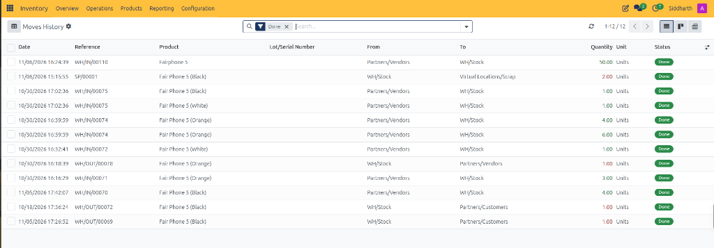
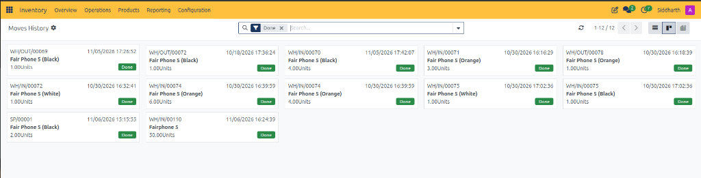
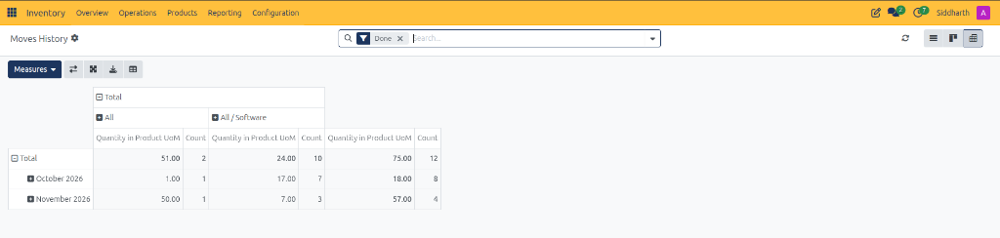

# Audit Historical Stock Movements in Moves History

This operational guide provides procedures for warehouse managers, inventory controllers, and compliance auditors to inspect atomic stock move lines, trace source and destination locations, audit hardware serial identifiers, review Kanban cards, and generate category-based pivot summaries in CURQ Inventory.

> **Prerequisites**
> * Operational access permissions to the CURQ Inventory application.
> * Validated warehouse transfers *(such as completed supplier receipts, customer deliveries, or scrap write-offs)*.
> * Familiarity with CURQ double-entry stock movement logic between internal, partner, and virtual locations.

---

## 1. Access Master Moves History and Audit Granular Stock Move Lines

1. In the top navigation bar, click the **Reporting** menu.
2. Select **Moves History**:

3. **Understand Moves History Granularity**:
   * **Atomic Move Line Level**: Unlike Moves Analysis which aggregates by high-level order picking lines, Moves History tracks atomic detailed operations *(such as specific bin allocations, split putaway lines, and serial assignments)*.
   * **Row Split Demonstration**: For example, vendor receipt `WH/IN/00074` appears as two distinct lines *(4.00 Units and 6.00 Units)* rather than a single 10-unit aggregate, documenting separate physical pallet putaways at dock intake.
   * **Record Count**: Displays all 12 executed atomic move lines (`1-12 / 12`) filtered by default to terminal `Done` status.
4. **Audit Granular Move Line Columns**:
   * **Date**: Execution timestamp of the physical stock transfer *(e.g., `11/06/2026 16:24:39`)*.
   * **Reference**: Direct operational document code *(e.g., `WH/IN/00110`, `SP/00001`, `WH/OUT/00069`)*.
   * **Product**: Inventory catalog SKU or variant *(e.g., `Fairphone 5`, `Fair Phone 5 (Black)`)*.
   * **Lot/Serial Number**: Dedicated column for tracking specific hardware serial strings or batch numbers.
   * **From**: Source location debited during execution *(e.g., `Partners/Vendors`, `WH/Stock`)*.
   * **To**: Destination location credited during execution *(e.g., `WH/Stock`, `Partners/Customers`, `Virtual Locations/Scrap`)*.
   * **Quantity**: Measured count of physical units transferred. Inventory deductions from internal storage *(such as `-2.00 Units` for scrap `SP/00001` or `-1.00 Units` for deliveries `WH/OUT/00069`)* are formatted in red text.
   * **Unit**: Primary inventory unit of measure *(e.g., `Units`)*.
   * **Status**: Confirms finalized physical execution with a green **Done** badge.

> **Tip:** For more details about the columns and tracking controls on the moves history register, see [**Moves History List Register Data Dictionary**](../settings-and-fields/06-stock-moves-analysis-and-valuation-field-definitions.md#3-moves-history-list-register-data-dictionary).

---

## 2. Review Operational Movements in Kanban Card Mode

To inspect historical stock movements in a card-oriented operational perspective:

1. In the upper-right corner of the Moves History register, click the **Kanban** view switcher.
2. CURQ renders executed movements as standalone operational cards:

3. **Inspect Card Details**:
   * **Header Reference & Timestamp**: Displays the originating document code alongside the exact execution date and time *(e.g., `WH/OUT/00069` executed on `11/05/2026 17:26:52`)*.
   * **Product Catalog Name**: Highlights the specific inventory item transferred *(e.g., `Fair Phone 5 (Black)`)*.
   * **Executed Quantity**: Confirms the physical unit count transferred *(e.g., `1.00Units`, `4.00Units`, `50.00Units`)*.
   * **Status Badge**: Terminal green **Done** badge confirming warehouse validation.
4. Click any card to drill down into the granular stock move record for detailed warehouse logging.

> **Tip:** For more details about the fields on operational movement cards, see [**Moves History Kanban Card Data Dictionary**](../settings-and-fields/06-stock-moves-analysis-and-valuation-field-definitions.md#4-moves-history-kanban-card-data-dictionary).

---

## 3. Aggregate Movements by Product Category in Pivot View

To analyze inventory throughput across product categories and calendar periods:

1. In the upper-right control panel, click the **Pivot** view switcher.
2. CURQ displays the category-based movement summary matrix:

3. **Analyze Category Throughput**:
   * **Category Columns**:
     * **All**: Tracks products belonging directly to the root category, such as base **Fairphone 5** intake *(e.g., 50.00 Units in November 2026)*.
     * **All / Software**: Tracks specialized variant items and service accessories *(e.g., 24.00 Units across 10 transactions)*.
   * **Sub-Metrics**:
     * **Quantity in Product UoM**: Total physical unit count transferred within that category.
     * **Count**: Total number of atomic move lines executed.
   * **Temporal Totals**:
     * **October 2026**: 18.00 Units across 8 move transactions.
     * **November 2026**: 57.00 Units across 4 move transactions.
     * **Total Enterprise Throughput**: 75.00 Units across 12 atomic moves.
   * 4. Use the pivot toolbar to download the matrix in XLSX format or embed it into corporate financial reports.

> **Tip:** For more details about category groupings and pivot matrix dimensions, see [**Moves History Pivot View Data Dictionary**](../settings-and-fields/06-stock-moves-analysis-and-valuation-field-definitions.md#5-moves-history-pivot-view-data-dictionary).

---

## Related Documentation

* [Stock Moves Analysis and Valuation Field Definitions](../settings-and-fields/06-stock-moves-analysis-and-valuation-field-definitions.md)
* [Track Inventory by Location and Storage Bins](./12-track-inventory-by-location-and-storage-bins.md)
* [Analyze Stock Moves and Warehouse Throughput](./10-analyze-stock-moves-and-warehouse-throughput.md)
* [Track Enterprise Stock Balances and Inventory at Date](./13-track-enterprise-stock-balances-and-inventory-at-date.md)
* [Audit Stock Moves and Inventory Valuation](./04-audit-stock-moves-and-inventory-valuation.md)
