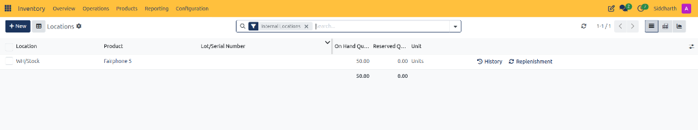
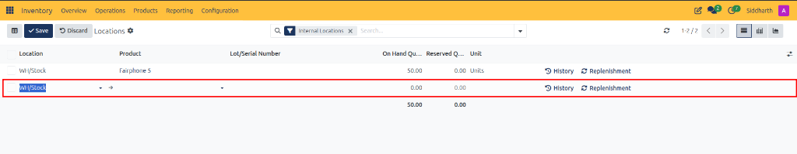
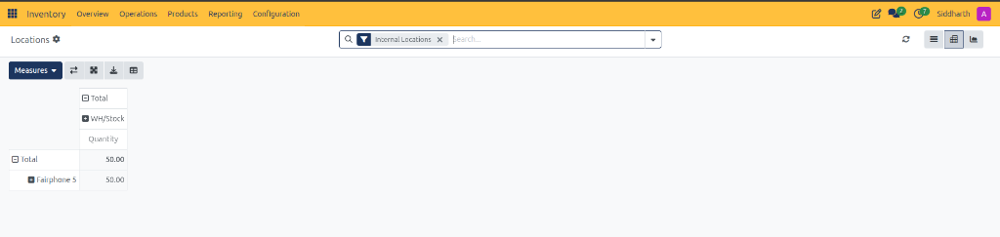
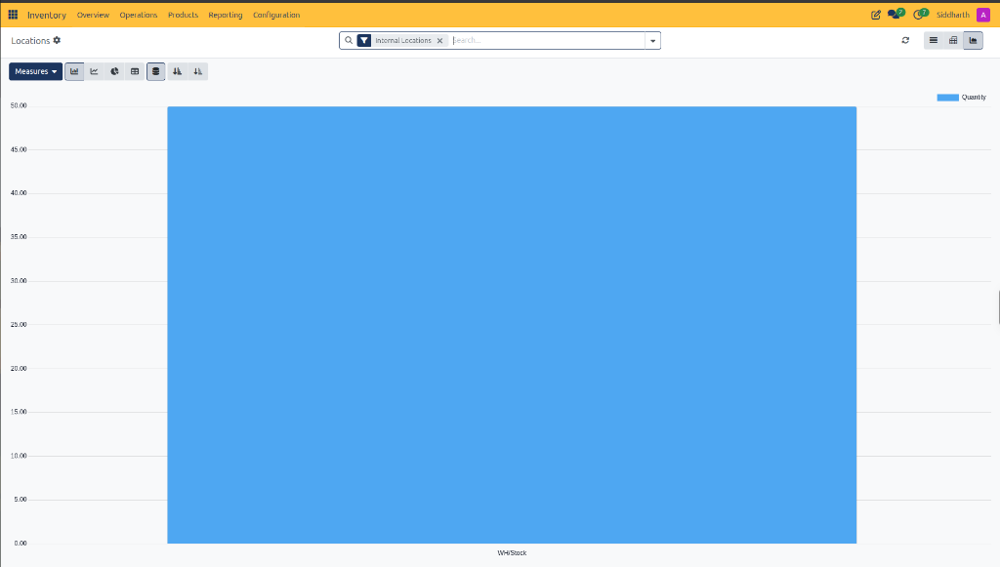

# Track Inventory by Location and Storage Bins

This operational guide provides procedures for warehouse managers, inventory controllers, and logistics supervisors to audit on-hand stock balances across physical storage locations and bins, analyze inventory distribution in pivot matrices, evaluate storage utilization in graphical charts, and trigger direct history auditing or reordering replenishment from location rows in CURQ Inventory.

> **Prerequisites**
> * Operational access permissions to the CURQ Inventory application.
> * Validated stock receipts into internal storage locations *(such as `WH/Stock`)*.
> * Familiarity with the CURQ location hierarchy separating internal warehouse storage from external partner and virtual scrap locations.

---

## 1. Audit and Adjust Storage Bin Stock

### 1.1 Access the Locations Report and Audit Internal Warehouse Stock

1. In the top navigation bar, click the **Reporting** menu.
2. Select **Locations**:

3. **Understand the Internal Locations Filter**:
   * CURQ automatically applies the **Internal Locations** filter tag in the search bar upon opening the report.
   * This filter restricts the view strictly to internal physical storage locations owned and managed by the company *(such as main warehouse storage `WH/Stock`, staging zones, or pick bins)*, excluding vendor intake, customer dispatch, inventory loss, and scrap virtual locations.
4. **Audit Granular Location Inventory Columns**:
   * **Location**: Specific storage zone, bin, aisle, or rack where stock is physically held *(e.g., `WH/Stock`)*.
   * **Product**: Catalog item description or SKU *(e.g., `Fairphone 5`)*.
   * **Lot/Serial Number**: Hardware tracking serial or production lot string assigned to the stored units *(remains blank for non-serialized stock items)*.
   * **On Hand Quantity**: Total physical units currently located in the bin *(e.g., `50.00`)*.
   * **Reserved Quantity**: Units committed to confirmed outbound delivery orders, manufacturing work orders, or pending internal transfers awaiting physical picking *(e.g., `0.00`)*. Net available stock for new sales orders equals On Hand Quantity minus Reserved Quantity.
   * **Unit**: Standard measurement unit applied to the inventory count *(e.g., `Units`)*.
   * **Summary Total Row**: Bottom row aggregating total physical stock on hand *(e.g., `50.00`)* and total reserved stock *(e.g., `0.00`)* across all filtered storage bins.
5. **Execute Row-Level Action Shortcuts**:
   * **History Control** *(clock counter-clockwise icon)*: Click **History** on any location line to open the Moves History register pre-filtered to that specific product and location. This allows immediate auditing of all past stock receipts, internal relocations, and customer shipments affecting that bin.
32:    * **Replenishment Control** *(cycle arrows icon)*: Click **Replenishment** on any location line to navigate directly to the replenishment rules configuration for that product at that location. Warehouse controllers can inspect min/max thresholds, review procurement lead times, or trigger an immediate purchase order.

> For more details about the columns and controls on the locations register, see [**Locations List Register and Action Controls Data Dictionary**](../settings-and-fields/05-stock-and-location-reporting-field-definitions.md#3-locations-list-register-and-action-controls-data-dictionary).

---

### 1.2 Record Opening Stock Balances and Manual Adjustments via + New

When initializing warehouse stock for the first time or performing manual inventory adjustments directly from the Locations register:

1. In the upper-left action bar of the Locations register, click the **+ New** button.
2. CURQ transitions the header controls to **Save** and **Discard** and appends an inline editable row at the bottom of the table:

3. **Distinguish Stock Balances from Storage Location Records**:
   * **Stock Balance Entry**: Clicking **+ New** on this reporting view does not create a new physical warehouse location. Instead, it inserts a new inventory balance line to record physical unit quantities inside an existing location.
   * **Warehouse Location Configuration**: Full warehouse location creation *(such as defining new storage racks, aisles, or bins)* is managed separately under **Configuration > Locations** once the storage locations setting is enabled in system settings.
4. **Configure Inline Stock Line Attributes**:
   * **Location**: Pre-selects default warehouse storage *(e.g., `WH/Stock`)*. Click the dropdown arrow to select a different existing location, or click the external link arrow *(right arrow icon)* next to the location name to inspect the underlying location setup. Creating new locations directly from this field is restricted to prevent unauthorized or misspelled bin records. Location setup must be configured under Configuration > Settings.
   * **Product**: Click the product dropdown to select the inventory catalog item to stage in this bin.
   * **Lot/Serial Number**: If tracking is activated on the product, select or enter the specific lot or serial number string.
   * **On Hand Quantity**: Enter the physical opening balance or adjusted unit count *(defaults to `0.00`)*.
5. **Commit or Cancel the Stock Line**:
   * Click the dark blue **Save** button *(checkmark icon)* to commit the stock line. CURQ automatically posts an inventory adjustment move crediting physical stock to the destination location from `Virtual Locations/Inventory adjustment`.
   * Click **Discard** *(undo arrow icon)* to cancel the entry and revert the register to standard view mode.

> For more details about inline balance recording controls, see [**Inline Stock Balance Entry Data Dictionary**](../settings-and-fields/05-stock-and-location-reporting-field-definitions.md#4-inline-stock-balance-entry-data-dictionary).

---

## 2. Analyze Storage Stock Across Pivot and Graph Views

### 2.1 Aggregate Storage Bin Stock in Pivot View

To analyze multi-location inventory distribution across products and warehouse storage zones:

1. In the upper-right corner of the Locations register, click the **Pivot** view switcher icon.
2. CURQ renders the multi-dimensional location stock matrix:

3. **Analyze Multi-Bin Distribution**:
   * **Column Dimensions**: Displays internal storage locations *(e.g., `WH/Stock`)* nested under total company stock, with sub-metric **Quantity**.
   * **Row Dimensions**: Displays inventory catalog items *(e.g., `Fairphone 5`)* nested under total stock lines.
   * **Matrix Intersections**: Each cell reports the exact physical unit quantity residing in that specific location *(e.g., `50.00` Units of `Fairphone 5` in `WH/Stock`)*.
4. **Utilize Pivot Analytical Controls**:
   * **Measures Dropdown**: Confirm that the calculation metric is configured to physical stock **Quantity**.
   * **Flip Axis Control**: Click the horizontal arrows icon to swap rows and columns, viewing products as column headers and storage locations as rows.
   * **Expand All and Collapse All**: Click the expandable cross arrows icon to reveal or conceal sub-location bin hierarchies.
   * **Download (XLSX)**: Click the download tray icon to export the live location stock matrix directly to Microsoft Excel format for third-party auditing.
   * **Insert in Spreadsheet**: Click the spreadsheet icon to embed the live location data matrix into an internal CURQ spreadsheet dashboard.

---

### 2.2 Visualize Storage Utilization in Graph View

To evaluate warehouse space utilization and compare inventory concentrations across bins:

1. In the upper-right corner of the Locations report, click the **Graph** view switcher icon.
2. CURQ renders the visual storage distribution chart:

3. **Interpret Graph Metrics**:
   * **Horizontal X-Axis**: Displays physical warehouse storage locations *(e.g., `WH/Stock`)*.
   * **Vertical Y-Axis**: Scales physical product unit quantities from `0.00` to `50.00`.
   * **Visual Bar Representation**: A single solid blue bar illustrates `50.00` units situated within `WH/Stock`.
   * **Legend**: Top-right legend confirms that the active measured attribute is **Quantity**.
4. **Adjust Graph Display Modes**:
   * **Chart Type Switchers**: Toggle between **Bar Chart** *(default for discrete bin comparisons)*, **Line Chart** *(for progressive distribution)*, and **Pie Chart** *(for overall warehouse percentage share)*.
   * **Layout Modes**: Select **Stacked Bar** or **Cumulative Grouped** to visualize multiple product variants stored within the same physical bin.
   * **Sorting Controls**: Click **Ascending** or **Descending** sort icons to order bins by stock volume, quickly identifying high-density storage areas and underutilized warehouse capacity.

---

## Related Documentation

* [Stock and Location Reporting Field Definitions](../settings-and-fields/05-stock-and-location-reporting-field-definitions.md)
* [Track Enterprise Stock Balances and Inventory at Date](./13-track-enterprise-stock-balances-and-inventory-at-date.md)
* [Audit Historical Stock Movements in Moves History](./11-audit-historical-stock-movements-in-moves-history.md)
* [Audit Stock Moves and Inventory Valuation](./04-audit-stock-moves-and-inventory-valuation.md)
* [Warehouse Operations and Transfer Field Definitions](../settings-and-fields/01-warehouse-operations-and-transfer-field-definitions.md)
