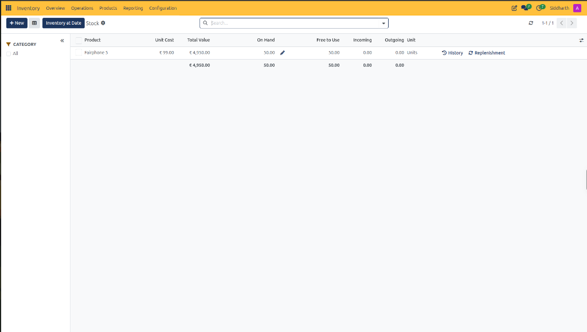
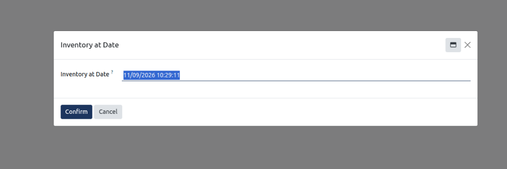

# Track Enterprise Stock Balances and Inventory at Date

This operational guide provides procedures for warehouse managers, inventory controllers, and financial auditors to inspect company-wide stock levels, analyze unit costs and total valuation, evaluate free-to-use availability against incoming and outgoing pipelines, perform inline quantity adjustments, and generate historical point-in-time stock snapshots in CURQ Inventory.

---

### Prerequisites

* Operational access permissions to the CURQ Inventory application.
* Validated stock receipts or inventory adjustments establishing on-hand product quantities.
* Familiarity with inventory availability calculations separating physical on-hand stock from unreserved free-to-use availability.

---

### Access the Stock Report and Audit Enterprise Stock Balances

1. In the top navigation bar, click the **Reporting** menu.
2. Select **Stock**:

3. **Filter by Product Category**:
   * On the left sidebar, click the **CATEGORY** panel drawer to filter inventory by product lines *(such as `All`)*.
   * Click the collapse icon *(double left chevron `<<`)* to hide the category drawer and maximize table width.
4. **Audit Stock Register Columns**:
   * **Product**: Catalog item description or SKU *(e.g., `Fairphone 5`)*.
   * **Unit Cost**: Standard purchase cost or inventory valuation cost per unit *(e.g., `€ 99.00`)*.
   * **Total Value**: Extended asset value calculated by multiplying on-hand quantity by unit cost *(e.g., `50.00 Units` at `€ 99.00` equals `€ 4,950.00`)*.
   * **On Hand**: Total physical units currently held in warehouse storage *(e.g., `50.00`)*.
   * **Inline Adjustment Pencil Icon**: Clicking the blue pencil icon directly next to the on-hand quantity opens an inline adjustment field, enabling authorized controllers to correct stock counts immediately without navigating to the Physical Inventory adjustments menu.
   * **Free to Use**: Physical units available to promise for new customer sales orders *(e.g., `50.00`)*. Calculated as On Hand Quantity minus Outgoing reserved units.
   * **Incoming**: Total units scheduled on approved vendor purchase orders or incoming transfers awaiting dock intake *(e.g., `0.00`)*.
   * **Outgoing**: Total units reserved for confirmed customer delivery orders or manufacturing orders awaiting physical picking *(e.g., `0.00`)*.
   * **Unit**: Standard unit of measure *(e.g., `Units`)*.
5. **Execute Row-Level Shortcuts**:
   * **History Control** *(clock counter-clockwise icon)*: Click **History** on any product line to open the Moves History register pre-filtered to that specific item, displaying all historical inbound receipts, internal relocations, and customer shipments.
   * **Replenishment Control** *(cycle arrows icon)*: Click **Replenishment** to navigate directly to the replenishment board and adjust minimum/maximum safety stock thresholds or trigger an immediate purchase order.

---

### Generate Historical Inventory at Date Snapshots

For financial audits, month-end balance sheet reconciliations, and tax compliance, CURQ enables inventory controllers to recalculate warehouse stock balances and asset valuations as of any historical timestamp:

1. In the upper-left action bar of the Stock report, click the dark blue **Inventory at Date** button:

2. **Configure Historical Cutoff**:
   * **Inventory at Date Field**: Enter or select the exact historical cutoff date and time *(e.g., `11/09/2026 10:29:11`)*.
3. **Execute Historical Recalculation**:
   * Click the dark blue **Confirm** button.
   * CURQ rolls back subsequent stock moves, receipts, deliveries, and adjustments, displaying physical on-hand quantities, unit costs, and total valuation exactly as they stood at that historical moment.
4. **Dismiss Without Changes**:
   * Click **Cancel** to abort the wizard and maintain real-time current stock balances.

---

### Related Documentation

* [Stock Reporting Field Definitions](../settings-and-fields/13-stock-reporting-field-definitions.md)
* [Track Inventory by Location and Storage Bins](./12-track-inventory-by-location-and-storage-bins.md)
* [Location Reporting Field Definitions](../settings-and-fields/12-location-reporting-field-definitions.md)
* [Audit Historical Stock Movements in Moves History](./11-audit-historical-stock-movements-in-moves-history.md)
* [Moves History Field Definitions](../settings-and-fields/11-moves-history-field-definitions.md)
* [Analyze Stock Moves and Warehouse Throughput](./10-analyze-stock-moves-and-warehouse-throughput.md)
* [Moves Analysis and Reporting Field Definitions](../settings-and-fields/10-moves-analysis-and-reporting-field-definitions.md)
* [Audit Stock Moves and Inventory Valuation](./04-audit-stock-moves-and-inventory-valuation.md)
* [Detailed Operations and Stock Valuation Field Definitions](../settings-and-fields/04-detailed-operations-and-stock-valuation-field-definitions.md)
* [Manage Replenishment and Automated Reordering Rules](./09-manage-replenishment-and-automated-reordering-rules.md)
* [Understanding Double-Entry Inventory and Stock Flows](../core-concepts/01-understanding-double-entry-inventory-and-stock-flows.md)

