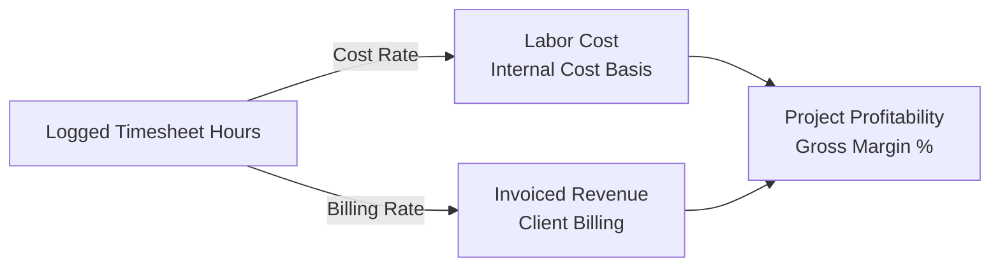
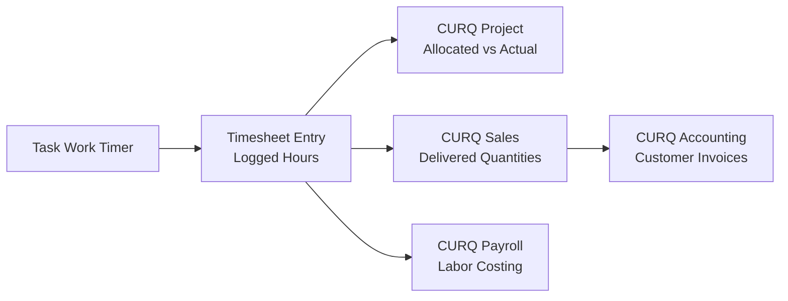

# Understanding Timesheet Costing and Project Profitability

Accurate project cost accounting requires continuous reconciliation between human effort, operational overhead, and commercial billing terms. In CURQ Project, timesheet entries serve as the fundamental transaction unit connecting daily development activities with corporate financial ledgers.

This guide explains the conceptual architecture of timesheet valuation, billable realization, and project margin calculations across integrated enterprise workflows.

---

## 1. The Timesheet Cost-Revenue Valuation Model

Every labor hour logged against a project task carries both a cost basis *(internal expense)* and, where applicable, a billing value *(external revenue)*:

### 1.1 Internal Labor Cost Valuation
* **Employee Cost Rate**: Configured within the employee or user profile, reflecting direct payroll expenses, employer contributions, and overhead allocation per working hour.
* **Direct Task Cost**: Calculated continuously as:
  $$\text{Task Labor Cost} = \text{Logged Hours} \times \text{Employee Hourly Cost}$$
* **Budget Variance**: Comparing logged hours against the **Allocated Time** defined on the task reveals delivery velocity and labor budget overruns before delivery deadlines are breached.

### 1.2 Commercial Realization and Invoicing Models
When a project workspace has the **Billable** parameter enabled, recorded timesheets flow into CURQ Sales and Invoicing under one of two pricing strategies:
* **Time and Materials (T&M)**: Logged hours are multiplied by agreed customer billing rates. Approved timesheet lines generate draft customer invoices periodically.
* **Fixed Price Milestones**: Project revenues are fixed to contract milestones *(e.g., `50% upon wireframe approval`, `50% upon deployment`)*. Timesheet hours track delivery expenditure to determine true milestone margins.

---

## 2. The Timesheet Verification and Approval Lifecycle

Timesheet records progress through structured operational states to ensure financial integrity:

1. **Draft**: Initial entry created via the real-time **Start work** timer or manual entry on the **Timesheets** tab. The specialist can edit descriptions and durations freely.
2. **Submitted**: Locked entries bundled for periodic review by team leads or project managers.
3. **Approved**: Certified hours verified for technical accuracy and customer billability. Approved entries lock against modifications and update project financial metrics.
4. **Invoiced**: Timesheet entries incorporated into a validated customer invoice in CURQ Accounting.

---

## 3. Billable versus Internal Project Overhead

Organizations manage both external client deliverables and internal initiatives within CURQ Project:

| Dimension | Billable Projects *(Client Delivery)* | Non-Billable Projects *(Internal / R&D)* |
| :--- | :--- | :--- |
| **Primary Objective** | Revenue generation, milestone delivery, margin realization. | Capitalized software development, operational support, training. |
| **Timesheet Function** | Generates billable units for customer invoicing and contractor costs. | Measures internal departmental resource utilization and labor expenditure. |
| **Cost Allocation** | Cost of Goods Sold (COGS) tied to sales orders. | Operating Expenses (OPEX) or Capitalized R&D Assets. |
| **Commercial Linkage** | Directly tied to CURQ Sales Orders and Accounting Invoices. | Linked to internal cost centers and analytical accounts. |

---

## 4. Cross-Module Financial Integration

Timesheet data flows seamlessly across CURQ modules to eliminate duplicate entries:

* **CURQ Project**: Provides real-time capacity feedback, burn-down visibility, and completion forecasts based on historical timesheet velocity.
* **CURQ Sales**: Automatically marks service order lines as delivered based on validated timesheets.
* **CURQ Accounting**: Generates accurate customer invoices without manual spreadsheet reconciliation and posts labor costs to analytical accounts.

---

## Related Documentation

* [Track Work Hours and Manage Timesheets](../getting-started/02-track-work-hours-and-manage-timesheets.md)
* [Track Task Time and Manage Timesheets](../task-guides/06-track-task-time-and-manage-timesheets.md)
* [Understanding Project Task Lifecycles and Stage Workflows](./01-understanding-project-task-lifecycles-and-stages.md)
* [Project Task Field Definitions](../settings-and-fields/03-project-task-field-definitions.md)
