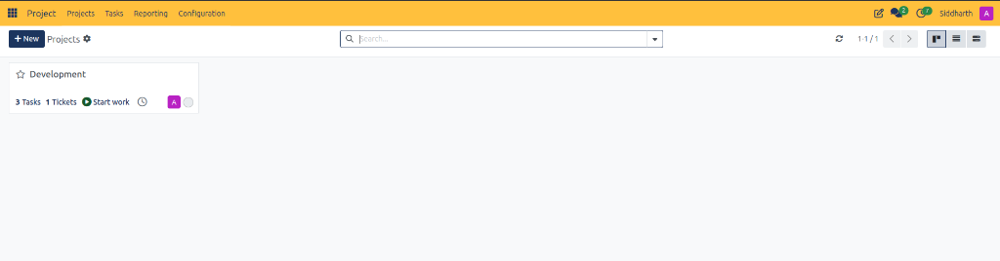
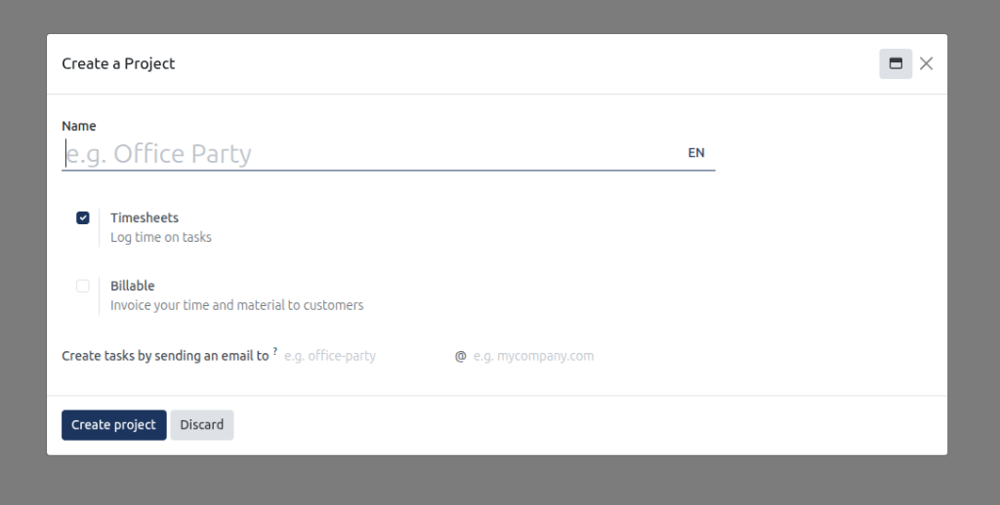
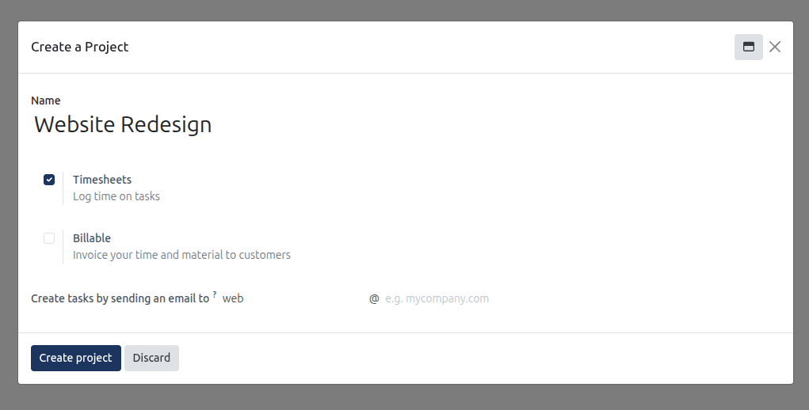
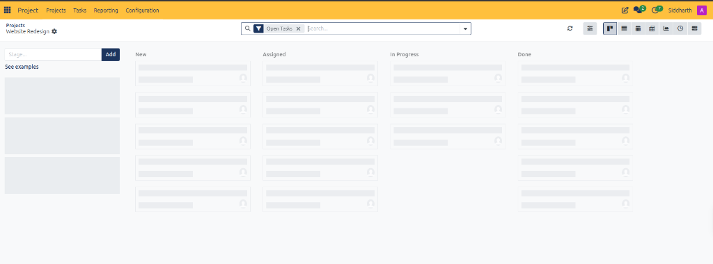
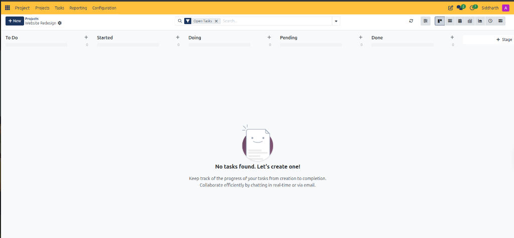
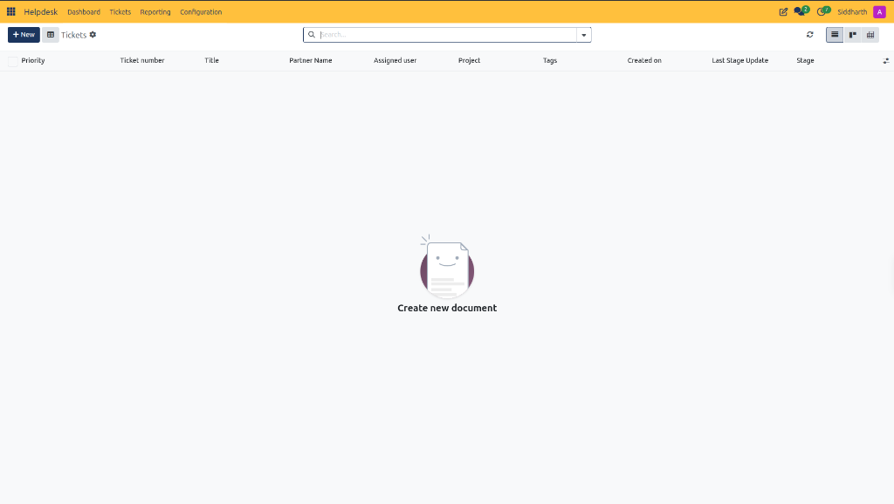
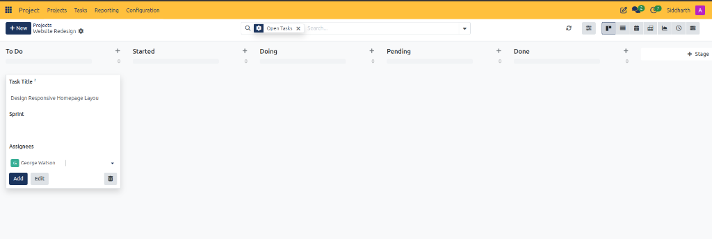
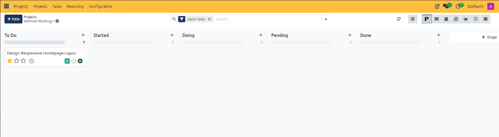
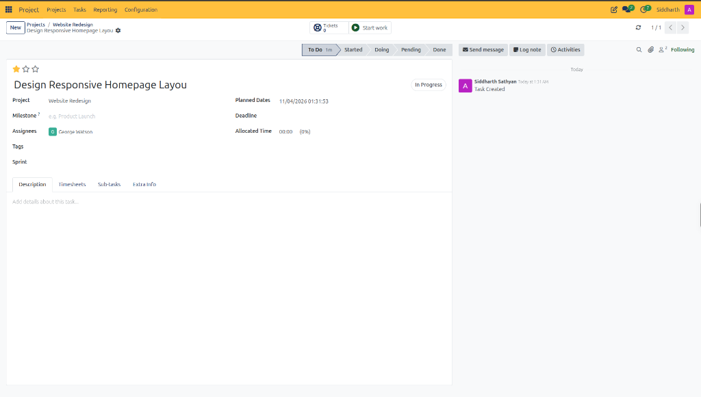

# Create and Manage Your First Project

This tutorial guides you through the foundational workflow in CURQ Project, from accessing the centralized Projects dashboard and interpreting project card metrics to tracking tasks and cross-module ticket linkages.

> **Prerequisites**
> * Access to the **Project** application in CURQ.
> * User permissions to view or create project workspaces.

---

## 1. End-to-End Project Creation and Management Workflow

### 1.1 Access the Project Application

1. From the main CURQ application switcher, click **Project**.
2. CURQ opens the primary **Projects** overview:

3. Review the top navigation structure:
   * **Projects**: Primary operational dashboard displaying active project workspaces as interactive Kanban cards.
   * **Tasks**: Centralized task register across all organizational projects.
   * **Reporting**: Performance metrics, task velocity, and team capacity analytics.
   * **Configuration**: Administrative settings for project stages, task stages, tags, and activity types.

---

### 1.2 Create a New Project Workspace

1. In the upper-left action bar, click **+ New**.
2. CURQ opens the project initialization dialog:

3. Configure initial workspace parameters:
   * **Name**: Type `Website Redesign`.
   * **Timesheets**: Ensure this option remains selected *(checked by default)* to enable task time logging.
   * **Billable**: Leave unchecked for internal operations, or check to rebill client hours.
   * **Create tasks by sending an email to**: Enter `web` to establish `web@yourcompany.com`:

4. Click **Create project**:
   * CURQ provisions the workspace and redirects you directly into the project's internal task board:

> For a detailed explanation of all project creation fields and settings toggles, see [**Project Creation Modal Field Definitions**](../settings-and-fields/01-project-dashboard-and-kanban-card-definitions.md#3-project-creation-modal-field-definitions).

---

### 1.3 Establish Project Task Stages

1. When first opening a new project, CURQ presents the stage initialization interface:

2. Configure the operational stages to match your team workflow:
   * **To Do**: Initial intake queue for newly identified requirements.
   * **Started**: Tasks where scoping or preliminary setup is underway.
   * **Doing**: Active development, design, and implementation work.
   * **Pending**: Tasks paused awaiting external assets, client feedback, or reviews.
   * **Done**: Completed deliverables meeting definition-of-done criteria.
3. Once stages are added, CURQ displays the active Kanban board ready for task creation:

4. Each column features a **`+`** quick-add button and active task counter *(currently `0`)*. With no tasks created yet, CURQ displays the onboarding prompt: `No tasks found. Let's create one!`.

---

### 1.4 Create a Task Using Inline Quick-Add

1. In the target stage column *(e.g., `To Do`)*, click the **`+`** icon:
   * CURQ opens the inline task creation card:

2. Enter the initial task parameters:
   * **Task Title**: Type `Design Responsive Homepage Layout`.
   * **Sprint**: Link the task to an active or upcoming development sprint if sprint management is configured.
   * **Assignees**: Select the assigned project specialist:

3. Finalize card creation:
   * Click **Add** to commit the task card directly into the column for immediate backlog registration.
   * Alternatively, click **Edit** to transition directly into the comprehensive task form view.

---

### 1.5 Review the Task Card on the Kanban Board

Once added, CURQ inserts the task card into the active stage column and updates the column counter from `0` to `1`:

Review the visual card elements:
1. **Card Title**: Displays the task deliverable designation *(e.g., `Design Responsive Homepage Layout`)*.
2. **Priority Rating**: Clickable stars to set importance levels *(normal, high, urgent)*.
3. **Timesheet Clock**: Quick status icon showing logged hours versus planned capacity.
4. **Assignee Avatar**: Displays the initial of the assigned specialist.
5. **Start Work Button**: Green play icon allowing the team member to initiate active time tracking directly from the Kanban card.

---

### 1.6 Configure Task Details in Form View

Click on the task card title to open the comprehensive task form:

Configure detailed delivery parameters:
1. **Planned Dates**: Automated timestamp recording task commencement.
2. **Milestone**: Link the deliverable to a major project milestone *(e.g., `Product Launch`)*.
3. **Allocated Time**: Define planned target hours for tracking team capacity.
4. **Notebook Tabs**: Access specialized workspaces for **Description**, **Timesheets**, **Sub-tasks**, and **Extra Info**.

> For a detailed explanation of all task header fields, notebook tabs, and stage status chevrons, see [**Project Task Field Definitions**](../settings-and-fields/03-project-task-field-definitions.md).

---

### 1.7 Inspect Project Card Controls on the Dashboard

Return to **Projects** via the top navigation bar to view your project portfolio:

1. **Favorite Toggle** *(star icon)*: Click the star to bookmark high-priority projects at the top of your workspace.
2. **Project Title**: Displays the formal workspace designation *(e.g., `Development` or `Website Redesign`)*. Clicking the title opens the internal task board.
3. **Tasks Metric** *(e.g., `3 Tasks`)*: Clickable counter displaying the number of active tasks assigned to the project.
4. **Tickets Metric** *(e.g., `1 Tickets`)*: Direct cross-module link to connected customer support tickets in CURQ Helpdesk.
5. **Start Work** *(play icon button)*: One-click operational action to initiate active work tracking and automated timesheet recording.
6. **Member Avatars**: Displays assigned project team members and specialist contributors.

> For a detailed explanation of project card indicators, metrics counters, and context menu options, see [**Project Dashboard and Kanban Card Definitions**](../settings-and-fields/01-project-dashboard-and-kanban-card-definitions.md).

---

### 1.8 Switch Project Views

Use the view switcher in the upper-right corner to alternate presentation layouts:
* **Kanban View** *(default)*: Visual card layout ideal for rapid project triage.
* **List View**: Tabular register displaying project names, project managers, partner accounts, and delivery deadlines.
* **Activity / Pivot View**: Timeline and analytical perspective for tracking milestones and team workloads.

---

## Related Documentation

* [Project Dashboard and Kanban Card Definitions](../settings-and-fields/01-project-dashboard-and-kanban-card-definitions.md)
* [Project Task Board and Stage Field Definitions](../settings-and-fields/02-project-task-board-and-stage-field-definitions.md)
* [Project Task Field Definitions](../settings-and-fields/03-project-task-field-definitions.md)
* [Create and Manage Project Tasks](../task-guides/04-create-and-manage-project-tasks.md)
* [Navigate and Manage Projects](../task-guides/01-navigate-and-manage-projects.md)
