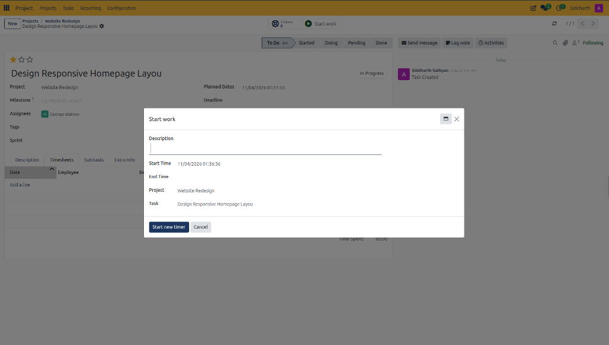
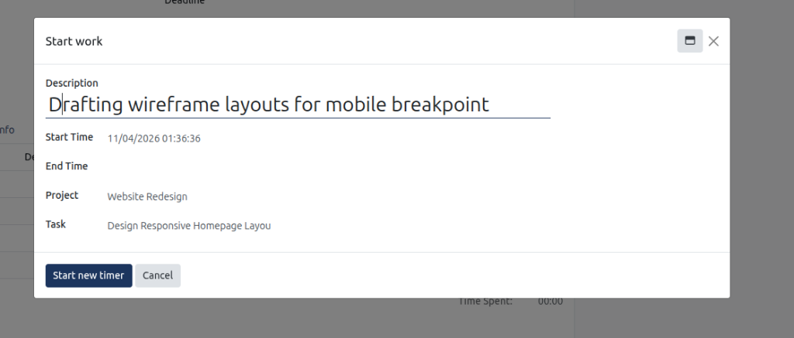
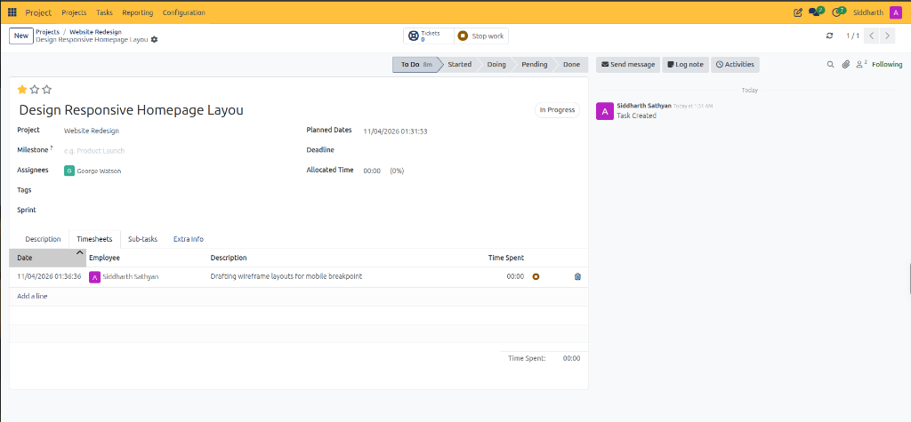

# Track Work Hours and Manage Timesheets

This tutorial walks through the end-to-end workflow of logging, tracking, and auditing labor hours on project tasks using the integrated CURQ Timesheets engine.

> **Prerequisites**
> * The target project workspace *(e.g., `Website Redesign`)* has **Timesheets** enabled in project configuration.
> * At least one deliverable task *(e.g., `Design Responsive Homepage Layout`)* configured with an allocated time budget.

---

## 1. Track Work Hours and Manage Task Timesheets

### 1.1 Open the Target Task

1. Navigate to **Project > Projects** and click the card for **Website Redesign**.
2. From the Kanban board or list view, click the title of your task *(e.g., `Design Responsive Homepage Layout`)* to enter the comprehensive form view.
3. Review the current time tracking header indicators:
   * **Allocated Time**: Displays planned hours *(e.g., `00:00 (0%)`)*.
   * **Start work**: Green play icon button in the action bar.

---

### 1.2 Launch Real-Time Time Tracking

1. In the top action bar, click **Start work**:
   * CURQ shifts the underlying notebook to the **Timesheets** tab and opens the modal timer dialog:

2. Review the session parameters pre-loaded by the system:
   * **Start Time**: Automatically captures the current system timestamp.
   * **Project**: Confirms the workspace context *(e.g., `Website Redesign`)*.
   * **Task**: Confirms the target deliverable.

---

### 1.3 Configure Work Session Details

1. In **Description**, type the active development focus *(e.g., `Drafting wireframe layouts for mobile breakpoint`)*:

2. Click **Start new timer**:
   * CURQ commits the session start time and shifts the task form into active recording mode.

---

### 1.4 Monitor the Active Work Session and Stop Timer

Once the timer is initiated, CURQ provides real-time visual feedback:

1. **Stop Work Action Button**: The primary header button transforms into a brown **Stop work** button with a square stop icon.
2. **Stage Duration**: The active stage chevron displays elapsed stage time *(e.g., `To Do 8m`)*.
3. **Live Timesheet Entry**: The **Timesheets** tab records a new row with:
   * **Date**: Automated timestamp matching session commencement.
   * **Employee**: Name or role of the active contributor.
   * **Description**: The notes recorded in the initialization dialog.
   * **Time Spent**: Active running counter with animated golden recording ring.
4. Conclude the work block:
   * Click **Stop work** in the upper action bar to stop the timer and post completed hours to the timesheet ledger.

> For a detailed explanation of live work timer modal parameters, timesheet row attributes, and running clock indicators, see [**Start Work Modal and Timesheets Tab Data Dictionary**](../settings-and-fields/03-project-task-field-definitions.md#4-start-work-modal-and-timesheets-tab-data-dictionary).

---

### 1.5 Manually Log Retrospective Hours

For work completed offline or outside the real-time timer:

1. Click the **Timesheets** tab on the lower notebook.
2. In the timesheet table, click **Add a line**:
   * **Date**: Select the date work was performed.
   * **Employee**: Confirm the specialist who performed the labor.
   * **Description**: Enter details of the completed deliverable.
   * **Hours Spent**: Input the duration in decimal format *(e.g., `02:30`)*.
3. CURQ automatically updates the **Time Spent** metric and recalculates the task completion percentage against **Allocated Time**.

---

## Related Documentation

* [Create and Manage Your First Project](./01-create-and-manage-your-first-project.md)
* [Project Task Field Definitions](../settings-and-fields/03-project-task-field-definitions.md)
* [Track Task Time and Manage Timesheets](../task-guides/06-track-task-time-and-manage-timesheets.md)
* [Understanding Timesheet Costing and Project Profitability](../core-concepts/02-understanding-timesheet-costing-and-project-profitability.md)
