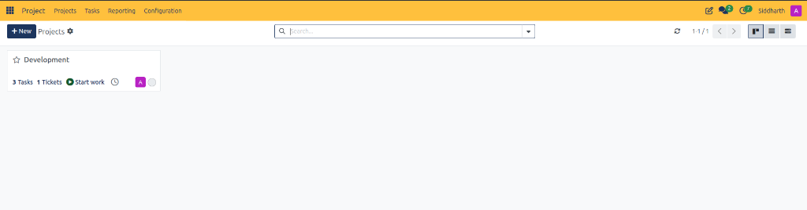

# Navigate and Manage Projects

This task guide outlines procedures for navigating the CURQ Project overview, tracking project workloads, launching real-time work sessions, and accessing cross-module support linkages.

> **Prerequisites**
> * Access to the **Project** application in CURQ.
> * Active project workspaces configured in the database.

---

## 1. Navigate the Project Kanban Overview and Launch Work

### 1.1 Navigate the Project Kanban Overview

1. In the top navigation bar, select **Projects**.
2. CURQ displays all active organizational project workspaces:

3. Locate the target project card *(e.g., `Development`)*:
   * Click the **Favorite Star** icon on any card to pin it to your personal favorites queue.
   * Click the project title *(e.g., `Development`)* to drill directly into its internal agile task board.

> For a detailed explanation of navigation controls, project card indicators, and metrics counters, see [**Top Navigation and Header Action Controls**](../settings-and-fields/01-project-dashboard-and-kanban-card-definitions.md#1-top-navigation-and-header-action-controls) and [**Project Card Field Definitions**](../settings-and-fields/01-project-dashboard-and-kanban-card-definitions.md#2-project-card-field-definitions).

---

### 1.2 Launch Direct Work via "Start work"

For rapid execution without searching through task backlogs:

1. Locate the target project on the overview board.
2. Click the green **Start work** action button on the card.
3. CURQ begins active work tracking against the project, logging active working sessions and timesheet entries in the background.
4. To stop or pause active tracking, click the active tracking timer button on the header bar.

---

## 2. Cross-Module Navigation and View Modes

### 2.1 Access Linked Helpdesk Tickets

When projects represent software engineering or client technical deliverables:

1. Review the metrics row on the project card.
2. Locate the **Tickets** counter *(e.g., `1 Tickets`)*.
3. Click **1 Tickets**:
   * CURQ navigates directly to the filtered Helpdesk ticket register displaying all customer tickets linked to this project *(such as `HT00065`)*.
   * Specialists can inspect client problem logs and requirements without manual search queries.

---

### 2.2 Switch Workspace Views

1. Locate the view switcher in the upper-right corner of the action bar.
2. Select your preferred display mode:
   * **Kanban**: High-level card board highlighting tasks, tickets, and work actions.
   * **List**: Dense tabular view with columns for Project Name, Project Manager, Partner, and Status.
   * **Activity**: Chronological grid displaying scheduled meetings, calls, and delivery deadlines.

---

## 3. Edge Cases & Troubleshooting

* **Missing Tickets Counter**: If the project card does not display a tickets metric, verify that CURQ Helpdesk is installed and that at least one support ticket has selected this project in its **Project** field.
* **Favorite Sorting**: Starred projects always appear first in the Kanban view regardless of default alphabetical ordering.

---

## Related Documentation

* [Create and Manage Your First Project](../getting-started/01-create-and-manage-your-first-project.md)
* [Create and Configure Projects](./02-create-and-configure-projects.md)
* [Project Dashboard and Kanban Card Definitions](../settings-and-fields/01-project-dashboard-and-kanban-card-definitions.md)
* [Project Task Board and Stage Field Definitions](../settings-and-fields/02-project-task-board-and-stage-field-definitions.md)
* [Project Configuration and Workspace Settings Field Definitions](../settings-and-fields/06-project-configuration-and-workspace-settings-field-definitions.md)
