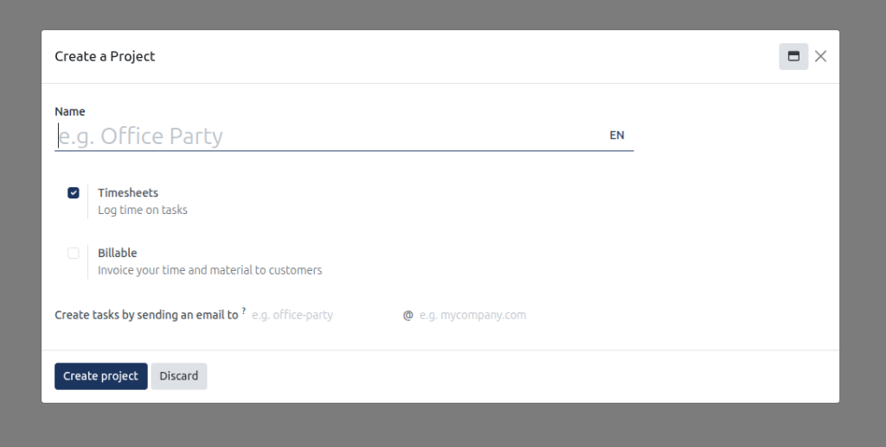
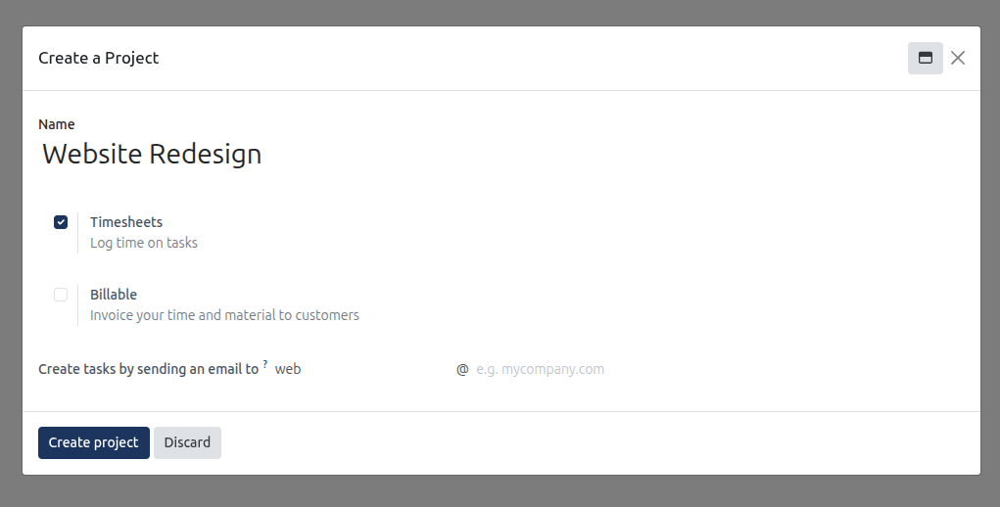
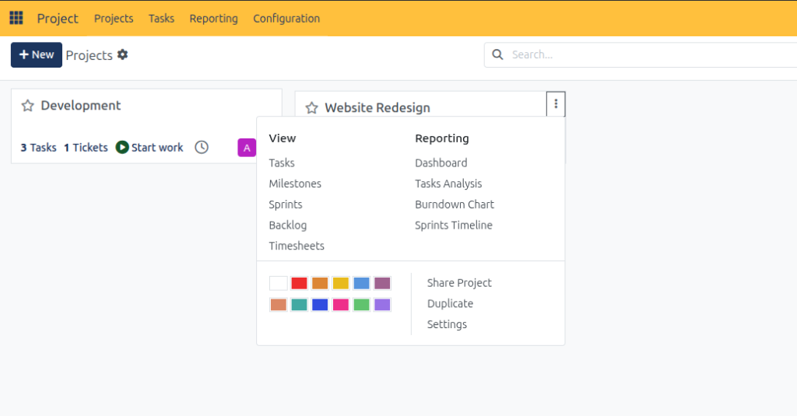
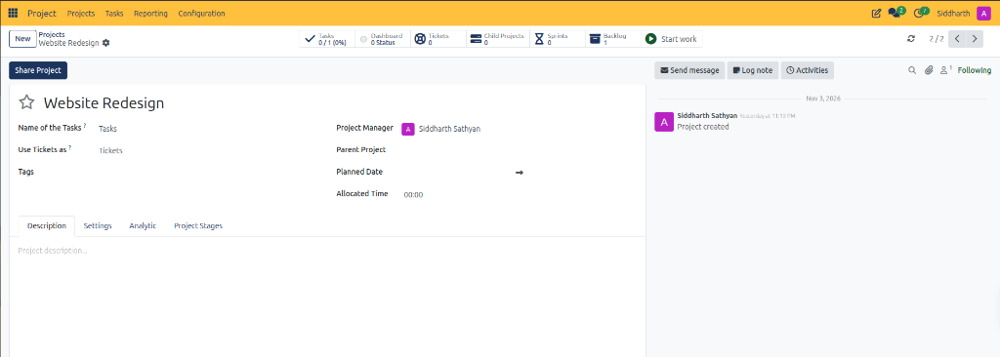
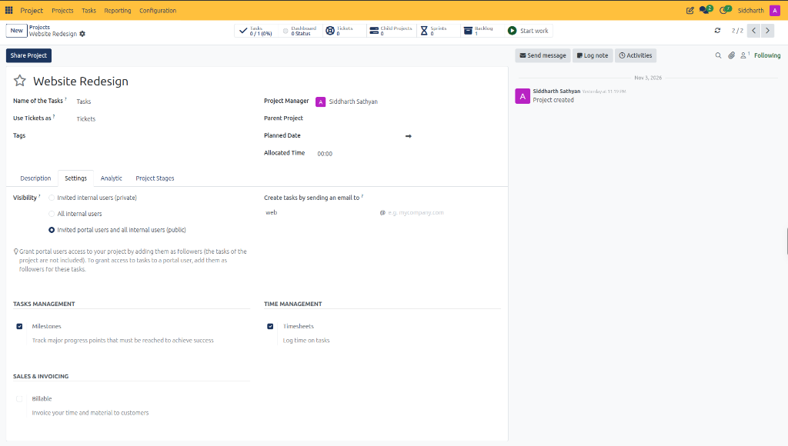
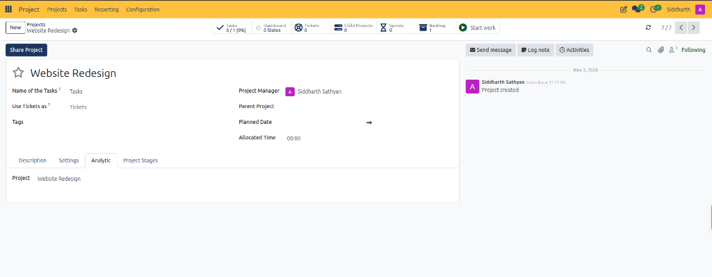
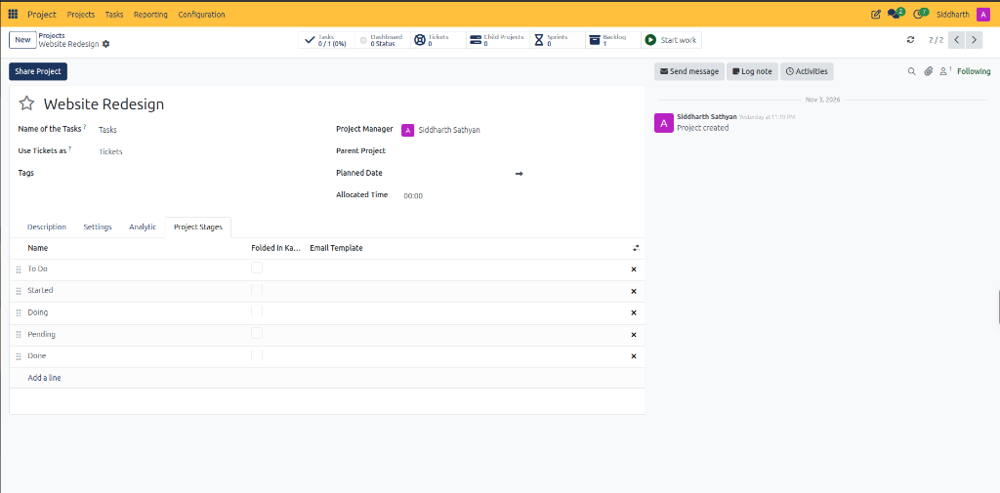

# Create and Configure Projects

This task guide provides step-by-step procedures for provisioning project workspaces, establishing time-tracking parameters, configuring customer billing options, and automating task creation via inbound email aliases in CURQ Project.

> **Prerequisites**
> * Project Administrator or Manager privileges in CURQ.
> * Basic knowledge of organizational project hierarchy and team workflows.
>
> **Warning (Configuration Advisory):** Modifying project parameters requires administrative privileges. Because misconfiguration can lead to operational disruptions or workflow errors, configuration by a user administrator with the assistance of an authorized CURQ advisor or consultant is advised.

---

## 1. Provision and Configure Project Workspaces

### 1.1 Provision a Project Workspace

1. In the top navigation bar, select **Projects**.
2. Click **+ New** in the upper-left action bar.
3. CURQ launches the **Create a Project** modal dialog:

4. In the **Name** field, enter the formal project title *(e.g., `Website Redesign`)*.
5. Configure tracking and communication options:
   * Keep **Timesheets** checked to enable task time logs.
   * Enter the inbound email prefix *(e.g., `web`)* to enable email task creation:

6. Click **Create project** to commit the workspace.

> For a detailed explanation of project creation parameters and timesheet toggles, see [**Project Creation Modal Field Definitions**](../settings-and-fields/01-project-dashboard-and-kanban-card-definitions.md#3-project-creation-modal-field-definitions).

---

### 1.2 Access Project Context Menu and Administrative Settings

1. From the primary **Projects** overview dashboard, locate the target project card *(e.g., `Website Redesign`)*.
2. Click the three vertical dots icon in the upper-right corner of the card:
   * CURQ opens the project context flyout:

3. Review the available context controls:
   * **View Links**: Quick access to **Tasks**, **Milestones**, **Sprints**, **Backlog**, and **Timesheets**.
   * **Reporting Links**: Direct navigation to project-specific **Dashboard**, **Tasks Analysis**, **Burndown Chart**, and **Sprints Timeline**.
   * **Color Palette**: Click any of the 12 color swatches to tint the card for rapid visual identification.
   * **Actions**: Select **Share Project** to invite external collaborators, **Duplicate** to clone the workspace template, or **Settings** to open the full project configuration form.

> For a detailed explanation of all context menu navigation links, color swatches, and actions, see [**Project Card Context Menu Data Dictionary**](../settings-and-fields/01-project-dashboard-and-kanban-card-definitions.md#4-project-card-context-menu-data-dictionary).

---

### 1.3 Configure Project Master Settings and Visibility

Click **Settings** from the context flyout to enter the comprehensive project administration view:

1. Review header attributes:
   * **Project Title**: Formal workspace designation *(e.g., `Website Redesign`)*.
   * **Name of the Tasks**: Customizable terminology used for deliverables *(default `Tasks`)*.
   * **Use Tickets as**: Label for cross-module Helpdesk items *(default `Tickets`)*.
   * **Project Manager**: Assign the primary administrative lead responsible for execution.
   * **Planned Date**: Set baseline target start and completion calendar dates.
   * **Allocated Time**: Define total planned labor hours budgeted across all deliverables.
2. Select the **Settings** notebook tab:

3. Configure governance and visibility:
   * **Visibility**: Select access boundaries between `Invited internal users (private)`, `All internal users`, or `Invited portal users and all internal users (public)`.
   * **Inbound Email Alias**: Configure or update the prefix *(e.g., `web`)* for automated task generation.
   * **Tasks Management**: Check **Milestones** to track major contractual or operational progress gates.
   * **Time Management**: Verify **Timesheets** remains enabled for task hour tracking.
   * **Sales & Invoicing**: Check **Billable** if client billing reconciliation is required.

---

## 2. Advanced Project Integrations and Pipelines

### 2.1 Link Analytic Accounts for Financial Accounting

Click the **Analytic** notebook tab to connect project operations with corporate cost ledgers:

1. Verify the designated **Project** analytic account *(e.g., `Website Redesign`)*.
2. Linking an analytic account guarantees that timesheet costs, vendor purchases, and sales revenues automatically post to project financial ledgers in CURQ Accounting.

---

### 2.2 Configure Stage Pipelines and Email Templates

Click the **Project Stages** notebook tab to manage the sequential delivery pipeline:

1. Review active stages: `To Do`, `Started`, `Doing`, `Pending`, and `Done`.
2. **Reorder Stages**: Click and hold the drag handle on the far left to resequence workflow progression.
3. **Folded in Kanban**: Check this box for terminal stages *(e.g., `Done`)* to collapse the column on the board by default and reduce visual clutter.
4. **Email Template**: Bind automated email notifications to specific stage transitions *(such as sending client updates when deliverables enter `Done`)*.
5. Click **Add a line** to introduce new custom stages directly into the project master configuration.

> For a detailed explanation of workspace settings, analytic account linkages, and pipeline stage options, see [**Project Settings Header and Smart Buttons**](../settings-and-fields/06-project-configuration-and-workspace-settings-field-definitions.md#1-project-settings-header-and-smart-buttons), [**Settings Tab Data Dictionary**](../settings-and-fields/06-project-configuration-and-workspace-settings-field-definitions.md#2-settings-tab-data-dictionary), [**Analytic Tab Data Dictionary**](../settings-and-fields/06-project-configuration-and-workspace-settings-field-definitions.md#3-analytic-tab-data-dictionary), and [**Project Stages Tab Data Dictionary**](../settings-and-fields/06-project-configuration-and-workspace-settings-field-definitions.md#4-project-stages-tab-data-dictionary).

---

> **Tip (Advised Settings):** Enable Timesheets and Milestones only on billable client projects; retain standard visibility (Invited Employees Only or All Employees).

---

## Related Documentation

* [Create and Manage Your First Project](../getting-started/01-create-and-manage-your-first-project.md)
* [Configure Project Stages and Task Pipelines](./03-configure-project-stages-and-task-pipelines.md)
* [Create and Manage Project Tasks](./04-create-and-manage-project-tasks.md)
* [Project Dashboard and Kanban Card Definitions](../settings-and-fields/01-project-dashboard-and-kanban-card-definitions.md)
* [Project Configuration and Workspace Settings Field Definitions](../settings-and-fields/06-project-configuration-and-workspace-settings-field-definitions.md)
