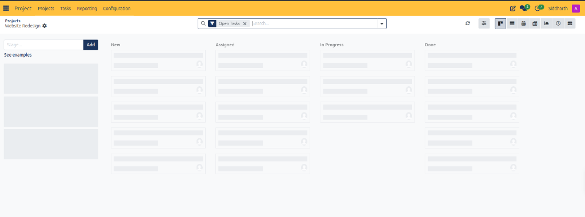
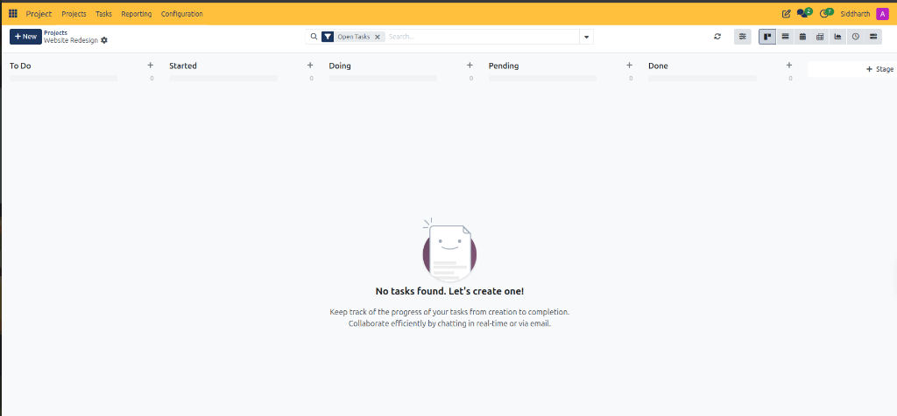

# Configure Project Stages and Task Pipelines

This task guide provides step-by-step procedures for defining custom project stages, adopting standardized agile templates, utilizing the Open Tasks search filter, and leveraging multi-view task displays in CURQ Project.

> **Prerequisites**
> * Project Manager or User permissions in CURQ Project.
> * An established project workspace ready for stage pipeline configuration.

---

## 1. Configure Workflow Stages and Templates

### 1.1 Establish Project Workflow Stages

When initializing a new project workspace or expanding existing delivery pipelines:

1. Open the project workspace *(e.g., `Projects / Website Redesign`)*.
2. CURQ presents the stage setup canvas:

3. Review the standard 4-stage pipeline template:
   * **New**: Intake and unprioritized backlog tasks.
   * **Assigned**: Tasks allocated to internal specialists awaiting kickoff.
   * **In Progress**: Active execution, design, and engineering work.
   * **Done**: Verified deliverables meeting project completion criteria.
4. To add custom stages:
   * Click inside the **Stage...** input box on the left.
   * Type the new stage designation *(e.g., `Quality Assurance` or `Client Review`)*.
   * Click **Add**. CURQ appends the new column to your Kanban board.
5. Review the resulting operational Kanban pipeline:

6. The active board organizes tasks across stages *(e.g., `To Do`, `Started`, `Doing`, `Pending`, `Done`)* with column counters *(initially `0`)* and quick task addition via the **`+`** icon on each column header.

> For a detailed explanation of task board headers, stage creation controls, and active pipeline columns, see [**Task Board Header and View Controls**](../settings-and-fields/02-project-task-board-and-stage-field-definitions.md#1-task-board-header-and-view-controls), [**Stage Pipeline Configuration Controls**](../settings-and-fields/02-project-task-board-and-stage-field-definitions.md#2-stage-pipeline-configuration-controls), and [**Active Stage Pipeline Data Dictionary**](../settings-and-fields/02-project-task-board-and-stage-field-definitions.md#3-active-stage-pipeline-data-dictionary).

---

### 1.2 Adopt Pre-Configured Workflow Templates

For teams seeking industry-standard delivery methodologies:

1. Locate the **See examples** link beneath the stage input field.
2. Click **See examples** to view pre-configured workflow pipelines:
   * **Software Development**: `Backlog` -> `Specifications` -> `Development` -> `Testing` -> `Done`.
   * **Marketing & Creative**: `Idea` -> `Drafting` -> `Design` -> `Approval` -> `Published`.
   * **Professional Services**: `Intake` -> `Consultation` -> `Delivery` -> `Invoicing` -> `Complete`.
3. Select the preferred template to auto-populate the project board columns.

---

## 2. Filter and Visualize Pipeline Workloads

### 2.1 Filter Active Work Using the "Open Tasks" Tag

By default, CURQ optimizes screen real estate by focusing on active deliverables:

1. Observe the top search bar: CURQ automatically maintains the **`[Open Tasks]`** filter tag.
2. While **`[Open Tasks]`** is active, terminal finished tasks in the `Done` stage are filtered out of daily queue displays.
3. To view historical or completed tasks, click the `X` icon inside the **`[Open Tasks]`** tag to restore all finished deliverables to the board.

---

### 2.2 Alternate Multi-View Visualizations

In the upper-right corner of the task board, toggle between seven dedicated display perspectives:

* **Kanban**: Drag-and-drop card columns organized by delivery stage.
* **List**: Tabular register showing task titles, assignees, deadlines, and progress tags.
* **Calendar**: Monthly and weekly delivery calendar mapping scheduled deliverables.
* **Pivot**: Multi-dimensional cross-tabulation table calculating hours and task counts across teams.
* **Graph**: Visual bar, line, and pie charts measuring velocity and team capacity.
* **Activity**: Chronological tracker organizing pending phone calls, reviews, and meetings.
* **Gantt**: Horizontal timeline displaying task dependencies, milestones, and critical delivery paths.

---

## 3. Edge Cases & Troubleshooting

* **Renaming or Deleting Stages**: Hover over any column title on the board and click the three-dots menu icon to edit stage parameters, fold the column, or delete unused stages.
* **Folded Stage Columns**: Stages without active tasks can be folded into narrow vertical headers to preserve screen space on complex multi-stage projects.

---

> **Tip (Advised Settings):** Limit project pipeline stages to 4–6 core progression milestones (e.g., New, In Progress, In Review, Done) to avoid micro-management overhead.

---

## Related Documentation

* [Create and Manage Your First Project](../getting-started/01-create-and-manage-your-first-project.md)
* [Understanding Project Task Lifecycles and Stage Workflows](../core-concepts/01-understanding-project-task-lifecycles-and-stages.md)
* [Project Task Board and Stage Field Definitions](../settings-and-fields/02-project-task-board-and-stage-field-definitions.md)
* [Navigate and Manage Projects](./01-navigate-and-manage-projects.md)
