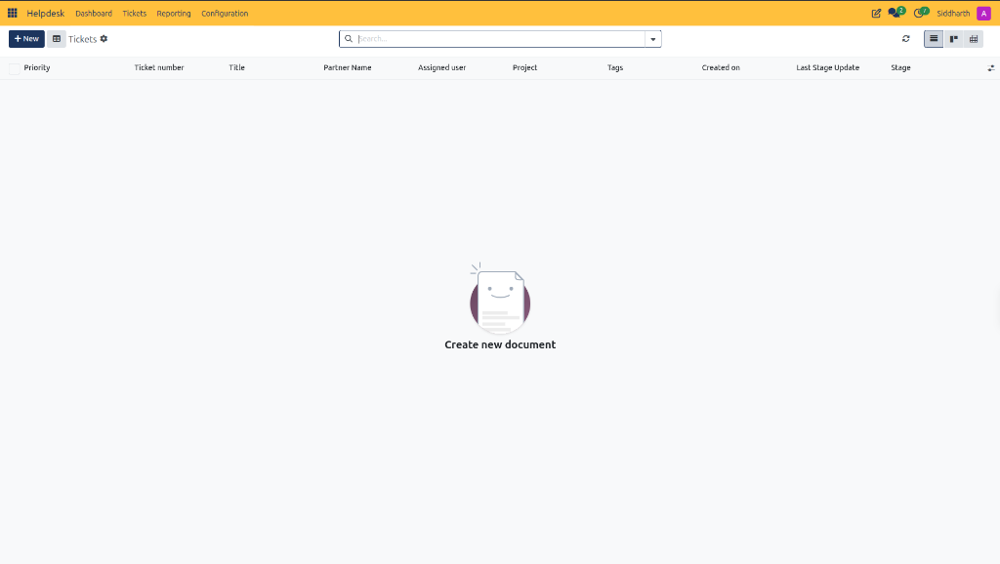
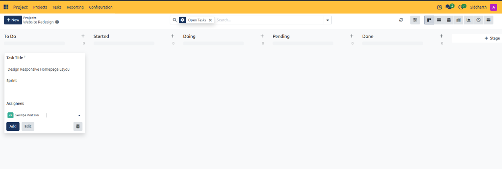
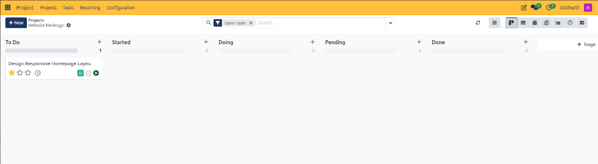
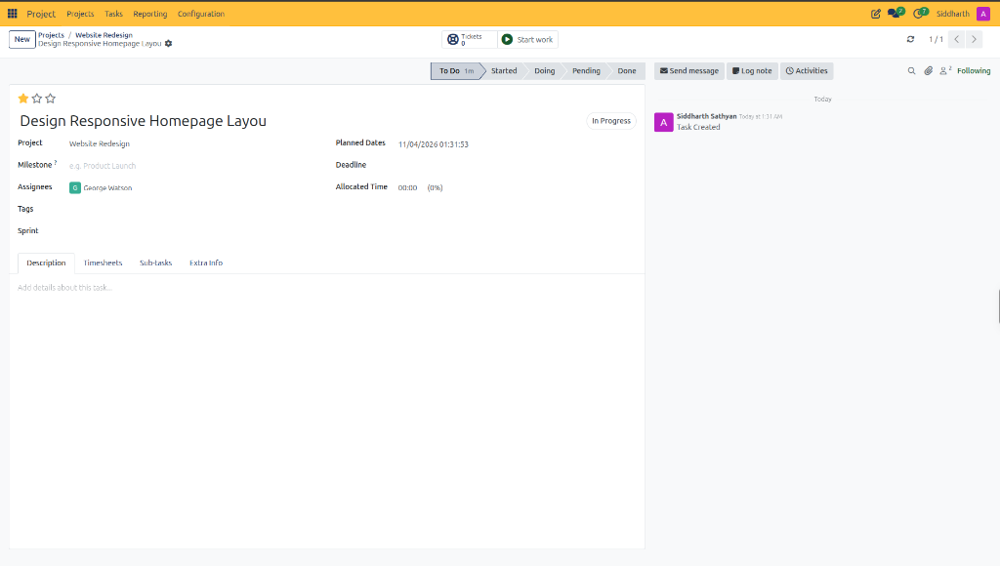

# Create and Manage Project Tasks

This guide walks through creating, assigning, configuring, and advancing project tasks across lifecycle stages within CURQ Project.

> **Prerequisites**
> * An active project workspace *(e.g., `Website Redesign`)* with established stage columns.
> * Appropriate user permissions within the Project application to author and update tasks.

---

## 1. Create and Configure Project Tasks

### 1.1 Create a Task Using Inline Quick-Add

Inline quick-add provides high-velocity backlog intake without navigating away from the Kanban board:

1. Navigate to **Project > Projects** and select your project card *(e.g., `Website Redesign`)*.
2. In the target pipeline column *(typically `To Do`)*, click the **`+`** icon on the column header:
   * CURQ renders the inline task creation card:

3. In **Task Title**, enter a concise, actionable summary of the work item *(e.g., `Design Responsive Homepage Layout`)*.
4. *(Optional)* In **Sprint**, assign the task to an active or planned agile sprint iteration.
5. In **Assignees**, select the designated project specialist:

6. Finalize card creation:
   * Click **Add** to instantly commit the task card to the column.
   * Click **Edit** to transition immediately into the full task form view.
   * Click the trash icon to discard the draft card without saving.

> For a detailed explanation of inline task quick-add controls and card elements, see [**Inline Quick-Add Task Card Controls**](../settings-and-fields/02-project-task-board-and-stage-field-definitions.md#4-inline-quick-add-task-card-controls).

---

### 1.2 Review and Manage Cards on the Kanban Board

Once added, CURQ places the task card into the active column:

1. **Prioritize Deliverables**: Click the star rating icons on the card footer to designate high or urgent priority.
2. **Track Timesheet Status**: Inspect the clock icon to verify logged hours against allocated capacity.
3. **Trigger Real-Time Execution**: Click the green **Start work** play button on the card to start the active work clock immediately.

---

### 1.3 Configure Comprehensive Task Details in Form View

Click the title of any task card to transition into the complete task form:

1. **Verify Lifecycle Stage**: The status bar in the upper right reflects current placement *(e.g., `To Do`, `Started`, `Doing`, `Pending`, `Done`)* with stage duration tracking *(e.g., `1m`)*.
2. **Assign Project Milestones**: Link the task to broader project milestones in **Milestone**.
3. **Plan Dates and Deadlines**: Review the automated **Planned Dates** timestamp and set a target completion in **Deadline**.
4. **Allocate Team Hours**: Enter planned hours in **Allocated Time** to establish baseline estimates for timesheet tracking.
5. **Author Specifications**: Use the **Description** rich text editor to document user stories, technical criteria, and mockups.

> For a detailed explanation of all task header fields, deadline settings, and notebook tabs, see [**Project Task Field Definitions**](../settings-and-fields/03-project-task-field-definitions.md).

---

## 2. Advance Lifecycle Stages and Track Progress

### 2.1 Transition Tasks Across Lifecycle Stages

Once tasks populate the Kanban board, team members update status by moving cards through operational stages:

1. **Drag and Drop**: Click and hold a task card, then drag it across stage columns *(e.g., from `To Do` to `Started` or `Doing`)*.
2. **Column Counters**: As cards move, CURQ automatically updates the active task count at the top of each column.
3. **Stage Automation**: Moving a task into terminal stages *(e.g., `Done`)* automatically logs completion dates and closes active timers.

---

## Best Practices for Task Hygiene

* **Atomic Scope**: Keep tasks scoped to deliverables achievable within a single sprint iteration or 1 to 3 working days.
* **Explicit Ownership**: Always assign a designated owner in **Assignees** before moving a task to `Doing`.
* **Stage Discipline**: Never skip workflow stages without documented rationale to preserve historical audit trails and velocity metrics.

---

## Related Documentation

* [Create and Manage Your First Project](../getting-started/01-create-and-manage-your-first-project.md)
* [Project Task Board and Stage Field Definitions](../settings-and-fields/02-project-task-board-and-stage-field-definitions.md)
* [Project Task Field Definitions](../settings-and-fields/03-project-task-field-definitions.md)
* [Configure Sub-Tasks and Task Hierarchies](./05-configure-sub-tasks-and-task-hierarchies.md)
* [Configure Project Stages and Task Pipelines](./03-configure-project-stages-and-task-pipelines.md)
