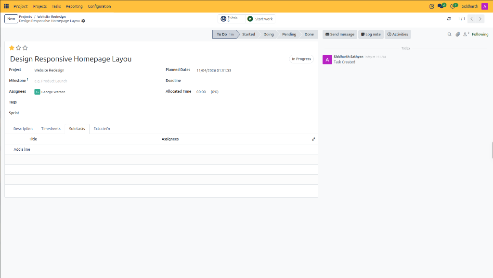
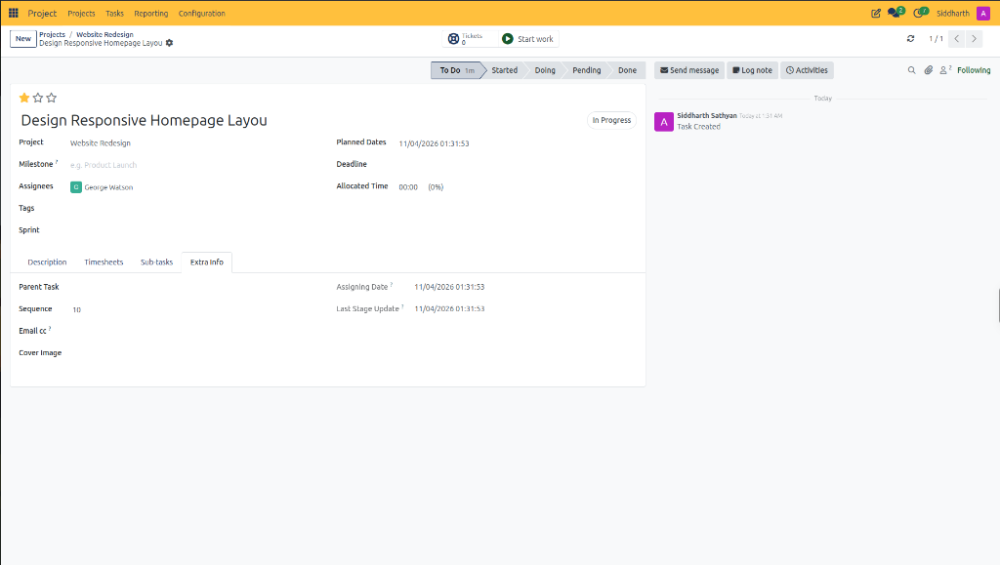

# Configure Sub-Tasks and Task Hierarchies

This operational guide explains how to decompose complex deliverables into structured sub-tasks, establish parent-child relationships, and configure task sequencing in CURQ Project.

> **Prerequisites**
> * An existing parent task *(e.g., `Design Responsive Homepage Layout`)* within an active project.
> * Operational permissions to create, assign, and modify project tasks.

---

## 1. Deconstruct Deliverables and Configure Sub-Tasks

### 1.1 Deconstruct Deliverables with Sub-Tasks

Complex features frequently involve multi-step execution by different specialists. Sub-tasks allow project managers to maintain high-level sprint visibility while tracking granular components:

1. Open the target task from the Kanban board or list view.
2. In the lower notebook section, click the **Sub-tasks** tab:
   * CURQ displays the sub-task register:

3. Click **Add a line** to insert a new sub-task deliverable:
   * **Title**: Enter the specific technical unit of work *(e.g., `Design Mobile Hamburger Menu` or `Define Typography Scale`)*.
   * **Assignees**: Delegate the sub-task to the specialist responsible for that specific item.
4. Add additional lines as needed for comprehensive coverage.
5. Sub-tasks inherit project context from the parent deliverable and appear in global task registers.

---

### 1.2 Configure Task Hierarchy and Metadata

Click the **Extra Info** tab to manage architectural relationships, execution priority sequences, and automated tracking timestamps:

Configure structural properties:

1. **Parent Task**: Designate an overarching deliverable if this task operates as part of a larger epic or work breakdown structure.
2. **Sequence**: Set an integer weighting *(default `10`)*. Lower numbers float tasks to the top of stage columns and prioritized lists.
3. **Email cc**: Enter external collaborator or stakeholder email addresses to receive automated notifications on task updates.
4. **Cover Image**: Upload an image file to display a visual header preview on the Kanban card.
5. **System Timestamps**:
   * **Assigning Date**: Automated audit timestamp logging when the current specialist was assigned.
   * **Last Stage Update**: Automated audit timestamp recording when the task transitioned between workflow stages.

> For a detailed explanation of sub-task table fields, parent task relationships, sequence numbers, and technical metadata, see [**Sub-Tasks and Extra Info Tab Field Definitions**](../settings-and-fields/03-project-task-field-definitions.md#2-sub-tasks-tab-data-dictionary).

---

## Best Practices for Sub-Task Management

* **Independent Execution**: Ensure each sub-task has a single, clear outcome and assigned owner.
* **Avoid Deep Nesting**: Limit task hierarchies to two levels *(Parent Task and Sub-task)* to prevent communication fragmentation.
* **Stage Tracking**: Verify that sub-task completions roll up to parent milestone progress.

---

## Related Documentation

* [Create and Manage Project Tasks](./04-create-and-manage-project-tasks.md)
* [Project Task Field Definitions](../settings-and-fields/03-project-task-field-definitions.md)
* [Understanding Project Task Lifecycles and Stage Workflows](../core-concepts/01-understanding-project-task-lifecycles-and-stages.md)
* [Create and Manage Your First Project](../getting-started/01-create-and-manage-your-first-project.md)
