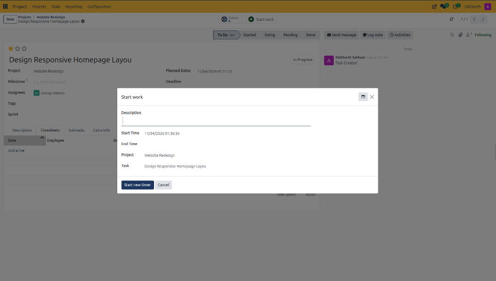
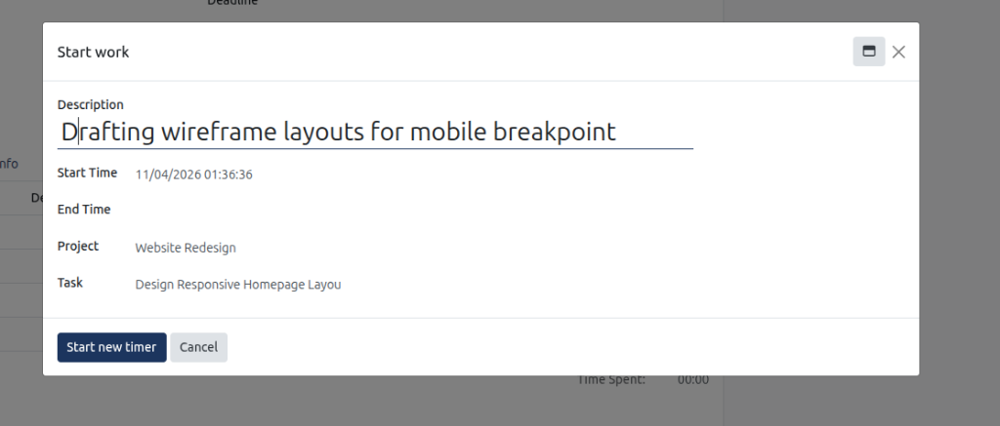
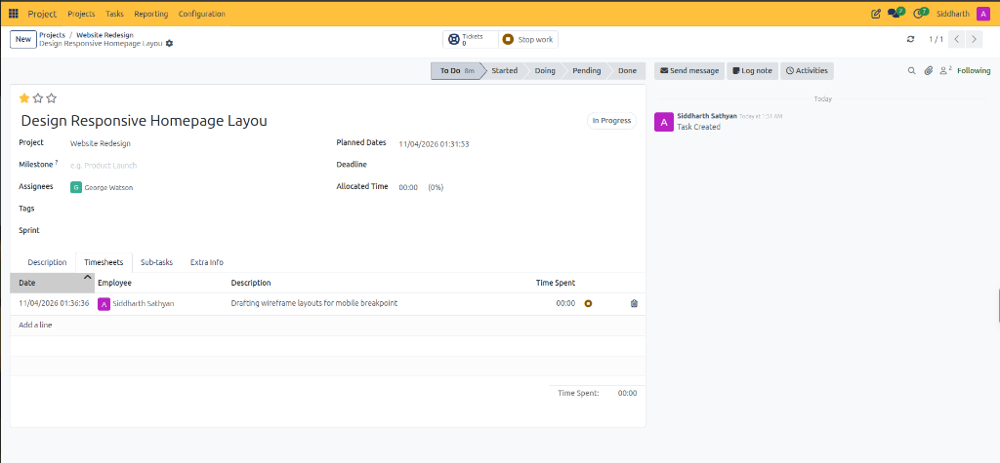

# Track Task Time and Manage Timesheets

This guide outlines operational procedures for recording live labor hours, entering manual timesheets, and auditing project capacity in CURQ Project.

> **Prerequisites**
> * An active task within a timesheet-enabled project workspace.
> * Employee profile configured with operational access to log timesheet entries.

---

## 1. Track Task Time and Manage Timesheets

### 1.1 Start and Stop the Real-Time Work Timer

Real-time timer tracking records precise labor duration without manual calculation:

1. Open the deliverable task card in form view.
2. In the top action bar, click **Start work**:
   * CURQ displays the **Start work** dialog over the Timesheets tab:

3. Review pre-filled parameters:
   * **Project**: Confirms project routing.
   * **Task**: Confirms the specific work item.
   * **Start Time**: Captures the exact initial timestamp.
4. In **Description**, specify the technical focus of the work block *(e.g., `Drafting wireframe layouts for mobile breakpoint`)*:

5. Click **Start new timer**:
   * The active work clock starts immediately.
   * CURQ updates the task header to display **Stop work** and highlights the active recording session:

6. When pausing or completing the activity, click **Stop work** in the header action bar to stop the timer and post recorded minutes to the timesheet ledger.

> For a detailed explanation of timer dialog controls, timesheet tab columns, and capacity tracking fields, see [**Start Work Modal and Timesheets Tab Data Dictionary**](../settings-and-fields/03-project-task-field-definitions.md#4-start-work-modal-and-timesheets-tab-data-dictionary).

---

### 1.2 Manually Log Retrospective Timesheet Lines

When specialists complete work offline or outside browser sessions:

1. Navigate to the task form and select the **Timesheets** tab.
2. Click **Add a line** in the timesheets table:
   * **Date**: Defaults to today; adjust if logging historical work.
   * **Employee**: Select the contributing specialist.
   * **Description**: Record delivered functionality or bug fixes.
   * **Hours Spent**: Enter duration in hours and minutes.
3. CURQ saves the line and recalculates the **Time Spent** total immediately.

---

### 1.3 Audit Labor Capacity and Overruns

1. Compare **Allocated Time** against cumulative **Time Spent** on the task header.
2. If **Time Spent** exceeds budgeted hours, the percentage display flags the overrun for project manager review.
3. Review team timesheet summaries across projects in the global reporting dashboards.

---

## Related Documentation

* [Track Work Hours and Manage Timesheets](../getting-started/02-track-work-hours-and-manage-timesheets.md)
* [Project Task Field Definitions](../settings-and-fields/03-project-task-field-definitions.md)
* [Understanding Timesheet Costing and Project Profitability](../core-concepts/02-understanding-timesheet-costing-and-project-profitability.md)
* [Create and Manage Project Tasks](./04-create-and-manage-project-tasks.md)
