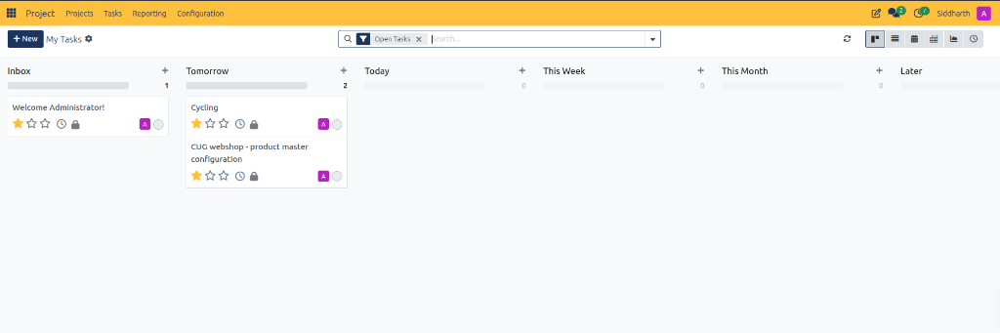

# Manage Personal Workloads with My Tasks

This guide walks through managing personalized task queues, scheduling daily execution, and prioritizing deliverables across multiple projects using the **My Tasks** dashboard in CURQ Project.

> **Prerequisites**
> * Operational access to the CURQ Project application.
> * Active tasks assigned to your employee or specialist profile.

---

## 1. Manage Personal Workloads with My Tasks

### 1.1 Access the Centralized Personal Task Register

While project workspaces isolate deliverables by client or department, individual contributors need a consolidated perspective across all assigned responsibilities:

1. In the top navigation bar, click **Tasks**:
   * CURQ opens the **My Tasks** operational dashboard:

2. Review the upper control bar:
   * **Breadcrumb**: Displays **My Tasks** with a settings gear icon for customizing view preferences.
   * **Open Tasks Filter**: Automatically filters out closed and archived items, displaying only active assignments.
   * **View Switcher**: Alternate between Kanban view, List view, Calendar view, Pivot view, Graph view, and Activity view.

> For a detailed explanation of control panel elements, temporal horizon columns, and card indicator badges, see [**My Tasks Control Panel and View Selectors**](../settings-and-fields/04-my-tasks-and-temporal-scheduling-field-definitions.md#1-my-tasks-control-panel-and-view-selectors), [**Temporal Scheduling Horizon Columns**](../settings-and-fields/04-my-tasks-and-temporal-scheduling-field-definitions.md#2-temporal-scheduling-horizon-columns), and [**Personal Task Card Indicators**](../settings-and-fields/04-my-tasks-and-temporal-scheduling-field-definitions.md#3-personal-task-card-indicators).

---

### 1.2 Understand Temporal Scheduling Queues

Unlike project-specific task boards that categorize tasks by development state *(e.g., `To Do`, `Doing`, `Done`)*, **My Tasks** organizes work by execution horizon:

1. **Inbox**: Staging area for new, unscheduled, or unprioritized assignments *(e.g., `Welcome Administrator!`)*. Specialists review the Inbox during daily triage.
2. **Tomorrow**: Deliverables pre-scheduled for execution on the following business day *(e.g., `Cycling`, `CUG webshop - product master configuration`)*.
3. **Today**: High-priority execution queue containing deliverables committed for immediate completion.
4. **This Week**: Near-term sprint commitments scheduled for delivery during the current working week.
5. **This Month**: Strategic deliverables and milestones requiring completion before the end of the active calendar month.
6. **Later**: Backlog deliverables and future initiatives scheduled for future cycles.

---

### 1.3 Triage and Reschedule Tasks

Specialists manage personal focus by dragging and dropping cards across time horizons:

1. **Morning Triage**: Open the **Inbox** column, review newly assigned cards, and drag them into **Today** or **This Week**.
2. **Reprioritize**: Move tasks between **Today** and **Tomorrow** as operational blockers or urgent requests emerge.
3. **Inspect Card Status**: Check priority stars, logged timesheets *(clock icon)*, and security/state badges directly from the card face.

---

## 2. Best Practices for Personal Task Management

* **Inbox Zero**: Empty the **Inbox** column at the start of each working day by assigning clear execution horizons.
* **Realistic Daily Commitment**: Limit cards in **Today** to 3 to 5 primary deliverables to maintain focused flow.
* **Stage Synchronization**: Rescheduling a card across temporal horizons in **My Tasks** maintains its formal development stage in the parent project board.

---

## Related Documentation

* [Create and Manage Project Tasks](./04-create-and-manage-project-tasks.md)
* [Filter and Export Cross-Project Tasks](./08-filter-and-export-cross-project-tasks.md)
* [My Tasks and Temporal Scheduling Field Definitions](../settings-and-fields/04-my-tasks-and-temporal-scheduling-field-definitions.md)
* [Navigate and Manage Projects](./01-navigate-and-manage-projects.md)
