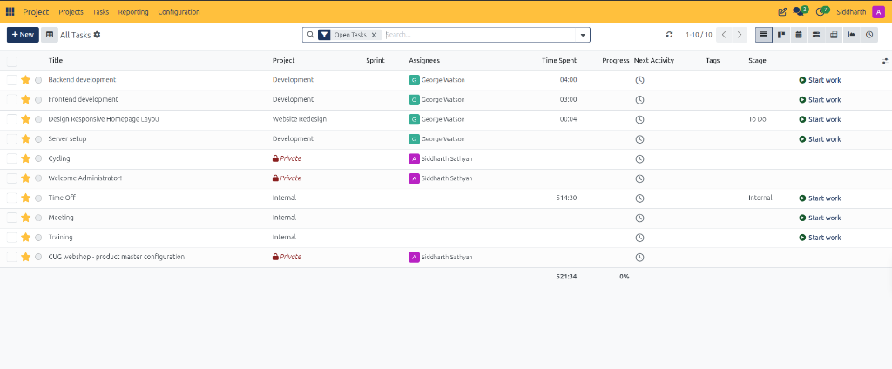

# Filter and Export Cross-Project Tasks

This guide walks through using the centralized **All Tasks** list view in CURQ Project to audit organizational workloads, filter tasks across projects, track cumulative timesheets, and launch work timers.

> **Prerequisites**
> * Access permissions to the CURQ Project application.
> * Active tasks distributed across one or more project workspaces *(e.g., `Development`, `Internal`, `Website Redesign`)*.

---

## 1. Filter and Export Cross-Project Tasks

### 1.1 Access the Global Task Register in List View

While Kanban boards excel at day-to-day visual flow within a single project or individual workload, the tabular list view provides centralized oversight across the entire enterprise portfolio:

1. In the top navigation bar, click **Tasks**.
2. In the upper-right view switcher, click the **List View** icon *(second icon from the left)*:
   * CURQ displays the comprehensive **All Tasks** register:

3. Review the register summary footer:
   * **Total Time Spent**: Aggregates all recorded labor hours across visible tasks *(e.g., `521:34`)*.
   * **Overall Progress**: Displays weighted milestone completion percentages *(e.g., `0%`)*.
   * **Pagination Counter**: Displays the active range and total count *(e.g., `1-10 / 10`)*.

> For a detailed explanation of list view columns, timesheet rollups, and task row controls, see [**All Tasks List Register Data Dictionary**](../settings-and-fields/05-project-reporting-and-analytics-field-definitions.md#1-all-tasks-list-register-data-dictionary).

---

### 1.2 Filter and Audit Tasks by Project and Visibility

1. **Open Tasks Filter**: By default, the search bar applies the `Open Tasks` tag filter to isolate incomplete deliverables.
2. **Project Segregation**:
   * **Commercial Projects**: Tasks linked to customer workspaces *(e.g., `Website Redesign`)*.
   * **Technical Projects**: Core infrastructure and engineering workspaces *(e.g., `Development`)*.
   * **Internal Administration**: Non-billable operational activities *(e.g., `Internal` for Time Off, Meetings, Training)*.
   * **Private Tasks**: Confidential personal items flagged with the red **Private** badge.
3. **Execute One-Click Work Timers**: Click **Start work** directly within any table row to start active time tracking without opening the task form.

---

## Best Practices for Portfolio Auditing

* **Batch Verification**: Use the leftmost checkboxes to select multiple tasks for bulk stage updates or reassignment.
* **Overdue Surveillance**: Scan the **Next Activity** column for clock icons indicating scheduled follow-ups or approaching deadlines.
* **Timesheet Discrepancy Checks**: Compare cumulative **Time Spent** across projects to detect labor overruns early.

---

## Related Documentation

* [Manage Personal Workloads with My Tasks](./07-manage-personal-workloads-with-my-tasks.md)
* [Create and Manage Project Tasks](./04-create-and-manage-project-tasks.md)
* [Track Task Time and Manage Timesheets](./06-track-task-time-and-manage-timesheets.md)
* [Analyze Project Performance and Reporting](./09-analyze-project-performance-and-reporting.md)
* [Project Task Field Definitions](../settings-and-fields/03-project-task-field-definitions.md)
