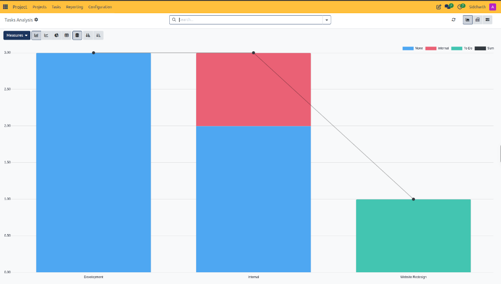
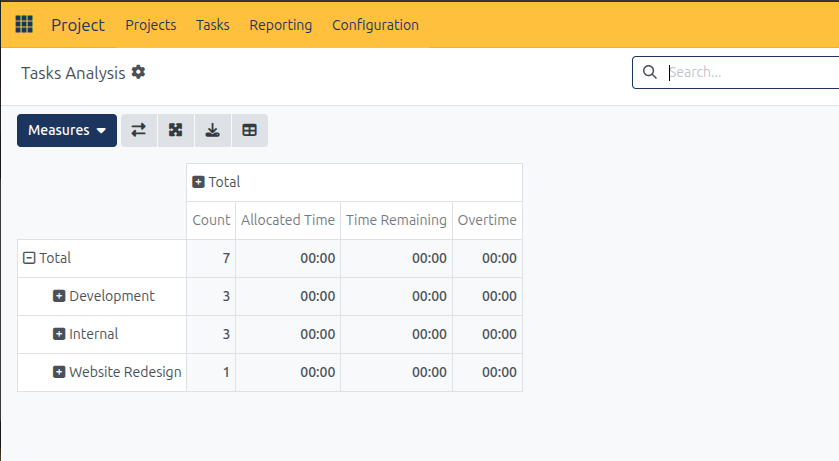
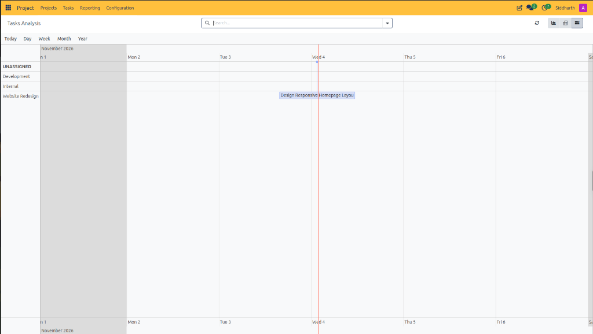

# Analyze Project Performance and Reporting

This guide outlines procedures for generating multi-dimensional project analytics, tracking labor capacity, auditing task distributions, and monitoring delivery schedules using the **Reporting** engine in CURQ Project.

> **Prerequisites**
> * Operational access to CURQ Project with reporting permissions.
> * Populated project workspaces with active or completed tasks and logged timesheets.

---

## 1. Analyze Project Performance and Reporting

### 1.1 Analyze Task Volume and Distribution in Graph View

Graph view provides high-level visual summaries of project workload balance and stage progression:

1. In the top navigation bar, click **Reporting**:
   * CURQ opens the **Tasks Analysis** dashboard in Graph view by default:

2. Select presentation formats from the graph controls bar:
   * **Bar Chart**: Default vertical representation comparing task volumes across projects.
   * **Line Chart**: Velocity trajectory visualizer highlighting task creation and completion rates over time.
   * **Pie Chart**: Proportional breakdown illustrating portfolio share by project or department.
   * **Stacked Chart**: Layers stage distributions *(e.g., `None`, `Internal`, `To Do`)* within project columns.
3. Apply analytical sorting:
   * Click the **Ascending** or **Descending** sort icons to rank projects by workload volume.
   * Inspect the black trendline connecting project volume nodes.

> For a detailed explanation of graph modes, pivot matrix metrics, and Gantt timeline elements, see [**Tasks Analysis Graph View Data Dictionary**](../settings-and-fields/05-project-reporting-and-analytics-field-definitions.md#2-tasks-analysis-graph-view-data-dictionary), [**Tasks Analysis Pivot Matrix Data Dictionary**](../settings-and-fields/05-project-reporting-and-analytics-field-definitions.md#3-tasks-analysis-pivot-matrix-data-dictionary), and [**Tasks Analysis Gantt Timeline Data Dictionary**](../settings-and-fields/05-project-reporting-and-analytics-field-definitions.md#4-tasks-analysis-gantt-timeline-data-dictionary).

---

### 1.2 Cross-Tabulate Capacity and Hours in Pivot View

Pivot view provides multi-dimensional analytical matrixes for evaluating capacity budgets, remaining hours, and project overtimes:

1. In the upper-right view switcher, click the **Pivot View** icon:
   * CURQ renders the **Tasks Analysis** cross-tabulation table:

2. Configure aggregation metrics via **Measures**:
   * **Count**: Total quantity of tasks assigned to each project.
   * **Allocated Time**: Budgeted baseline hours planned for delivery.
   * **Time Remaining**: Outstanding hours before reaching budgeted capacity.
   * **Overtime**: Logged labor hours exceeding initial allocations.
3. Structure the matrix layout:
   * Click **Flip axis** to swap rows and columns.
   * Click **Expand all** to unpack sub-groupings by department, stage, or specialist.
   * Click **Download / Export** to export the pivot matrix as an XLSX spreadsheet for executive reporting.

---

### 1.3 Track Project Milestones in Gantt Timeline View

Gantt view plots task schedules on a chronological timeline to identify delivery overlaps and deadline constraints:

1. In the upper-right view switcher, click the **Gantt View** icon *(far right)*:
   * CURQ displays the interactive horizontal scheduling grid:

2. Adjust the temporal resolution:
   * Toggle between **Today**, **Day**, **Week**, **Month**, and **Year** scales.
3. Review schedule elements:
   * **Project Grouping Rows**: Tasks grouped by workspace *(e.g., `Development`, `Internal`, `Website Redesign`, `UNASSIGNED`)*.
   * **Current Day Marker**: Vertical red guide line indicating today's operational date *(e.g., `Wed 4`)*.
   * **Task Delivery Blocks**: Visual bars representing scheduled durations *(e.g., `Design Responsive Homepage Layout`)*.
4. Reschedule deliverables by clicking and dragging task blocks across calendar days.

---

## Related Documentation

* [Project Reporting and Analytics Field Definitions](../settings-and-fields/05-project-reporting-and-analytics-field-definitions.md)
* [Filter and Export Cross-Project Tasks](./08-filter-and-export-cross-project-tasks.md)
* [Track Task Time and Manage Timesheets](./06-track-task-time-and-manage-timesheets.md)
* [Understanding Timesheet Costing and Project Profitability](../core-concepts/02-understanding-timesheet-costing-and-project-profitability.md)
