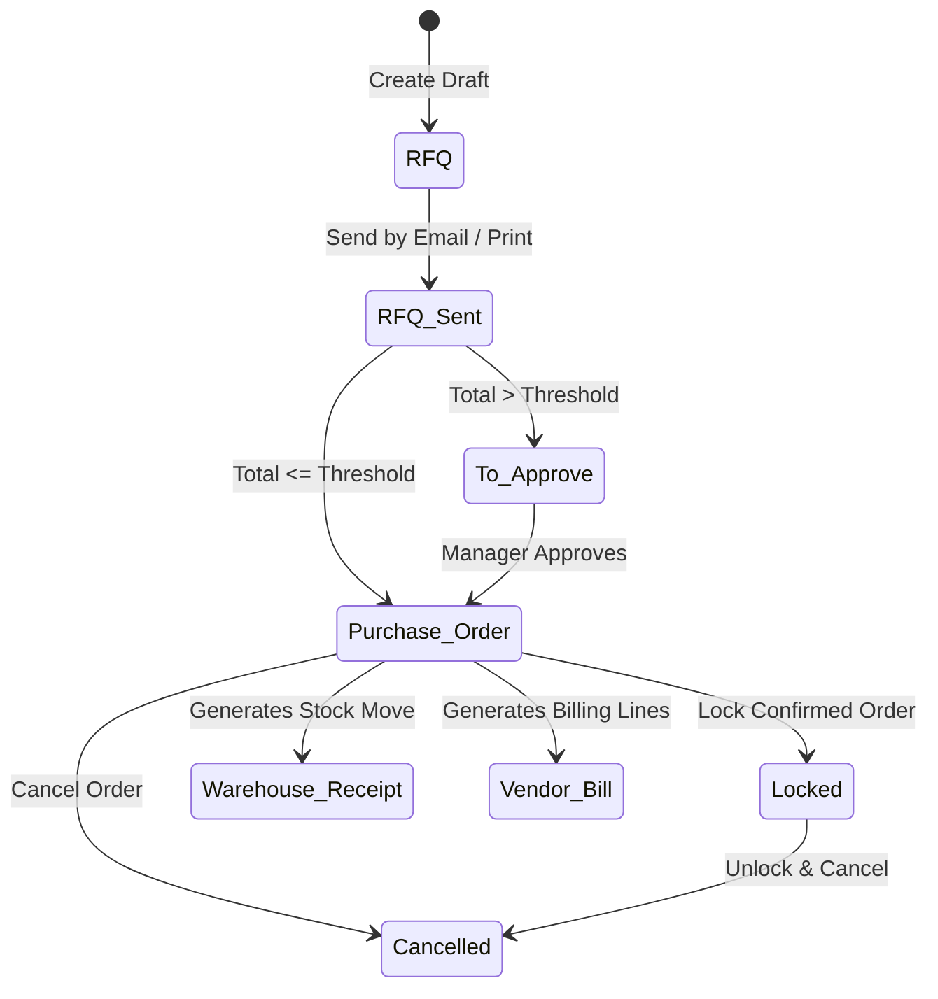
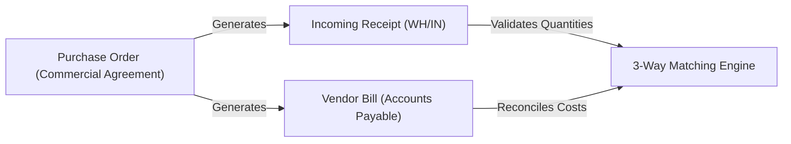

# Understanding the Procurement Lifecycle and Order States

This guide explains the architectural principles, state transitions, operational relationships, and locking mechanisms governing the procurement lifecycle in CURQ 18 Purchase.

---

## 1. The Core Procurement Lifecycle

Procurement in CURQ 18 is structured as an integrated lifecycle that coordinates commercial purchasing negotiations, physical warehouse receiving, and accounts payable validation across a single database model.

### Stage 1: Request for Quotation (RFQ)
The initial stage of procurement. An RFQ represents an unconfirmed negotiation draft where buyers enter requested items, quantities, target delivery dates, and potential suppliers. While in the **RFQ** stage:
* No warehouse stock moves or inventory allocations are created.
* No financial liabilities or general ledger entries are recorded.
* Multiple competing quotation alternatives can be drafted for the same procurement need to compare vendor bids.

### Stage 2: RFQ Sent
Advancing to **RFQ Sent** signals that the quotation has been transmitted to the supplier via email or exported as a PDF document. This state provides clear operational tracking:
* The system logs an audit copy of the message and PDF attachment in the record chatter.
* The primary action button shifts to **Confirm Order**, highlighting that the document is ready for conversion as soon as the vendor confirms pricing and terms.

### Stage 3: To Approve (Optional Approval Gate)
When organizational approval controls are active, orders exceeding a defined monetary limit (e.g., `$ 5,000.00`) cannot transition directly from quotation to confirmed purchase order. Instead, they enter the **To Approve** stage:
* The order remains unconfirmed and cannot generate warehouse receipts.
* A user with *Purchase Manager* rights must review the commercial terms and click **Approve Order**.

### Stage 4: Purchase Order
Confirming an order establishes a legally binding commercial agreement with the supplier. Transitioning to **Purchase Order**:
* **Generates Warehouse Receipts**: CURQ automatically creates an incoming receipt (`WH/IN/`) in the Inventory application, scheduling warehouse dock receiving.
* **Activates Billable Lines**: The order becomes eligible for vendor bill generation according to the configured bill control policy.
* **Updates Lead Times**: The vendor's promised delivery date feeds directly into manufacturing schedules and sales order delivery forecasts.

### Stage 5: Locked (Default State)
When the *Lock Confirmed Orders* setting is enabled (the system default), confirming a purchase order immediately locks the record:
* Prevents accidental price edits, quantity modifications, or item deletions that could de-synchronize warehouse delivery receipts or accounts payable records.
* Authorized users can temporarily click **Unlock** if legitimate post-confirmation adjustments are required.

### Stage 6: Cancelled
Cancelling a purchase order halts all downstream procurement operations:
* Cancels any unvalidated incoming warehouse delivery pickings linked to the order.
* Releases any reserved supplier capacity or expected stock counts.
* If goods were already received into inventory, a warehouse return picking must be processed before the order can be cancelled.

---

## 2. Cross-Module Architecture

The Purchase module serves as the commercial starting point for supply chain operations, directly driving Inventory and Accounting records:

1. **Purchase Order to Warehouse Receipt**: Confirming the purchase order creates linked `stock.move` records. Warehouse operators receive goods against these moves without seeing supplier pricing or sensitive commercial data.
2. **Purchase Order to Vendor Bill**: Accounts payable creates vendor bills referencing the purchase order. Billed quantities and costs are checked against the agreed purchase order terms.
3. **Receipt to Bill Reconciliation**: Through 3-way matching, CURQ verifies that invoiced amounts correspond to physically delivered quantities, preventing overbilling on short shipments.

---

## Related Documentation

* [Create and Process Your First Purchase Order](../getting-started/01-create-and-process-your-first-purchase-order.md)
* [Confirm Purchase Orders and Manage Approvals](../task-guides/03-confirm-purchase-orders-and-manage-approvals.md)
* [Understanding Bill Control and 3-Way Matching](./02-understanding-bill-control-and-3-way-matching.md)
* [RFQ and Purchase Order Field Definitions](../settings-and-fields/02-rfq-and-purchase-order-field-definitions.md)
