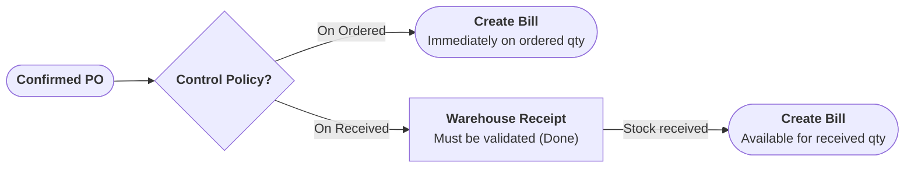
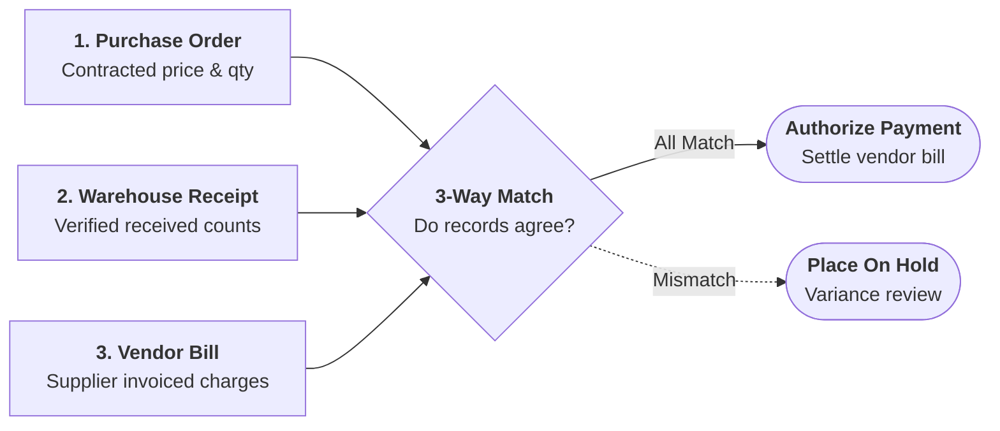

# Understanding Bill Control and 3-Way Matching

This guide explains how CURQ 18 enforces billing control policies, executes 3-way matching between purchase orders, warehouse receipts, and vendor bills, and protects corporate cash flow from procurement discrepancies.

---

## 1. Bill Control Policies

A **Bill Control Policy** dictates the operational event that unlocks vendor bill creation for a purchase order. In CURQ 18, control policies are configured on product master records and enforced globally:

### 1.1 Policy 1: On Received Quantities
* **System Behavior**: CURQ prevents accounts payable from creating vendor bills until incoming delivery receipts are physically verified and validated by the warehouse team (`WH/IN/` in *Done* status).
* **Billed Quantity Default**: When **Create Bill** is clicked, the bill line quantity defaults to the *Received Quantity* minus any previously billed quantities.
* **Primary Use Case**: Tangible goods, raw materials, heavy machinery, inventory components, and items prone to vendor shipping discrepancies.

### 1.2 Policy 2: On Ordered Quantities
* **System Behavior**: Vendor bills can be created immediately upon purchase order confirmation, prior to any goods arriving at the warehouse dock.
* **Billed Quantity Default**: When **Create Bill** is clicked, the bill line quantity defaults to the *Ordered Quantity* on the purchase order line.
* **Primary Use Case**: Intangible services, prepaid consulting, software licenses, recurring utility subscriptions, or direct dropship arrangements.

---

## 2. The 3-Way Matching Principle

**3-Way Matching** is an automated internal accounting control that verifies three foundational procurement records prior to authorizing supplier payment:

1. **Purchase Order**: Establishes the contracted quantity and negotiated unit price.
2. **Warehouse Receipt**: Confirms the physical count and acceptable condition of products received at the warehouse.
3. **Vendor Bill**: Represents the monetary charge claimed by the vendor.

### 2.1 How CURQ Detects Discrepancies
When accounts payable receives a vendor invoice and registers the bill:
* **Quantity Variance**: If the vendor bills for 100 units but the warehouse receipt validates only 80 units (a short shipment), CURQ flags the difference and limits bill validation to the 80 received units unless explicitly overridden.
* **Price Variance**: If the vendor bill states a unit cost of `$ 120.00` while the purchase order locked a price of `$ 100.00`, CURQ highlights the price discrepancy on the bill matching workspace.

---

## 3. Handling Short Shipments and Vendor Returns

### 3.1 Backorders and Staggered Billing
When a vendor fulfills an order in partial shipments:
1. Validating the first receipt creates an automated **Backorder** for remaining units.
2. The initial vendor bill invoices strictly the quantities received on the first delivery.
3. When the backorder delivery arrives, a second vendor bill is generated for the remaining balance.

### 3.2 Processing Vendor Returns
If received items are damaged or defective and returned using a warehouse return picking:
* CURQ decreases the cumulative **Received Quantity** on the purchase order.
* If a vendor bill has already been posted, accounts payable creates a **Credit Note** (vendor refund) linked to the return picking to reconcile the payable balance.

---

## Related Documentation

* [Generate and Validate Vendor Bills](../task-guides/06-generate-and-validate-vendor-bills.md)
* [Reconcile Vendor Bills with Bill Matching](../task-guides/07-reconcile-vendor-bills-with-bill-matching.md)
* [Receive Products and Manage Backorders](../task-guides/05-receive-products-and-manage-backorders.md)
* [Warehouse Receipt and Vendor Bill Field Definitions](../settings-and-fields/02-warehouse-receipt-and-vendor-bill-field-definitions.md)
