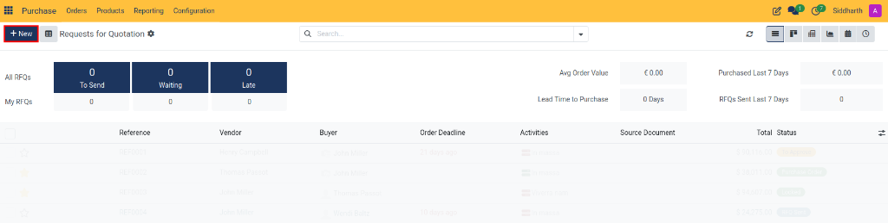
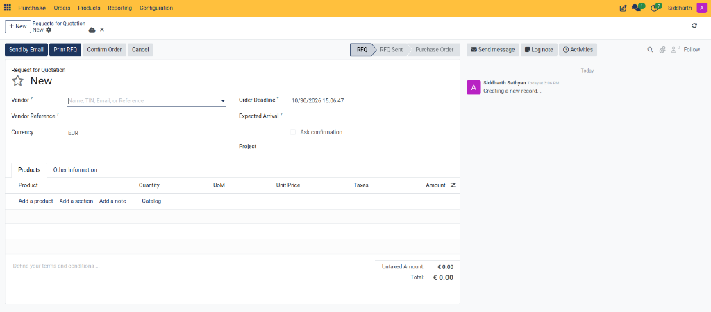
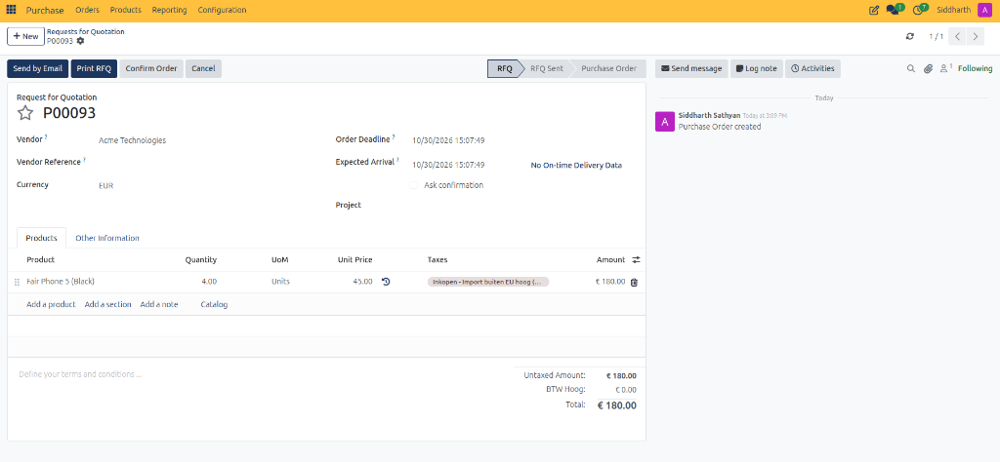
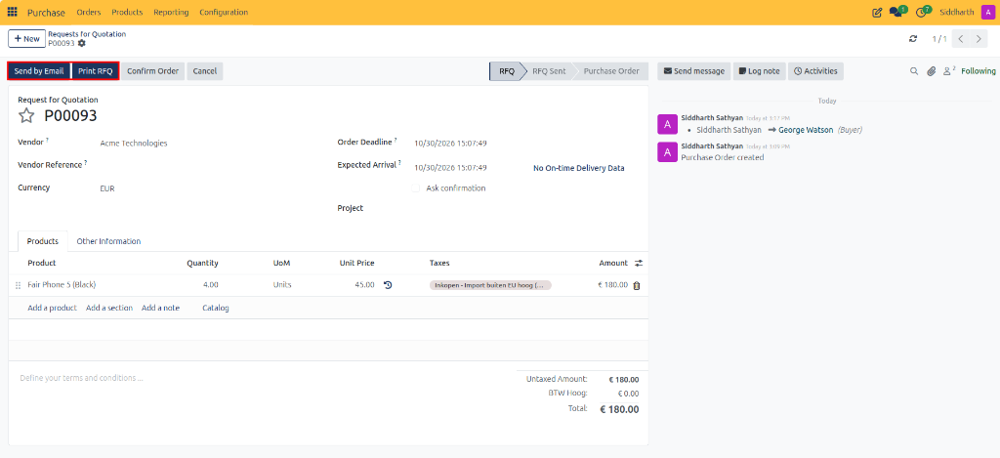
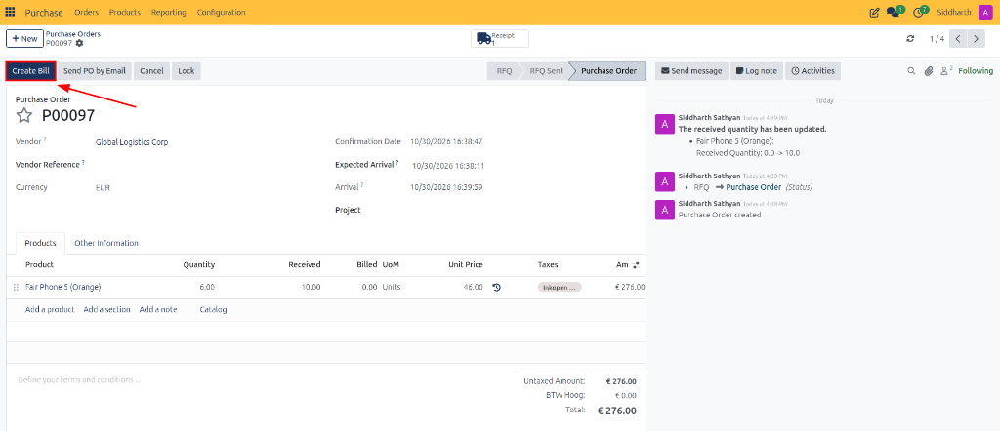
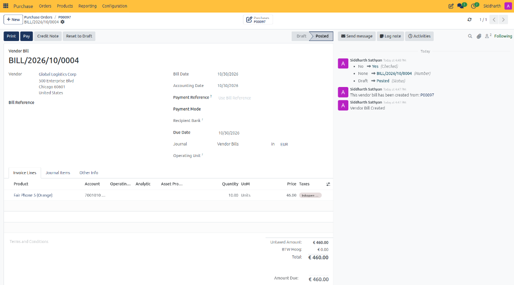

# Create and Process Your First Purchase Order

This tutorial walks you through the complete procurement lifecycle in CURQ 18—from creating and sending an initial Request for Quotation (RFQ), through order confirmation and warehouse receiving, to generating and validating the final vendor bill.

> **Prerequisites**
> * Access to the **Purchase**, **Inventory**, and **Accounting** / **Invoicing** applications in CURQ.
> * At least one vendor contact record created in **Contacts**.
> * At least one product configured as a storable product in your database.

---

## 1. End-to-End Purchase Order Lifecycle

### 1.1 Create a Request for Quotation (RFQ)

Begin by drafting a quotation request to ask a supplier for pricing and delivery availability:

1. Open the **Purchase** application from your CURQ dashboard.
2. In the top navigation, ensure you are on **Orders → Requests for Quotation**.
3. Click the blue **New** button in the upper-left corner.

4. On the blank RFQ form, configure the vendor and delivery details:
   * **Vendor**: Select your supplier. CURQ automatically populates default payment terms, currency, and tax fiscal positions.
   * **Vendor Reference**: Enter any external catalog or quotation reference provided by the supplier.
   * **Order Deadline**: Set the date by which the vendor should respond with confirmation.
   * **Expected Arrival**: Specify the target date when goods are expected at your warehouse.
   * **Deliver To**: Select your warehouse receiving operation (such as *YourCompany: Receipts*).

> For detailed definitions of all header fields, tax rules, and delivery options, see [**RFQ and Purchase Order Field Definitions**](../settings-and-fields/02-rfq-and-purchase-order-field-definitions.md).

5. Under the **Products** tab, click **Add a product**:
   * Select your product in the **Product** column (e.g., *Fair Phone 5 (Black)*).
   * Enter the requested quantity in the **Quantity** column (e.g., `4 Units`).
   * Review the **Unit Price** (loaded from product defaults or entered manually).
   * Verify the applied **Taxes** and inspect the calculated **Untaxed Amount** and **Total** at the bottom right.

---

### 1.2 Send the RFQ to Your Supplier

Transmit the quotation request to your vendor for commercial confirmation:

1. In the top action bar of the RFQ form, click **Send by Email**.

2. The email composer modal appears with a pre-formatted message and an automatically compiled PDF attachment (`Request for Quotation - [Ref].pdf`).
3. Verify the recipient email address, review the message text, and click **Send**.
4. The document status badge advances from **RFQ** to **RFQ Sent**, and an audit copy is saved in the record chatter.

---

### 1.3 Confirm the Purchase Order

When the vendor confirms availability and accepts your pricing terms, convert the quotation into an active purchase order:

1. Open the sent RFQ from **Purchase → Orders → Requests for Quotation**.
2. Click the blue **Confirm Order** button in the top action bar.
3. The document status updates to **Purchase Order** (or **Locked** if automatic locking is active).

> If your company enforces approval limits and the order exceeds the configured threshold, the order advances to **To Approve** and requires authorization from a Purchase Manager before confirmation. For configuration details, see [**Purchase Settings and General Configuration**](../settings-and-fields/01-purchase-settings-and-general-configuration.md).

---

### 1.4 Receive Goods at the Warehouse

Confirming the purchase order automatically generates an incoming shipment in the Inventory application:

1. On the confirmed purchase order, click the **Receive Products** button in the top action bar (or click the **Receipt** smart button in the top right).

2. CURQ opens the linked incoming receipt form (`WH/IN/`).
3. In the **Operations** tab, verify that physical deliveries match the **Demand** column.
4. Click **Validate** in the top action bar to confirm stock receipt.
5. The receipt status changes to **Done**, and products are officially added to your warehouse stock.

---

### 1.5 Generate and Validate the Vendor Bill

Complete the procurement cycle by registering the supplier's invoice:

1. Return to the purchase order by clicking its breadcrumb reference at the top of the screen.
2. Click the blue **Create Bill** button in the top action bar.

3. CURQ generates a draft **Vendor Bill** pre-filled with the order lines, prices, and quantities verified during receiving.
4. Enter the supplier's formal invoice number in the **Bill Reference** field and set the **Bill Date**.
5. Click **Confirm** to post the bill to accounts payable.

6. When payment is made to the supplier, click **Register Payment** to settle the liability and reconcile the purchase order to **Fully Billed**.

---

## Related Documentation

* [Create and Manage Requests for Quotation](../task-guides/01-create-and-manage-requests-for-quotation.md)
* [Receive Products and Manage Backorders](../task-guides/05-receive-products-and-manage-backorders.md)
* [Generate and Validate Vendor Bills](../task-guides/06-generate-and-validate-vendor-bills.md)
* [Understanding the Procurement Lifecycle and Order States](../core-concepts/01-understanding-the-procurement-lifecycle-and-order-states.md)
