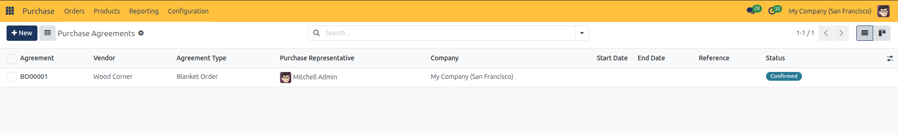
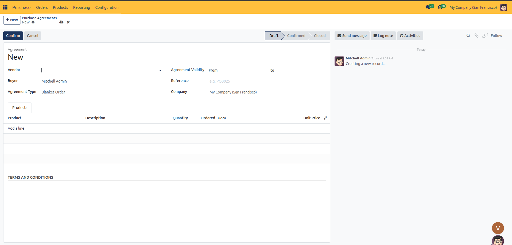

# Set Up a Blanket Order and Call-Off Purchases

This tutorial guides you through establishing a long-term procurement contract using Blanket Orders in CURQ 18, negotiating volume-locked pricing with a supplier, releasing periodic call-off purchase orders, and tracking commitment fulfillment over time.

---

## Prerequisites
Before starting, ensure that:
* **Purchase Agreements** is enabled under **Purchase → Configuration → Settings**.
* You have a contracted supplier profile established in your database.
* The product items you intend to procure under the blanket agreement are configured in the catalog.

---

## Step 1: Create a Blanket Order

Establish a master purchasing contract for pre-negotiated quantities:

1. Navigate to **Purchase → Orders → Purchase Agreements**.
2. Click the blue **+ New** button in the upper-left corner.

3. Configure the agreement header details:
   * **Vendor**: Select your contracted supplier (mandatory for blanket orders).
   * **Buyer**: Assign the responsible internal buyer.
   * **Agreement Type**: Select **Blanket Order**.
   * **Agreement Validity**: Select the effective contract date window in the **From** and **to** calendar fields.
   * **Reference**: Enter the supplier's formal contract code or master agreement reference.

> For detailed specifications of all agreement types and header parameters, see [RFQ, Purchase Order, and Blanket Order Field Definitions](../settings-and-fields/02-rfq-and-purchase-order-field-definitions.md).

---

## Step 2: Define Contract Items and Pre-Negotiated Pricing

Specify the committed product volumes and pre-negotiated unit costs:

1. Under the **Products** tab, click **Add a line**.
2. Select the item in the **Product** column.
3. In the **Quantity** column, enter the total volume committed over the contract period (e.g., `1,000 Units`).
4. In the **Unit Price** column, enter the locked negotiated cost per unit (e.g., `$ 45.00`).
5. Notice the **Ordered** column displays `0.00`, as no call-offs have been released yet.
6. Click **Confirm** in the top action bar to activate the blanket agreement. The status advances to **Confirmed**.

---

## Step 3: Issue a Call-Off Purchase Order

As operational needs arise, release partial purchase orders against the blanket order:

1. On the confirmed blanket order, click the blue **New Quotation** button in the top action bar.
2. CURQ automatically generates a new Request for Quotation pre-filled with:
   * The contracted **Vendor**.
   * The linked **Agreement** reference (`BO00001`).
   * The pre-negotiated **Unit Price** locked on the blanket agreement.
3. Adjust the **Quantity** on the order line to the volume required for this specific shipment (e.g., `250 Units`).
4. Click **Confirm Order** to convert the call-off quotation into an active purchase order.

---

## Step 4: Monitor Commitment Fulfillment

Track cumulative consumption against your total agreed volume:

1. Return to **Purchase → Orders → Purchase Agreements** and open your blanket order.
2. Under the **Products** tab, check the **Ordered** column:
   * The ordered count automatically reflects the cumulative units called off across all confirmed orders (e.g., `250 / 1,000`).
3. Click the **RFQs/Orders** smart button in the top-right stat area to inspect the full list of call-off purchase orders linked to this agreement.
4. When the full contracted quantity has been fulfilled, click **Close** to finalize the agreement.

---

## Related Documentation

* [Understanding the Procurement Lifecycle and Order States](../core-concepts/01-understanding-the-procurement-lifecycle-and-order-states.md)
* [RFQ, Purchase Order, and Blanket Order Field Definitions](../settings-and-fields/02-rfq-and-purchase-order-field-definitions.md)
